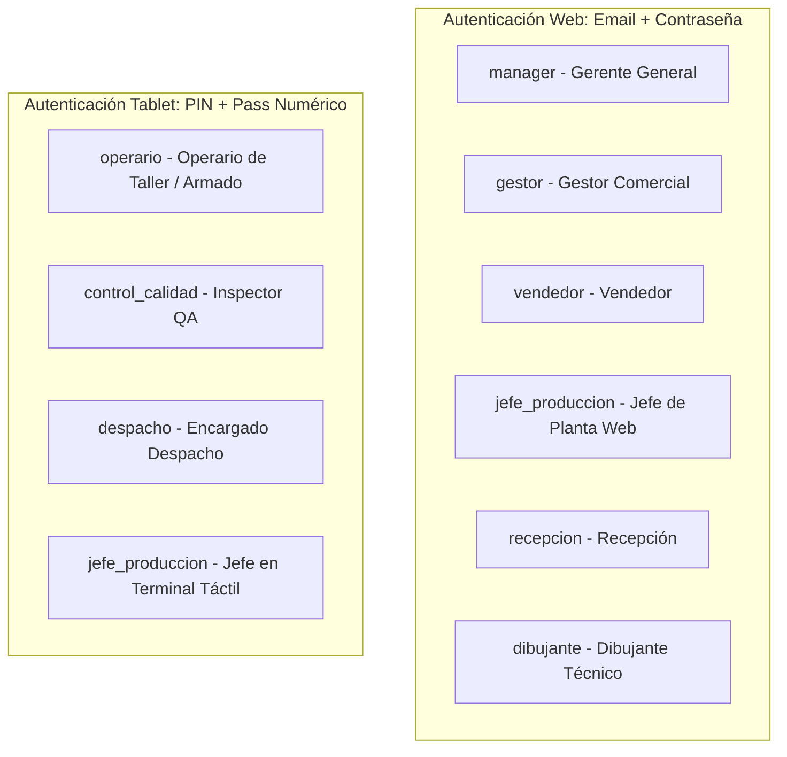
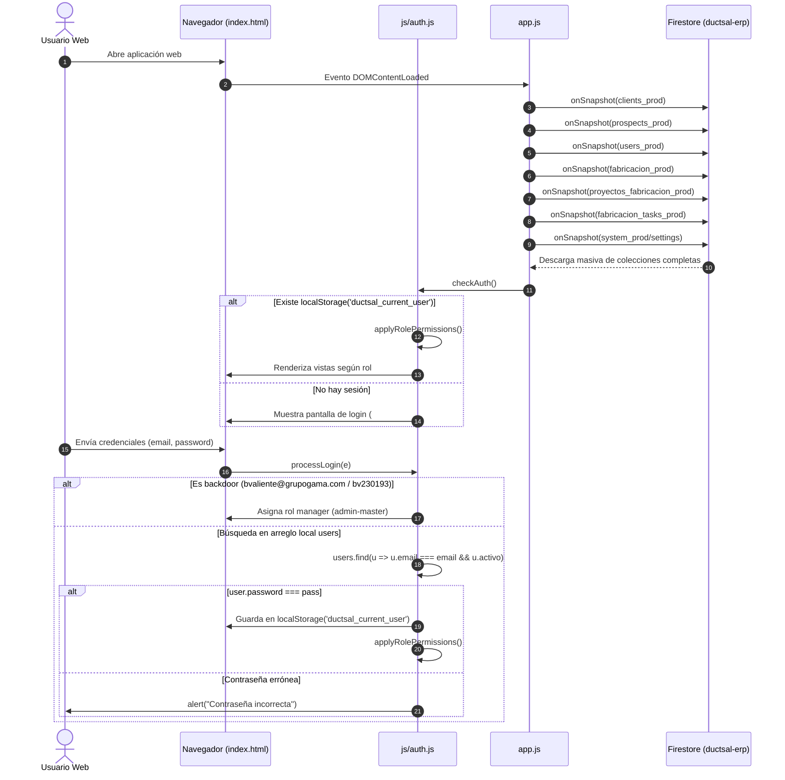
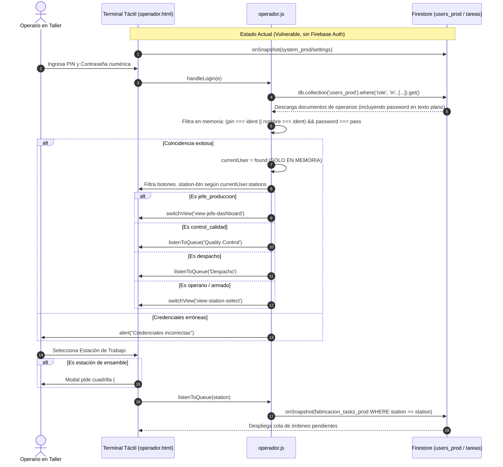
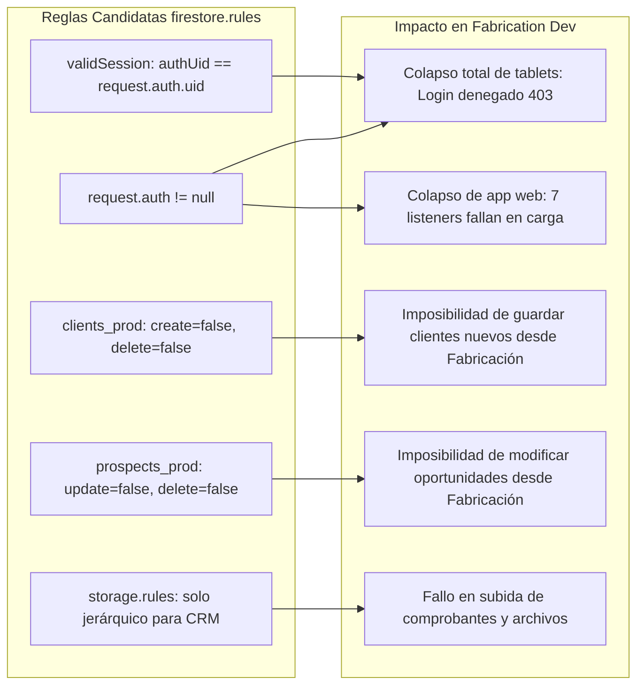
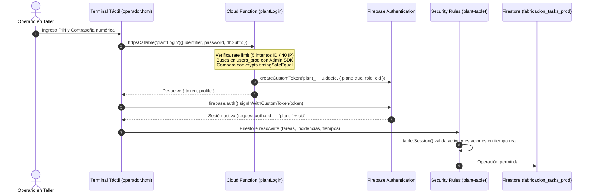
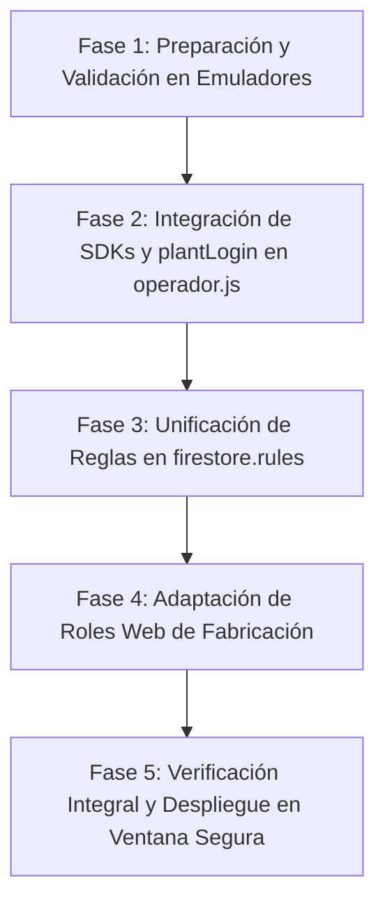

# SEC-02 — Documentación Técnica y Mapa de Permisos de Fabrication Dev

> **Fecha de Elaboración:** 17 de Octubre de 2026  
> **Estado:** Documentación Técnica de Auditoría y Diseño (SOLO LECTURA)  
> **Alcance:** Repositorios `fabricacion-dev` (`/Users/Benjamin/Documents/DUCTSAL/fabricacion-dev`) y `sales-reporting-system` (`/Users/Benjamin/Documents/DUCTSAL/sales-reporting-system`)  
> **Objetivo:** Documentar la arquitectura actual de Fabrication Dev, mapear sus dependencias con el CRM comercial y diseñar la integración segura de autenticación (`plantLogin`) sin interrumpir la operación de planta ni debilitar las reglas candidatas de seguridad.

---

## 1. Resumen Ejecutivo

### 1.1 Contexto Operativo y Tecnológico
El ecosistema de software de **Ductsal** opera sobre un único proyecto compartido de Google Firebase (`ductsal-erp`), abasteciendo dos aplicaciones diferenciadas:
1. **Sales Reporting System (CRM Comercial):** Sistema web administrativo y comercial (`app_core.js`, `crm_auth.js`), actualmente endurecido en Fases 4A y 4B con Firebase Authentication, Cloud Functions transaccionales y directorio sin contraseñas (`userDirectory_prod`).
2. **Fabrication Dev (ERP de Planta y Terminales de Taller):** Aplicación web de escritorio (`index.html`, `app.js`, `js/*.js`) y terminal táctil para operarios de taller (`operador.html`, `operador.js`, `js/op-qa.js`, `js/op-despacho.js`).

### 1.2 Realidad Actual de la Autenticación en Fabricación
Tras una exhaustiva auditoría estática del código fuente de `fabricacion-dev`, se constata que:
- **Ausencia Total de Firebase Auth:** Ninguno de los dos módulos de fabricación (`index.html` ni `operador.html`) importa el SDK de Firebase Authentication (`firebase-auth-compat.js`) ni inicializa `firebase.auth()`.
- **Autenticación en Memoria y LocalStorage:**
  - **Aplicación Web (`index.html`):** Los usuarios se autentican comparando la contraseña en texto plano en el navegador (`user.password === pass` en `js/auth.js:47`) sobre una copia en memoria de la colección completa `users_prod`, descargada mediante un listener abierto `onSnapshot` (`app.js:331`). Cuenta además con una puerta trasera maestra cableada (*hardcoded backdoor*) para `bvaliente@grupogama.com` (`js/auth.js:29-34`).
  - **Terminal de Operador (`operador.html`):** Los operarios ingresan un PIN y una contraseña numérica. La función `handleLogin` (`operador.js:256-274`) ejecuta una consulta sin credenciales a `users_prod` filtrando por roles de taller, descarga los registros con contraseñas en texto plano y realiza la comparación en JavaScript. La sesión vive exclusivamente en la variable volátil `let currentUser` en memoria; **no se guarda siquiera en `localStorage`**, perdiéndose ante cualquier recarga del navegador.
- **Acceso Directo a Firestore y Storage:** Ambas aplicaciones leen y escriben colecciones y archivos en Firebase Storage de forma directa, sin mediación de Cloud Functions ni validación de identidad en el servidor.

### 1.3 Impacto Crítico de las Reglas Candidatas del CRM
El repositorio CRM dispone de reglas candidatas de seguridad (`firestore.rules` y `storage.rules`) basadas en el principio de menor privilegio (`request.auth != null`, `validSession()`, validación de `authUid` y custom claims).
**Si dichas reglas se despliegan en producción en este momento:**
1. **Bloqueo Total Inmediato de las Tablets:** Las terminales táctiles no podrán consultar `users_prod` para iniciar sesión, no podrán leer la configuración de taller (`system_prod/settings`), ni registrar avances, pausas, tiempos de corte, inspecciones de calidad, incidentes de máquinas ni despachos. La planta quedaría paralizada.
2. **Bloqueo Total de la Web de Fabricación:** Ningún usuario (Gerente, Dibujante, Recepcionista, Jefe de Producción) podrá cargar datos debido a que los 7 listeners `onSnapshot` fallarán de inmediato por falta de token de autenticación.
3. **Rechazo de Escrituras Directas:** Las reglas candidatas prohíben explícitamente escrituras directas sobre `clients_prod` (`allow create: if false;`, `allow delete: if false;`) y `prospects_prod` (`allow update: if false;`, `allow delete: if false;`), operaciones que la web de fabricación ejecuta directamente mediante `saveClientToDB`, `saveProspectToDB`, `deleteClient` y `deleteProspect`.

### 1.4 La Solución Existente: `plantLogin`
El CRM ya dispone en su backend de una Cloud Function callable (`plantLogin` en `functions/plantAuthService.js` e `index.js:1366`) y de un juego de reglas evaluado en emuladores (`functions/isolated-tests/rules/plant-tablet.firestore.rules`), diseñados específicamente para resolver SEC-02:
- Valida el PIN y contraseña numérica en el servidor contra `users_prod`.
- Protege frente a fuerza bruta con limitación estricta de intentos (5 por identificador y 40 por IP cada 15 min).
- Emite un **Custom Token** de Firebase Auth con UID `plant_<cid>` y claims `{ plant: true, role, cid }`.
- **Aislamiento Criptográfico Absoluto:** El identificador `plant_<cid>` nunca colisiona con un `authUid` comercial, impidiendo que un operario de taller acceda a datos del CRM o ejecute funciones administrativas, mientras que las reglas permiten a la tablet operar exclusivamente las estaciones de trabajo asignadas a su perfil.

---

## 2. Inventario Exhaustivo de Roles y Permisos

En `fabricacion-dev` coexisten **9 roles operativos reales** (tras unificar `encargado_armado` dentro de `operario`, cuyas atribuciones se definen mediante la asignación de estaciones) con esquemas de acceso e identificación diferenciados:



### 2.1 Roles de Acceso Web (`index.html`)

#### 1. Gerente (`manager`)
- **Identificación:** Correo electrónico corporativo y contraseña alfanumérica en formulario web (`#login-screen`). Admite bypass maestro mediante `bvaliente@grupogama.com` / `bv230193` (`js/auth.js:29-34`).
- **Módulos y Pantallas:** Acceso irrestricto a las 8 vistas del sistema:
  - `dashboard-view` (Métricas financieras y comerciales de oportunidades).
  - `projects-view` (Listado y seguimiento de proyectos con saldos).
  - `settings-view` / `settings-modal` (Configuración general de empresa, maquinaria y USBs).
  - `users-view` (Catálogo y gestión de usuarios, roles, estaciones y contraseñas).
  - `fabricacion-view` (Tablero Kanban de órdenes de fabricación).
  - `fabricacion-dashboard-view` (Métricas de planta, piezas producidas, tiempos y bobinas).
  - `list-view` (Pipeline de oportunidades y prospectos comerciales).
  - `clients-view` (Directorio y edición de clientes).
- **Acciones Permitidas:**
  - CRUD total sobre clientes, prospectos, usuarios, órdenes y tareas.
  - Eliminación física permanente de clientes (`js/clientes.js:327`) y de prospectos con borrado en cascada de proyectos de fabricación (`js/oportunidades.js:1017-1024`).
  - Creación, modificación, reseteo de contraseñas y activación/desactivación de usuarios (`js/auth.js:236-355`).
  - Creación y edición de matriz de maquinaria central (`config/maquinas`).
  - División manual de órdenes de fabricación (`splitFabricacionOrder` en `js/fabricacion.js:1071`).
- **Colecciones:** Lectura y escritura en `clients_prod`, `prospects_prod`, `users_prod`, `fabricacion_prod`, `fabricacion_tasks_prod`, `proyectos_fabricacion_prod`, `bobinas_soldadura_prod`, `system_prod`, `audit_logs_prod`, `config` (`maquinas`, `estado_equipos`), `alertas_maquinas`.
- **Restricciones Frontend vs Servidor:**
  - *Frontend:* `applyRolePermissions()` activa todos los elementos del DOM.
  - *Servidor Actual:* Sin verificación (Firestore abierto).
  - *Servidor Candidato:* Verificado con `isManager()` (`validSession() && role() == 'manager' && request.auth.token.manager == true`).

#### 2. Gestor de Ventas (`gestor`)
- **Identificación:** Correo electrónico y contraseña en pantalla web.
- **Módulos y Pantallas:** `projects-view`, `list-view`, `clients-view`. Menús de fabricación, métricas directivas y administración de usuarios ocultos por CSS (`js/auth.js:91-95`).
- **Acciones Permitidas:** Crear/editar clientes, registrar cotizaciones, gestionar cobros, facturación y órdenes de cambio sobre oportunidades. No puede gestionar usuarios ni configuración técnica de planta.
- **Colecciones:** `clients_prod` (Lectura/Escritura), `prospects_prod` (Lectura/Escritura), `system_prod` (Lectura), `audit_logs_prod` (Creación).
- **Restricciones Frontend vs Servidor:** Restringido por navegación en cliente. En reglas candidatas, evaluado bajo `isPrivileged() || isGestor()`.

#### 3. Vendedor (`vendedor`)
- **Identificación:** Correo electrónico y contraseña en pantalla web.
- **Módulos y Pantallas:** `list-view` (pipeline comercial de prospectos), `clients-view`.
- **Acciones Permitidas:** Alta de clientes, creación de prospectos comerciales, avance de etapas en prospectos propios, subida de ofertas y comprobantes de levantamiento. Oculto de módulos de taller y configuración.
- **Colecciones:** `clients_prod` (Lectura/Escritura), `prospects_prod` (Lectura/Escritura), `audit_logs_prod` (Creación).
- **Restricciones Frontend vs Servidor:** Frontend oculta vistas no comerciales. Reglas candidatas restringen visibilidad a cartera propia (`createdBy == me() || me() in visibleTo`).

#### 4. Jefe de Producción (`jefe_produccion`) — Perfil Web
- **Identificación:** Correo electrónico corporativo o PIN numérico configurado como usuario web.
- **Módulos y Pantallas:** `fabricacion-view` (Kanban de taller) y `nav-settings` (configuración de maquinaria y parámetros de taller) (`js/auth.js:101-104`).
- **Acciones Permitidas:**
  - Crear órdenes de fabricación vinculadas a proyectos o independientes.
  - Asignar prioridades, reasignar estaciones y dividir órdenes en lotes (`splitFabricacionOrder`).
  - Configurar catálogo de maquinaria en `config/maquinas` (`js/fabricacion.js:794`).
  - Visualizar incidentes de máquinas en tiempo real (`listenToActiveMachineIncidents`).
- **Colecciones:** `fabricacion_prod` (CRU), `fabricacion_tasks_prod` (CRUD), `proyectos_fabricacion_prod` (CRU), `bobinas_soldadura_prod` (CRU), `system_prod` (R/W), `config` (R/W), `alertas_maquinas` (R/W). No accede a `clients_prod` ni `prospects_prod`.

#### 5. Recepción (`recepcion`) — Perfil Web
- **Identificación:** Correo y contraseña en formulario web.
- **Módulos y Pantallas:** Exclusivamente `fabricacion-view` (`js/auth.js:105-109`).
- **Acciones Permitidas:**
  - Registro de requerimientos y órdenes manuales directas del cliente (`FAB-PROJ-*`).
  - Creación de proyectos en `proyectos_fabricacion_prod` (`js/fabricacion.js:122, 158`).
  - Subida de archivos y planos preliminares del cliente a `prod_files/requerimientos/`.
  - Envío de órdenes a etapa inicial "Dibujo".
- **Colecciones:** `proyectos_fabricacion_prod` (Creación/Lectura), `fabricacion_prod` (Creación/Lectura/Actualización inicial), `system_prod` (Lectura).
- **Restricciones Frontend vs Servidor:** Bloqueado en cliente de vistas comerciales. En reglas candidatas, contemplado en `isPlant() && role() in ['jefe_produccion', 'recepcion', 'dibujante']`.

#### 6. Dibujante Técnico (`dibujante`) — Perfil Web
- **Identificación:** Correo y contraseña en formulario web.
- **Módulos y Pantallas:** Exclusivamente `fabricacion-view` (`js/auth.js:105-109`).
- **Acciones Permitidas:**
  - Tomar órdenes en etapa "Dibujo".
  - Despiece, carga y procesamiento de listas de materiales (BOM) en formato CSV/tabla (`bom.js`).
  - Subida de archivos de corte DXF y especificaciones a `prod_files/fabricacion_archivos/` (`js/fabricacion.js:2305-2316`).
  - Generación de las tareas desglosadas por estación (`fabricacion_tasks_prod`) y avance de la orden a la etapa "Fabricación".
  - Edición técnica de piezas devueltas por Control de Calidad (`qa_status === 'devuelto_dibujo'`).
- **Colecciones:** `fabricacion_prod` (Lectura/Actualización de etapa y BOM), `fabricacion_tasks_prod` (Creación masiva y edición de tareas), `proyectos_fabricacion_prod` (Lectura), `system_prod` (Lectura).

---

### 2.2 Roles de Acceso en Terminal Táctil (`operador.html`)

#### 7. Operario de Taller (`operario`) — Terminal Taller (Unifica Maquinaria y Armado/Ensamble)
- **Identificación:** Credencial / PIN numérico (e.g., `1010`) y contraseña numérica en teclado táctil de `operador.html`.
- **Nota de Unificación Arquitectónica:** Absorbe formalmente el rol histórico redundante `encargado_armado`. Las funciones de armado, doblado y ensamblado manual no requieren un rol separado, sino que se gestionan mediante la asignación de las estaciones correspondientes (`Cierres/Armado/Doblado`, `Esquinas`, `Piezas Especiales`, `Aislado`, `Pintura`) en el arreglo `stations` del perfil del operario.
- **Módulos y Pantallas:**
  - `view-station-select`: Selector de estaciones de trabajo, filtrado estrictamente por el arreglo `currentUser.stations` asignado a su perfil (`operador.js:298`).
  - `view-queue`: Cola de tareas de la estación seleccionada.
  - Modales operativos: Registro de personal de apoyo cuadrilla (*headcount*) al abrir estaciones de ensamble (`operador.js:356-363`), inicio de tarea, pausas justificadas, registro de métricas de corte (ADL / CNC), reporte de paradas de equipo (`#incident-modal`).
- **Acciones Permitidas:**
  - Iniciar tarea (`status: 'en_proceso'`, captura de `operator_id`, `operator_name`, `started_at`).
  - Pausar y reanudar tarea (acumulación en arreglo `pauses`).
  - Finalizar tarea (`status: 'terminada'`, `finished_at`, cálculo de duración real).
  - Desbloqueo automático de tareas sucesoras (`unblockDependents` en `operador.js:2060-2095` sobre el campo `depends_on`).
  - Si opera estación `Soldadura`: dar de alta bobinas de microalambre en `bobinas_soldadura_prod`, registrar consumo y cerrar bobina agotada (`operador.js:1240-1375`).
  - Reportar fallas de máquina: crea documento en `alertas_maquinas` y actualiza `config/estado_equipos` a estado `'parada'`.
- **Colecciones:** `fabricacion_tasks_prod` (Lectura y Actualización estricta de sus tareas y desbloqueo de dependientes), `fabricacion_prod` (Lectura y Actualización de etapa a 'Quality Control' cuando finaliza la última tarea), `bobinas_soldadura_prod` (Lectura/Creación/Actualización en Soldadura), `system_prod` (Lectura de settings), `config` (Lectura), `config/estado_equipos` (Actualización de paradas), `alertas_maquinas` (Creación).
- **Restricciones Frontend vs Servidor:**
  - *Frontend:* Oculta estaciones no asignadas en `currentUser.stations`.
  - *Servidor Actual:* Sin verificación.
  - *Servidor Candidato (`plant-tablet.firestore.rules`):* Valida que la estación modificada pertenezca a `myStations()`, que los campos modificados correspondan a `taskOwnKeys()` o `tabletUnblock()`, y prohíbe tocar datos ajenos.

#### 8. Inspector de Calidad (`control_calidad`) — Terminal Taller
- **Identificación:** PIN y contraseña numérica.
- **Módulos y Pantallas:**
  - Navegación directa automática a estación `Quality Control` en `view-queue` (`operador.js:313-317`).
  - Si el usuario tiene activo el indicador `also_does_dispatch === true`, el frontend le muestra `view-station-select` permitiéndole alternar libremente entre `Quality Control` y `Despacho` (`operador.js:292-294, 310`).
- **Acciones Permitidas (`js/op-qa.js`):**
  - Inspección física pieza por pieza contra la lista BOM (`qa_pieces_status`).
  - Registro de errores categorizados (`errores_dibujo`, `errores_fabricacion`).
  - Devolución (*rework*): Envía órdenes y tareas rechazadas de vuelta a etapa "Dibujo" o "Fabricación", limpiando operadores asignados y restableciendo el estado de la tarea a pendiente (`tabletQaRework` en `op-qa.js:860-880`).
  - Aprobación de orden: Avance formal de la orden de fabricación de etapa "Quality Control" a "Despacho".
- **Colecciones:** `fabricacion_prod` (Lectura y Actualización de campos de QA y etapa), `fabricacion_tasks_prod` (Lectura y reasignación por devolución), `system_prod` (Lectura), `config` (Lectura), `alertas_maquinas` (Creación/Lectura).

#### 9. Despacho y Entrega (`despacho`) — Terminal Taller
- **Identificación:** PIN y contraseña numérica.
- **Módulos y Pantallas:** Navegación directa automática a estación `Despacho` en `view-queue` (`operador.js:318-323`).
- **Acciones Permitidas (`js/op-despacho.js`):**
  - Verificación final de embalaje, conteo de bultos y accesorios.
  - Registro del despacho en `dispatch_registry` (fechas, piezas despachadas, responsable).
  - Marcado de orden como **"Entregado"** (`etapa: 'Entregado'`), cerrando el ciclo de vida en planta.
- **Colecciones:** `fabricacion_prod` (Lectura y Actualización de `bom`, `dispatch_registry` y `etapa == 'Entregado'`), `fabricacion_tasks_prod` (Lectura), `system_prod` (Lectura), `config` (Lectura), `alertas_maquinas` (Creación).

#### 10. Jefe de Producción en Terminal Táctil (`jefe_produccion`) — Terminal Taller
- **Identificación:** PIN y contraseña numérica en `operador.html`.
- **Módulos y Pantallas:**
  - Detección inmediata en `handleLogin`: Muestra botón especial `#btn-to-jefe-dashboard`, activa sincronización en tiempo real (`startJefeDashboardRealtimeSync`) y abre la pantalla táctil dedicada `view-jefe-dashboard` (`operador.js:304-307`).
  - Selector de estaciones: Habilita el acceso directo a **todas** las estaciones de producción física (excluyendo únicamente QA y Despacho) sin requerir asignación previa en el arreglo `stations` (`operador.js:287-288`).
- **Acciones Permitidas:**
  - Supervisión en vivo de tiempos de cuello de botella por estación y estado de operarios.
  - Operar cualquier máquina o estación en reemplazo de un operario ausente.
  - Reconocer y silenciar alertas de fallas de máquinas (`leida: true` en `alertas_maquinas`).
- **Colecciones:** Acceso operativo completo a todas las colecciones de planta sin restricciones de estación.

---

## 3. Arquitectura y Flujo de la Aplicación Web (`app.js`)



### 3.1 Inicialización de Firebase
- **Archivo y Líneas:** [`app.js:3-25`](file:///Users/Benjamin/Documents/DUCTSAL/fabricacion-dev/app.js#L3-L25)
- **Detalle Técnico:** Se inicializa `firebase.initializeApp(firebaseConfig)` con la configuración del proyecto `ductsal-erp`. Se instancia `db = firebase.firestore()` y `storage = firebase.storage()`. Se activa la persistencia sin conexión mediante `db.enablePersistence({ synchronizeTabs: true })`.
- **Detección de Entorno:** [`app.js:28-41`](file:///Users/Benjamin/Documents/DUCTSAL/fabricacion-dev/app.js#L28-L41). `DB_SUFFIX` se lee de `localStorage('forced_db_suffix')`; si no existe, toma de forma predeterminada `'_prod'`. `STORAGE_PREFIX` se define como `'prod_files'`.

### 3.2 Inicio de Sesión y Verificación de Credenciales
- **Archivo y Líneas:** [`js/auth.js:24-52`](file:///Users/Benjamin/Documents/DUCTSAL/fabricacion-dev/js/auth.js#L24-L52)
- **Mecanismo de Backdoor:**
  ```javascript
  // js/auth.js:29-34
  if (email.toLowerCase() === 'bvaliente@grupogama.com' && pass === 'bv230193') {
      currentUser = { id: 'admin-master', nombre: 'Benjamin Valiente', email: 'bvaliente@grupogama.com', password: pass, role: 'manager', activo: true };
      localStorage.setItem('ductsal_current_user', JSON.stringify(currentUser));
      checkAuth();
      return;
  }
  ```
- **Validación Estándar:** Busca en el arreglo en memoria `users` (poblado por el listener abierto sobre `users_prod`):
  ```javascript
  // js/auth.js:36-51
  const user = users.find(u => u.email === email && u.activo);
  if (!user) return alert("Usuario no encontrado o inactivo.");
  if (user.password !== pass) return alert("Contraseña incorrecta.");
  currentUser = user;
  localStorage.setItem('ductsal_current_user', JSON.stringify(currentUser));
  checkAuth();
  ```
- **Primer Acceso:** Si `user.password === ""`, abre `#setup-screen` y guarda la nueva contraseña directamente en el documento de `users_prod` mediante `saveUserToDB` ([`js/auth.js:54-67`](file:///Users/Benjamin/Documents/DUCTSAL/fabricacion-dev/js/auth.js#L54-L67)).

### 3.3 Gestión de Sesión y Cierre
- La sesión se mantiene serializada en `localStorage.getItem('ductsal_current_user')`.
- Al pulsar Cerrar Sesión ([`js/auth.js:69-73`](file:///Users/Benjamin/Documents/DUCTSAL/fabricacion-dev/js/auth.js#L69-L73)), se asigna `currentUser = null`, se elimina la clave de `localStorage` y se ejecuta `checkAuth()`, ocultando `#main-app` y mostrando `#login-screen`.

### 3.4 Control de Navegación y Permisos
- **Archivo y Líneas:** [`js/auth.js:75-114`](file:///Users/Benjamin/Documents/DUCTSAL/fabricacion-dev/js/auth.js#L75-L114)
- La función `applyRolePermissions()` manipula el estilo `display` de los elementos de navegación:
  - `manager`: Habilita todos los menús y navega a `dashboard-view`.
  - `gestor`: Habilita proyectos, listado y clientes; navega a `projects-view`.
  - `vendedor`: Habilita listado y clientes; navega a `list-view`.
  - `jefe_produccion`: Habilita fabricación y configuración; navega a `fabricacion-view`.
  - Otros (`recepcion`, `dibujante`, etc.): Habilita únicamente `fabricacion-view`.

### 3.5 Lecturas y Escrituras Directas de Firestore
- **Suscripciones Globales:** [`app.js:329-346`](file:///Users/Benjamin/Documents/DUCTSAL/fabricacion-dev/app.js#L329-L346) mantiene 7 listeners activos sobre: `clients_prod`, `prospects_prod`, `users_prod`, `fabricacion_prod`, `proyectos_fabricacion_prod`, `fabricacion_tasks_prod`, `system_prod/settings`.
- Adicionalmente, mantiene listeners sobre `config/maquinas` ([`app.js:350`](file:///Users/Benjamin/Documents/DUCTSAL/fabricacion-dev/app.js#L350)), `bobinas_soldadura_prod` ([`app.js:369`](file:///Users/Benjamin/Documents/DUCTSAL/fabricacion-dev/app.js#L369)) y `alertas_maquinas` ([`app.js:386`](file:///Users/Benjamin/Documents/DUCTSAL/fabricacion-dev/app.js#L386)).
- **Escrituras Directas:**
  - `saveClientToDB(c)`: `db.collection('clients_prod').doc(c.id).set(c)` ([`app.js:397`](file:///Users/Benjamin/Documents/DUCTSAL/fabricacion-dev/app.js#L397)).
  - `saveProspectToDB(p)`: `db.collection('prospects_prod').doc(p.id).set(p)` ([`app.js:398`](file:///Users/Benjamin/Documents/DUCTSAL/fabricacion-dev/app.js#L398)).
  - `saveUserToDB(u)`: `db.collection('users_prod').doc(u.id).set(u)` ([`app.js:399`](file:///Users/Benjamin/Documents/DUCTSAL/fabricacion-dev/app.js#L399)).
  - `saveFabricacionToDB(f)`: `db.collection('fabricacion_prod').doc(f.id).set(f)` ([`app.js:400`](file:///Users/Benjamin/Documents/DUCTSAL/fabricacion-dev/app.js#L400)).
  - `saveFabricacionTaskToDB(t)`: `db.collection('fabricacion_tasks_prod').doc(t.id).set(t)` ([`app.js:401`](file:///Users/Benjamin/Documents/DUCTSAL/fabricacion-dev/app.js#L401)).
  - `saveSettings()`: `db.collection('system_prod').doc('settings').set(settings)` ([`app.js:403`](file:///Users/Benjamin/Documents/DUCTSAL/fabricacion-dev/app.js#L403)).

### 3.6 Llamadas a Cloud Functions
- **Resultado de la Inspección:** **Cero llamadas.** No se importa el SDK de Cloud Functions (`firebase-functions-compat.js`) ni se utiliza `httpsCallable` en ningún punto de la aplicación web.

---

## 4. Arquitectura y Flujo de la Aplicación de Tabletas (`operador.js`)



### 4.1 Identificación y Validación de Credenciales
- **Archivo y Líneas:** [`operador.js:256-274`](file:///Users/Benjamin/Documents/DUCTSAL/fabricacion-dev/operador.js#L256-L274)
- La función `handleLogin` realiza una consulta directa no autenticada:
  ```javascript
  const snap = await db.collection(`users${DB_SUFFIX}`)
      .where('role', 'in', ['operario', 'encargado_armado', 'jefe_produccion', 'control_calidad', 'despacho'])
      .get();

  let found = null;
  snap.forEach(doc => {
      const u = doc.data();
      if ((u.email === userOrPin || u.nombre === userOrPin || (u.pin && String(u.pin) === userOrPin)) && u.password === pass) {
          found = u;
      }
  });
  ```
- **Fallas Críticas Identificadas:**
  1. No existe autenticación ante Firebase (`request.auth == null`).
  2. Descarga a la memoria de la tableta todas las credenciales y PINs de los trabajadores de planta.
  3. No hay limitación de intentos de acceso ni protección contra ataques de fuerza bruta en la pantalla táctil.

### 4.2 Gestión de Sesión y Comportamiento ante Errores
- **Almacenamiento:** [`operador.js:232`](file:///Users/Benjamin/Documents/DUCTSAL/fabricacion-dev/operador.js#L232): `let currentUser = null;`.
- **Persistencia Nula:** No se escribe en `localStorage` ni en `sessionStorage`. Si la tableta sufre una desconexión momentánea del navegador, refresco de página o pérdida de energía, la sesión se destruye inmediatamente y regresa a la pantalla de PIN.
- **Expiración de Sesión:** **Inexistente.** Si la terminal no se recarga, la sesión permanece activa indefinidamente.
- **Cierre de Sesión:** [`operador.js:336-343`](file:///Users/Benjamin/Documents/DUCTSAL/fabricacion-dev/operador.js#L336-L343) (`logout()`). Cancela el listener de la cola (`queueUnsubscribe`), detiene el refresco del jefe y reinicia `currentUser = null`.

### 4.3 Operaciones de Taller contra Firestore
1. **Suscripción a Tareas:** [`operador.js:600-610`](file:///Users/Benjamin/Documents/DUCTSAL/fabricacion-dev/operador.js#L600-L610). Escucha `fabricacion_tasks_prod` filtrando por estación.
2. **Actualización de Tarea en Curso:** [`operador.js:1582, 1620`](file:///Users/Benjamin/Documents/DUCTSAL/fabricacion-dev/operador.js#L1582). Actualiza `status`, `started_at`, `pauses`, `operator_id`, `operator_name`, `headcount`.
3. **Desbloqueo en Cascada (`unblockDependents`):** [`operador.js:2060-2095`](file:///Users/Benjamin/Documents/DUCTSAL/fabricacion-dev/operador.js#L2060-L2095). Busca tareas dependientes, remueve el ID de la tarea finalizada del arreglo `depends_on` y, si queda vacío, cambia su estado a `'pendiente'`.
4. **Reporte de Averías de Máquinas:** [`operador.js:1175-1200`](file:///Users/Benjamin/Documents/DUCTSAL/fabricacion-dev/operador.js#L1175-L1200). Genera un documento en `alertas_maquinas` y actualiza el documento no sufijado `config/estado_equipos`.
5. **Consumo de Bobinas de Soldadura:** [`operador.js:1250-1375`](file:///Users/Benjamin/Documents/DUCTSAL/fabricacion-dev/operador.js#L1250-L1375). Crea y actualiza documentos en `bobinas_soldadura_prod`.
6. **Inspección de Calidad y Devolución (`op-qa.js`):** Modifica `qa_pieces_status`, `errores_dibujo`, `errores_fabricacion`, y reasigna tareas para reproceso.
7. **Despacho (`op-despacho.js`):** Modifica el arreglo `dispatch_registry` y actualiza la orden principal a `etapa: 'Entregado'`.

---

## 5. Mapeo de Dependencias entre Fabrication Dev y Sales Reporting

Ambos sistemas comparten la misma base de datos Firestore y el mismo bucket de Cloud Storage:

| Colección / Recurso | Tipo | Acceso en CRM | Acceso en Fabrication Dev | Estado frente a Reglas Candidatas |
| :--- | :--- | :--- | :--- | :--- |
| `users_prod` | **Compartida** | Lectura restringida / `userDirectory_prod` | `app.js:331` (onSnapshot total)<br>`operador.js:262` (login) | 🔴 **BLOQUEO TOTAL.** Exige `validSession() && (isManager() \|\| userId == me())`. `write: if false`. |
| `clients_prod` | **Compartida** | Vendedores asignados y Gerencia | `app.js:329` (onSnapshot total)<br>`clientes.js:203` (set directo)<br>`clientes.js:327` (delete) | 🔴 **BLOQUEO TOTAL.** Prohíbe `create` directo y `delete` directo. Exige token autenticado. |
| `prospects_prod` | **Compartida** | Vendedores y Gerencia | `app.js:330` (onSnapshot total)<br>`oportunidades.js:521` (set)<br>`oportunidades.js:1017` (delete) | 🔴 **BLOQUEO TOTAL.** Prohíbe `update: if false;` y `delete: if false;`. Exige Functions en CRM. |
| `system_prod` | **Compartida** | Gerentes | `app.js:336` (onSnapshot settings)<br>`operador.js:224` (onSnapshot) | 🔴 **BLOQUEO.** Reglas exigen `validSession()` (o `tabletSession()`). Fallará de inmediato sin Auth. |
| `audit_logs_prod` | **Compartida** | Solo lectura gerencial | `clientes.js:328` (add directo)<br>`oportunidades.js:1026` (add) | 🔴 **BLOQUEO.** Exige sesión activa y límite estricto de claves. Prohíbe acceso a operarios. |
| `fabricacion_prod` | **Fabricación** | Solo lectura gerencial/gestor | Lectura, creación y actualización intensiva en web y tablets | 🔴 **BLOQUEO.** Reglas candidatas exigen `isManager() \|\| isPlant()`, ambas dependientes de Auth. |
| `fabricacion_tasks_prod`| **Fabricación** | Inactivo | Lectura y actualización continua por operarios | 🔴 **BLOQUEO.** Exige sesión activa. |
| `proyectos_fabricacion_prod`| **Fabricación**| Inactivo | Creación en web (`recepcion`, `jefe_produccion`) | 🔴 **BLOQUEO.** Exige sesión activa. |
| `bobinas_soldadura_prod`| **Fabricación** | Dashboard Gerencial | CRUD en web y estación de soldadura | 🔴 **BLOQUEO.** Exige sesión activa. |
| `config` (maquinas, estado_equipos) | **No sufijada** | Inactivo | Lectura y actualización de estados | 🔴 **BLOQUEO.** Exige sesión activa. |
| `alertas_maquinas` | **No sufijada** | Inactivo | Creación por operarios, lectura en web | 🔴 **BLOQUEO.** Exige sesión activa. |
| `Storage: prod_files/{folder}` | **Almacenamiento**| Estructura jerárquica | Subida directa plana a `clientes`, `proyectos`, `facturas`, `pagos`, etc. | 🔴 **BLOQUEO.** `storage.rules` solo permite rutas planas para `plantFolder` (`requerimientos`, `fabricacion_archivos`). |

---

## 6. Riesgos de Incompatibilidad y Análisis de Impacto



### 6.1 Detalle de Riesgos Identificados

1. **Riesgo Operativo Crítico en Planta (Tablets bloqueadas):**
   Al no poseer token de Firebase Auth, cualquier lectura a `users_prod` o `system_prod` arrojará `permission-denied` (HTTP 403). La terminal no pasará de la pantalla de bienvenida.
2. **Riesgo de Incompatibilidad en Módulos Comerciales duplicados en Fabricación:**
   `fabricacion-dev` heredó módulos comerciales antiguos (`js/clientes.js`, `js/oportunidades.js`, `js/proyectos.js`) que realizan operaciones incompatibles con el diseño seguro de Sales Reporting System. Si un usuario en la web de fabricación intenta crear un cliente o modificar una cotización, las reglas rechazarán la petición porque en el CRM esas mutaciones ahora deben transitar obligatoriamente por Cloud Functions (`createClientAdmin`, `advanceProspectStageAdmin`, etc.).
3. **Riesgo en Firebase Storage (Rutas Planas vs Jerárquicas):**
   `fabricacion-dev` sigue subiendo archivos a rutas planas obsoletas como `prod_files/proyectos/` o `prod_files/facturas/`. Las reglas candidatas de Storage restringen estrictamente las subidas planas a `plantFolder` (`requerimientos` y `fabricacion_archivos`). Todas las demás subidas comerciales exigen la estructura jerárquica `prod_files/prospects/{pid}/{folder}/{file}`.
4. **Riesgo de Regresión de Seguridad en `users_prod`:**
   Actualmente, `operador.js` y `app.js` dependen de que el campo `password` esté presente en texto plano dentro del documento de `users_prod`. Cuando se ejecute la purga idempotente de contraseñas de SEC-03, `u.password` será eliminado de los usuarios comerciales. Si los operarios no se migran al esquema de `plantLogin` antes de la purga, sus contraseñas podrían verse afectadas o quedar inaccesibles.

---

## 7. Diseño Mínimo Propuesto para Integrar `plantLogin`

Para resolver SEC-02 sin reescribir la aplicación de fabricación ni perturbar los módulos web, se plantea aprovechar la arquitectura ya implementada en el CRM:



### 7.1 Componentes Técnicos de la Integración

#### A. Carga de SDKs en `operador.html`
Añadir únicamente las librerías compatibles que faltan:
```html
<!-- operador.html (Líneas 11-13) -->
<script src="https://www.gstatic.com/firebasejs/10.8.1/firebase-app-compat.js" crossorigin="anonymous"></script>
<script src="https://www.gstatic.com/firebasejs/10.8.1/firebase-auth-compat.js" crossorigin="anonymous"></script>
<script src="https://www.gstatic.com/firebasejs/10.8.1/firebase-firestore-compat.js" crossorigin="anonymous"></script>
<script src="https://www.gstatic.com/firebasejs/10.8.1/firebase-functions-compat.js" crossorigin="anonymous"></script>
```

#### B. Refactorización de `handleLogin` en `operador.js`
Sustituir la consulta directa a `users_prod` por la invocación del callable seguro:
```javascript
// Diseño propuesto para operador.js (handleLogin)
async function handleLogin(e) {
    e.preventDefault();
    const userOrPin = document.getElementById('login-username').value.trim();
    const pass = document.getElementById('login-password').value.trim();

    try {
        const plantLoginFn = firebase.functions().httpsCallable('plantLogin');
        const res = await plantLoginFn({
            identifier: userOrPin,
            password: pass,
            dbSuffix: DB_SUFFIX
        });

        const { token, profile } = res.data;

        // Autenticar la terminal con el Custom Token devuelto por el servidor
        await firebase.auth().signInWithCustomToken(token);

        currentUser = profile;
        document.getElementById('header-user').textContent = profile.nombre;
        document.getElementById('app-header').style.display = 'flex';

        // Filtrado de estaciones en interfaz...
        setupStationUI(profile);

    } catch (err) {
        console.error("Fallo de autenticación en tablet:", err);
        alert(err.message || "Error al verificar credenciales.");
    }
}
```

#### C. Control del Ciclo de Vida de la Sesión
Vincular el estado de la aplicación a `firebase.auth().onAuthStateChanged`:
- Al detectar sesión activa de operario, sincroniza `currentUser` si no estaba inicializado.
- En `logout()`, ejecutar `await firebase.auth().signOut()`.
- Ante expiración del token (vigencia de 1 hora para custom tokens recién emitidos), Firebase Auth refresca automáticamente el ID token sin interrumpir el turno del operario.

#### D. Separación Criptográfica y Principio de Menor Privilegio
- **Aislamiento Total respecto al CRM:**
  El Custom Token tiene UID con prefijo `plant_<cid>`.
  En `firestore.rules`, la función comercial `validSession()` exige:
  ```javascript
  myProfile().authUid == request.auth.uid
  ```
  Dado que ningún perfil de `users_prod` contiene un `authUid` con prefijo `plant_`, **es matemáticamente imposible** que una tableta de taller lea o modifique clientes, prospectos, auditorías o configuraciones comerciales.
- **Revocación Inmediata en Tiempo Real:**
  Las reglas en `plant-tablet.firestore.rules:55-63` leen el perfil actual del operario en cada petición:
  ```javascript
  function tabletSession() {
    return request.auth != null
      && request.auth.token.get('plant', false) == true
      && request.auth.uid == 'plant_' + request.auth.token.cid
      && tabletProfile().get('activo', false) == true
      && tabletProfile().get('role', '') == request.auth.token.role;
  }
  ```
  Si el jefe de planta desactiva a un operario o cambia sus estaciones en `users_prod`, el cambio entra en vigor **de inmediato** en Firestore, sin esperar a que expire el token de la tableta.

#### E. Autenticación de Roles Web de Fabricación
Para los usuarios de oficina de fabricación (`jefe_produccion`, `recepcion`, `dibujante`):
- Se mantienen en la aplicación web (`index.html`).
- Se autentican mediante el flujo estándar de Firebase Auth (`signInWithEmailAndPassword`) utilizando las cuentas provisionadas o vinculadas.
- Reciben claims de rol `{ role: 'jefe_produccion', cid: '...' }`, etc., los cuales satisfacen la regla existente:
  ```javascript
  function isPlant() { return validSession() && role() in plantRoles(); }
  ```
- No requieren cambios estructurales en su modelo de datos y quedan plenamente autorizados en las colecciones de fabricación según su rol.

---

## 8. Plan de Implementación por Fases (Hoja de Ruta)



### Fase 1: Validación en Aislamiento (Entorno Local)
1. Ejecutar la suite completa de pruebas aisladas existentes (`plantAuth.iso.js`) para garantizar que la Cloud Function `plantLogin` y el archivo `plant-tablet.firestore.rules` operan al 100% de eficacia.
2. Confirmar que las cuentas de prueba de operarios ficticios autentican correctamente y reciben los tokens con claims esperados.

### Fase 2: Adaptación de la Terminal de Operador (`fabricacion-dev`)
1. Incorporar los scripts compatibles de Auth y Functions en `operador.html`.
2. Reemplazar la lógica de `handleLogin` en `operador.js` por la llamada segura a `plantLogin`.
3. Ajustar `logout()` para ejecutar `firebase.auth().signOut()`.
4. Comprobar en emulador que la tableta opera normalmente: inicio de tareas, pausas, reportes de incidentes, avance de etapas y despacho.

### Fase 3: Fusión de Reglas de Seguridad en el CRM
1. Integrar el bloque de `tabletSession()` y las reglas granulares de estaciones desde `plant-tablet.firestore.rules` hacia el archivo principal `sales-reporting-system/firestore.rules`.
2. Mantener la suite de pruebas unitarias (`rules.unit.test.js` y `plantAuth.iso.js`) garantizando cero regresiones en los módulos comerciales.

### Fase 4: Definición del Alcance de la Web de Fabricación
1. Acordar comercialmente si los módulos redundantes de clientes y oportunidades en `fabricacion-dev` se desactivan para canalizar las ventas exclusivamente a través de `sales-reporting-system`, o si se adaptan para consumir las Cloud Functions autorizadas.
2. Asegurar que las cuentas web de `dibujante`, `recepcion` y `jefe_produccion` dispongan de sus credenciales vinculadas en Firebase Auth.

### Fase 5: Despliegue Controlado
1. Desplegar funciones actualizadas a Firebase (`plantLogin`).
2. Desplegar las reglas unificadas de Firestore y Storage.
3. Desplegar la actualización de `operador.html` y `operador.js` en las terminales físicas del taller.
4. Monitorear logs de intentos y rechazos de reglas en la consola de Firebase.

---

## 9. Matriz de Pruebas Requeridas para Validación

| Identificador | Caso de Prueba | Rol / Actor | Entrada / Acción | Resultado Esperado |
| :--- | :--- | :--- | :--- | :--- |
| **TEST-OP-01** | Login exitoso de operario con PIN | `operario` | PIN válido y contraseña numérica en tableta | Recibe Custom Token, autentica en Firebase Auth, muestra estaciones autorizadas. |
| **TEST-OP-02** | Rechazo de credenciales inválidas | Desconocido | PIN inexistente o contraseña incorrecta | Error descriptivo, no emite token, incrementa contador de intentos. |
| **TEST-OP-03** | Bloqueo por fuerza bruta (Identificador) | Atacante | 6 intentos fallidos consecutivos sobre el mismo PIN | Bloqueo por 15 minutos (`resource-exhausted`). El séptimo intento falla de inmediato. |
| **TEST-OP-04** | Bloqueo por fuerza bruta (IP de planta) | Red Taller | 41 intentos fallidos desde la misma dirección IP | Bloqueo de la IP por 15 minutos protegiendo la red del taller. |
| **TEST-OP-05** | Rechazo de usuario inactivo | `operario` inactivo | PIN de operario con `activo: false` | Denegado en servidor (`Usuario inactivo. Consulta con el jefe`). |
| **TEST-OP-06** | Aislamiento estricto de estación | `operario` | Intenta modificar tarea de estación no asignada | `permission-denied` en Firestore Rules (`tabletTaskOwn`). |
| **TEST-OP-07** | Intento de acceso a colecciones del CRM | `operario` autenticado | Tableta intenta leer `clients_prod` o `prospects_prod` | `permission-denied` inmediato en Firestore Rules. |
| **TEST-OP-08** | Desbloqueo legítimo de dependencias | `operario` | Finaliza tarea previa y actualiza `depends_on` de sucesora | Permitido por regla `tabletUnblock()`. |
| **TEST-OP-09** | Devolución de calidad (Rework) | `control_calidad` | Inspector devuelve tarea con defecto a Dibujo/Taller | Permitido por regla `tabletQaRework()`. Limpia campos operativos y marca defecto. |
| **TEST-OP-10** | Entrega y cierre de orden | `despacho` | Marca orden como 'Entregado' y registra despacho | Permitido por regla `tabletOrderUpdate()`. |
| **TEST-OP-11** | Reporte de paro de máquina | `operario` | Registra falla en `#incident-modal` | Crea documento en `alertas_maquinas` y actualiza `config/estado_equipos`. |
| **TEST-OP-12** | Acceso de Gerente en Web de Fabricación | `manager` | Login en `index.html` con cuenta vinculada | Visualiza Kanban de taller, dashboard de planta y configuración general. |
| **TEST-OP-13** | Revocación en tiempo real | `operario` en turno | Gerente desactiva al operario en `users_prod` | Siguiente escritura en tableta rechazada por regla en tiempo real. |

---

## 10. Referencias de Código y Evidencias Documentales

| Archivo Inspeccionado | Rango de Líneas | Hallazgo / Elemento Documentado |
| :--- | :--- | :--- |
| `fabricacion-dev/operador.html` | Líneas 11-12 | Carga exclusiva de `firebase-app-compat` y `firebase-firestore-compat`. Ausencia total de Auth y Functions. |
| `fabricacion-dev/operador.html` | Líneas 2167-2170 | Inclusión de scripts de taller: `op-qa.js`, `op-despacho.js`, `operador.js`. |
| `fabricacion-dev/operador.js` | Líneas 12-14 | Inicialización de Firebase sin módulo Auth. |
| `fabricacion-dev/operador.js` | Líneas 232-239 | Declaración de `currentUser` en memoria volátil; ausencia de persistencia en `localStorage`. |
| `fabricacion-dev/operador.js` | Líneas 256-274 | Consulta sin autenticación sobre `users_prod` y comparación de contraseñas en texto plano. |
| `fabricacion-dev/operador.js` | Líneas 280-302 | Filtrado de visibilidad de botones `.station-btn` basado en `currentUser.stations`. |
| `fabricacion-dev/operador.js` | Líneas 336-343 | Función `logout()` con reinicio manual de variables en memoria. |
| `fabricacion-dev/operador.js` | Líneas 600-610 | Consulta y listener de cola de tareas por estación en `fabricacion_tasks_prod`. |
| `fabricacion-dev/operador.js` | Líneas 1175-1200 | Creación de incidencias en `alertas_maquinas` y escritura en `config/estado_equipos`. |
| `fabricacion-dev/operador.js` | Líneas 2060-2095 | Lógica de desbloqueo en cascada de dependencias (`unblockDependents`). |
| `fabricacion-dev/app.js` | Líneas 12-15 | Inicialización de Firestore y Storage en aplicación web sin SDK de Auth. |
| `fabricacion-dev/app.js` | Líneas 328-346 | Suscripción masiva en tiempo real (`onSnapshot`) a 7 colecciones simultáneas. |
| `fabricacion-dev/app.js` | Líneas 350, 369, 386 | Listeners sobre `config/maquinas`, `bobinas_soldadura_prod` y `alertas_maquinas`. |
| `fabricacion-dev/app.js` | Líneas 397-403 | Funciones de guardado directo (`saveClientToDB`, `saveProspectToDB`, `saveFabricacionToDB`, etc.). |
| `fabricacion-dev/js/auth.js` | Líneas 29-34 | Puerta trasera maestra (*backdoor*) para `bvaliente@grupogama.com` con asignación de rol `manager`. |
| `fabricacion-dev/js/auth.js` | Líneas 36-51 | Búsqueda y comparación de contraseñas en texto plano sobre arreglo local de usuarios. |
| `fabricacion-dev/js/auth.js` | Líneas 75-114 | Función `applyRolePermissions()` con control cosmético de visualización por CSS. |
| `fabricacion-dev/js/auth.js` | Líneas 236-289 | Guardado de usuarios con PIN numérico y estaciones directamente en `users_prod`. |
| `fabricacion-dev/js/clientes.js` | Líneas 327-335 | Borrado físico directo de clientes en Firestore y registro manual en `audit_logs_prod`. |
| `fabricacion-dev/js/oportunidades.js`| Líneas 1017-1033| Borrado físico de prospectos y eliminación en cascada en `proyectos_fabricacion_prod`. |
| `fabricacion-dev/js/fabricacion.js` | Líneas 122, 158 | Creación directa de proyectos en `proyectos_fabricacion_prod`. |
| `fabricacion-dev/js/fabricacion.js` | Líneas 1071-1200 | División manual de órdenes de fabricación (`splitFabricacionOrder`). |
| `fabricacion-dev/js/op-qa.js` | Líneas 860-880 | Lógica de devolución de piezas por defectos de calidad (*QA Rework*). |
| `fabricacion-dev/js/op-despacho.js` | Líneas 366-375 | Registro de entrega final de orden (`etapa: 'Entregado'`). |
| `sales-reporting-system/firestore.rules` | Líneas 22-49 | Definición de sesiones comerciales `validSession()`, `isManager()` e `isPlant()`. |
| `sales-reporting-system/firestore.rules` | Líneas 124-159 | Reglas candidatas para `fabricacion_prod`, `fabricacion_tasks_prod`, `config` y `alertas_maquinas`. |
| `sales-reporting-system/storage.rules` | Líneas 137-143 | Reglas de Storage que restringen rutas planas exclusivamente a `plantFolder`. |
| `sales-reporting-system/functions/plantAuthService.js` | Líneas 18-36 | Configuración de política de rate limit (5 intentos/identificador, 40/IP) y roles de tableta. |
| `sales-reporting-system/functions/plantAuthService.js` | Líneas 48-84 | Gestión transaccional de intentos fallidos en `plantLoginAttempts_prod`. |
| `sales-reporting-system/functions/plantAuthService.js` | Líneas 95-141 | Validación de credenciales en servidor con comparación en tiempo constante y emisión de Custom Token. |
| `sales-reporting-system/functions/index.js` | Líneas 1366-1376 | Exportación del callable `plantLogin`. |
| `sales-reporting-system/functions/isolated-tests/rules/plant-tablet.firestore.rules` | Líneas 50-123 | Reglas candidatas aisladas con soporte completo para `tabletSession()`, estaciones y tareas. |

---

## 11. Preguntas Abiertas y Supuestos Pendientes de Confirmación

Antes de iniciar la fase de codificación de SEC-02, se deben validar con la dirección del proyecto los siguientes puntos funcionales:

1. **Uso de Módulos Comerciales en `fabricacion-dev`:**
   ¿Es requisito de la empresa que los usuarios que ingresan a `fabricacion-dev` sigan teniendo acceso a la creación de clientes y cotizaciones de venta, o debe limitarse `fabricacion-dev` exclusivamente a la gestión de planta y taller (`fabricacion-view`), centralizando toda la actividad comercial en `sales-reporting-system`?
   *Impacto:* Si se mantiene la creación de clientes/proyectos en `fabricacion-dev`, dichos módulos deben reescribirse para invocar las Cloud Functions del CRM (`createClientAdmin`, etc.) en lugar de escribir directo a Firestore.
2. **Eliminación Definitiva de la Puerta Trasera Maestra:**
   ¿Se autoriza la eliminación completa del bloque de bypass para `bvaliente@grupogama.com` en `js/auth.js:29-34` y la exigencia estricta de cuentas autenticadas de Firebase Auth para todos los usuarios de oficina?
3. **Cuentas de Usuarios Web de Planta:**
   ¿Los usuarios de oficina de taller (`dibujante`, `recepcion`, `jefe_produccion`) dispondrán de correos electrónicos corporativos propios en Firebase Auth vinculados a sus perfiles de `users_prod`, de forma idéntica al personal comercial?
4. **Política de Cierre de Sesión en Terminales Táctiles:**
   ¿Desea la planta mantener la sesión del operario abierta durante todo el turno de trabajo de 8 horas, o se requiere un temporizador de cierre automático por inactividad (e.g., 30 minutos sin pulsaciones táctiles) para prevenir que un operario firme piezas a nombre de otro?
5. **Normalización de Colecciones No Sufijadas:**
   Las colecciones `config` (documentos `maquinas` y `estado_equipos`) y `alertas_maquinas` no cuentan con sufijo de entorno (`_prod` / `_local`). ¿Se mantendrán compartidas globalmente o deben migrarse al esquema sufijado para aislar los entornos de prueba?

---

*Fin del documento técnico SEC-02_FABRICATION_AUTH_MAP.md. Esperando revisión y aprobación formal para dar inicio a la Fase de Implementación.*
