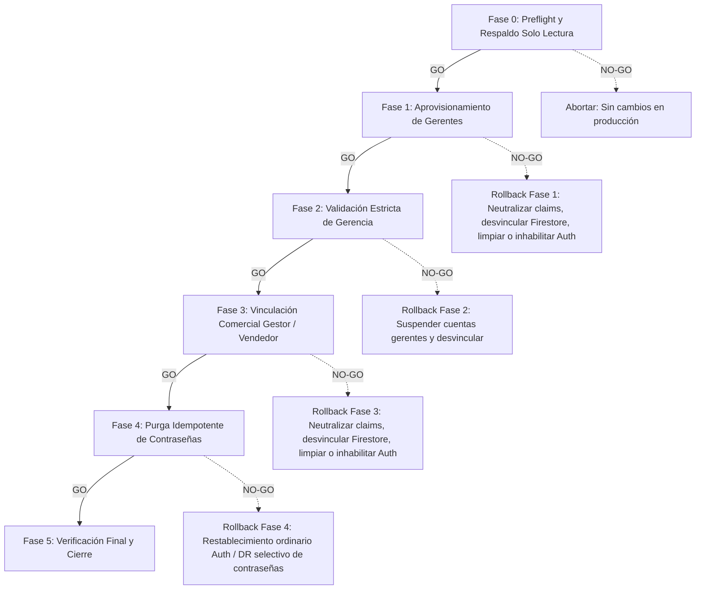
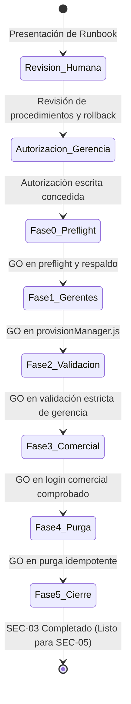

# SEC-03 — Runbook de Migración de Identidad a Producción

> **Documento:** `SEC-03_PRODUCTION_MIGRATION_RUNBOOK.md`  
> **Repositorio:** `/Users/Benjamin/Documents/DUCTSAL/sales-reporting-system`  
> **Proyecto Firebase:** `ductsal-erp`  
> **Estado:** Procedimiento de Ejecución, Verificación y Recuperación (DOCUMENTACIÓN TÉCNICA — NO EJECUTADO)  
> **Fecha de Elaboración:** Octubre 2026  
> **Regla de Operación:** Toda orden de escritura en producción está estrictamente condicionada a autorización explícita previa. Ningún comando de este runbook se ejecuta de forma autónoma.

---

## 1. Inventario Confirmado de Cuentas

Auditoría de perfiles en la colección `users_prod` del proyecto `ductsal-erp` previa a la migración:

| CID | Usuario | Correo Electrónico | Rol | Estado | Acción en Runbook | Mecanismo de Identidad |
|---|---|---|---|---|---|---|
| `1776895495203` | Benjamin Valiente | `bvaliente@grupogama.com` | `manager` | Activo | **Migrar (Fase 1)** | Aprovisionamiento Admin (`provisionManager.js`) |
| `1776904494660` | Denys González | `dgonzalez@ductsal.com` | `manager` | Activo | **Migrar (Fase 1)** | Aprovisionamiento Admin (`provisionManager.js`) |
| `1776904514932` | Alejandra Ayala | `aayala@ductsal.com` | `gestor` | Activa | **Vincular (Fase 3)** | Cloud Function (`linkHistoricalUserAdmin`) |
| `1788471603604` | Roberto Flores | `rflores@ductsal.com` | `vendedor` | Activo | **Vincular (Fase 3)** | Cloud Function (`linkHistoricalUserAdmin`) |
| `1784221928346` | Gustavo Velásquez | `gvelasquez@ductsal.com` | `vendedor` | **Inactivo** | **EXCLUIR TOTALMENTE** | **Ninguna operación ni cuenta Auth** |

> [!IMPORTANT]
> **Condición de partida de identidades:** Las cuatro cuentas activas carecen actualmente de `authUid` en `users_prod`. Sus accesos operan bajo el esquema histórico en texto plano. El perfil inactivo de Gustavo Velásquez (`1784221928346`) **debe permanecer excluido** de cualquier comando de creación de cuenta, asignación de claims o modificación de perfil.

### 1.1 Límites Técnicos de Consistencia: Ausencia de Transaccionalidad Cruzada (Auth y Firestore)

> [!CAUTION]
> **Principio de Diseño de Resiliencia:**  
> Google Firebase Authentication y Cloud Firestore son dos subsistemas distribuidos independientes. **No existe protocolo de commit en dos fases (2PC) ni transaccionalidad atómica cruzada** entre el catálogo de usuarios de Auth y los documentos de Firestore.
>
> Por esta razón, el operador y el auditor deben asumir las siguientes realidades técnicas:
> 1. **Estados Parciales Posibles:** Si un fallo de red, concurrencia o excepción ocurre durante una operación de escritura, es posible que un usuario Auth haya sido creado o sus claims modificados sin que el documento en `users_prod` se haya actualizado, o viceversa.
> 2. **Rollback Automático de Mejor Esfuerzo:** Tanto `provisionManager.js` como `linkHistoricalUserAdmin` implementan mecanismos de compensación que intentan limpiar el estado en caso de error. Sin embargo, si la red o el servicio fallan durante la compensación, se generará un error compuesto (`[CRITICAL: ROLLBACK PARTIAL FAILURE]`) que exigirá reconciliación manual.
> 3. **Prohibición de Eliminación de Cuentas Auth Preexistentes:** La invocación de `admin.auth().deleteUser(uid)` **solo es admisible** si se demostró de forma fehaciente que la cuenta Auth fue creada durante el intento fallido (`createdAuth === true`). Si la cuenta ya existía previamente en Firebase Auth, **NUNCA DEBE SER ELIMINADA**, sino únicamente desvinculada (restaurando claims previos y limpiando `authUid` en Firestore).
> 4. **Irreversibilidad de la Revocación de Sesiones:** Cuando `auth.revokeRefreshTokens(uid)` es ejecutado en el servidor de autenticación, la invalidación de los refresh tokens existentes es **inmediata e irreversible**. Dicha acción no puede "deshacerse": los usuarios afectados deberán renovar sus credenciales iniciando sesión nuevamente.
> 5. **Diagnóstico Previo Mandatorio:** Antes de aplicar cualquier script o acción de recuperación, es obligatorio ejecutar las consultas de **solo lectura** correspondientes para conocer el estado exacto de Auth y de Firestore.

### 1.2 Matriz de Recuperabilidad de Datos y Operaciones Irreversibles

Para garantizar que el operador comprenda con exactitud el impacto de cada intervención, se establece la siguiente clasificación técnica de recuperabilidad:

| Operación / Recurso | Nivel de Reversibilidad | Clasificación | Mecanismo de Reversión o Recuperación | Consecuencia si se Ejecuta |
|---|---|---|---|---|
| **Revocación de Refresh Tokens (`auth.revokeRefreshTokens`)** | **IRREVERSIBLE** | Servidor Auth | **Ninguno.** No existe API para revalidar tokens revocados. | Los usuarios deben renovar credenciales iniciando sesión nuevamente en el CRM. |
| **Purga de Contraseña (`FieldValue.delete()`)** | **IRREVERSIBLE en Firestore** | Base de Datos | **Manual desde Respaldo Frío.** Solo recuperable mediante inserción selectiva condicionada desde el JSON de Fase 0. | El campo `password` desaparece permanentemente del motor de base de datos. No hay papelera. |
| **Eliminación de Cuenta Auth (`deleteUser`)** | **IRREVERSIBLE** | Catálogo Auth | **Ninguno.** Si se elimina una cuenta preexistente, se pierden UID, antigüedad y configuraciones previas. | **PROHIBIDO** para usuarios que existían antes de la migración (`createdAuth === false`). |
| **Despacho SMTP de Correo Real** | **IRREVERSIBLE** | Red / Correo | **Ninguno.** Un correo entregado a un servidor de destino no se puede cancelar. | Notificación o enlace enviado de forma definitiva al destinatario. |
| **Vinculación de Perfil (`authUid`, `authProvider`)** | **RECUPERABLE** | Documento Firestore | **Reversible Selectivamente.** Transacción Firestore eliminando dichos campos con `FieldValue.delete()`. | Restaura el perfil a su estado no vinculado sin afectar otros campos. |
| **Custom Claims (`setCustomUserClaims`)** | **RECUPERABLE** | Token Auth | **Reversible.** Sobrescritura con el objeto de claims previo (`priorClaims`) o `{}`. | Los nuevos tokens reflejarán los claims restaurados tras refrescar. |
| **Contraseña Histórica en Firestore** | **RECUPERABLE (Excepcional)** | Archivo Respaldo | **Inyección Selectiva desde Respaldo Frío.** Verificado por hash SHA-256 independiente. | Solo como medida extrema de Disaster Recovery bajo autorización escrita. |

### 1.3 Reglas de Restauración: Selectivas, Condicionales y Protección de Cambios Posteriores

Cualquier operación de rollback o restauración de contingencia debe regirse estrictamente por las siguientes reglas arquitectónicas:
1. **Restauraciones Selectivas Obligatorias:** Queda **estrictamente prohibido** sobrescribir documentos enteros mediante `docRef.set(backupDoc)` o restaurar colecciones completas. Toda restauración debe ser selectiva a nivel de campo (e.g. `{ password: backup[cid].password }` o `{ authUid: FieldValue.delete() }`).
2. **Restauraciones Condicionales en Transacción:** Toda actualización de restauración debe ejecutarse dentro de una transacción (`runTransaction`) que lea previamente el documento de Firestore y verifique que las precondiciones siguen vigentes (e.g. que el documento existe, coincide el correo y no ha sufrido alteraciones concurrentes).
3. **Prohibición de Sobrescribir Cambios Posteriores sin Revisión Humana:** Si durante la ventana de operación o diagnóstico se detecta que un documento contiene modificaciones legítimas posteriores (e.g. cambios de perfil, actualización de datos de contacto o marcas temporales más recientes), **el procedimiento de restauración debe abortar inmediatamente**. Ningún cambio posterior puede ser sobrescrito sin análisis y autorización humana colegiada por escrito.

### 1.4 Prioridad en la Recuperación de Acceso: Firebase Auth vs Respaldo en Texto Plano

> [!IMPORTANT]
> **DIRECTIVA DE SEGURIDAD OPERATIVA:**  
> Si un usuario encuentra dificultades o bloqueos para iniciar sesión tras la migración o purga:
> 1. **Vía Ordinaria y Prioritaria:** El acceso debe restablecerse exclusivamente mediante las capacidades nativas de **Firebase Authentication**, generando y enviando un enlace de restablecimiento de contraseña oficial (`firebase.auth().sendPasswordResetEmail(email)` o enlace generado en Firebase Console).
> 2. **Prohibición de Contraseñas en Texto Plano como Soporte Ordinario:** **No debe recomendarse ni utilizarse** la restauración de contraseñas históricas en texto plano como mecanismo ordinario de soporte. 
> 3. **Carácter de Disaster Recovery Extremo:** La reincorporación de una contraseña histórica en texto plano desde el archivo de respaldo frío es un procedimiento de desastre de último recurso, aplicable únicamente si los servicios de Firebase Authentication experimentan una caída insalvable y la operación crítica del negocio está paralizada, requiriendo siempre aprobación explícita de la dirección.


---

## 2. Fases de Ejecución del Runbook



---

### Fase 0 — Preflight (Solo Lectura y Respaldo)

#### 1. Objetivo
Verificar el entorno de producción (`ductsal-erp`), comprobar credenciales administrativas, validar la consistencia previa de `users_prod` y generar un respaldo frío inmutable y verificable sin efectuar ninguna escritura.

#### 2. Precondiciones
1. Conexión de red estable hacia Google Cloud / Firebase.
2. Google Cloud CLI (`gcloud`) y Firebase CLI (`firebase`) instalados y autenticados con cuenta administrativa autorizada.
3. Proyecto activo configurado en `ductsal-erp`.
4. Ninguna escritura ejecutada previamente en esta ventana.
5. **Prerrequisito Administrativo de Firebase Authentication:** El servicio de Firebase Authentication debe estar debidamente inicializado ("Comenzar" / "Get Started" activado) en el proyecto `ductsal-erp` y el proveedor nativo **Correo electrónico/Contraseña** (Email/Password) debe encontrarse en estado **Habilitado**. Si el servicio responde `CONFIGURATION_NOT_FOUND`, se detiene de inmediato el procedimiento (STOP CONDITION 1).
6. **Prerrequisito de Credenciales de `firebase-admin` (Application Default Credentials / Service Account):**  
   Los scripts operativos y de auditoría que utilizan `firebase-admin` en Node.js requieren credenciales con permisos de administrador en Google Cloud (`roles/firebase.admin` o `roles/editor`). En entornos locales, `firebase-admin` no utiliza directamente la sesión de `firebase-tools.json`, sino Application Default Credentials (ADC) o una clave de cuenta de servicio especificada en la variable de entorno `GOOGLE_APPLICATION_CREDENTIALS`. Antes de ejecutar cualquier script Node.js con `admin.initializeApp({ projectId: 'ductsal-erp' })`, el operador debe exportar dicha variable (`export GOOGLE_APPLICATION_CREDENTIALS="/ruta/segura/service-account.json"`) o haber ejecutado `gcloud auth application-default login`.

#### 3. Comandos Exactos y Clasificación

##### Paso 0.0 — Verificación Manual en Firebase Console (Estado de Inicialización de Auth y Proveedores)
> [!IMPORTANT]
> **COMPROBACIÓN VISUAL EN CONSOLA (SOLO LECTURA):**  
> El operador o auditor técnico debe verificar el estado del backend de autenticación en la interfaz web de Firebase Console antes de lanzar cualquier script de preflight o aprovisionamiento. **ESTÁ PROHIBIDO ACTIVAR O MODIFICAR PROVEEDORES SIN AUTORIZACIÓN FORMAL DEL ADMINISTRADOR DE INFRAESTRUCTURA.**

- **Procedimiento de Inspección Visual:**
  1. Acceder a [Firebase Console](https://console.firebase.google.com/) con la identidad autorizada (`bevalienteb@gmail.com`).
  2. Seleccionar el proyecto **`ductsal-erp`** (confirmar que el ID del proyecto en el encabezado sea exactamente `ductsal-erp` y el número de proyecto sea `948658286825`).
  3. En la barra lateral izquierda, navegar a **Compilación** (*Build*) > **Authentication**.
  4. Observar la pantalla principal:
     - **Estado NO Inicializado (`CONFIGURATION_NOT_FOUND`):** Aparece la pantalla de bienvenida con la ilustración de inicio y el botón central **"Comenzar"** (*Get Started*). En este estado, no existen pestañas de *Users*, *Sign-in method*, ni configuraciones activas. Las APIs de Auth rechazarán cualquier consulta con error 400.
     - **Estado Inicializado:** Aparece la consola de gestión con las pestañas superiores: **Users** (Usuarios), **Sign-in method** (Método de inicio de sesión), **Templates** (Plantillas) y **Settings** (Configuración).
  5. En caso de estar inicializado, hacer clic en la pestaña **Sign-in method** y revisar la tabla de proveedores:
     - Buscar la fila **Correo electrónico/Contraseña** (*Email/Password*).
     - La columna **Estado** (*Status*) debe mostrar claramente **Habilitado** (*Enabled*).
     - Si aparece como *Inhabilitado* (*Disabled*), las cuentas no podrán ser aprovisionadas ni podrán recibir correos de restablecimiento.
- **Clasificación:** **LECTURA VISUAL EN CONSOLA** (Sin efectos secundarios).
- **Criterio:** Si Authentication no está inicializado o Email/Password está inhabilitado, reportar formalmente al administrador y suspender el procedimiento.

##### Paso 0.1 — Verificación del Proyecto y Credenciales Activas (CLI y firebase-admin)
- **Comando (Firebase CLI):**
  ```bash
  # LECTURA — Verificación de identidad y proyecto activo sin exponer secretos
  npx -y firebase-tools@latest projects:list
  npx -y firebase-tools@latest login:list
  ```
- **Comando (Credenciales de firebase-admin / ADC — Sin exponer secretos ni tokens):**
  ```bash
  # LECTURA — Verificación de variables de entorno y conectividad de firebase-admin
  node -e "
  const fs = require('fs');
  const credPath = process.env.GOOGLE_APPLICATION_CREDENTIALS;
  if (!credPath) {
    console.log('ESTADO_ADC: GOOGLE_APPLICATION_CREDENTIALS no está definida en el entorno.');
    console.log('Se utilizará la detección estándar de Google Application Default Credentials.');
  } else if (!fs.existsSync(credPath)) {
    console.error('ERROR: El archivo especificado en GOOGLE_APPLICATION_CREDENTIALS no existe:', credPath);
    process.exit(1);
  } else {
    try {
      const sa = JSON.parse(fs.readFileSync(credPath, 'utf8'));
      console.log('CREDENCIALES_SERVICE_ACCOUNT_VERIFICADAS:', {
        type: sa.type,
        project_id: sa.project_id,
        client_email: sa.client_email
      });
      if (sa.project_id !== 'ductsal-erp') {
        console.error('ERROR CRÍTICO: La cuenta de servicio pertenece a un proyecto diferente:', sa.project_id);
        process.exit(1);
      }
    } catch (e) {
      console.error('ERROR al parsear archivo de credenciales:', e.message);
      process.exit(1);
    }
  }

  // Prueba de conectividad de solo lectura contra Firestore
  const admin = require('firebase-admin');
  admin.initializeApp({ projectId: 'ductsal-erp' });
  admin.firestore().collection('users_prod').limit(1).get()
    .then(snap => {
      console.log('CONECTIVIDAD_FIREBASE_ADMIN: OK (Lectura de prueba exitosa contra ductsal-erp)');
      process.exit(0);
    })
    .catch(err => {
      console.error('ERROR de autenticación en firebase-admin:', err.message);
      console.error('Asegúrese de configurar GOOGLE_APPLICATION_CREDENTIALS o ejecutar gcloud auth application-default login.');
      process.exit(1);
    });
  "
  ```
- **Clasificación:** **LECTURA** (Inspección de configuración local/cloud sin exposición de claves).
- **Resultado Esperado:** Proyecto `ductsal-erp` verificado, cuenta operativa `bevalienteb@gmail.com` o Service Account de `ductsal-erp`, y conectividad `firebase-admin` confirmada con salida 0.

##### Paso 0.2 — Inspección de Cuentas Auth Preexistentes (Detección de Colisiones)
> [!NOTE]
> **COMPORTAMIENTO ANTE CONFIGURATION_NOT_FOUND:**  
> Si este comando arroja el error `auth/configuration-not-found` o HTTP 400 `CONFIGURATION_NOT_FOUND`, certifica que el servicio de Authentication aún no ha sido provisionado en `ductsal-erp`. En tal caso, se detiene el preflight inmediatamente bajo la **STOP CONDITION 1**.

- **Comando:**
  ```bash
  node -e "
  const admin = require('firebase-admin');
  admin.initializeApp({ projectId: 'ductsal-erp' });
  const emails = ['bvaliente@grupogama.com', 'dgonzalez@ductsal.com', 'aayala@ductsal.com', 'rflores@ductsal.com', 'gvelasquez@ductsal.com'];
  Promise.all(emails.map(email => admin.auth().getUserByEmail(email).then(u => ({ email, exists: true, uid: u.uid })).catch(e => ({ email, exists: false, error: e.code }))))
    .then(r => { console.table(r); process.exit(0); })
    .catch(err => { console.error('Fallo en consulta Auth:', err); process.exit(1); });
  "
  ```

##### Paso 0.2C — Procedimiento de Revalidación de Solo Lectura tras Inicialización de Auth
> [!IMPORTANT]
> **REVALIDACIÓN TRAS ACTIVACIÓN EN CONSOLA (SOLO LECTURA):**  
> Una vez que el administrador confirme que Firebase Authentication ha sido inicializado en Firebase Console y el proveedor Email/Password se encuentra habilitado, este procedimiento consulta directamente las cuentas para certificar que el error `CONFIGURATION_NOT_FOUND` se ha resuelto y comprobar el estado exacto de los 5 correos antes de autorizar cualquier escritura.

- **Comando:**
  ```bash
  # LECTURA — Revalidación de catálogo Auth tras confirmación de inicialización
  node -e "
  const admin = require('firebase-admin');
  admin.initializeApp({ projectId: 'ductsal-erp' });
  const auth = admin.auth();

  async function revalidateAuthAccounts() {
    console.log('=== REVALIDACIÓN DE CUENTAS FIREBASE AUTH (SOLO LECTURA) ===');
    const targetEmails = [
      'bvaliente@grupogama.com',
      'dgonzalez@ductsal.com',
      'aayala@ductsal.com',
      'rflores@ductsal.com',
      'gvelasquez@ductsal.com'
    ];

    const results = [];
    let configError = false;

    for (const email of targetEmails) {
      try {
        const u = await auth.getUserByEmail(email);
        results.push({
          email,
          exists: true,
          uid: u.uid,
          disabled: u.disabled,
          claims: u.customClaims || {},
          created: u.metadata.creationTime,
          lastSignIn: u.metadata.lastSignInTime
        });
      } catch (err) {
        if (err.code === 'auth/user-not-found') {
          results.push({ email, exists: false, uid: 'N/A', disabled: 'N/A', claims: 'N/A' });
        } else if (err.code === 'auth/configuration-not-found' || (err.message && err.message.includes('CONFIGURATION_NOT_FOUND'))) {
          configError = true;
          results.push({ email, error: 'CONFIGURATION_NOT_FOUND', details: err.message });
        } else {
          results.push({ email, error: err.code || err.message });
        }
      }
    }

    console.table(results);

    if (configError) {
      console.error('\nCRITERIO DE PARADA (STOP CONDITION 1): Firebase Authentication sigue sin inicializarse en ductsal-erp.');
      console.error('El administrador debe pulsar \"Comenzar\" y habilitar Email/Password en Firebase Console.');
      process.exit(2);
    } else {
      console.log('\nREVALIDACIÓN EXITOSA: La API de Auth responde normalmente.');
      console.log('Cuentas preexistentes o limpias auditadas correctamente.');
      process.exit(0);
    }
  }

  revalidateAuthAccounts().catch(e => { console.error('Fallo en revalidación:', e); process.exit(1); });
  "
  ```
- **Clasificación:** **LECTURA** (Consulta a Firebase Authentication).
- **Resultado Esperado:** Tabla de 5 filas sin errores de configuración. Si alguna cuenta ya existía previamente, su UID y claims quedan registrados para el aprovisionamiento.

##### Paso 0.3 — Respaldo Frío de `users_prod`
- **Comando (Opción A — Exportación Nativa Administrada Firestore):**
  > [!WARNING]
  > **NO DISPONIBLE EN ESTE ENTORNO:**  
  > 1. Requiere la CLI `gcloud` (no instalada en el PATH de esta estación de trabajo).  
  > 2. El bucket `gs://ductsal-erp-backups` no existe en el proyecto `ductsal-erp` (HTTP 404).  
  > 3. Su formato binario (SSTables/LevelDB) es opaco, no permite validación local de esquema en dry-run ni inspección previa de campos.  
  > 4. El mecanismo de restauración nativo (`gcloud firestore import`) ejecuta una sobrescritura masiva y no selectiva a nivel de base de datos, violando las reglas arquitectónicas de restauración selectiva y condicional (Sección 1.3).  
  > Por consiguiente, la **Opción B (JSON)** constituye el **MÉTODO PRIMARIO Y OBLIGATORIO**.
  ```bash
  # No ejecutable si gcloud o el bucket no están disponibles
  gcloud firestore export gs://ductsal-erp-backups/pre-sec03-users-$(date +%Y%m%d%H%M%S) --collection-ids='users_prod'
  ```
- **Comando (Opción B — Respaldo JSON Cifrado Local con Decodificación Recursiva de Tipos y Paginación Exhaustiva — MÉTODO PRIMARIO):**
  ```bash
  node -e "
  const { fetchAllCollectionDocuments } = require('./functions/firestoreBackupUtil');
  const fs = require('fs');
  const path = require('path');
  const crypto = require('crypto');

  const cfg = JSON.parse(fs.readFileSync(path.join(process.env.HOME, '.config', 'configstore', 'firebase-tools.json'), 'utf8'));
  const token = cfg.tokens.access_token;

  async function executeBackup() {
    console.log('Iniciando extracción fiel de users_prod con decodificación recursiva de tipos y verificación de paginación...');
    
    // Extracción paginada completa con aserciones estrictas (exactamente 5 documentos y CIDs específicos)
    const res = await fetchAllCollectionDocuments({
      projectId: 'ductsal-erp',
      collectionId: 'users_prod',
      token,
      pageSize: 10
    });

    const json = JSON.stringify(res.backupData, null, 2);

    // Destino seguro FUERA del repositorio para prevenir exposición accidental en Git
    const backupDir = path.join(process.env.HOME, '.ductsal-backups');
    if (!fs.existsSync(backupDir)) {
      fs.mkdirSync(backupDir, { mode: 0o700, recursive: true });
    }
    const backupPath = path.join(backupDir, 'backup_users_prod_' + Date.now() + '.json');

    // 1. Protección estricta contra sobrescritura: verificar que no existe y flag 'wx'
    if (fs.existsSync(backupPath)) {
      console.error('ERROR CRÍTICO: El archivo de respaldo ya existe en disco. Abortando para evitar sobrescritura:', backupPath);
      process.exit(1);
    }
    fs.writeFileSync(backupPath, json, { mode: 0o600, flag: 'wx' });

    // 2. Cálculo estricto de SHA-256 sobre los bytes efectivamente escritos en disco
    const writtenBytes = fs.readFileSync(backupPath);
    const hash = crypto.createHash('sha256').update(writtenBytes).digest('hex');

    console.log('BACKUP_SAVED:', backupPath);
    console.log('SHA256:', hash);
    console.log('COUNT:', res.documentCount);
    console.log('PAGES_PROCESSED:', res.pageCount);
    console.log('BYTES:', writtenBytes.length);
    process.exit(0);
  }

  executeBackup().catch(e => {
    console.error('Error al generar respaldo:', e.message || e);
    process.exit(1);
  });
  "
  ```
- **Clasificación:** **LECTURA / EXPORTACIÓN LOCAL** (No modifica la base de datos).

> [!IMPORTANT]
> **REGISTRO INDEPENDIENTE DEL HASH SHA-256:**  
> Inmediatamente después de ejecutar el Paso 0.3, el operador debe copiar la cadena hexadecimal SHA-256 emitida en la bitácora y anotarla en un medio externo e independiente del archivo (e.g. ticket del cambio, bitácora de control o canal de auditoría). En el Paso 0.3B, el valor a verificar debe ser introducido manualmente desde ese registro externo para garantizar que no se compara un archivo contra un hash originado en el mismo medio potencialmente alterado.

##### Paso 0.3B — Comprobación de Restaurabilidad e Integridad de Esquema del Respaldo (Dry-Run / Solo Lectura)
> [!IMPORTANT]
> **VERIFICACIÓN INDEPENDIENTE DEL ARCHIVO Y DRY-RUN:**  
> Comprueba la integridad del archivo generado contra el hash SHA-256 registrado independientemente y valida que el esquema de datos cumpla con todas las propiedades requeridas, **sin realizar ninguna escritura ni restauración en producción**.

- **Comando:**
  ```bash
  # LECTURA / DRY-RUN LOCAL — Validación estricta sin contacto de escritura con la base de datos
  node -e "
  const fs = require('fs');
  const crypto = require('crypto');

  const backupPath = '<PATH_ARCHIVO_BACKUP_GENERADO>'; // e.g., /Users/Benjamin/.ductsal-backups/backup_users_prod_1729000000.json
  const expectedSha256 = '<HASH_SHA256_REGISTRADO_EN_BITACORA_INDEPENDIENTE>'; // Tomado del registro externo

  // 1. Verificación de Hash independiente
  const buffer = fs.readFileSync(backupPath);
  const actualHash = crypto.createHash('sha256').update(buffer).digest('hex');
  if (actualHash !== expectedSha256) {
    console.error('ERROR CRÍTICO: Discrepancia de hash SHA-256. Respaldo comprometido o corrupto.');
    console.error('Esperado (registro independiente):', expectedSha256);
    console.error('Calculado (archivo actual):       ', actualHash);
    process.exit(1);
  }

  // 2. Validación de Esquema (Parseo e integridad estructural de tipos)
  let parsed;
  try {
    parsed = JSON.parse(buffer.toString());
  } catch (err) {
    console.error('ERROR DE ESQUEMA: El archivo de respaldo no es un JSON válido:', err.message);
    process.exit(1);
  }

  const expectedCids = ['1776895495203', '1776904494660', '1776904514932', '1788471603604', '1784221928346'];
  const validRoles = ['manager', 'gestor', 'vendedor'];
  const actualCids = Object.keys(parsed);

  if (actualCids.length !== 5 || !expectedCids.every(id => actualCids.includes(id))) {
    console.error('ERROR DE ESQUEMA: El respaldo no contiene exactamente los 5 perfiles requeridos.', actualCids);
    process.exit(1);
  }

  for (const cid of expectedCids) {
    const doc = parsed[cid];
    if (!doc || typeof doc !== 'object') {
      console.error('ERROR DE ESQUEMA: Documento inválido para CID:', cid);
      process.exit(1);
    }
    if (typeof doc.email !== 'string' || !doc.email.includes('@')) {
      console.error('ERROR DE ESQUEMA: Correo inválido en CID:', cid, doc.email);
      process.exit(1);
    }
    if (typeof doc.role !== 'string' || !validRoles.includes(doc.role)) {
      console.error('ERROR DE ESQUEMA: Rol inválido en CID:', cid, doc.role);
      process.exit(1);
    }
    if (typeof doc.activo !== 'boolean') {
      console.error('ERROR DE ESQUEMA: Campo activo no es booleano en CID:', cid, doc.activo);
      process.exit(1);
    }
    if (typeof doc.password !== 'string') {
      console.error('ERROR DE ESQUEMA: Campo password no es string en CID:', cid);
      process.exit(1);
    }
    // En el perfil de Benjamín Valiente (1776895495203) la contraseña histórica en Firestore es vacía por diseño original.
    // Para los 4 perfiles comerciales restantes, debe ser un string con longitud mayor a 0.
    if (cid !== '1776895495203' && doc.password.trim().length === 0) {
      console.error('ERROR DE ESQUEMA: Contraseña histórica ausente o vacía en respaldo para CID:', cid);
      process.exit(1);
    }
  }

  if (parsed['1784221928346'].activo !== false) {
    console.error('ERROR DE ESQUEMA: Gustavo Velasquez debe figurar inactivo (activo === false) en el respaldo.');
    process.exit(1);
  }

  console.log('DRY-RUN EXITOSO:');
  console.log('- Hash SHA-256 verificado contra registro externo independiente: OK');
  console.log('- Estructura JSON y tipos de datos de los 5 perfiles: 100% VÁLIDOS');
  console.log('- Perfiles listos para restauración selectiva y condicional si fuere requerida.');
  console.log('- Ninguna operación de escritura fue enviada a Firestore.');
  process.exit(0);
  "
  ```
- **Clasificación:** **LECTURA / VALIDACIÓN LOCAL** (No toca producción).
- **Resultado Esperado:** Mensaje `DRY-RUN EXITOSO` y salida 0.

#### 4. Criterios GO/NO-GO y Condiciones de Parada Inequívocas

##### Condiciones de Parada Obligatorias (STOP CONDITIONS):
El procedimiento debe ser **detenido de forma inmediata** y reportado para decisión humana si se cumple cualquiera de las siguientes condiciones:
1. **STOP CONDITION 1 (Persistencia de CONFIGURATION_NOT_FOUND):**  
   Si al consultar Firebase Authentication el servicio responde con `auth/configuration-not-found` o HTTP 400 `CONFIGURATION_NOT_FOUND`. Indica que el backend de Auth o el proveedor Email/Password no están inicializados en consola. **Prohibido ejecutar aprovisionamiento en este estado.**
2. **STOP CONDITION 2 (Colisión, Discrepancia de Identidad o Claims Incompatibles en Auth):**  
   Si una cuenta encontrada por correo en Auth tiene un UID distinto al registrado en Firestore, si se encuentra deshabilitada (`disabled === true`), si pertenece a un usuario ajeno o si presenta claims incompatibles (`cid` discrepante, rol contradictorio o claim de `plant: true`). **Prohibido intentar corregir automáticamente.**
3. **STOP CONDITION 3 (Discrepancia en Perfiles de Firestore `users_prod`):**  
   Si cualquiera de los 5 documentos en `users_prod` difiere del inventario de referencia (correo alterado, rol cambiado, alteración de estado activo o aparición imprevista de un `authUid`).
4. **STOP CONDITION 4 (Fallo en Generación o Integridad del Respaldo Frío):**  
   Si la exportación falla, si el archivo de respaldo ya existía (conflicto de nombre), si el JSON es inválido, si faltan perfiles requeridos, o si el hash SHA-256 calculado no coincide byte a byte con el valor registrado independientemente en la bitácora externa.

##### Dictamen de Preflight:
- **GO:** Proyecto confirmado es `ductsal-erp`, credenciales administrativas válidas, Firebase Authentication operativo y revalidado sin `CONFIGURATION_NOT_FOUND` (Paso 0.2C), auditoría profunda (Paso 0.2B) reportó 0 anomalías, backup generado con integridad comprobada (hash SHA-256 verificado independientemente en Paso 0.3B), los 5 perfiles existen en `users_prod`, y el perfil `1784221928346` está confirmado como inactivo (`activo === false`).
- **NO-GO:** Activación de cualquiera de las 4 condiciones de parada anteriores, proyecto diferente o fallo de permisos IAM. **Detener inmediatamente.**

#### 5. Evidencia Requerida (Sin Secretos)
- Captura de salida del comando `firebase projects:list` mostrando `ductsal-erp`.
- Salida del Paso 0.2B certificando 0 anomalías.
- Hash SHA-256 y tamaño en bytes del archivo de respaldo de `users_prod`.
- Salida del Paso 0.3B confirmando `DRY-RUN EXITOSO`.
- Tabla resumen de preexistencia en Firebase Auth (correo, estado `exists: true/false`, UID si existe; nunca contraseñas ni tokens).

#### 6. Procedimiento de Recuperación
Al tratarse de operaciones exclusivas de lectura, si la Fase 0 falla, no se requiere reversión de base de datos. Se corrige la configuración de red, permisos o credenciales antes de reintentar.

---

### Fase 1 — Aprovisionamiento de Gerentes

#### 1. Objetivo
Aprovisionar o vincular las cuentas de los dos gerentes generales (Benjamin Valiente y Denys González) en Firebase Authentication, asignando de forma atómica sus Custom Claims (`role: 'manager'`, `manager: true`, `cid: '<cid>'`) y enlazando su `authUid` en el documento de Firestore `users_prod/{cid}`, empleando el script endurecido `functions/scripts/provisionManager.js`.

#### 2. Precondiciones
1. Fase 0 completada con dictamen **GO**.
2. Autorización independiente y explícita por escrito de la dirección para proceder con la migración.
3. Respaldo de `users_prod` resguardado.
4. Parámetro `--allow-authorized-production-run` presente en la invocación de `provisionManager.js`.
5. Sin contraseñas temporales codificadas ni contraseñas compartidas. Creación de cuenta Auth sin contraseña inicial (establecimiento seguro posterior mediante restablecimiento de contraseña oficial).

#### 3. Comandos Exactos y Clasificación

##### Paso 1.1 — Aprovisionamiento de Gerente: Benjamin Valiente
- **Comando:**
  ```bash
  # REQUIERE AUTORIZACIÓN EXPLÍCITA — OPERACIÓN DE ESCRITURA EN PRODUCCIÓN
  node functions/scripts/provisionManager.js \
    --cid 1776895495203 \
    --email bvaliente@grupogama.com \
    --nombre "Benjamin Valiente" \
    --suffix _prod \
    --op-id op_prov_mgr_1776895495203_01 \
    --allow-authorized-production-run
  ```
- **Clasificación:** **ESCRITURA — REQUIERE AUTORIZACIÓN EXPLÍCITA** (Crea/actualiza usuario Auth, asigna custom claims, actualiza `users_prod/1776895495203` y registra trazabilidad en `userOps`).
- **Comportamiento en Código:** 
  - Registra atómicamente el inicio de la operación en `userOps/{opId}` con estado `pending` antes de cualquier efecto.
  - Valida que `users_prod/1776895495203` exista, correo coincida exactamente, `role === 'manager'` y `activo === true`.
  - Registra transición a `authCreating`. Si Auth no existe, lo crea con `createUser({ email, displayName })` sin contraseña; transiciona a `authCreated`.
  - Asigna Custom Claims sanitizados: `{ role: 'manager', manager: true, cid: '1776895495203' }`.
  - Ejecuta transacción en Firestore actualizando `authUid`, `authProvider: 'firebase'` y registra estado `firestoreLinked`.
  - Finaliza en estado `succeeded` y asienta bitácora en `commercialAudit_prod`.
  - Revoca tokens anteriores si correspondía. Si la transacción falla, ejecuta rollback automático eliminando el usuario Auth recién creado o restaurando claims previos, registrando `error` o `manualReview`.
- **Resultado Esperado:** Objeto JSON en bitácora con `cid: '1776895495203'`, `email: 'bvaliente@grupogama.com'`, `role: 'manager'`, `uid: '<authUid>'`, `opId: 'op_prov_mgr_1776895495203_01'`.

##### Paso 1.2 — Aprovisionamiento de Gerente: Denys González
- **Comando:**
  ```bash
  # REQUIERE AUTORIZACIÓN EXPLÍCITA — OPERACIÓN DE ESCRITURA EN PRODUCCIÓN
  node functions/scripts/provisionManager.js \
    --cid 1776904494660 \
    --email dgonzalez@ductsal.com \
    --nombre "Denys González" \
    --suffix _prod \
    --op-id op_prov_mgr_1776904494660_01 \
    --allow-authorized-production-run
  ```
- **Clasificación:** **ESCRITURA — REQUIERE AUTORIZACIÓN EXPLÍCITA** (Crea/actualiza usuario Auth, asigna custom claims, actualiza `users_prod/1776904494660` y registra trazabilidad en `userOps`).
- **Resultado Esperado:** Objeto JSON en bitácora con `cid: '1776904494660'`, `email: 'dgonzalez@ductsal.com'`, `role: 'manager'`, `uid: '<authUid>'`, `opId: 'op_prov_mgr_1776904494660_01'`.

##### Paso 1.3 — Mecanismo Oficial de Establecimiento de Contraseña
- **Diagnóstico del Flujo en Frontend:**  
  La pantalla de inicio de sesión (`#login-screen` en `index.html`) no dispone de un botón público de "Olvidé mi contraseña" o "Primer acceso". Asimismo, `resetUserPassword` en `app_core.js:1546` reside dentro de la vista administrativa (`#users-view`), la cual exige una sesión activa de gerente.
- **Procedimiento para Fase 1 (Sin Sesión Previa de CRM):**  
  Dado que ningún usuario cuenta con sesión en el CRM en esta etapa, el correo de primer acceso de los gerentes no puede solicitarse desde la interfaz web del CRM. Se debe utilizar exclusivamente uno de los siguientes mecanismos oficiales autorizados:
  1. **Opción A (Consola de Firebase — Recomendada):**  
     Acceder a **Firebase Console > Authentication > Users**, buscar `bvaliente@grupogama.com` y `dgonzalez@ductsal.com`, seleccionar los tres puntos de acción y presionar **"Send password reset email"** (Enviar correo para restablecer contraseña). Firebase Authentication despacha el correo directamente al destinatario.
  2. **Opción B (Llamada al SDK Cliente desde Navegador):**  
     Desde la consola de desarrollador en el navegador donde se carga el CRM (sin necesidad de iniciar sesión):
     ```javascript
     // LECTURA / INVITACIÓN DE CLIENTE (Dispara el servicio oficial de correo de Firebase Auth)
     await firebase.auth().sendPasswordResetEmail('bvaliente@grupogama.com');
     await firebase.auth().sendPasswordResetEmail('dgonzalez@ductsal.com');
     ```
  3. **Opción C (Script Administrativo Out-Of-Band):**  
     Generar el enlace mediante Admin SDK (`admin.auth().generatePasswordResetLink(email)`) y entregarlo individualmente por canal seguro y cifrado. **Prohibido volcar el enlace a terminales compartidas o repositorios.**
- **Comportamiento del Usuario:** El gerente recibe el correo oficial con remitente de Firebase, hace clic en el enlace seguro, define su contraseña y luego ingresa al CRM mediante el formulario regular (`#login-screen`).
- **Clasificación:** **GESTIÓN DE IDENTIDAD OUT-OF-BAND** (No se envían correos en esta fase de preparación).


#### 4. Criterios GO/NO-GO
- **GO:** Ambos perfiles (`1776895495203` y `1776904494660`) retornaron estado exitoso, disponen de `authUid` registrado en Firestore, claims `{ role: 'manager', manager: true, cid }` confirmados en Auth y sin errores de rollback.
- **NO-GO:** Fallo en la creación de usuario Auth, discrepancia de correo o CID, fallo en la transacción de Firestore, o error de concurrencia. **Detener y ejecutar procedimiento de recuperación de Fase 1.**

#### 5. Evidencia Requerida (Sin Secretos)
- Salida estructurada de `provisionManager.js` para ambos CIDs (UID asignado, correo, rol, marcas de tiempo).
- Verificación de campos en Firestore mediante consulta de solo lectura:
  ```bash
  # LECTURA
  node -e "
  const admin = require('firebase-admin');
  admin.initializeApp({ projectId: 'ductsal-erp' });
  const db = admin.firestore();
  Promise.all(['1776895495203', '1776904494660'].map(id => db.collection('users_prod').doc(id).get().then(s => ({ id, authUid: s.data().authUid, authProvider: s.data().authProvider, activo: s.data().activo }))))
    .then(r => { console.table(r); process.exit(0); });
  "
  ```

#### 6. Procedimiento de Recuperación (Rollback Fase 1)

##### 6.1 Análisis de Estados Parciales Posibles y Orden de Recuperación
Cualquier procedimiento de contingencia o reversión debe ejecutar las operaciones en el **orden estricto de seguridad inversa**:
1. **Paso 1 (Neutralización Inmediata de Privilegios):** Si la cuenta Auth existe y tiene Custom Claims asignados (`role: 'manager'`), se deben neutralizar o restaurar a su estado previo (`auth.setCustomUserClaims(uid, priorClaims || {})`) y revocar sus refresh tokens (`auth.revokeRefreshTokens(uid)`). Esto mitiga el riesgo de retención indebida de privilegios en Frontend, Cloud Storage o Cloud Functions.
2. **Paso 2 (Desvinculación Transaccional y Selectiva en Firestore):** Ejecutar una transacción en `users_prod/{cid}` para remover exclusivamente `authUid` y `authProvider` mediante `FieldValue.delete()`. La transacción debe verificar previamente que el `authUid` actual coincide exactamente con el UID a revertir, garantizando que cambios posteriores legítimos no sean sobrescritos.
3. **Paso 3 (Procesamiento Controlado de Cuenta Auth):** Fuera de la transacción de Firestore, evaluar si la cuenta puede eliminarse de forma segura o si debe preservarse/inhabilitarse:
   - **Cuenta Preexistente:** Queda **estrictamente prohibido eliminarla**. Permanece intacta con sus claims originales.
   - **Cuenta con Actividad (`lastSignInTime !== null`):** Queda **estrictamente prohibido eliminarla**. Se detecta actividad legítima de usuario; la cuenta se inhabilita (`disabled: true`) para proteger el historial y credenciales.
   - **Cuenta Nueva sin Actividad:** Se permite eliminar con `auth.deleteUser(uid)` únicamente tras confirmación humana explícita (`CONFIRM_DELETE_AUTH_ACCOUNT=YES`).

**Trazabilidad mediante `opId` y Tratamiento de Fallos Parciales Específicos:**

Cada ejecución de `provisionManager.js` registra su ciclo de vida en `userOps/{opId}` transitando por los estados formales:
- `pending`: Operación registrada antes de cualquier mutación externa.
- `authCreating`: Intento de consulta/creación de cuenta en Firebase Auth.
- `authCreated`: Cuenta Auth creada o identificada de forma inequívoca (`createdAuth: boolean`, `uid`).
- `firestoreLinked`: Perfil en Firestore actualizado atómicamente y verificado.
- `succeeded`: Claims asignados, tokens revocados, operación terminada y asentada en `commercialAudit_prod`.
- `conflict`: Rechazo seguro por discrepancia de CID, correo, o perfil no elegible (sin efectos residuales).
- `error`: Fallo compensado limpiamente por el rollback automático (`rolledBack: true`).
- `manualReview`: Fallo parcial con persistencia de estado que exige intervención humana explícita (`rolledBack: false`).

**Escenarios de Fallo y Recuperación:**
1. **Fallo en Validación Previa (Paso 1 a 4 de `provisionManager.js`):** La ejecución aborta registrando `conflict`. No hay cambios ni en Auth ni en Firestore.
2. **Fallo en Firestore tras Crear Usuario Auth Nuevo (`createdAuth === true`):** El rollback automático interno elimina la cuenta Auth recién creada y asienta `error` (`rolledBack: true`). Si la eliminación en Auth fallara, transiciona a `manualReview` (`rolledBack: false`, `uid` preservado); el diagnóstico del paso 6.2 lo detectará para aplicar la Acción A.
3. **Fallo en Firestore con Usuario Auth Preexistente (`createdAuth === false`):** La cuenta Auth ya existía. La transacción de Firestore falló. Los claims en Auth son restaurados por el rollback automático a `priorClaims` y el usuario Auth **nunca se elimina**. Si el rollback automático falló, transiciona a `manualReview`.
4. **Fallo en `revokeRefreshTokens`:** Si la revocación falla o se interrumpe la red, la vinculación en Firestore y los claims ya fueron completados con éxito. La revocación de refresh tokens es **unidireccional e irreversible**; los tokens caducarán de forma natural (máximo 1 hora) o se renovarán en el siguiente login.
5. **Reintento con Mismo `opId`:** Si la operación previa alcanzó `succeeded`, reintentar con el mismo `--op-id` devuelve el resultado inmediatamente de forma idempotente (`alreadyCompleted: true`) sin re-ejecutar mutaciones ni duplicar registros.
6. **Fallo en Rollback Automático (`[CRITICAL: ROLLBACK PARTIAL FAILURE]`):** El script arroja una excepción compuesta y registra `manualReview` en `userOps/{opId}` con la lista de `rollbackErrors` para guiar la reconciliación manual controlada.

##### 6.2 Diagnóstico de Estado Real (SOLO LECTURA — SEGURO)
Ejecutar inmediatamente ante cualquier fallo o duda para conocer el estado exacto de ambos sistemas sin alterar nada:
```bash
# LECTURA — SEGURO (Diagnóstico cruzado Auth + Firestore para gerentes)
node -e "
const admin = require('firebase-admin');
admin.initializeApp({ projectId: 'ductsal-erp' });
const auth = admin.auth();
const db = admin.firestore();

async function diagnoseManager(cid, email) {
  console.log('=== DIAGNÓSTICO GERENTE CID:', cid, 'EMAIL:', email, '===');
  const snap = await db.collection('users_prod').doc(cid).get();
  const fsData = snap.exists ? snap.data() : null;
  console.log('Firestore Profile:', fsData ? {
    exists: true,
    authUid: fsData.authUid || 'NO_VINCULADO',
    authProvider: fsData.authProvider || 'NO_SET',
    activo: fsData.activo,
    role: fsData.role
  } : { exists: false });

  try {
    const authUser = await auth.getUserByEmail(email);
    console.log('Firebase Auth User:', {
      exists: true,
      uid: authUser.uid,
      disabled: authUser.disabled,
      claims: authUser.customClaims || {},
      created: authUser.metadata.creationTime,
      lastSignIn: authUser.metadata.lastSignInTime
    });
  } catch (e) {
    console.log('Firebase Auth User:', { exists: false, code: e.code });
  }
}

Promise.all([
  diagnoseManager('1776895495203', 'bvaliente@grupogama.com'),
  diagnoseManager('1776904494660', 'dgonzalez@ductsal.com')
]).then(() => process.exit(0)).catch(e => { console.error(e); process.exit(1); });
"
```

##### 6.3 Acciones de Recuperación (Clasificadas por Riesgo y con Salvaguardas)

* **Acción A: Reversión cuando el usuario Auth fue CREADO EN LA MIGRACIÓN (`createdAuth === true`):**
  > [!CAUTION]
  > **CONDICIONES DE PARADA Y AUTORIZACIÓN HUMANA OBLIGATORIAS:**
  > 1. Si el diagnóstico revela que `lastSignInTime` NO es nulo (el usuario ya inició sesión), **QUEDA PROHIBIDO ELIMINAR LA CUENTA**. El script abortará automáticamente con `USER_ACTIVITY_DETECTED` y la inhabilitará preventivamente.
  > 2. Requiere confirmación humana explícita mediante la variable de entorno `CONFIRM_DELETE_AUTH_ACCOUNT=YES`.
  ```bash
  # REQUIERE AUTORIZACIÓN EXPLÍCITA — ROLLBACK FASE 1 (USUARIO CREADO EN MIGRACIÓN)
  CONFIRM_DELETE_AUTH_ACCOUNT=YES node -e "
  const admin = require('firebase-admin');
  const { FieldValue } = require('firebase-admin/firestore');
  admin.initializeApp({ projectId: 'ductsal-erp' });
  const uid = '<UID_RECIEN_CREADO>';
  const cid = '<CID_TARGET>';
  const confirmDelete = process.env.CONFIRM_DELETE_AUTH_ACCOUNT || 'NO';

  async function rollbackCreatedManagerAuth() {
    const auth = admin.auth();
    const db = admin.firestore();

    // 1. Diagnóstico previo de la cuenta Auth
    const authUser = await auth.getUser(uid).catch(() => null);
    if (!authUser) {
      console.warn('Auth user ya no existe o fue eliminado previamente:', uid);
    } else {
      // Condición de parada 1: Detección de actividad posterior
      if (authUser.metadata.lastSignInTime) {
        console.error('STOP: [USER_ACTIVITY_DETECTED] La cuenta registra inicios de sesión (' + authUser.metadata.lastSignInTime + '). PROHIBIDO ELIMINAR.');
        await auth.updateUser(uid, { disabled: true });
        console.log('SEGURIDAD: Cuenta inhabilitada preventivamente en Auth. No se elimina.');
      } else if (confirmDelete !== 'YES') {
        console.error('STOP: [MISSING_HUMAN_AUTHORIZATION] Se requiere CONFIRM_DELETE_AUTH_ACCOUNT=YES para proceder a la eliminación.');
        process.exit(1);
      }
    }

    // 2. Neutralizar privilegios en Auth inmediatamente
    if (authUser) {
      await auth.setCustomUserClaims(uid, {}).catch(e => console.warn('Aviso claims:', e.message));
      await auth.revokeRefreshTokens(uid).catch(e => console.warn('Aviso tokens:', e.message));
    }

    // 3. Desvinculación transaccional y selectiva en Firestore (Preserva 100% otros campos)
    const ref = db.collection('users_prod').doc(cid);
    await db.runTransaction(async tx => {
      const doc = await tx.get(ref);
      if (!doc.exists) {
        throw new Error('Perfil no existe en Firestore para CID: ' + cid);
      }
      const data = doc.data();
      if (data.authUid && data.authUid !== uid) {
        throw new Error('Conflicto: authUid en Firestore (' + data.authUid + ') no coincide con UID a desvincular (' + uid + '). No se sobrescriben cambios de otro proceso.');
      }
      tx.update(ref, {
        authUid: FieldValue.delete(),
        authProvider: FieldValue.delete()
      });
    });
    console.log('DESVINCULACION_FIRESTORE_EXITOSA para CID:', cid);

    // 4. Eliminación segura de la cuenta Auth (solo si no hubo actividad y hubo confirmación)
    if (authUser && !authUser.metadata.lastSignInTime && confirmDelete === 'YES') {
      await auth.deleteUser(uid);
      console.log('ELIMINACION_AUTH_EXITOSA para UID:', uid);
    }

    console.log('ROLLBACK_USUARIO_NUEVO_COMPLETADO para CID:', cid);
  }

  rollbackCreatedManagerAuth().then(() => process.exit(0)).catch(e => { console.error('Fallo en rollback:', e); process.exit(1); });
  "
  ```

* **Acción B: Reversión cuando el usuario Auth era PREEXISTENTE (`createdAuth === false`):**
  > [!CAUTION]
  > **PROHIBIDO ELIMINAR LA CUENTA AUTH.** Solo restaurar claims originales y desvincular selectivamente en Firestore.
  ```bash
  # REQUIERE AUTORIZACIÓN EXPLÍCITA — ROLLBACK FASE 1 (USUARIO PREEXISTENTE)
  node -e "
  const admin = require('firebase-admin');
  const { FieldValue } = require('firebase-admin/firestore');
  admin.initializeApp({ projectId: 'ductsal-erp' });
  const uid = '<UID_PREEXISTENTE>';
  const cid = '<CID_TARGET>';
  // Claims que tenía antes de la operación (o {} si no tenía claims)
  const priorClaims = {}; 

  async function rollbackPreexistingAuth() {
    const auth = admin.auth();
    const db = admin.firestore();

    // 1. Restaurar claims previos y revocar tokens de inmediato
    await auth.setCustomUserClaims(uid, priorClaims);
    await auth.revokeRefreshTokens(uid).catch(e => console.warn('Aviso revocación tokens:', e.message));
    console.log('CLAIMS_RESTAURADOS para UID:', uid);

    // 2. Desvinculación transaccional y selectiva en Firestore
    const ref = db.collection('users_prod').doc(cid);
    await db.runTransaction(async tx => {
      const doc = await tx.get(ref);
      if (!doc.exists) {
        throw new Error('Perfil no existe en Firestore para CID: ' + cid);
      }
      const data = doc.data();
      if (data.authUid && data.authUid !== uid) {
        throw new Error('Conflicto: authUid en Firestore (' + data.authUid + ') no coincide con UID a desvincular (' + uid + '). No se sobrescriben cambios concurrentes.');
      }
      tx.update(ref, {
        authUid: FieldValue.delete(),
        authProvider: FieldValue.delete()
      });
    });

    console.log('ROLLBACK_PREEXISTENTE_COMPLETADO para CID:', cid);
  }

  rollbackPreexistingAuth().then(() => process.exit(0)).catch(e => { console.error('Fallo en rollback preexistente:', e); process.exit(1); });
  "
  ```

* **Acción C: Tratamiento de Revocación de Tokens:**
  Si `auth.revokeRefreshTokens(uid)` ya se ejecutó en los servidores de Auth, dicha invalidación no puede revertirse. No se requiere comando de reparación: el usuario simplemente deberá iniciar sesión para generar un nuevo par de tokens ID y Refresh.


---

### Fase 2 — Validación de Gerencia

#### 1. Objetivo
Verificar exhaustivamente que las dos cuentas de gerencia aprovisionadas en la Fase 1 inicien sesión de manera correcta, que sus tokens contengan los claims esperados, que su `authUid` coincida byte a byte con `users_prod`, que posean acceso a las funciones administrativas autorizadas y que carezcan de acceso no autorizado.

#### 2. Precondiciones
1. Fase 1 completada con dictamen **GO**.
2. Ambos gerentes han establecido su contraseña mediante el mecanismo oficial.
3. Disponibilidad de un entorno de navegador para iniciar sesión o script de verificación de token ID.

#### 3. Comprobaciones Explícitas y Comandos

##### Comprobación 2.1 — Validación de Tokens y Claims
- **Script de Verificación de Claims en Servidor:**
  ```bash
  # LECTURA
  node -e "
  const admin = require('firebase-admin');
  admin.initializeApp({ projectId: 'ductsal-erp' });
  const auth = admin.auth();
  const db = admin.firestore();
  async function verify(cid, expectedEmail) {
    const doc = await db.collection('users_prod').doc(cid).get();
    const profile = doc.data();
    if (!profile.authUid) throw new Error(cid + ' no tiene authUid');
    const user = await auth.getUser(profile.authUid);
    const claims = user.customClaims || {};
    const ok = claims.role === 'manager' && claims.manager === true && claims.cid === cid && user.email === expectedEmail && profile.activo === true;
    return { cid, email: user.email, authUid: user.uid, claims, valid: ok };
  }
  Promise.all([
    verify('1776895495203', 'bvaliente@grupogama.com'),
    verify('1776904494660', 'dgonzalez@ductsal.com')
  ]).then(r => { console.table(r); process.exit(0); }).catch(e => { console.error(e); process.exit(1); });
  "
  ```
- **Clasificación:** **LECTURA** (Consulta de verificación Auth + Firestore).
- **Resultado Esperado:** Ambos registros deben mostrar `valid: true`, `claims.role === 'manager'`, `claims.manager === true` y `claims.cid` idéntico al ID del documento.

##### Comprobación 2.2 — Inicio de Sesión y Verificación de Token en Cliente
- **Procedimiento:**
  1. El gerente ingresa al CRM mediante el formulario oficial con sus credenciales de Firebase Auth.
  2. En la consola del cliente web, se comprueba la sesión activa:
     ```javascript
     // Ejecutado en consola del navegador del gerente autenticado
     const user = firebase.auth().currentUser;
     console.assert(user !== null, "Usuario no autenticado en cliente");
     const tokenResult = await user.getIdTokenResult(true);
     console.log("Claims activos:", tokenResult.claims);
     console.assert(tokenResult.claims.manager === true, "Falta claim manager");
     console.assert(tokenResult.claims.role === 'manager', "Rol incorrecto");
     console.assert(tokenResult.claims.cid !== undefined, "Falta claim cid");
     ```
- **Clasificación:** **LECTURA** (Inspección de token en cliente).

##### Comprobación 2.3 — Autorización de Funciones Administrativas
- **Comprobación:** Invocar una función callable de solo lectura o administrativa desde la sesión de gerencia activa (e.g. `reconcileUserOp` o lectura de catálogo restringido):
  - La llamada debe completarse con éxito.
  - La función `assertManager(context)` en backend valida `context.auth != null`, `claims.manager === true`, `requester.disabled !== true` y `assertRequesterProfileActive` confirma que el perfil está activo.

##### Comprobación 2.4 — Ausencia de Acceso No Autorizado
- **Comprobación de Seguridad:**
  - El gerente no puede invocar funciones operativas exclusivas de taller que exijan el claim `plant: true` (e.g., avance directo de estaciones de taller reservadas a tablets).
  - El gerente no puede suplantar la autoría de un vendedor en operaciones comerciales sin que quede registrado su propio actor en la bitácora de auditoría (`commercialAudit_prod`).

#### 4. Criterios GO/NO-GO
- **GO:** Ambas cuentas de gerencia completaron el 100% de las comprobaciones (login exitoso, claims exactos, correspondencia estricta `authUid === profile.authUid`, acceso administrativo operativo).
- **NO-GO:** Cualquiera de los gerentes no puede iniciar sesión, claims incompletos o ausentes, token revocado sin renovación, o perfil inactivo.
- **DIRECTIVA CRÍTICA:** **NO CONTINUAR A LA FASE 3 SI CUALQUIERA DE LAS COMPROBACIONES DE FASE 2 FALLA.**

#### 5. Evidencia Requerida (Sin Secretos)
- Tabla de verificación de claims emitida por el script de verificación.
- Registro de auditoría del primer inicio de sesión de cada gerente (`authUser.metadata.lastSignInTime` no nulo).
- Confirmación visual de carga del panel directivo del CRM.

#### 6. Procedimiento de Recuperación
Si la validación de gerencia falla, suspender el inicio de sesión comercial, no proceder con la vinculación de vendedores y revisar los claims asignados mediante `setCustomUserClaims` o el estado del documento en `users_prod`.

---

### Fase 2.5 — Simulación y Planificación del Backfill de Datos para Endurecimiento de Reglas

#### 1. Objetivo
Simular exhaustivamente y en modo **estrictamente de solo lectura** la migración y saneamiento de datos necesarios en las colecciones comerciales (`prospects_prod`, `clients_prod` y `userDirectory_prod`) antes de poder activar las reglas de seguridad restrictivas de Firestore y Storage, garantizando cero interrupción en la operativa comercial y de planta.

#### 2. Recuentos Comprobados en Vivo (`ductsal-erp`)
Inspección en vivo efectuada mediante `functions/scripts/simulateSec03Backfill.js` utilizando credenciales de administrador delegadas:

| Colección en Producción | Total Documentos | Estado Actual Auditado | Acción Requerida en Backfill |
|---|:---:|---|---|
| `users_prod` | **5** | 2 gerentes activos, 1 gestor activo, 1 vendedor activo, 1 vendedor inactivo (`Gustavo Velásquez`, `1784221928346`). | Fuente de verdad para el directorio público. |
| `userDirectory_prod` | **0** | Colección vacía (100% ausente). | Sincronizar los 5 usuarios con proyección segura `{ id, nombre, role, activo }`. |
| `clients_prod` | **107** | 107 sin `visibleTo` (100%); 41 sin `createdBy`; 0 con prospectos huérfanos (107/107 con prospectos vinculados). | Calcular `visibleTo` y `closingVendors` reactivos; asignar `createdBy` unánime a los 41 históricos. |
| `prospects_prod` | **166** | 84 con `createdBy` y `vendedorId`; 24 sin `createdBy`; 58 con `createdBy` pero sin `vendedorId`; 0 huérfanos. | Resolver `createdBy` y `vendedorId` en los 24 documentos de Alejandra Ayala; estandarizar `vendedorId` en los 58 documentos. |

#### 3. Esquema Propuesto y Reglas de Derivación

##### A. Oportunidades (`prospects_prod`)
- **Regla de Derivación de `createdBy` y `vendedorId`:**
  - En los 24 documentos faltantes de `createdBy` (`OPP-1777081074183-0` a `OPP-1777081083975-23`), la propiedad `vendedor` indica textualmente `"Alejandra Ayala"` y 1 de ellos contiene `vendedorId: "1776904514932"`.
  - Existe evidencia incontrovertible de autoría e importación histórica en lote por parte de Alejandra Ayala. Se propone el parche seguro `{ createdBy: "1776904514932", vendedorId: "1776904514932" }`.
- **Estandarización de `vendedorId`:**
  - En los 58 documentos creados por `1776904514932` que carecen de `vendedorId`, se estandariza `vendedorId: "1776904514932"` para asegurar indexación dual simétrica.
- **Conflictos y Ambigüedades:** **0 documentos ambiguos.** Todos los prospectos de la base corresponden a usuarios conocidos.

##### B. Clientes (`clients_prod`)
- **Regla de Derivación de `visibleTo` y `closingVendors`:**
  - Se calculan de forma idéntica a la Cloud Function reactiva `syncClientVisibility` (`functions/clientsService.js:recomputeVisibility`).
  - Para cada cliente, se examinan sus prospectos activos vinculados (`p.eliminado !== true`).
  - `visibleTo`: Lista ordenada de identificadores de vendedores únicos (`[p.createdBy, p.vendedorId]`, excluyendo `'sistema'`).
  - `closingVendors`: Subconjunto de vendedores con prospectos en etapa `cierre` y estado distinto de `perdido`.
- **Resolución de `createdBy` para 41 Clientes Históricos:**
  - De los 41 clientes sin `createdBy`, el 100% cuenta con prospectos asociados.
  - **40 clientes** tienen la totalidad de sus prospectos creados y gestionados unánimemente por Alejandra Ayala (`1776904514932`).
  - **1 cliente** (`C1784933224052`, "AR Multiservicios") tiene la totalidad de sus prospectos gestionados por Gustavo Velásquez (`1784221928346`).
  - **0 clientes** presentan propiedad dividida o vendedores en conflicto.
  - Se propone asignar `createdBy` unánime a cada uno de ellos, respaldado por la trazabilidad de sus prospectos.

##### C. Directorio Seguro (`userDirectory_prod`)
- **Campos Autorizados:**
  ```json
  {
    "id": "string (CID)",
    "nombre": "string",
    "role": "manager | gestor | vendedor",
    "activo": true | false
  }
  ```
- **Campos Excluidos de Forma Estricta y Definitiva:**
  `password`, `email`, `authUid`, `authProvider`, `creado`, `hasPassword`, tokens de acceso o metadatos de sesión.

#### 4. Resultados del Dry-Run Automatizado

```text
================================================================
       SEC-03 FASE F2: SIMULACIÓN DE BACKFILL (DRY-RUN)        
          ESTRICTAMENTE SOLO LECTURA — ZERO ESCRITURAS         
================================================================
[SIMULATION] Target Project: ductsal-erp
[SIMULATION] Live counts: users=5, userDir=0, clients=107, prospects=166

--- 1. PROSPECTS_PROD (TOTAL: 166) ---
- Al día (createdBy y vendedorId presentes): 84
- Propuestas de actualización: 82
  * Lote de 24 sin createdBy resueltos: 24
  * Lote de 58 sin vendedorId estandarizados: 58
- Casos ambiguos / revisión manual: 0

--- 2. CLIENTS_PROD (TOTAL: 107) ---
- Al día: 0
- Propuestas de actualización visibleTo / closingVendors: 66
- Clientes sin createdBy resueltos por prospectos unánimes: 41
- Clientes huérfanos / ambiguos / revisión manual: 0

--- 3. USERDIRECTORY_PROD (TOTAL ACTUAL: 0) ---
- Documentos a sincronizar desde users_prod: 5
- Documentos a actualizar: 0
- Documentos huérfanos a eliminar: 0
================================================================
```

#### 5. Compatibilidad de Consultas y Bloqueos Críticos Antes de Endurecer Reglas

> [!CAUTION]
> **BLOQUEO TÉCNICO DE PRODUCCIÓN (CONDICIÓN NO-GO PARA REGLAS FIRESTORE/STORAGE):**  
> Antes de poder desplegar las reglas restrictivas candidatas de Firestore (`firestore.rules`) y Storage (`storage.rules`), deben cumplirse dos condiciones indispensables:
> 1. **Backfill Real de Datos (Fase F2.5b):** El script de backfill debe ejecutarse con escrituras en producción (previa autorización explícita) para poblar `visibleTo` en los 107 clientes y poblar los 5 registros de `userDirectory_prod`. Sin este backfill, los vendedores verán su cartera completamente vacía al aplicarse la regla `clientVisible()`.
> 2. **SEC-02 (Terminales de Taller en Fabricación):** La aplicación de operarios en taller (`../fabricacion-dev/operador.html` y `operador.js`) realiza actualmente lecturas **sin autenticación** sobre `users_prod` (para validar PIN) y sobre `system_prod/settings`. **Si se despliegan las reglas de Firestore en este momento, todas las tablets de la planta quedarán bloqueadas de inmediato con error 403 (PERMISSION_DENIED).** El endurecimiento de reglas no debe ejecutarse hasta que la integración de `plantLogin` de SEC-02 esté completada en las terminales del taller.

---

### Fase 2.5 — Procedimiento de Ejecución del Backfill, Matriz de Cambios y Rollback Quirúrgico

#### 1. Arquitectura del Ejecutor de Backfill (`executeSec03Backfill.js`)
El procedimiento de backfill operativo se implementa en [`functions/scripts/executeSec03Backfill.js`](file:///Users/Benjamin/Documents/DUCTSAL/sales-reporting-system-release/functions/scripts/executeSec03Backfill.js) bajo cinco salvaguardas arquitectónicas inquebrantables:
1. **Modalidad de Simulación Obligatoria por Defecto:** Cualquier invocación sin banderas explícitas opera en `--dry-run` (0 escrituras en Firestore). Requiere simultáneamente `--apply`, `--confirm-apply`, `--op-id <token>` y `--allow-authorized-production-run` para escribir.
2. **Idempotencia Estricta:** Antes de emitir cualquier mutación, evalúa en memoria el documento actual. Si los campos en Firestore ya coinciden con la propuesta (por ejemplo, tras una ejecución previa o corrección manual), la operación se clasifica como `NOOP` y no consume escrituras ni genera ruido de auditoría.
3. **Lotes Atómicos Controlados (`BATCH_SIZE = 50`):** Las escrituras se segmentan en lotes de 50 documentos utilizando `db.batch()`, garantizando atomicidad por lote y evitando la contención de transacciones globales.
4. **Registro de Proveniencia Quirúrgica (Antes/Después):** Cada documento modificado almacena una entrada en la colección de auditoría `sec03MigrationAudit_prod/<opId>` y en un archivo local JSON con el snapshot exacto de sus campos previos (`before`) y aplicados (`after`).
5. **Rollback Quirúrgico No Destructivo:** La reversión compara el estado actual con el valor aplicado (`after`). Si un usuario comercial legítimo modificó el registro con posterioridad (ej. reasignó el vendedor o avanzó de etapa), la reversión detecta la colisión (`COLLISION_CONCURRENT_USER_MODIFICATION`), **omite sobrescribir el campo** y lo preserva intacto.

---

#### 2. Matriz Exhaustiva de Cambios de Datos (SEC-03 F2.5)

| Conjunto de Datos | Población | Estado Actual en Producción | Regla de Derivación y Parche Propuesto | Atribución Verificada |
|---|:---:|---|---|---|
| **Prospectos sin `createdBy`** | **24** | `createdBy: null`, `vendedor: "Alejandra Ayala"`, `vendedorId: null` (en 23/24). Importación masiva `OPP-1777081074183-0` a `23`. | `patch = { createdBy: "1776904514932", vendedorId: "1776904514932" }` | **Alejandra Ayala** (100% de evidencia textual y temporal unánime). |
| **Prospectos sin `vendedorId`** | **58** | `createdBy: "1776904514932"`, `vendedorId: null`, `vendedor: undefined`. | `patch = { vendedorId: "1776904514932" }` | **Alejandra Ayala** (estandarización simétrica del creador). |
| **Clientes Históricos de Alejandra** | **40** | `createdBy: null`, `visibleTo: null`, `closingVendors: null`. | `patch = { createdBy: "1776904514932", visibleTo: [...], closingVendors: [...] }` | **Alejandra Ayala** (100% de prospectos vinculados creados y gestionados por ella). |
| **Cliente "AR Multiservicios"** | **1** | Doc `C1784933224052`: `createdBy: null`, `visibleTo: null`, `closingVendors: null`. Prospecto único `1784933235289` creado y asignado a Gustavo. | `patch = { createdBy: "1784221928346", visibleTo: ["1784221928346"], closingVendors: [] }` | **Gustavo Velásquez** (`1784221928346`, vendedor inactivo). **PROHIBIDO REASIGNAR SILENCIOSAMENTE.** |
| **Cartera Completa de Clientes** | **107** | 107 clientes carecen de `visibleTo` (100%). | Se calculan `visibleTo` (vendedores vinculados) y `closingVendors` (vendedores en etapa cierre activo). | Cobertura total de la cartera (66 con `createdBy` preexistente + 41 resueltos unánimes). |
| **Directorio de Usuarios (`userDirectory_prod`)** | **5** | Colección vacía (0 documentos). | Proyección estricta: `{ id, nombre, role, activo }`. Exclusión total de contraseñas, emails, claims o UIDs. | 2 gerentes activos, 1 gestor activo, 1 vendedor activo, 1 vendedor inactivo. |

---

#### 3. Política y Procedimiento para "AR Multiservicios"
1. **Preservación Estricta de la Autoría Histórica:**  
   El cliente `C1784933224052` ("AR Multiservicios") fue captado por Gustavo Velásquez (`1784221928346`) antes de su inactivación. El backfill asignará deterministamente:
   ```json
   {
     "createdBy": "1784221928346",
     "visibleTo": ["1784221928346"],
     "closingVendors": []
   }
   ```
2. **Prohibición de Atribución Ficticia:**  
   Está estrictamente prohibido falsear la historia asignando `createdBy: "1776904514932"` (Alejandra) o `"1788471603604"` (Roberto) a este documento.
3. **Procedimiento de Reasignación Administrativa:**  
   Dado que Gustavo Velásquez está inactivo (`activo: false`) y las reglas de seguridad denegarán el acceso a vendedores ajenos a `visibleTo`, la activación operativa del cliente requiere que Gerencia (`role: 'manager'`) ejecute una reasignación formal mediante la Cloud Function `reassignProspectAdmin`:
   - **Paso 1:** Gerente accede al detalle de la oportunidad `1784933235289`.
   - **Paso 2:** Selecciona al nuevo vendedor activo (ej. Roberto Flores).
   - **Paso 3:** El backend valida la sesión del gerente, actualiza `vendedorId: "1788471603604"`, registra la entrada en `prospect.logs` con la identidad del gerente y fecha/hora, y el trigger `syncClientVisibility` incorpora atómicamente a Roberto en `visibleTo` del cliente sin alterar su `createdBy` histórico.

---

#### 4. Procedimiento de Ejecución del Backfill

```bash
# 1. Ejecutar simulación obligatoria (Dry-Run — CERO escrituras):
NODE_PATH=functions/node_modules node functions/scripts/executeSec03Backfill.js

# 2. Revisar el archivo de preview generado: sec03_plan_<opId>.json

# 3. Solo tras autorización formal de Gerencia, ejecutar la mutación real:
NODE_PATH=functions/node_modules node functions/scripts/executeSec03Backfill.js \
  --apply \
  --confirm-apply \
  --op-id <opId_generado> \
  --allow-authorized-production-run
```

---

#### 5. Procedimiento de Rollback Quirúrgico

Si se detecta alguna discrepancia posterior a la aplicación, se revierte exclusivamente la operación deseada sin degradar la seguridad del sistema:

```bash
# Ejecutar rollback quirúrgico (detecta y respeta modificaciones concurrentes):
NODE_PATH=functions/node_modules node functions/scripts/executeSec03Backfill.js \
  --rollback \
  --confirm-rollback \
  --op-id <opId_a_revertir> \
  --allow-authorized-production-run
```

---

### Fase 3 — Vinculación Comercial

#### 1. Objetivo
Vincular las dos cuentas comerciales activas (Alejandra Ayala, rol `gestor`, y Roberto Flores, rol `vendedor`) a Firebase Authentication mediante la Cloud Function transaccional `linkHistoricalUserAdmin`, autorizada y firmada criptográficamente por la sesión de un gerente validado en la Fase 2.

> [!WARNING]
> **Exclusión Estricta:** Gustavo Velásquez (`1784221928346`) es un vendedor inactivo (`activo: false`). Está expresamente prohibido invocar `linkHistoricalUserAdmin` para su CID. La Cloud Function rechazaría la llamada con error `failed-precondition: 'Cannot link an inactive profile'`, pero no debe intentarse bajo ninguna circunstancia.

#### 2. Precondiciones
1. Fases 1 y 2 completadas con dictamen **GO**.
2. Sesión activa de gerente (Benjamin Valiente o Denys González) con token ID fresco verificado.
3. Generación de claves de operación unívocas (`opId`) para garantizar idempotencia y registro en la colección `userOps` (nombre real de colección para `dbSuffix === '_prod'` según `functions/index.js:70`).
4. Ningún enlace de restablecimiento expuesto en bitácoras o logs.

#### 3. Comandos Exactos y Clasificación

##### Paso 3.1 — Vinculación Comercial de Alejandra Ayala (`gestor`)
- **Parámetros de Entrada:**
  - CID: `1776904514932`
  - Perfil esperado en Firestore: `email: 'aayala@ductsal.com'`, `role: 'gestor'`, `activo: true`.
  - Operación: `opId = 'op_link_1776904514932_' + Date.now()`
- **Comando (Ejecutado desde la consola del CRM por un gerente autenticado):**
  ```javascript
  // REQUIERE AUTORIZACIÓN EXPLÍCITA — OPERACIÓN DE ESCRITURA EN PRODUCCIÓN
  // Ejecutado en contexto autenticado de manager
  const linkFn = firebase.functions().httpsCallable('linkHistoricalUserAdmin');
  const opId = 'op_link_1776904514932_' + Date.now();
  const res = await linkFn({ id: '1776904514932', opId: opId, dbSuffix: '_prod' });
  console.log('Resultado Vinculación Alejandra:', res.data);
  ```
- **Clasificación:** **ESCRITURA — REQUIERE AUTORIZACIÓN EXPLÍCITA** (Invoca `linkHistoricalUserAdmin`: crea Auth si no existe, asigna claim `{ role: 'gestor', cid: '1776904514932' }`, actualiza `users_prod/1776904514932` con `authUid` y escribe entrada en `commercialAudit_prod`).
- **Resultado Esperado:** Objeto `{ status: 'linked', id: '1776904514932', uid: '<authUid>', email: 'aayala@ductsal.com', role: 'gestor' }`.

##### Paso 3.2 — Vinculación Comercial de Roberto Flores (`vendedor`)
- **Parámetros de Entrada:**
  - CID: `1788471603604`
  - Perfil esperado en Firestore: `email: 'rflores@ductsal.com'`, `role: 'vendedor'`, `activo: true`.
  - Operación: `opId = 'op_link_1788471603604_' + Date.now()`
- **Comando (Ejecutado desde la consola del CRM por un gerente autenticado):**
  ```javascript
  // REQUIERE AUTORIZACIÓN EXPLÍCITA — OPERACIÓN DE ESCRITURA EN PRODUCCIÓN
  // Ejecutado en contexto autenticado de manager
  const linkFn = firebase.functions().httpsCallable('linkHistoricalUserAdmin');
  const opId = 'op_link_1788471603604_' + Date.now();
  const res = await linkFn({ id: '1788471603604', opId: opId, dbSuffix: '_prod' });
  console.log('Resultado Vinculación Roberto:', res.data);
  ```
- **Clasificación:** **ESCRITURA — REQUIERE AUTORIZACIÓN EXPLÍCITA** (Invoca `linkHistoricalUserAdmin`: asigna claim `{ role: 'vendedor', cid: '1788471603604' }`, actualiza `users_prod/1788471603604` con `authUid` y escribe auditoría).
- **Resultado Esperado:** Objeto `{ status: 'linked', id: '1788471603604', uid: '<authUid>', email: 'rflores@ductsal.com', role: 'vendedor' }`.

##### Paso 3.3 — Entrega de Instrucciones de Contraseña
- **Comportamiento Técnico del Servidor:**  
  La Cloud Function `resendInvitationAdmin` ([`functions/index.js:873–900`](file:///Users/Benjamin/Documents/DUCTSAL/sales-reporting-system/functions/index.js#L873-L900)) **no envía correos desde el servidor**. Valida que el perfil esté activo y tenga `authUid`, y devuelve `{ sent: false, delivery: 'client', email: profile.email }` con el mensaje instructivo: *"No email was sent by the server. Use Firebase sendPasswordResetEmail from the client."*
- **Procedimiento de Despacho (Tras Validar Fase 2 con Gerente Autenticado):**  
  Una vez que el gerente (Benjamin o Denys) ha iniciado sesión en el CRM, el envío del correo de restablecimiento hacia Alejandra (`aayala@ductsal.com`) y Roberto (`rflores@ductsal.com`) se realiza mediante cualquiera de las siguientes vías autorizadas:
  1. **Vía Interfaz del CRM (Recomendada):**  
     El gerente autenticado accede a la tabla de usuarios (`#users-view`) y presiona el botón **"Reset Pass"** en la fila de Alejandra y de Roberto. Esta acción ejecuta `CrmAuth.sendPasswordSetupEmail(firebase, target.email)` ([`app_core.js:1546`](file:///Users/Benjamin/Documents/DUCTSAL/sales-reporting-system/app_core.js#L1546)), disparando el correo oficial de Firebase Auth.
  2. **Vía SDK Cliente de Firebase:**  
     Desde la consola del navegador del CRM:
     ```javascript
     // LECTURA / INVITACIÓN DE CLIENTE (Dispara el servicio oficial de correo de Firebase Auth)
     await firebase.auth().sendPasswordResetEmail('aayala@ductsal.com');
     await firebase.auth().sendPasswordResetEmail('rflores@ductsal.com');
     ```
  3. **Vía Consola de Firebase:**  
     Firebase Console > Authentication > Users > Acción "Send password reset email" para cada cuenta.
- **Protección de Privacidad:** No se imprime en ningún momento el enlace directo ni tokens en la consola. El usuario recibe un correo oficial de Firebase con expiración automática.


##### Paso 3.4 — Verificación de Roles y Accesos Comerciales
- **Para Alejandra Ayala (`gestor`):**
  - Inicia sesión en CRM.
  - Verifica acceso a módulos comerciales: gestión de clientes, cotizaciones, proyectos y aprobaciones comerciales.
  - Verifica restricción: No tiene acceso a administración de usuarios (`users-view`) ni a configuración de planta.
- **Para Roberto Flores (`vendedor`):**
  - Inicia sesión en CRM.
  - Verifica acceso a su cartera propia de clientes y prospectos (`createdBy == '1788471603604'`).
  - Verifica restricción: No puede visualizar prospectos ajenos no autorizados ni administrar usuarios.

#### 4. Criterios GO/NO-GO
- **GO:** Ambas cuentas vinculadas exitosamente (`status: 'linked'`), `authUid` presente en Firestore, claims `{ role: 'gestor', cid }` y `{ role: 'vendedor', cid }` confirmados, inicio de sesión exitoso por cada usuario y perfiles de acceso correctos.
- **NO-GO:** Fallo en la invocación de `linkHistoricalUserAdmin`, intento no autorizado de vincular a Gustavo Velásquez, colisión de cuentas o reclamación de claims errónea. **Detener de inmediato.**

#### 5. Evidencia Requerida (Sin Secretos)
- Identificador de operación (`opId`) y resultado JSON retornado por `linkHistoricalUserAdmin`.
- Registros generados en `commercialAudit_prod` con acción `linkHistoricalUser` mostrando UID del actor (gerente) y UID del destinatario.
- Verificación de exclusión de Gustavo: consulta que demuestre que `users_prod/1784221928346` no fue modificado.

#### 6. Procedimiento de Recuperación (Rollback Fase 3)

##### 6.1 Análisis de Estados Parciales Posibles y Orden de Recuperación
Cualquier procedimiento de contingencia o reversión comercial debe ejecutar las operaciones en el **orden estricto de seguridad inversa**:
1. **Paso 1 (Neutralización Inmediata de Privilegios Comerciales):** Si la cuenta Auth existe y tiene Custom Claims asignados (`role: 'gestor'` o `role: 'vendedor'`), se deben neutralizar o vaciar inmediatamente (`auth.setCustomUserClaims(authUid, priorClaims || {})`) y revocar sus refresh tokens (`auth.revokeRefreshTokens(authUid)`). Esto impide que una sesión activa continúe accediendo a clientes, cotizaciones o reportes en Firestore o Storage.
2. **Paso 2 (Desvinculación Transaccional y Selectiva en Firestore):** Ejecutar una transacción en `users_prod/{cid}` para remover exclusivamente `authUid` y `authProvider` mediante `FieldValue.delete()`. La transacción verifica previamente que el `authUid` actual coincide exactamente con el UID a revertir. Todos los demás campos de negocio (`nombre`, `role`, `activo`, `password`, `departamento`) permanecen 100% inalterados.
3. **Paso 3 (Procesamiento Controlado de Cuenta Auth):** Fuera de la transacción de Firestore, evaluar la cuenta Auth:
   - **Cuenta Preexistente:** Queda **estrictamente prohibido eliminarla**. Permanece en Auth sin claims comerciales.
   - **Cuenta con Actividad (`lastSignInTime !== null`):** Queda **estrictamente prohibido eliminarla**. Se detecta actividad legítima de usuario; la cuenta se inhabilita (`disabled: true`) preventivamente para proteger registros históricos.
   - **Cuenta Nueva sin Actividad:** Se elimina con `auth.deleteUser(authUid)` únicamente si se cuenta con confirmación humana explícita (`CONFIRM_DELETE_AUTH_ACCOUNT=YES`).

**Tratamiento de Fallos Parciales Específicos:**
1. **Compensación Automática en `linkHistoricalUserAdmin`:** La Cloud Function ya implementa rollback automático interno (`functions/index.js:1045-1047, 1071-1073`): si la cuenta Auth fue recién creada (`createdThisOp === true`) y la asignación de claims o la transacción de Firestore falla, la función elimina inmediatamente el usuario Auth creado con `auth().deleteUser(authUid)` y registra el fallo en `userOps/{opId}` con estado `ERROR`.
2. **Cuenta Auth Preexistente:** Si la cuenta Auth ya existía antes de llamar a `linkHistoricalUserAdmin` (`createdThisOp === false`), la función **nunca la elimina**; únicamente falla la transacción y no actualiza `users_prod`.
3. **Fallo de Concurrencia o Red en Respuesta del Cliente:** Si la función completó la vinculación en el servidor pero el cliente perdió conexión antes de recibir la respuesta, la operación en `userOps/{opId}` tendrá estado `SUCCEEDED`. Un reintento con el mismo `opId` retornará de inmediato el resultado sin duplicar operaciones ni crear cuentas adicionales (idempotencia demostrada en tests).
4. **Fallo al Desvincular en Firestore tras Neutralizar Claims:** El estado es seguro desde el punto de vista de permisos: el usuario no tiene claims en Auth aunque Firestore conserve temporalmente el `authUid`. El operador puede reintentar exclusivamente la transacción de desvinculación en Firestore sin efectos colaterales.

##### 6.2 Diagnóstico de Estado Real (SOLO LECTURA — SEGURO)
Ejecutar antes de cualquier decisión para inspeccionar el estado exacto de la operación comercial:
```bash
# LECTURA — SEGURO (Diagnóstico cruzado Auth + Firestore + userOps para comercial)
node -e "
const admin = require('firebase-admin');
admin.initializeApp({ projectId: 'ductsal-erp' });
const auth = admin.auth();
const db = admin.firestore();

async function diagnoseCommercial(cid, email) {
  console.log('=== DIAGNÓSTICO COMERCIAL CID:', cid, 'EMAIL:', email, '===');
  const snap = await db.collection('users_prod').doc(cid).get();
  const fsData = snap.exists ? snap.data() : null;
  console.log('Firestore Profile:', fsData ? {
    exists: true,
    authUid: fsData.authUid || 'NO_VINCULADO',
    authProvider: fsData.authProvider || 'NO_SET',
    activo: fsData.activo,
    role: fsData.role,
    passwordPresent: fsData.password !== undefined
  } : { exists: false });

  try {
    const authUser = await auth.getUserByEmail(email);
    console.log('Firebase Auth User:', {
      exists: true,
      uid: authUser.uid,
      disabled: authUser.disabled,
      claims: authUser.customClaims || {},
      created: authUser.metadata.creationTime,
      lastSignIn: authUser.metadata.lastSignInTime
    });
  } catch (e) {
    console.log('Firebase Auth User:', { exists: false, code: e.code });
  }

  // Buscar operaciones registradas en userOps
  const opsSnap = await db.collection('userOps').where('profileId', '==', cid).get();
  console.log('Operaciones en userOps:', opsSnap.docs.map(d => ({ opId: d.id, status: d.data().status, action: d.data().action })));
}

Promise.all([
  diagnoseCommercial('1776904514932', 'aayala@ductsal.com'),
  diagnoseCommercial('1788471603604', 'rflores@ductsal.com')
]).then(() => process.exit(0)).catch(e => { console.error(e); process.exit(1); });
"
```

##### 6.3 Acciones de Recuperación (Clasificadas por Riesgo y con Salvaguardas)

* **Acción A: Reversión cuando el usuario Auth fue CREADO EN LA OPERACIÓN (`createdThisOp === true`):**
  > [!CAUTION]
  > **CONDICIONES DE PARADA Y AUTORIZACIÓN HUMANA OBLIGATORIAS:**
  > 1. Si el diagnóstico revela que `lastSignInTime` NO es nulo (el usuario ya inició sesión), **QUEDA PROHIBIDO ELIMINAR LA CUENTA**. El script abortará automáticamente con `USER_ACTIVITY_DETECTED` e inhabilitará la cuenta preventivamente.
  > 2. Requiere confirmación humana explícita mediante la variable de entorno `CONFIRM_DELETE_AUTH_ACCOUNT=YES`.
  > 3. Las operaciones sobre Firebase Auth se ejecutan **fuera de la transacción de Firestore** para evitar reintentos duplicados en red.
  ```bash
  # REQUIERE AUTORIZACIÓN EXPLÍCITA — ROLLBACK FASE 3 (USUARIO CREADO EN MIGRACIÓN)
  CONFIRM_DELETE_AUTH_ACCOUNT=YES node -e "
  const admin = require('firebase-admin');
  const { FieldValue } = require('firebase-admin/firestore');
  admin.initializeApp({ projectId: 'ductsal-erp' });
  const cid = '<CID_TARGET>'; // '1776904514932' o '1788471603604'
  const confirmDelete = process.env.CONFIRM_DELETE_AUTH_ACCOUNT || 'NO';

  async function rollbackCreatedCommercialUser() {
    const auth = admin.auth();
    const db = admin.firestore();
    const docRef = db.collection('users_prod').doc(cid);

    // 1. Obtener UID vinculado actualmente en Firestore
    const snap = await docRef.get();
    if (!snap.exists) {
      throw new Error('Perfil no existe en Firestore para CID: ' + cid);
    }
    const authUid = snap.data().authUid;
    if (!authUid) {
      console.log('El perfil CID ' + cid + ' no tiene authUid vinculado. No se requiere reversión de Auth.');
      return;
    }

    // 2. Diagnóstico previo de la cuenta Auth
    const authUser = await auth.getUser(authUid).catch(() => null);
    if (!authUser) {
      console.warn('Auth user no encontrado o ya eliminado previamente:', authUid);
    } else {
      // Condición de parada 1: Detección de actividad posterior
      if (authUser.metadata.lastSignInTime) {
        console.error('STOP: [USER_ACTIVITY_DETECTED] La cuenta comercial registra inicios de sesión (' + authUser.metadata.lastSignInTime + '). PROHIBIDO ELIMINAR.');
        await auth.updateUser(authUid, { disabled: true });
        console.log('SEGURIDAD: Cuenta inhabilitada preventivamente en Auth. No se elimina.');
      } else if (confirmDelete !== 'YES') {
        console.error('STOP: [MISSING_HUMAN_AUTHORIZATION] Se requiere CONFIRM_DELETE_AUTH_ACCOUNT=YES para proceder a la eliminación.');
        process.exit(1);
      }
    }

    // 3. Neutralizar privilegios en Auth de inmediato
    if (authUser) {
      await auth.setCustomUserClaims(authUid, {}).catch(e => console.warn('Aviso claims:', e.message));
      await auth.revokeRefreshTokens(authUid).catch(e => console.warn('Aviso tokens:', e.message));
    }

    // 4. Desvinculación transaccional y selectiva en Firestore (Preserva 100% de otros campos)
    await db.runTransaction(async tx => {
      const curSnap = await tx.get(docRef);
      if (!curSnap.exists) throw new Error('Perfil no existe en Firestore');
      const curData = curSnap.data();
      if (curData.authUid && curData.authUid !== authUid) {
        throw new Error('Conflicto: authUid en Firestore (' + curData.authUid + ') difiere del UID a desvincular (' + authUid + '). Abortando.');
      }
      tx.update(docRef, {
        authUid: FieldValue.delete(),
        authProvider: FieldValue.delete()
      });
    });
    console.log('DESVINCULACION_FIRESTORE_EXITOSA para CID:', cid);

    // 5. Eliminación segura de la cuenta Auth (solo si no hubo actividad y hubo confirmación)
    if (authUser && !authUser.metadata.lastSignInTime && confirmDelete === 'YES') {
      await auth.deleteUser(authUid);
      console.log('ELIMINACION_AUTH_EXITOSA para UID:', authUid);
    }

    console.log('ROLLBACK_USUARIO_CREADO_COMPLETADO para CID:', cid);
  }

  rollbackCreatedCommercialUser().then(() => process.exit(0)).catch(e => { console.error('Fallo en rollback comercial:', e); process.exit(1); });
  "
  ```

* **Acción B: Reversión cuando el usuario Auth era PREEXISTENTE (`createdThisOp === false`):**
  > [!CAUTION]
  > **PROHIBIDO ELIMINAR LA CUENTA AUTH.** Solo limpiar claims comerciales asignados y desvincular selectivamente en Firestore.
  ```bash
  # REQUIERE AUTORIZACIÓN EXPLÍCITA — ROLLBACK FASE 3 (USUARIO PREEXISTENTE)
  node -e "
  const admin = require('firebase-admin');
  const { FieldValue } = require('firebase-admin/firestore');
  admin.initializeApp({ projectId: 'ductsal-erp' });
  const cid = '<CID_TARGET>';
  const priorClaims = {}; // Claims previos que tenía la cuenta

  async function rollbackPreexistingCommercial() {
    const auth = admin.auth();
    const db = admin.firestore();
    const docRef = db.collection('users_prod').doc(cid);

    // 1. Obtener UID vinculado actualmente
    const snap = await docRef.get();
    if (!snap.exists) throw new Error('Perfil no existe para CID: ' + cid);
    const authUid = snap.data().authUid;
    if (!authUid) {
      console.log('Perfil ' + cid + ' ya está desvinculado.');
      return;
    }

    // 2. Restaurar claims previos en Auth y revocar tokens de inmediato
    await auth.setCustomUserClaims(authUid, priorClaims);
    await auth.revokeRefreshTokens(authUid).catch(e => console.warn('Aviso tokens:', e.message));
    console.log('CLAIMS_RESTAURADOS para UID:', authUid);

    // 3. Desvinculación transaccional y selectiva en Firestore
    await db.runTransaction(async tx => {
      const curSnap = await tx.get(docRef);
      if (!curSnap.exists) throw new Error('Perfil no existe');
      const curData = curSnap.data();
      if (curData.authUid && curData.authUid !== authUid) {
        throw new Error('Conflicto: authUid en Firestore difiere del UID esperado. Abortando.');
      }
      tx.update(docRef, {
        authUid: FieldValue.delete(),
        authProvider: FieldValue.delete()
      });
    });

    console.log('ROLLBACK_PREEXISTENTE_COMERCIAL_COMPLETADO para CID:', cid);
  }

  rollbackPreexistingCommercial().then(() => process.exit(0)).catch(e => { console.error('Fallo en rollback comercial preexistente:', e); process.exit(1); });
  "
  ```


---

### Fase 4 — Purga de Contraseñas Históricas

#### 1. Objetivo
Eliminar definitivamente los campos `password` en texto plano de los cuatro perfiles migrados en `users_prod`, utilizando la Cloud Function `purgeHistoricalPasswordAdmin`.

> [!CAUTION]
> **REGLA MANDATORIA DE SEGURIDAD:** La contraseña histórica **NUNCA** debe eliminarse antes de que el usuario haya demostrado un inicio de sesión exitoso en Firebase Authentication (`lastSignInTime` verificado en metadata o invocación directa por el usuario autenticado).

#### 2. Precondiciones
1. Fases 1, 2 y 3 completadas y validadas con dictamen **GO**.
2. **Verificación Individual Obligatoria:** Cada uno de los 4 usuarios debe haber iniciado sesión de forma real e independiente en Firebase Auth (`authUser.metadata.lastSignInTime !== null`). **El inicio de sesión de un usuario NUNCA valida ni habilita la purga de otro usuario.**
3. **Condición de Parada Estricta:** Si para cualquiera de los CIDs el valor de `lastSignInTime` es nulo o el perfil presenta alguna inconsistencia, la purga de ese CID se suspende de inmediato y el procedimiento completo se detiene para investigación humana.
4. Verificación de que el perfil inactivo de Gustavo (`1784221928346`) permanece intacto (no se toca su registro histórico).

#### 3. Comandos Exactos y Clasificación

##### Paso 4.1 — Verificación Previa e Individual de `lastSignInTime`
- **Comando:**
  ```bash
  # LECTURA — Auditoría previa e individual de inicios de sesión reales
  node -e "
  const admin = require('firebase-admin');
  admin.initializeApp({ projectId: 'ductsal-erp' });
  const auth = admin.auth();
  const db = admin.firestore();
  const cids = ['1776895495203', '1776904494660', '1776904514932', '1788471603604'];

  async function verifyLastSignIns() {
    console.log('=== VERIFICACIÓN INDIVIDUAL DE LOGIN PREVIA A LA PURGA ===');
    const results = [];
    let hasFailure = false;

    for (const cid of cids) {
      const snap = await db.collection('users_prod').doc(cid).get();
      if (!snap.exists) {
        results.push({ cid, ok: false, error: 'PERFIL_INEXISTENTE', canPurge: false });
        hasFailure = true;
        continue;
      }
      const d = snap.data();
      if (!d.authUid) {
        results.push({ cid, nombre: d.nombre, ok: false, error: 'SIN_AUTHUID', canPurge: false });
        hasFailure = true;
        continue;
      }
      const u = await auth.getUser(d.authUid);
      const lastLogin = u.metadata && u.metadata.lastSignInTime;
      const canPurge = !!lastLogin;
      if (!canPurge) hasFailure = true;
      results.push({
        cid,
        nombre: d.nombre,
        email: d.email,
        authUid: d.authUid,
        lastSignInTime: lastLogin || 'NUNCA_HA_INICIADO_SESION',
        canPurge
      });
    }

    console.table(results);

    if (hasFailure) {
      console.error('\nCRITERIO DE PARADA ACTIVADO: Uno o más usuarios elegibles carecen de inicio de sesión comprobado o presentan inconsistencias.');
      console.error('PROHIBIDO PROCEDER CON LA PURGA HASTA QUE TODOS Y CADA UNO DE LOS USUARIOS ELEGIBLES HAYAN INICIADO SESIÓN.');
      console.error('El inicio de sesión de un usuario NUNCA valida ni habilita la purga de otro usuario.');
      process.exit(2);
    } else {
      console.log('\nVERIFICACIÓN DE ACCESOS COMPLETADA: Todos los usuarios elegibles demostraron inicio de sesión real.');
      process.exit(0);
    }
  }

  verifyLastSignIns().catch(e => { console.error('Fallo en verificación:', e); process.exit(1); });
  "
  ```
- **Clasificación:** **LECTURA** (Inspección individual de metadatos de acceso).
- **Resultado Esperado:** Los 4 usuarios deben mostrar `canPurge: true` y una marca temporal real en `lastSignInTime`. Si alguno muestra `canPurge: false`, **NO SE PROCEDE CON LA PURGA DE NINGÚN USUARIO HASTA INVESTIGACIÓN**.

##### Paso 4.2 — Ejecución Individual de la Purga para Cuentas Validadas
- **Comando (Desde el CRM autenticado como gerente o mediante llamada callable):**
  ```javascript
  // REQUIERE AUTORIZACIÓN EXPLÍCITA — OPERACIÓN DE ESCRITURA EN PRODUCCIÓN
  const purgeFn = firebase.functions().httpsCallable('purgeHistoricalPasswordAdmin');
  
  // Ejecución INDIVIDUAL y SECUENCIAL para cada usuario con inicio de sesión comprobado:
  const cidsToPurge = ['1776895495203', '1776904494660', '1776904514932', '1788471603604'];
  for (const cid of cidsToPurge) {
    const res = await purgeFn({ id: cid, dbSuffix: '_prod' });
    console.log(`Purga individual CID ${cid}:`, res.data);
  }
  ```
- **Clasificación:** **ESCRITURA — REQUIERE AUTORIZACIÓN EXPLÍCITA** (Elimina el campo `password` mediante `FieldValue.delete()` y escribe registro de auditoría en `commercialAudit_prod`).
- **Comportamiento en Código (`functions/index.js:1093`):**
  - Exige sesión autenticada (`context.auth.uid`).
  - La llamada se ejecuta estrictamente de forma individual para un único `id`.
  - Si quien ejecuta es el propio usuario (`context.auth.uid === profile.authUid`), el acceso actual demuestra la validez de la sesión propia.
  - Si quien ejecuta es un gerente, la función comprueba estrictamente en el servidor:
    `if (!authUser.metadata.lastSignInTime) throw new HttpsError('failed-precondition', 'Cannot purge password before verified login: user has not signed in yet');`
  - Utiliza `FieldValue.delete()` de Firestore para garantizar que no quede ningún rastro ni valor nulo/cadena vacía.
  - Es completamente **idempotente**: si el campo ya fue purgado, devuelve `{ status: 'already-purged', id }`.
  - Registra una entrada de auditoría formal sin registrar en ningún momento contraseñas ni secretos.
- **Resultado Esperado:** Objeto `{ status: 'purged', id: '<cid>' }` o `{ status: 'already-purged', id: '<cid>' }` individual para cada cuenta.

#### 4. Criterios GO/NO-GO
- **GO:** Los 4 perfiles activos tienen el campo `password` totalmente ausente en Firestore (`password === undefined`). Los 4 usuarios continúan iniciando sesión normalmente mediante Firebase Auth.
- **NO-GO:** Fallo en la comprobación de `lastSignInTime`, error de permisos en la función callable o alteración de perfiles ajenos.

#### 5. Evidencia Requerida (Sin Secretos)
- Tabla de verificación posterior a la purga demostrando la inexistencia del campo `password`:
  ```bash
  # LECTURA
  node -e "
  const admin = require('firebase-admin');
  admin.initializeApp({ projectId: 'ductsal-erp' });
  const db = admin.firestore();
  Promise.all(['1776895495203', '1776904494660', '1776904514932', '1788471603604', '1784221928346'].map(async id => {
    const doc = await db.collection('users_prod').doc(id).get();
    const data = doc.data();
    return { id, nombre: data.nombre, hasPassword: data.password !== undefined, authUid: !!data.authUid };
  })).then(r => { console.table(r); process.exit(0); });
  "
  ```
- Comprobación esperada:
  - CIDs activos: `hasPassword: false`, `authUid: true`.
  - CID `1784221928346` (Gustavo): `hasPassword: true` (intacto en su estado histórico de exclusión), `authUid: false`.

#### 6. Procedimiento de Recuperación (Rollback Fase 4)

##### 6.1 Análisis de Estado y Prioridad de Recuperación
1. **Prioridad Número 1: Restablecimiento Ordinario con Firebase Auth:**  
   Ante cualquier problema de acceso tras la purga, **el mecanismo ordinario, seguro y mandatorio es restablecer el acceso mediante Firebase Auth** (e.g., despachando un correo oficial de restablecimiento con `firebase.auth().sendPasswordResetEmail(email)` o mediante enlace administrativo generado en Firebase Console).
2. **Prohibición de Contraseñas en Texto Plano como Soporte Ordinario:**  
   No se debe recomendar ni aplicar la reintroducción de contraseñas en texto plano como soporte técnico estándar.
3. **Carácter Excepcional de Disaster Recovery (DR Extremo):**  
   La restauración de una contraseña histórica en texto plano desde el respaldo frío es una medida extrema de último recurso que **requiere autorización explícita y por escrito de la dirección**, aplicable únicamente si el servicio de Firebase Authentication está caído de forma insalvable y la operación comercial se encuentra paralizada.
4. **Restauración Estrictamente Selectiva y Condicional:**  
   Si se autoriza la contingencia, la restauración debe ser de un único campo (`password`), mediante transacción que verifique previamente que el perfil actual no contiene cambios posteriores o inesperados.

##### 6.2 Verificación de Integridad de Respaldo y Restauración Controlada (Condicional y Selectiva)
> [!CAUTION]
> **REQUIERE AUTORIZACIÓN EXPLÍCITA POR ESCRITO DE LA DIRECCIÓN.**  
> Antes de restaurar cualquier contraseña histórica, se debe verificar que el archivo de respaldo no ha sido manipulado comparando su hash SHA-256 contra el registrado en la bitácora externa independiente.
```bash
# REQUIERE AUTORIZACIÓN EXPLÍCITA — ROLLBACK DE CONTINGENCIA FASE 4 (SELECTIVO Y CONDICIONAL)
node -e "
const admin = require('firebase-admin');
const fs = require('fs');
const crypto = require('crypto');
admin.initializeApp({ projectId: 'ductsal-erp' });

const backupPath = '<PATH_ARCHIVO_BACKUP_FASE_0>'; // e.g., /Users/Benjamin/.ductsal-backups/backup_users_prod_1729000000.json
const expectedSha256 = '<HASH_SHA256_REGISTRADO_EN_BITACORA_INDEPENDIENTE>'; // Desde registro externo
const targetCid = '<CID_A_RESTAURAR>';

async function conditionalPasswordRestore() {
  // 1. Verificar integridad del respaldo contra valor externo
  const fileBuffer = fs.readFileSync(backupPath);
  const calculatedHash = crypto.createHash('sha256').update(fileBuffer).digest('hex');
  if (calculatedHash !== expectedSha256) {
    console.error('ERROR CRÍTICO: Discrepancia de hash SHA-256 (' + calculatedHash + ' vs ' + expectedSha256 + '). Abortando.');
    process.exit(1);
  }

  // 2. Extraer contraseña histórica del perfil desde el respaldo
  const backupData = JSON.parse(fileBuffer.toString());
  if (!backupData[targetCid] || typeof backupData[targetCid].password !== 'string') {
    console.error('ERROR: El perfil ' + targetCid + ' no contiene campo password de tipo string en el respaldo.');
    process.exit(1);
  }
  const historicalPassword = backupData[targetCid].password;
  const expectedEmail = backupData[targetCid].email;

  // 3. Restauración CONDICIONAL y SELECTIVA mediante transacción
  const docRef = admin.firestore().collection('users_prod').doc(targetCid);
  await admin.firestore().runTransaction(async tx => {
    const snap = await tx.get(docRef);
    if (!snap.exists) {
      throw new Error('Perfil no existe en Firestore para CID: ' + targetCid);
    }
    const current = snap.data();
    if (current.email !== expectedEmail) {
      throw new Error('Conflicto: El correo actual (' + current.email + ') no coincide con el respaldo (' + expectedEmail + '). No se sobrescriben cambios sin revisión humana.');
    }
    // Actualizar exclusivamente el campo password; no sobrescribir ningún otro campo
    tx.update(docRef, { password: historicalPassword });
  });

  console.log('CONTINGENCIA_APLICADA: Contraseña histórica restaurada condicionalmente para CID:', targetCid);
}

conditionalPasswordRestore().then(() => process.exit(0)).catch(err => {
  console.error('Fallo en restauración condicional:', err);
  process.exit(1);
});
"
```


---

### Fase 5 — Verificación Final y Cierre

#### 1. Objetivo
Realizar la conciliación final completa del sistema: certificar que los 4 usuarios activos cuentan con identidad vinculada en Firebase Authentication, comprobar que Gustavo Velásquez permanece 100% excluido e inactivo, validar los flujos operativos clave del CRM (búsqueda de clientes, carga de oportunidades, generación de documentos) y documentar formalmente el cierre de SEC-03.

#### 2. Precondiciones
1. Fases 0 a 4 completadas con éxito.
2. Todas las evidencias recolectadas y archivadas sin datos sensibles.
3. Usuarios notificados y operando con sus credenciales de Firebase Auth.

#### 3. Comandos Exactos y Clasificación

##### Paso 5.1 — Conciliación Global Exhaustiva de Identidades
- **Comando:**
  ```bash
  # LECTURA — Conciliación estricta de estado final sin escrituras
  node -e "
  const admin = require('firebase-admin');
  admin.initializeApp({ projectId: 'ductsal-erp' });
  const auth = admin.auth();
  const db = admin.firestore();

  async function runReconciliation() {
    console.log('=== CONCILIACIÓN FINAL EXHAUSTIVA DE IDENTIDADES (users_prod) ===');
    const expectedCids = ['1776895495203', '1776904494660', '1776904514932', '1788471603604', '1784221928346'];
    const expectedData = {
      '1776895495203': { email: 'bvaliente@grupogama.com', role: 'manager', activo: true, shouldBeLinked: true },
      '1776904494660': { email: 'dgonzalez@ductsal.com', role: 'manager', activo: true, shouldBeLinked: true },
      '1776904514932': { email: 'aayala@ductsal.com', role: 'gestor', activo: true, shouldBeLinked: true },
      '1788471603604': { email: 'rflores@ductsal.com', role: 'vendedor', activo: true, shouldBeLinked: true },
      '1784221928346': { email: 'gvelasquez@ductsal.com', role: 'vendedor', activo: false, shouldBeLinked: false }
    };
    const allowedKeys = new Set([
      'nombre', 'email', 'role', 'activo', 'authUid', 'authProvider',
      'password', 'telefono', 'departamento', 'fechaRegistro', 'createdAt', 'updatedAt'
    ]);

    const snap = await db.collection('users_prod').get();
    const anomalies = [];
    const report = [];
    const actualCids = snap.docs.map(d => d.id);

    // 1. Verificación de cardinalidad exacta (exactamente 5 documentos)
    if (snap.size !== 5) {
      anomalies.push({
        tipo: 'CARDINALIDAD_INVALIDA',
        detalle: 'users_prod contiene ' + snap.size + ' documentos; se esperan exactamente 5',
        cidsEncontrados: actualCids
      });
    }

    // 2. Verificación de los 5 CIDs exactos
    for (const expCid of expectedCids) {
      if (!actualCids.includes(expCid)) {
        anomalies.push({ tipo: 'CID_FALTANTE', cid: expCid });
      }
    }
    for (const actCid of actualCids) {
      if (!expectedCids.includes(actCid)) {
        anomalies.push({ tipo: 'CID_INESPERADO', cid: actCid });
      }
    }

    // 3. Mapa para detección global de authUid duplicados
    const authUidMap = {};

    for (const doc of snap.docs) {
      const cid = doc.id;
      const p = doc.data();
      const exp = expectedData[cid];

      if (!exp) continue;

      // A. Detección de campos inesperados en el documento
      const docKeys = Object.keys(p);
      const unexpectedFields = docKeys.filter(k => !allowedKeys.has(k));
      if (unexpectedFields.length > 0) {
        anomalies.push({
          cid,
          tipo: 'CAMPOS_INESPERADOS_EN_DOCUMENTO',
          campos: unexpectedFields
        });
      }

      // B. Verificación de campos base contra catálogo de referencia
      if (p.email !== exp.email) {
        anomalies.push({ cid, tipo: 'EMAIL_DISCREPANTE', actual: p.email, esperado: exp.email });
      }
      if (p.role !== exp.role) {
        anomalies.push({ cid, tipo: 'ROL_DISCREPANTE', actual: p.role, esperado: exp.role });
      }
      if (p.activo !== exp.activo) {
        anomalies.push({ cid, tipo: 'ESTADO_ACTIVO_DISCREPANTE', actual: p.activo, esperado: exp.activo });
      }

      // C. Verificación de identidad vinculada (authUid y authProvider)
      let authUser = null;
      let claims = {};

      if (exp.shouldBeLinked) {
        // Cuentas activas que debieron ser vinculadas
        if (!p.authUid) {
          anomalies.push({ cid, tipo: 'AUTHUID_FALTANTE_EN_CUENTA_ACTIVA' });
        } else {
          // Chequeo de duplicados de authUid
          if (authUidMap[p.authUid]) {
            anomalies.push({
              cid,
              tipo: 'AUTHUID_DUPLICADO',
              authUid: p.authUid,
              compartidoCon: authUidMap[p.authUid]
            });
          } else {
            authUidMap[p.authUid] = cid;
          }

          // Consultar usuario en Firebase Auth
          try {
            authUser = await auth.getUser(p.authUid);
            claims = authUser.customClaims || {};

            if (authUser.email.toLowerCase() !== exp.email.toLowerCase()) {
              anomalies.push({
                cid,
                tipo: 'DISCREPANCIA_EMAIL_AUTH_VS_FIRESTORE',
                emailAuth: authUser.email,
                emailFirestore: exp.email
              });
            }
            if (authUser.disabled === true) {
              anomalies.push({ cid, tipo: 'CUENTA_AUTH_DESHABILITADA', uid: p.authUid });
            }
            if (claims.role !== exp.role || claims.cid !== cid) {
              anomalies.push({
                cid,
                tipo: 'CLAIMS_DISCREPANTES',
                claimsActuales: claims,
                esperado: { role: exp.role, cid }
              });
            }
            if (exp.role === 'manager' && claims.manager !== true) {
              anomalies.push({ cid, tipo: 'CLAIM_MANAGER_FALTANTE', claims });
            }
          } catch (e) {
            anomalies.push({ cid, tipo: 'ERROR_AUTH_LOOKUP', error: e.code || e.message });
          }
        }

        // authProvider debe ser 'firebase'
        if (p.authProvider !== 'firebase') {
          anomalies.push({
            cid,
            tipo: 'AUTHPROVIDER_INVALIDO',
            actual: p.authProvider,
            esperado: 'firebase'
          });
        }

        // password debe estar purgada (undefined)
        if (p.password !== undefined) {
          anomalies.push({
            cid,
            tipo: 'PASSWORD_NO_PURGADA',
            detalles: 'El campo password aún existe en el documento'
          });
        }
      } else {
        // Gustavo Velásquez (inactivo, no debe ser vinculado ni purgado)
        if (p.authUid !== undefined) {
          anomalies.push({
            cid,
            tipo: 'AUTHUID_INDEBIDO_EN_CUENTA_INACTIVA',
            authUid: p.authUid
          });
        }
        if (p.authProvider !== undefined) {
          anomalies.push({
            cid,
            tipo: 'AUTHPROVIDER_INDEBIDO_EN_CUENTA_INACTIVA',
            authProvider: p.authProvider
          });
        }
        if (p.password === undefined) {
          anomalies.push({
            cid,
            tipo: 'PASSWORD_PURGADA_EN_CUENTA_EXCLUIDA',
            detalles: 'Gustavo no debió ser purgado en esta fase'
          });
        }
      }

      report.push({
        cid,
        nombre: p.nombre,
        role: p.role,
        activo: p.activo,
        authUid: p.authUid || 'AUSENTE',
        authProvider: p.authProvider || 'AUSENTE',
        emailMatch: authUser ? (authUser.email.toLowerCase() === exp.email.toLowerCase()) : (exp.shouldBeLinked ? false : 'N/A'),
        claimsOk: authUser ? (claims.role === exp.role && claims.cid === cid) : (exp.shouldBeLinked ? false : 'N/A'),
        passwordPurged: p.password === undefined
      });
    }

    console.table(report);

    if (anomalies.length > 0) {
      console.error('\n======================================================');
      console.error('ALERTA CRÍTICA: Se detectaron anomalías durante la conciliación final:');
      console.table(anomalies);
      console.error('CRITERIO DE CIERRE NO CUMPLIDO. Se requiere investigación humana.');
      console.error('======================================================\n');
      process.exit(2);
    } else {
      console.log('\nCONCILIACIÓN FINAL EXITOSA: 0 anomalías.');
      console.log('- 5 CIDs exactos validados sin documentos adicionales ni faltantes.');
      console.log('- 4 cuentas comerciales activas operando con Firebase Auth, authProvider="firebase" y password purgada.');
      console.log('- 1 perfil histórico inactivo (Gustavo) preservado sin alteraciones.');
      console.log('- Custom Claims y unicidad de authUid comprobados al 100%.\n');
      process.exit(0);
    }
  }

  runReconciliation().catch(e => { console.error('Fallo en conciliación:', e); process.exit(1); });
  "
  ```
- **Clasificación:** **LECTURA** (Auditoría cruzada y conciliación de estado final).
- **Resultado Esperado:** 
  - Las 4 cuentas activas deben reportar: `authUid: <PRESENTE>`, `authProvider: 'firebase'`, `emailMatch: true`, `claimsOk: true`, `passwordPurged: true`.
  - Gustavo (`1784221928346`) debe reportar: `activo: false`, `authUid: 'AUSENTE'`, `authProvider: 'AUSENTE'`, `emailMatch: 'N/A'`, `claimsOk: 'N/A'`, `passwordPurged: false`.
  - 0 anomalías y código de salida 0.

##### Paso 5.2 — Validación de Flujos Críticos del CRM
- **Flujo 1: Búsqueda y Catálogo de Clientes:**
  - El usuario comercial busca clientes en el CRM.
  - La Cloud Function `searchClientsCatalog` o consulta de Firestore responde con los datos autorizados según cartera.
- **Flujo 2: Consulta y Actualización de Oportunidades:**
  - Los gerentes visualizan todas las oportunidades; los vendedores solo su cartera.
  - Creación de prospecto exitosa vinculada a un cliente válido.
- **Flujo 3: Documentación y Expedientes:**
  - Carga y visualización de documentos en Storage respetando la estructura autorizada.

#### 4. Criterios de Cierre y GO/NO-GO
- **Criterio de Cierre Exitoso:**
  1. 100% de las 4 cuentas activas operan con Firebase Auth y sin contraseñas en texto plano.
  2. Perfil inactivo de Gustavo preservado sin modificaciones.
  3. No se reportan incidencias de acceso en el CRM durante la ventana de observación.
  4. Bitácora de auditoría completa registrada en `commercialAudit_prod`.
  5. SEC-03 se declara formalmente **COMPLETADO**, habilitando la etapa posterior de SEC-05 y el endurecimiento de reglas.

---

## 3. Dependencia Obligatoria: SEC-02 y Reglas de Seguridad

> [!WARNING]
> **ADVERTENCIA TÉCNICA FUNDAMENTAL:**  
> La migración de las cuentas comerciales (SEC-03) **NO** autoriza el despliegue inmediato de las reglas restrictivas candidatas (`firestore.rules` y `storage.rules`).  
> **Una sesión del CRM NO equivale a una sesión de fabricación.** La planta de producción (`fabricacion-dev`) opera bajo una arquitectura completamente independiente que colapsaría si se despliegan reglas restrictivas antes de completar SEC-02.

### 3.1 Arquitectura de Autenticación de Tablets de Planta
Según la auditoría de SEC-02 (`SEC-02_FABRICATION_AUTH_MAP.md`):
- Las tablets de taller (`operador.html`) acceden mediante terminales táctiles compartidas con **PIN y contraseña numérica**.
- **No usan correo ni contraseña alfanumérica.**
- No pueden utilizar el flujo de Firebase Auth clásico (`signInWithEmailAndPassword`).
- La autenticación se realiza mediante la Cloud Function callable `plantLogin` (`functions/plantAuthService.js`), la cual:
  1. Verifica el PIN y clave numérica en el servidor contra `users_prod`.
  2. Aplica limitación estricta de tasa contra fuerza bruta (5 intentos por ID / 40 por IP cada 15 min).
  3. Emite un **Custom Token** de Firebase Authentication con:
     - **UID:** Prefijo estricto `plant_<cid>` (e.g., `plant_1776904514932`).
     - **Claims:** `{ plant: true, role: '<rol_taller>', cid: '<cid>' }`.

### 3.2 Matriz de Roles y Tipos de Token

| Sistema | Rol | Aplicación | Tipo de Token / Identidad | Claims Asociados | Identificador en `request.auth.uid` |
|---|---|---|---|---|---|
| **CRM Comercial** | `manager` | Web CRM | Firebase Auth (Email/Pass) | `{ role: 'manager', manager: true, cid }` | `<authUid>` estándar |
| **CRM Comercial** | `gestor` | Web CRM | Firebase Auth (Email/Pass) | `{ role: 'gestor', cid }` | `<authUid>` estándar |
| **CRM Comercial** | `vendedor` | Web CRM | Firebase Auth (Email/Pass) | `{ role: 'vendedor', cid }` | `<authUid>` estándar |
| **Fabricación Web** | `jefe_produccion` | Web Fabricación | Firebase Auth (Email/Pass) | `{ role: 'jefe_produccion', cid }` | `<authUid>` estándar |
| **Fabricación Web** | `recepcion` | Web Fabricación | Firebase Auth (Email/Pass) | `{ role: 'recepcion', cid }` | `<authUid>` estándar |
| **Fabricación Web** | `dibujante` | Web Fabricación | Firebase Auth (Email/Pass) | `{ role: 'dibujante', cid }` | `<authUid>` estándar |
| **Tablet Taller** | `operario` | Terminal Táctil | **Custom Token (`plantLogin`)** | `{ plant: true, role: 'operario', cid }` | `plant_<cid>` |
| **Tablet Taller** | `control_calidad` | Terminal Táctil | **Custom Token (`plantLogin`)** | `{ plant: true, role: 'control_calidad', cid }` | `plant_<cid>` |
| **Tablet Taller** | `despacho` | Terminal Táctil | **Custom Token (`plantLogin`)** | `{ plant: true, role: 'despacho', cid }` | `plant_<cid>` |

### 3.3 Matriz de Operaciones de Fabricación y Riesgo de Bloqueo

| Colección / Recurso | Operación en Fabricación | Actor | Comportamiento Actual (Abierto) | Regla Candidata (`firestore.rules`) | Consecuencia si se Despliega antes de SEC-02 |
|---|---|---|---|---|---|
| `users_prod` | Lectura inicial de operarios y estaciones | Tablet (`operador.js`) | Lectura sin autenticación | `allow get: if validSession() && ...;` | **BLOQUEO TOTAL (403):** La tablet no puede validar PIN ni cargar estaciones. |
| `system_prod/settings` | Lectura de configuración de taller | Tablet (`operador.js`) | Lectura sin autenticación | `allow read: if validSession();` | **BLOQUEO TOTAL (403):** La tablet no puede iniciar la interfaz de tareas. |
| `fabricacion_tasks_prod` | Avance de tarea, pausas y fin de trabajo | Tablet (`operador`) | Actualización directa en Firestore | `allow update: if isManager() || isPlant();` | **BLOQUEO TOTAL:** `isPlant()` exige `validSession()`, que requiere `myProfile().authUid == uid`. Las tablets fallan de inmediato. |
| `fabricacion_prod` | Avance de orden a Quality Control / Despacho | Tablet (`operario` / `QA`) | Actualización directa de etapa | `allow create, update: if ... isPlant() ...;` | **BLOQUEO TOTAL:** La orden queda atrapada en el taller sin poder avanzar a despacho. |
| `clients_prod` | Creación de clientes desde módulo web | Web Fabricación (`clientes.js`) | Escritura directa `setDoc` | `allow create: if false;` | **ERROR 403:** Fabricación web no usa Cloud Functions para clientes; fallará al crear clientes. |
| `prospects_prod` | Edición de proyectos y órdenes de cambio | Web Fabricación (`oportunidades.js`)| Escritura directa `updateDoc` | `allow update: if false;` | **ERROR 403:** Fabricación web fallará al editar oportunidades directamente. |
| `prod_files/proyectos/` | Subida de planos y especificaciones | Web Fabricación (`fabricacion.js`) | Subida plana en Storage | Solo permite jerárquico `prospects/{pid}/...` | **ERROR 403:** Archivos rechazados por violación de ruta jerárquica de Storage. |

### 3.4 Pruebas Obligatorias Pre-Despliegue de Reglas
Antes de poder publicar reglas restrictivas en producción, deben superarse satisfactoriamente las siguientes pruebas integradas en emuladores:
1. **`plantAuth.iso.js` (11 pruebas unitarias e integradas):**
   - Emisión de Custom Token para operarios con PIN válido.
   - Rechazo de contraseñas erróneas y PINs inexistentes.
   - Activación de bloqueo por fuerza bruta (5 intentos por identificador / 40 por IP).
   - Rechazo de operarios inactivos.
2. **`plant-tablet.firestore.rules` (Evaluación de Reglas de Taller):**
   - Verificación de que una tablet con `plant_<cid>` **NO** puede leer ni escribir `clients_prod` ni `prospects_prod`.
   - Verificación de que un operario solo puede modificar tareas de estaciones incluidas en su perfil (`myStations()`).
   - Verificación del desbloqueo legítimo de dependencias (`tabletUnblock`).
   - Verificación de retorno por control de calidad (`tabletQaRework`) y despacho (`tabletOrderUpdate`).

---

## 4. Requisitos para las Futuras Reglas de Seguridad

### 4.1 Principios de Firestore Rules
1. **Identidad Vinculada (`validSession`):**  
   Toda petición comercial debe exigir:
   ```javascript
   function validSession() {
     return request.auth != null
       && request.auth.token.get('cid', '') != ''
       && myProfile().authUid == request.auth.uid
       && myProfile().activo == true
       && myProfile().role == request.auth.token.role;
   }
   ```
2. **Sesión de Planta Diferenciada (`tabletSession`):**  
   Para evitar colisiones y proteger el CRM:
   ```javascript
   function tabletSession() {
     return request.auth != null
       && request.auth.token.get('plant', false) == true
       && request.auth.uid == 'plant_' + request.auth.token.cid
       && tabletProfile().get('activo', false) == true
       && tabletProfile().get('role', '') == request.auth.token.role;
   }
   ```
3. **Colecciones Críticas Protegidas:**
   - `users_prod`: Lectura restringida a gerencia o al propio usuario. Escritura directa bloqueada (`allow write: if false;`). Solo modificable mediante Cloud Functions (Admin SDK).
   - `clients_prod` y `prospects_prod`: Creación/actualización directa bloqueada o estrictamente mediada por Cloud Functions con auditoría (`commercialAudit_prod`).
   - `audit_logs_prod`: Colección append-only; solo gerencia puede leer.

### 4.2 Principios de Storage Rules
1. **Acceso Restringido por Archivo y Operación:**
   - Queda estrictamente prohibido el acceso de lectura o escritura pública (`allow read, write: if true;` queda erradicado).
   - Prohibido el listado masivo de buckets (`allow list: if false;`).
2. **Estructura de Carpetas Autorizada:**
   - Comercial: `prod_files/prospects/{prospectId}/{folder}/{file}` (donde `folder` pertenece a `proyectos`, `facturas`, `pagos`, `ordenes_cambio`).
   - Clientes: `prod_files/clients/{cid}/identificacion/{file}` y `prod_files/clients/{cid}/legal/{file}`.
   - Planta: `prod_files/requerimientos/{file}` y `prod_files/fabricacion_archivos/{file}`.
3. **Descargas Históricas:**
   - Los documentos generados y almacenados previamente se consumen mediante URLs de descarga firmadas y tokens de objeto autorizados, evitando la exposición directa de los buckets.
4. **Validación de Archivos:**
   - Límites de tamaño estrictos (10 MiB para identificaciones, 25 MiB para legales, 100 MiB para planos técnicos de proyectos y fabricación).
   - Rechazo estricto de ejecutables o contenido activo (`html`, `javascript`, `php`, `exe`).

### 4.3 Casos de Prueba Negativos Indispensables (Pre-Despliegue)
Toda suite de verificación debe certificar el rechazo inequívoco (HTTP 403 / `permission-denied`) de:
1. **Usuario no autenticado (`request.auth == null`):** Denegación total de lectura y escritura en todas las colecciones y rutas de Storage.
2. **Usuario inactivo (`activo == false`):** Denegación inmediata, incluso si el token JWT aún no ha expirado.
3. **Rol incorrecto:** Un vendedor intentando leer `audit_logs_prod` o escribir en configuración del sistema.
4. **CID ajeno:** Un vendedor intentando acceder a expedientes o prospectos creados por otro vendedor sin autorización de cartera.
5. **Tableta intentando leer datos comerciales:** Un Custom Token `plant_<cid>` intentando consultar `clients_prod` o `prospects_prod`.
6. **Sobrescritura en Storage:** Intento de reemplazar un archivo existente (modelo *write-once*).

### 4.4 Plan de Contingencia y Rollback de Reglas
Si tras un futuro despliegue de reglas de Firestore o Storage se detecta bloqueo de una operación operativa legítima:
1. **Identificación Inmediata:** Monitorear logs de Firebase Console filtrando por `Status: PERMISSION_DENIED`.
2. **Restauración de Emergencia:** Revertir al juego de reglas anterior mediante Firebase CLI:
   ```bash
   # ROLLBACK DE REGLAS DE EMERGENCIA (A ser versionado previamente en Git)
   firebase deploy --only firestore:rules,storage --project ductsal-erp
   ```
3. **Ventana de Aislamiento:** Analizar en el emulador local el diff exacto que generó la denegación y subsanar en la regla antes de reprogramar el despliegue.

---

## 5. Resumen de Gobernanza y Criterios de Aprobación



1. **Estado del Repositorio:** El presente runbook documenta de forma íntegra, ejecutable y reproducible el proceso técnico de migración de identidad para el proyecto `ductsal-erp`.
2. **Preservación Absoluta:** Ningún comando de escritura sobre producción ha sido ejecutado durante esta etapa de preparación.
3. **Paso Siguiente:** Someter este runbook a revisión humana colegiada con el responsable del proyecto antes de coordinar la ventana de ejecución autorizada.

### 5.1 Separación Estricta de Cambios: Aislamiento de SEC-03

Para prevenir cualquier impacto imprevisto en producción o mezcla de responsabilidades arquitectónicas, se formaliza el aislamiento de este paquete de trabajo:

#### 1. Delimitación Estricta del Alcance de SEC-03
SEC-03 comprende **exclusivamente**:
- Creación y vinculación de identidades en Firebase Authentication para las 4 cuentas comerciales activas.
- Asignación atómica de Custom Claims (`role`, `cid`, `manager` según perfil).
- Actualización transaccional de los campos `authUid` y `authProvider: 'firebase'` en Firestore `users_prod`.
- Purga individual, condicionada e idempotente del campo `password` tras verificar el inicio de sesión real de cada usuario.
- Resguardo inmutable y verificación del perfil inactivo de Gustavo Velásquez (`1784221928346`).

#### 2. Componentes Excluidos de Despliegue (PROHIBIDO DESPLEGAR EN SEC-03)
Queda expresamente certificado que la ejecución de SEC-03 **NO REQUIERE NI AUTORIZA EL DESPLIEGUE DE**:
1. **Archivos Frontend / Hosting (`app.js`, `app_core.js`, `index.html`):**  
   No se ejecuta `firebase deploy --only hosting`. El frontend de producción permanece inalterado.
2. **Reglas de Seguridad (`firestore.rules`, `storage.rules`):**  
   No se ejecuta `firebase deploy --only firestore:rules,storage`. Las reglas candidatas restrictivas desarrolladas en el repositorio están reservadas para SEC-05 y **bloquearían inmediatamente la planta de fabricación** si se publican antes de que SEC-02 esté operativo en producción.
3. **Cloud Functions Ajenas o No Necesarias:**  
   No se despliega la totalidad de funciones del backend; únicamente se utilizan los scripts de administración local (`provisionManager.js`) y las funciones callables de vinculación/purga (`linkHistoricalUserAdmin`, `purgeHistoricalPasswordAdmin`).

#### 3. Integridad y Preservación del Repositorio Local
- Todos los cambios locales en el árbol de trabajo (archivos modificados en la rama `pilot/createUserAdmin-pilot`: `app.js`, `app_core.js`, `index.html` y archivos de soporte) **se mantienen intactos**.
- **No se realiza commit, no se realiza push, no se ejecuta checkout, ni se aplica ninguna limpieza (`git restore`, `git clean`).**
- Ningún secreto, credencial de producción ni enlace generado se almacena en el control de versiones.

