# SEC-08 — Runbook de Revocación de Tokens Históricos de Firebase Storage

> **Documento:** `SEC-08_STORAGE_REVOCATION_RUNBOOK.md`  
> **Repositorio:** `/Users/Benjamin/Documents/DUCTSAL/sales-reporting-system-release`  
> **Proyecto Firebase:** `ductsal-erp` (us-central1)  
> **Estado:** **EJECUTADO Y VERIFICADO EN PRODUCCIÓN — EVIDENCIA DOCUMENTADA Y VERSIONADA**  
> **Fecha de Ejecución en Producción:** 2026-10-20T22:27:05Z  
> **Fecha de Formalización y Versionado:** Octubre 2026  
> **Regla de Operación:** La remediación productiva de los 807 objetos ya fue completada exitosamente. **No debe repetirse ni modificarse ningún recurso productivo.** Este documento constituye el registro formal, auditoría, especificación técnica y procedimiento de recuperación del control.

---

## 1. Contexto, Alcance y Estado de SEC-08

### 1.1 Doble Alcance Histórico y Operativo de SEC-08
En la evolución de la arquitectura de seguridad del CRM/ERP de Ductsal, el control **SEC-08** abarca dos componentes complementarios:

1. **Retiro de Escritores Residuales (Fase 4B — Completado en Código):**  
   Erradicación de la función `saveUserToDB` en `app_core.js` y de las escrituras directas a `users_prod` para evitar reseteos de contraseña a texto plano y desbordamiento de permisos.
2. **Revocación de Tokens de Descarga de Firebase Storage (Fase Operativa — Ejecutado en Producción):**  
   Revocación sistemática de los `downloadTokens` públicos asociados a objetos históricos en Firebase Storage, cerrando el bypass de CDN/Edge que permitía descargas no autenticadas fuera de las reglas de seguridad (`storage.rules`).

### 1.2 Diferenciación Explícita de Certezas y Entornos
Conforme a las directrices de auditoría, se delimitan estrictamente los alcances:
- **Revocación en Producción:** Ejecutada el 20 de octubre de 2026 sobre **807 objetos comerciales** en el bucket `ductsal-erp.firebasestorage.app`.
- **Pruebas en Emulador:** Suite automatizada reproducible de 9 pasos en `functions/isolated-tests/storageTokenRevocation.iso.js` ejecutada contra Firebase Emulator Suite (`demo-ductsal-isolated` en puerto Storage 9290) con objetos sintéticos desechables. No se confunden las pruebas de emulador con las operaciones en producción.
- **Preservación de Archivos Originales:** Los blobs binarios de los archivos nunca fueron alterados ni modificados; únicamente se eliminó el metadato de token público de descarga.
- **Respaldo Frío:** Metadatos completos y tokens originales respaldados de forma segura con verificación criptográfica SHA-256 previa a la mutación.
- **Limitación Documentada:** La revocación se restringió a rutas comerciales (`prod_files/clients`, `prod_files/prospects`, `prod_files/proyectos`, `prod_files/facturas`, `prod_files/pagos`). Las rutas de taller (`requerimientos` y `fabricacion_archivos`) fueron expresamente excluidas para proteger la operación de planta hasta el cierre de SEC-02 en `fabricacion-dev`.

---

## 2. Coexistencia de Mecanismos de Descarga en Ductsal ERP

En la arquitectura coexistían tres vías de acceso a archivos:

```mermaid
graph TD
    subgraph Mecanismo_Universal_Seguro [Mecanismo Seguro SEC-07 / SEC-10 - ACTIVO]
        U1[Usuario Autenticado CRM] --> CF[Cloud Function: getSecureDownloadUrlAdmin]
        CF -->|Verifica RBAC y Cartera| SA[Service Account: crm-downloads-sa]
        SA -->|GCS V4 Signed URL - 15 min| GCS[Google Cloud Storage]
        GCS -->|HTTP 200| U1
    end

    subgraph Mecanismo_Historico_Tokens [Mecanismo Público Histórico - REVOCADO EN SEC-08]
        U2[Acceso Anónimo / Enlace Antiguo] -->|?alt=media&token=UUID| CDN[Firebase Storage CDN Edge]
        CDN -->|Bypass storage.rules| BLOCKED[HTTP 403 Forbidden / Not Authorized]
    end

    subgraph Mecanismo_SDK_Directo [SDK Directo Cliente - RESTRINGIDO]
        U3[Llamada SDK getDownloadURL] --> SR[storage.rules]
        SR -->|Evalúa request.auth y roles| BLK[Bloqueo / Escritura Única]
    end
```



1. **Mecanismo Universal Seguro (SEC-07 / SEC-10 — Producción Activa):**
   - **Backend:** Cloud Function `getSecureDownloadUrlAdmin` bajo Service Account `crm-downloads-sa@ductsal-erp.iam.gserviceaccount.com`.
   - **Token emitido:** URL firmada de Google Cloud Storage (GCS V4 Signed URL) con vigencia de 15 minutos (900 s).
   - **Autorización:** Evaluación multi-criterio de identidad en Firestore (`verifyDocumentAccess`).
   - **Desacoplamiento:** **100% independiente de los `downloadTokens` de Firebase Storage**.
2. **Mecanismo Histórico de Descarga Directa (Vulnerable — Objeto de SEC-08):**
   - **Estructura:** `https://firebasestorage.googleapis.com/v0/b/<bucket>/o/<ruta>?alt=media&token=<token>`
   - **Vulnerabilidad:** Resuelto directamente en CDN de Firebase Storage omitiendo `storage.rules`. Persistencia indefinida sin expiración automática.
   - **Estado Actual:** **Revocado y clausurado**. Las URLs devuelven `HTTP 403 Forbidden`.

---

## 3. Hallazgos Empíricos sobre la Mecánica de Revocación de Storage

La suite en emulador (`storageTokenRevocation.iso.js`) demostró cuatro hechos técnicos que rigieron la ejecución:

### 3.1 Hallazgo 1: Asignar `null` NO revoca el token (Falso Positivo)
- Enviar `PATCH` con `{ metadata: { firebaseStorageDownloadTokens: null } }` borra la clave del diccionario de metadatos personalizados, **pero el subsistema interno mantiene el token activo en `downloadTokens`**.
- La URL antigua sigue respondiendo `HTTP 200 OK`.

### 3.2 Hallazgo 2: Enviar nuevo UUID concatena en lugar de reemplazar
- Enviar `PATCH` con un nuevo UUID genera `downloadTokens: "oldToken,newToken"`.
- El token histórico permanece activo y sirviendo el archivo (`HTTP 200 OK`).

### 3.3 Hallazgo 3: `delete_token` es el ÚNICO método efectivo y soportado
- Invocación al endpoint de gestión de Firebase Storage:
  ```http
  POST /v0/b/<bucket>/o/<ruta_codificada>?delete_token=<oldToken>
  Authorization: Bearer <oauth2_access_token>
  ```
- **Efecto:** El token es eliminado permanentemente. La URL histórica devuelve inmediatamente **`HTTP 403 Forbidden`**. Los metadatos de auditoría y negocio (`retention`, `uploader_uid`, `original_filename`, `contentType`) permanecen 100% intactos.

### 3.4 Hallazgo 4: Reversión (Rollback) 100% Viable
- Inyectar el token original mediante `PATCH` sobre `metadata.firebaseStorageDownloadTokens` restaura el token en `downloadTokens`, devolviendo la URL histórica a `HTTP 200 OK`.

---

## 4. Clasificación de Objetivos y Protección de Rutas de Planta

El inventario previo identificó la distribución de archivos en el bucket `ductsal-erp.firebasestorage.app`:

| Familia de Archivos | Prefijo de Ruta | Objetos Auditados | Acción en SEC-08 | Justificación Operativa |
|---|---|:---:|:---:|---|
| **Clientes** | `prod_files/clients/**` | 141 | **Revocados** | Gestionado vía `getSecureDownloadUrlAdmin`. Cero impacto operativo. |
| **Prospectos / Proyectos** | `prod_files/prospects/**`<br>`prod_files/proyectos/**` | 527 | **Revocados** | Gestionado vía `getSecureDownloadUrlAdmin`. Cero impacto operativo. |
| **Facturas y Pagos** | `prod_files/facturas/**`<br>`prod_files/pagos/**` | 138 | **Revocados** | Gestionado vía backend comercial. Cero impacto operativo. |
| **Requerimientos de Taller** | `prod_files/requerimientos/**` | 0 en lote comercial | **EXCLUIDO** | Consumido por tablets de `fabricacion-dev` (sin Auth). Preservado intacto. |
| **Planos de Fabricación** | `prod_files/fabricacion_archivos/**` | 0 en lote comercial | **EXCLUIDO** | Planos CAD/corte para operarios de taller. Preservado intacto. |

---

## 5. Respaldo Frío Mandatorio y Evidencia Criptográfica

Antes de ejecutar mutaciones sobre los 807 objetos en producción, se generó un respaldo frío integral:

- **Archivo de Respaldo Unmasked:**  
  Ubicado en el entorno local seguro fuera de Git en el directorio scratch del IDE:  
  `scratch/sec08_full_unmasked_backup.json`
- **Hash Criptográfico SHA-256 del Respaldo:**  
  `131eeedb3f3a1d10b66db2a4d75d602384900ae81db5159cb54a3a16f7664ab8`
- **Archivo de Resultados de Ejecución:**  
  `scratch/sec08_full_execution_results.json`
- **Protección de Confidencialidad:**  
  El archivo contiene identificadores históricos de acceso y rutas internas de clientes. Tiene permisos restringidos (`chmod 600`), está explícitamente excluido del repositorio Git (`.gitignore`) y no contiene credenciales de servicio, secretos ni URLs firmadas activas.

---

## 6. Resultados Reales de la Ejecución en Producción

La ejecución masiva controlada mediante el script `execute_full_revocation.js` concluyó exitosamente con los siguientes parámetros auditados:

```json
{
  "completedAt": "2026-10-20T22:27:05.909Z",
  "status": "COMPLETED",
  "totalExamined": 807,
  "totalWithTokensInitially": 807,
  "successfullyRevoked": 781,
  "alreadyRevoked": 26,
  "failedOrPending": 0,
  "allFilesIntact": true,
  "allAnonymousAccessBlocked": true,
  "authenticatedPipelineStatus": "OPERATIONAL"
}
```

### Métricas Clave de la Ejecución:
1. **Total de Objetos Procesados:** **807 objetos** examinados.
2. **Tokens Revocados en Ejecución Masiva:** **781 objetos**.
3. **Objetos Ya Revocados Previamente:** **26 objetos** (incluye los 5 archivos del lote piloto de validación previa y 21 objetos sin tokens públicos activos).
4. **Fallos o Pendientes:** **0 objetos** (Tasa de fallo: 0.00%).
5. **Pacing y Respeto a Cuotas:** Intervalos de 50 ms entre peticiones; 0 errores de tipo 429 (Rate Limit) o 5xx.

---

## 7. Verificaciones Post-Ejecución

### 7.1 Verificación de Seguridad Negativa (Bloqueo de Enlaces Antiguos)
- Muestreo sistemático de URLs históricas previamente activas ejecutado con peticiones anónimas `GET`.
- **Resultado:** **100% devuelven HTTP 403 Forbidden / Not Authorized**. Ningún token previo otorga acceso al contenido.

### 7.2 Verificación de Integridad de Archivos Binarios
- Comparación de metadatos `size` (bytes) y `contentType` antes y después de la ejecución para los 807 objetos.
- **Resultado:** **100% de los archivos intactos**. No existió mutación ni corrupción en el contenido de los objetos de Storage.

### 7.3 Verificación Operativa Positiva (Acceso Legítimo en ERP)
- Comprobación manual realizada en el ERP comercial publicado (`https://erp.ductsal.com`) con identidad de gestión autorizada:
  - Apertura del visor modal sobre documento de oportunidad (`ALUNA TOWER - ACT SALIDA LATERAL.pdf`).
  - La Cloud Function `getSecureDownloadUrlAdmin` emite la URL firmada V4 (expiración 15 min).
  - Previsualización y descarga completadas con éxito (**HTTP 200 OK**).
- **Conclusión:** La revocación de tokens de Storage no generó ninguna regresión en el funcionamiento del ERP comercial.

---

## 8. Procedimiento de Recuperación y Contingencia (Disaster Recovery)

En caso de que una auditoría o proceso de negocio requiera restaurar un enlace histórico, se establece el procedimiento diferenciado:

### 8.1 Restauración de Archivos Binarios
- **Innecesaria:** Los archivos binarios nunca fueron borrados, truncados ni modificados. Permanecen íntegros en sus rutas de Storage.

### 8.2 Restauración Selectiva de Token Histórico
Si se requiere reactivar temporalmente un enlace legacy específico:
1. Localizar el objeto en `sec08_full_unmasked_backup.json` usando la ruta normalizada.
2. Extraer el valor del token original (`backupRecord.originalToken`).
3. Ejecutar `PATCH` autenticado sobre los metadatos del objeto inyectando el token:
   ```javascript
   await fetch(`https://firebasestorage.googleapis.com/v0/b/${bucket}/o/${encodeURIComponent(path)}`, {
     method: 'PATCH',
     headers: {
       'Content-Type': 'application/json',
       Authorization: `Bearer ${accessToken}`
     },
     body: JSON.stringify({
       metadata: {
         firebaseStorageDownloadTokens: backupRecord.originalToken
       }
     })
   });
   ```
4. Comprobar que la URL histórica vuelve a responder con `HTTP 200 OK`.
5. Registrar la restitución temporal en la bitácora administrativa de auditoría.

---

## 9. Criterios de Cierre y Dictamen Final

| Criterio Exigido | Estado | Evidencia de Respaldo |
|---|:---:|---|
| Retiro de escritor residual `saveUserToDB` | **Cumplido** | Erradicado en `app_core.js` y `crm_auth.js`. |
| Respaldo frío previo con hash criptográfico | **Cumplido** | `sec08_full_unmasked_backup.json` (SHA-256: `131eeedb3f3a...`). |
| Revocación de tokens en producción mediante `delete_token` | **Cumplido** | 807 objetos procesados (781 revocados + 26 previos, 0 fallos). |
| Bloqueo comprobado de URLs antiguas (HTTP 403) | **Cumplido** | Verificado en lote piloto y muestreo masivo. |
| Preservación íntegra de archivos originales | **Cumplido** | 100% de archivos intactos en tamaño y tipo de contenido. |
| Operatividad de `getSecureDownloadUrlAdmin` preservada | **Cumplido** | Verificada en ERP publicado (`ALUNA TOWER`). |
| Exclusión y protección de rutas de fabricación | **Cumplido** | 0 archivos de taller o planos afectados. |
| Suite de pruebas aislada reproducible | **Cumplido** | 9/9 PASS en `storageTokenRevocation.iso.js`. |
| Documentación y versionado en Git | **Cumplido** | Runbook formalizado y suite integrada en repositorio. |

**Dictamen de Cierre:**  
El control **SEC-08** se declara formalmente **CERRADO Y VERIFICADO — remediación productiva ejecutada y evidencia versionada**.
