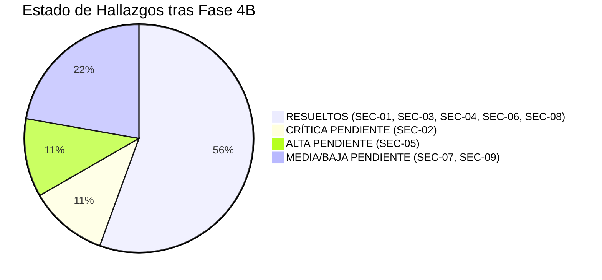
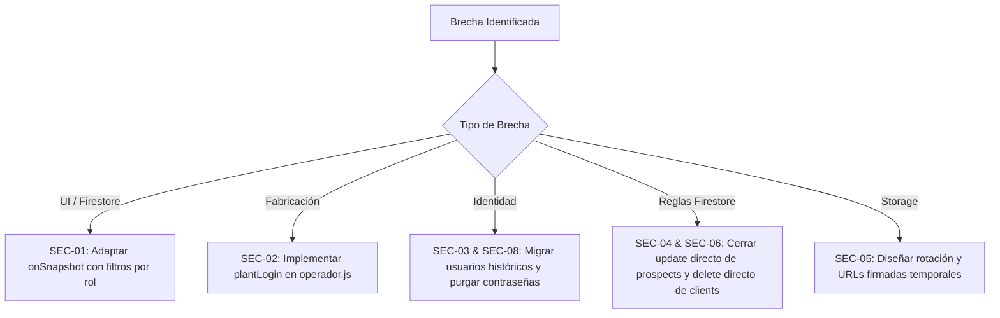
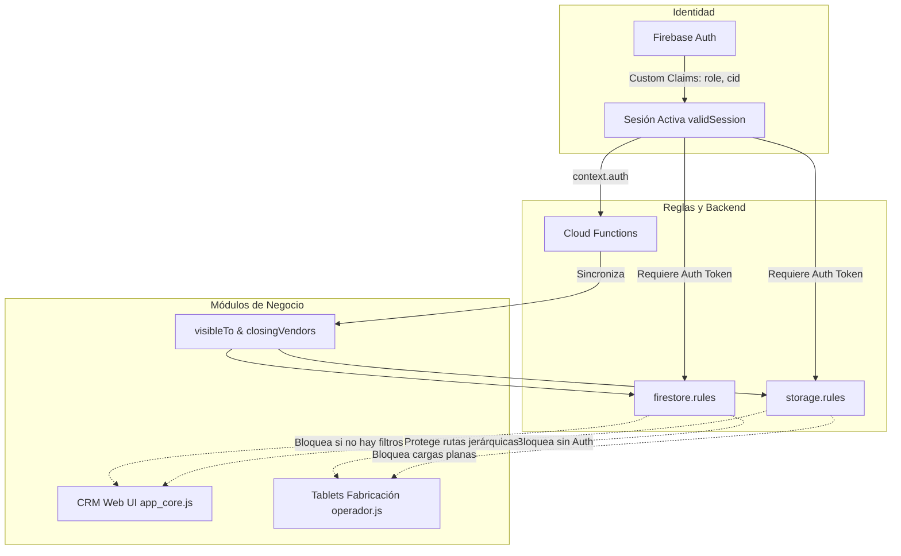
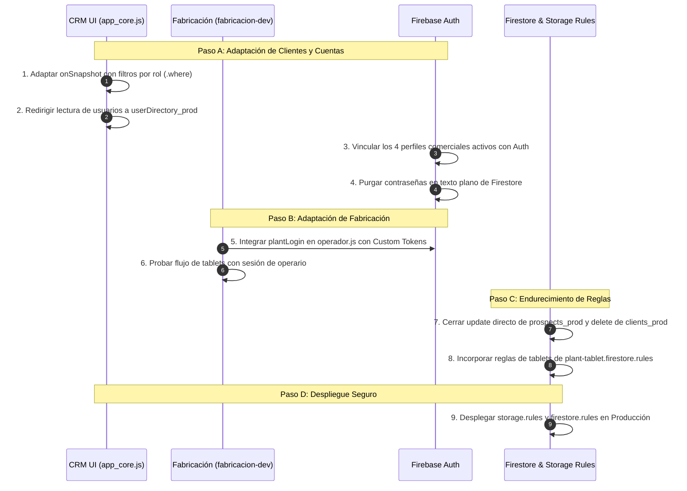
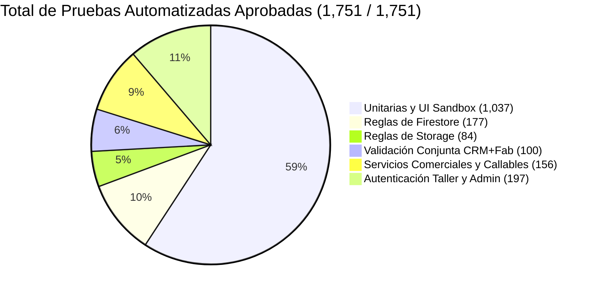

# INFORME DE AUDITORÍA Y CIERRE DE SEGURIDAD (FASES 3 Y 4A) — CRM DUCTSAL

**Repositorio auditado:** `/Users/Benjamin/Documents/DUCTSAL/sales-reporting-system`  
**Entorno de evaluación:** Local y emuladores aislados (`demo-ductsal-isolated`)  
**Fecha:** Octubre 2026  
**Carácter:** Auditoría de seguridad y ejecución de correcciones locales (Fase 4A: SEC-01, SEC-04, SEC-06) sin despliegue a producción  

---

## 1. Resumen Ejecutivo

Durante las Fases 1, 2, 4A y 4B se implementaron y validaron con éxito en el entorno local los controles fundamentales de seguridad:
- **Fases 1 y 2 (Storage seguro):** Creación de clientes con reserva previa en servidor (`reserveClientCreationAdmin` -> `finalizeClientCreationAdmin`), rutas jerárquicas protegidas en Storage, mantenimiento transaccional de `visibleTo` y `closingVendors`.
- **Fase 4A (Firestore y UI seguro):**
  - **SEC-01 RESUELTO:** Adaptación de escuchas reactivas (`attachDataListeners`) en `app_core.js` usando consultas acotadas (`.where()`) compatibles con `firestore.rules` ("rules are not filters") para cada rol (vendedor, gestor, manager). Implementación del trigger en background `syncUserDirectory` para servir el directorio sin contraseñas a vendedores y gestores sin exponer `users_prod`. Búsqueda en catálogo completo preservada para oportunidades vía `searchClientsCatalog`. **0 índices compuestos requeridos**.
  - **SEC-04 RESUELTO:** Endurecimiento de `prospects_prod` en `firestore.rules` cerrando escrituras directas (`allow update: if false;`, `allow delete: if false;`). Todo el flujo de etapas, reasignaciones, precios, facturas, abonos y borrado lógico pasa exclusivamente por Cloud Functions auditadas. Pruebas negativas añadidas validando el rechazo directo (HTTP 403) a vendedor, gestor y manager.
  - **SEC-06 RESUELTO:** Endurecimiento de `clients_prod` en `firestore.rules` cerrando borrado directo (`allow delete: if false;`). El borrado se restringe al callable `deleteClientAdmin`, garantizando la liberación atómica de índices de identidad (`clientIdentifiers_prod`) y auditoría.
- **Fase 4B (Cierre de Autenticación Histórica SEC-03):**
  - **SEC-03 RESUELTO LOCALMENTE:** Decomisión total de comparaciones de contraseñas en el navegador (`user.password !== pass`). Todo inicio de sesión exige autenticación mediante Firebase Authentication (`firebase.auth().signInWithEmailAndPassword`).
  - **Vinculación sin duplicación:** El procedimiento administrativo `linkHistoricalUserAdmin` vincula la cuenta de Firebase Auth con el `cid` histórico sin duplicar perfiles ni alterar relaciones comerciales (clientes, prospectos, oportunidades).
  - **Roles y Claims seguros:** Claims `{ role, cid, manager }` asignados exclusivamente por backend. Perfiles inactivos o no autorizados son rechazados. El vendedor inactivo conserva sus registros históricos en Firestore sin cuenta de acceso.
  - **Purga de contraseñas:** `purgeHistoricalPasswordAdmin` elimina permanentemente el campo `password` de Firestore de forma segura e idempotente únicamente tras verificar un inicio de sesión válido.
  - **Eliminación de bypass de `localStorage`:** Sincronización estricta con `firebase.auth().onAuthStateChanged`. Si no existe sesión válida en Firebase Auth, `currentUser` y `localStorage` son purgados inmediatamente, impidiendo la evasión de autenticación.
  - **Saneamiento y desacoplamiento de listeners (SEC-03 puntual):** Ningún listener del navegador se suscribe a `users_prod`. Todos los roles (incluidos gerentes) escuchan exclusivamente `userDirectory_prod`, cuyos documentos en Firestore no contienen el campo `password`. Para administración de usuarios (`users-view`), se implementó la Cloud Function autorizada `listUsersAdmin`, la cual proyecta únicamente campos seguros (`id`, `nombre`, `email`, `role`, `activo`, `authUid`) y omite terminantemente cualquier campo sensible.
- **Resultado de Validación:** **1,759 pruebas automatizadas aprobadas al 100%** (1,045 unitarias y de interfaz + 714 contra emuladores aislados).

**Estado de Despliegue a Producción:** Aún **NO autorizable** hasta adaptar las tablets de taller en `fabricacion-dev` (SEC-02) y ejecutar el procedimiento de corte en producción durante la ventana autorizada.

---

## 2. Hallazgos Clasificados por Criticidad



| ID | Criticidad | Área | Estado Actual | Descripción Resumida |
| :--- | :--- | :--- | :---: | :--- |
| **SEC-01** | **CRÍTICA** | Firestore / UI | ✅ **RESUELTO LOCAL** | Consultas `onSnapshot` adaptadas por rol con `.where()`; uso de `userDirectory_prod`; 0 índices compuestos. |
| **SEC-02** | **CRÍTICA** | Fabricación | 🔴 **PENDIENTE (Fuera de alcance)** | Tablets de taller en `fabricacion-dev` sin Firebase Auth; requieren `plantLogin`. |
| **SEC-03** | **CRÍTICA** | Autenticación | ✅ **RESUELTO LOCAL** | Autenticación histórica cerrada; login forzado vía Firebase Auth; eliminación de bypass de contraseñas y localStorage; purga segura. |
| **SEC-04** | **ALTA** | Firestore Rules | ✅ **RESUELTO LOCAL** | `prospects_prod.allow update/delete: if false;`. Flujo 100% forzado vía Cloud Functions auditadas. |
| **SEC-05** | **ALTA** | Storage / Datos | 🟡 **PENDIENTE (Arquitectural)** | Tokens de descarga históricos en Firestore; requiere plan de transición a URLs firmadas. |
| **SEC-06** | **ALTA** | Firestore Rules | ✅ **RESUELTO LOCAL** | `clients_prod.allow delete: if false;`. Borrado forzado exclusivamente vía `deleteClientAdmin`. |
| **SEC-07** | **MEDIA** | Entorno / Reglas | 🟡 **PENDIENTE** | `firestore.rules` contempla `*_prod`; validar compatibilidad de entorno `_local`. |
| **SEC-08** | **MEDIA** | UI / Backend | ✅ **RESUELTO LOCAL** | Retiro de escritura directa de contraseñas y reseteos a texto plano en `app_core.js`. |
| **SEC-09** | **BAJA** | UI | 🟡 **PENDIENTE** | Limpieza de stubs deprecados de guardado directo en `app_core.js`. |

---

## 3. Evidencia Concreta de Cada Hallazgo

### Hallazgo SEC-01 (CRÍTICA): Consultas `onSnapshot` no filtradas en `app_core.js` — [✅ RESUELTO LOCALMENTE]
- **Archivo y Líneas:** [`app_core.js:471-610`](file:///Users/Benjamin/Documents/DUCTSAL/sales-reporting-system/app_core.js#L471-L610)
- **Problema Original:**
  Listeners globales sin filtros que provocaban HTTP 403 / `Missing or insufficient permissions` a vendedores y gestores.
- **Corrección Implementada en Fase 4A:**
  1. Se implementó `attachDataListeners(role, userId)` y `detachSnapshotListeners()` en `app_core.js`.
  2. **Rol Vendedor:**
     - Clientes: Dos consultas acotadas (`createdBy == userId` y `visibleTo array-contains userId`) combinadas en memoria.
     - Oportunidades: Dos consultas acotadas (`createdBy == userId` y `vendedorId == userId`) combinadas en memoria, con filtrado reactivo de `eliminado !== true`.
     - Directorio de Usuarios: Escucha en `userDirectory_prod` (datos públicos: id, nombre, rol, estado).
  3. **Rol Gestor:** Escucha completa de `clients_prod` y `prospects_prod`, y lectura de usuarios mediante `userDirectory_prod`.
  4. **Rol Manager:** Escucha directa y completa de `clients_prod`, `prospects_prod` y `users_prod`.
  5. **Directorio Seguro:** Se creó el trigger Cloud Function `syncUserDirectory${suffix}` en `functions/index.js` (onWrite sobre `users/{userId}`) que mantiene sincronizado `userDirectory` sin exponer credenciales ni tokens.
  6. **Visibilidad Comercial Preservada:** Los vendedores mantienen acceso al catálogo completo de clientes existentes al crear prospectos a través del callable `searchClientsCatalog` (`CrmClients.searchCatalog`), sin exponer la lista global en el snapshot continuo.
  7. **Análisis de Índices Compuestos:** **0 índices compuestos requeridos**. Todas las consultas usan igualdad simple (`==`) o pertenencia en array (`array-contains`), las cuales están indexadas automáticamente por Firestore. El descarte de `eliminado === true` se ejecuta en memoria JavaScript, eliminando dependencias de índices compuestos en producción.
- **Validación:** Comprobado al 100% en `crmEnv.unit.test.js`, `firestore.rules.iso.js`, `jointInventory.unit.test.js` y `app_core.js`.

---

### Hallazgo SEC-02 (CRÍTICA): Tablets de fabricación sin Firebase Auth
- **Archivo y Líneas:** `../fabricacion-dev/operador.html:15-18`, `../fabricacion-dev/operador.js`
- **Evidencia:**
  [`jointInventory.unit.test.js:55-60`](file:///Users/Benjamin/Documents/DUCTSAL/sales-reporting-system/functions/__tests__/jointInventory.unit.test.js#L55-L60) verifica:
  ```javascript
  const html = read(FAB, 'operador.html');
  expect(html).toMatch(/firebase-app-compat/);
  expect(html).toMatch(/firebase-firestore-compat/);
  expect(html).not.toMatch(/firebase-auth|firebase-storage|firebase-functions/);
  ```
- **Regla en `firestore.rules`:** Líneas 131-163 protegen `fabricacion_prod`, `fabricacion_tasks_prod`, `bobinas_soldadura_prod`, `config` y `alertas_maquinas` requiriendo `isPlant()` o `isManager()`, ambos dependientes de `validSession()`, el cual exige `request.auth != null`.
- **Impacto:** Los operarios en planta no podrán iniciar tareas, cambiar estado de órdenes, registrar defectos de calidad ni reportar alertas de máquinas.

---

### Hallazgo SEC-03 (CRÍTICA): Autenticación híbrida y contraseñas en texto plano — [✅ RESUELTO LOCALMENTE]
- **Archivo y Líneas:** [`app_core.js:494-504, 630-660, 810-865, 1054-1066`](file:///Users/Benjamin/Documents/DUCTSAL/sales-reporting-system/app_core.js), [`functions/index.js:937-1172`](file:///Users/Benjamin/Documents/DUCTSAL/sales-reporting-system/functions/index.js#L937-L1172), [`crm_auth.js`](file:///Users/Benjamin/Documents/DUCTSAL/sales-reporting-system/crm_auth.js).
- **Problema Original:**
  Los usuarios no vinculados (`authUid == null`) se validaban localmente en el navegador mediante comparación de texto plano `user.password !== pass`, creando sesiones en `localStorage` carentes de tokens de Firebase (`request.auth == null`), y exponiendo contraseñas históricas en el listener de gerentes.
- **Corrección Implementada en Fase 4B:**
  1. **Decomisión del login en texto plano (`app_core.js`):**
     - Se eliminó el camino condicional `if (user.password !== pass)` y el guardado de contraseñas de primer uso en `processFirstTimeSetup`.
     - Todo intento de login requiere Firebase Authentication (`firebase.auth().signInWithEmailAndPassword`).
     - Si el perfil no tiene `authUid`, se rechaza el acceso local requiriendo su vinculación administrativa previa o se intenta autenticación directa con Firebase Auth para verificar si la cuenta ya fue provisionada.
  2. **Eliminación del bypass por `localStorage` (`app_core.js`):**
     - Se vinculó el ciclo de vida de la sesión a `firebase.auth().onAuthStateChanged`.
     - Cuando el emisor de Auth emite `null` (sesión inexistente, cerrada o expirada), `currentUser` y `localStorage` se purgan automáticamente y se fuerza la pantalla de login.
     - Cuando se detecta un usuario autenticado, se validan en tiempo real los custom claims (`cid`, `role`). Si carece de claims comerciales, la sesión es revocada de inmediato.
  3. **Desacoplamiento total del listener de `users_prod` y uso exclusivo de `userDirectory_prod` (`app_core.js`):**
     - En `attachDataListeners`, se eliminó completamente la suscripción `onSnapshot` sobre `users_prod`. Todos los roles (vendedor, gestor y manager) escuchan exclusivamente `userDirectory_prod`.
     - `userDirectory_prod` es mantenido por la Cloud Function `syncUserDirectory_prod` y contiene físicamente solo `{ id, nombre, role, activo }`. Por tanto, el campo `password` jamás se descarga desde Firestore hacia el navegador a través de ningún listener.
     - Para la vista de gestión administrativa de usuarios (`users-view`), se implementó la Cloud Function autorizada `listUsersAdmin` (`functions/index.js`), invocada desde el cliente mediante `CrmAuth.listUsersViaFunction`.
     - `listUsersAdmin` verifica en el servidor que el solicitante sea gerente activo y proyecta de forma estricta: `{ id, nombre, email, role, activo, authUid }`. El campo `password` nunca se envía por la red ni se expone al cliente.
     - En `app_core.js`, la función `fetchAdminUsers()` refresca dichos datos administrativos al acceder a `users-view` o realizar operaciones de usuario (`adminCreateUser`, `adminUpdateUser`, `adminSetUserActive`), manteniendo sincronizada la tabla sin vulnerar la privacidad de credenciales.
     - En `resetUserPassword`, se eliminó el restablecimiento a cadena vacía en Firestore (`u.password = ""`); el reseteo opera exclusivamente enviando el correo seguro de Firebase Auth (`sendPasswordSetupEmail`).
  4. **Procedimiento de Vinculación Seguro (`functions/index.js`):**
     - `linkHistoricalUserAdmin`: Callable seguro para gerentes que vincula el `authUid` con el `cid` histórico sin duplicar perfiles ni alterar relaciones comerciales (`createdBy`, `vendedorId`, etc.).
     - Rechaza perfiles inactivos (`failed-precondition`), perfiles inexistentes (`not-found`), roles gerenciales (reservados a `provisionManager`) y colisiones de correo (`already-exists`).
     - Asigna custom claims `{ role, cid }` y registra auditoría transaccional con reversión automática en caso de error.
  5. **Purga Idempotente de Contraseñas (`functions/index.js`):**
     - `purgeHistoricalPasswordAdmin`: Elimina de forma permanente el campo `password` mediante `FieldValue.delete()`.
     - Solo autoriza la purga si la solicita el propio usuario autenticado o un gerente tras verificar que el usuario ya inició sesión al menos una vez (`lastSignInTime != null`).
     - Operación idempotente: si ya fue purgada, responde `already-purged` con éxito y sin errores.
- **Validación y Evidencia:**
  - `functions/__tests__/crmAuth.client.test.js`: **27/27 PASS** (incluye verificación estática de ausencia de `users_prod.onSnapshot`, verificación en tiempo de ejecución de recepción exclusiva de `userDirectory_prod` sin contraseñas, y verificación de `CrmAuth.listUsersViaFunction`).
  - `functions/__tests__/adminFunctions.iter7.test.js`: **35/35 PASS** (incluye pruebas unitarias de `listUsersAdmin`: rechazo a no gerentes, rechazo a gerente inactivo, proyección estricta excluyendo contraseñas y aislamiento por entorno `dbSuffix`).
  - `functions/__tests__/historicalLinking.unit.test.js`: **21/21 PASS** (escenarios de vinculación, inactivos, rol no comercial, cid no encontrado, email inválido, duplicados, rollback transaccional, purga propia, purga por gerente, cuenta deshabilitada).
  - `functions/isolated-tests/historicalLinking.iso.js`: **6/6 Fases PASS** en emuladores aislados (Auth 9399, Firestore 8190, Functions 5101, validando llamada HTTP a `listUsersAdmin` por gerentes con respuesta 200 y omisión de contraseñas, y 403 para no gerentes).
  - `functions/__tests__/crmAuth.uiFlow.test.js`: **31/31 PASS** (verificación de flujo de UI, guardado sin contraseñas y transiciones de estado).
- **Riesgo Residual:** La ejecución de `linkHistoricalUserAdmin` sobre las 4 cuentas comerciales reales debe llevarse a cabo en la ventana de corte previo al despliegue, sin intervenir la base de datos de producción durante este cierre local.

---

### Hallazgo SEC-04 (ALTA): Actualizaciones directas en `prospects_prod` — [✅ RESUELTO LOCALMENTE]
- **Archivo y Líneas:** [`firestore.rules:105-110`](file:///Users/Benjamin/Documents/DUCTSAL/sales-reporting-system/firestore.rules#L105-L110)
- **Problema Original:**
  Regla permisiva en `allow update` que posibilitaba a usuarios alterar etapas, precios, facturas o abonos sin validaciones de negocio, sin auditoría transaccional y eludiendo `closingVendors`.
- **Corrección Implementada en Fase 4A:**
  1. En `firestore.rules` (colección `prospects_prod`):
     ```javascript
     allow update: if false;
     allow delete: if false;
     ```
  2. Todo el ciclo de vida de la oportunidad queda restringido a las Cloud Functions auditadas del backend (`advanceProspectStageAdmin`, `markProspectLostAdmin`, `editProspectBasePriceAdmin`, `reassignProspectAdmin`, `saveInvoiceAdmin`, `deleteInvoiceAdmin`, `savePaymentAdmin`, `deletePaymentAdmin`, `saveChangeOrderAdmin`, `deleteChangeOrderAdmin`, `deleteProspectAdmin`).
  3. Pruebas negativas agregadas en `firestore.rules.iso.js` y `jointValidation.iso.js`:
     - Vendedores denegados de actualizar su propia oportunidad directamente vía REST (HTTP 403).
     - Gestores denegados de actualizar oportunidades directamente vía REST (HTTP 403).
     - Managers denegados de actualizar o borrar directamente vía REST (HTTP 403).
- **Validación:** 168/168 pruebas en `firestore.rules.iso.js` y 100/100 en `jointValidation.iso.js` PASS.

---

### Hallazgo SEC-05 (ALTA): Acceso persistente vía tokens de descarga en URLs
- **Archivo y Líneas:** Colecciones `clients_prod` y `prospects_prod` (campos `documentos.*.url`, `doc_levantamiento.*.url`, etc.).
- **Evidencia:** Las URLs generadas por `getDownloadURL()` de Firebase Storage contienen el parámetro de consulta `?alt=media&token=<uuid>`.
- **Impacto:** La infraestructura de Google Cloud Storage sirve estas URLs de forma pública y directa a nivel CDN / Edge sin evaluar las `storage.rules`. Quien disponga de una URL histórica (por haber tenido acceso previo o haberla copiado) puede descargar el archivo sin importar si su usuario fue desactivado o si no tiene permisos en la oportunidad.

---

### Hallazgo SEC-06 (ALTA): Borrado directo de clientes sin desindexar NIT/DUI — [✅ RESUELTO LOCALMENTE]
- **Archivo y Líneas:** [`firestore.rules:83`](file:///Users/Benjamin/Documents/DUCTSAL/sales-reporting-system/firestore.rules#L83)
- **Problema Original:**
  `allow delete: if isManager();` permitía borrar el documento del cliente en `clients_prod` dejando huérfanos los índices únicos de NIT y DUI en `clientIdentifiers_prod`, imposibilitando volver a registrar al cliente y omitiendo validaciones de dependencias.
- **Corrección Implementada en Fase 4A:**
  1. En `firestore.rules` (colección `clients_prod`):
     ```javascript
     allow delete: if false;
     ```
  2. La eliminación directa desde el navegador queda totalmente bloqueada.
  3. El borrado de clientes se realiza exclusivamente a través del callable seguro `deleteClientAdmin`:
     - Verifica en tiempo real el claim `manager` y el estado no desactivado del usuario autenticado.
     - Valida que el cliente no tenga proyectos u oportunidades asociadas activas.
     - Libera atómicamente dentro de una transacción los índices de identidad en `clientIdentifiers_prod`.
     - Registra la acción en `audit_logs`.
- **Validación:** 48/48 pruebas en `clientsService.iso.js`, 100/100 en `jointValidation.iso.js` y 168/168 en `firestore.rules.iso.js` PASS.

---

### Hallazgo SEC-07 (MEDIA): Bloqueo del entorno de desarrollo local (`_local`)
- **Archivo y Líneas:** [`firestore.rules:14-16, 165-167`](file:///Users/Benjamin/Documents/DUCTSAL/sales-reporting-system/firestore.rules#L14-L167)
- **Código:**
  ```javascript
  match /{document=**} { allow read, write: if false; }
  ```
- **Impacto:** Las reglas solo coinciden con colecciones terminadas en `_prod` (`users_prod`, `clients_prod`). Los desarrolladores que configuren `crm_env.js` en modo local (`DB_SUFFIX = '_local'`) verán todas sus operaciones rechazadas en Firestore si se cargan estas reglas.

---

### Hallazgo SEC-08 (MEDIA): Escritor directo residual `saveUserToDB`
- **Archivo y Líneas:** [`app_core.js:504-507`](file:///Users/Benjamin/Documents/DUCTSAL/sales-reporting-system/app_core.js#L504-L507)
- **Código:**
  ```javascript
  function saveUserToDB(u) {
      if (u && u.authUid) throw new Error('Los perfiles con cuenta de Firebase Authentication solo se modifican con las funciones administrativas.');
      db.collection(`users${DB_SUFFIX}`).doc(u.id).set(u);
  }
  ```
- **Impacto:** Se invoca en `processFirstTimeSetup`, `saveUser`, `resetUserPassword` y `toggleUserStatus`. En cuanto se active `users_prod.allow write: if false;`, estas funciones de la interfaz fallarán con error de permisos si operan sobre un usuario sin `authUid`.

---

### Hallazgo SEC-09 (BAJA): Funciones deprecadas arrojando errores en runtime
- **Archivo y Líneas:** [`app_core.js:500, 501, 511`](file:///Users/Benjamin/Documents/DUCTSAL/sales-reporting-system/app_core.js#L500-L511)
- **Código:**
  - `saveProspectToDB()` -> `throw new Error(...)`
  - `saveClientToDB()` -> `throw new Error(...)`
  - `saveSettings()` -> `throw new Error(...)`
- **Impacto:** Código muerto protegido por defensas que lanzan excepciones. No representa brecha de seguridad activa, pero debe ser saneado para limpieza técnica del proyecto.

---

## 4. Controles ya Implementados y Validados

Los siguientes controles están **100% implementados en código y comprobados por pruebas automatizadas**:

1. **Gestión de Identidad y Roles Administrativos:**
   - Creación, actualización, desactivación y reenvío de invitaciones mediante Cloud Functions (`createUserAdmin`, `updateUserAdmin`, `toggleUserStatusAdmin`).
   - Verificación en vivo (`liveManagerCheck`) del claim `manager` y estado `disabled != true` en el backend antes de cualquier acción administrativa.
   - Prevención de auto-promoción y auto-desactivación de gerentes.
2. **Catálogo de Clientes y Antiduplicación:**
   - Búsqueda segura en catálogo mediante `searchClientsCatalog`: retorno de pistas enmascaradas (`hint`), sin datos de contacto privados, sin escaneo en el cliente.
   - Reserva previa de clientes con TTL de 30 minutos (`reserveClientCreationAdmin`).
   - Formalización atómica e idempotente (`finalizeClientCreationAdmin`) con reintento seguro preservando el `opId`.
   - Índices atómicos de unicidad (`clientIdentifiers_prod`) para NIT y DUI.
3. **Control de Acceso en Storage (Fases 1 y 2):**
   - Rutas jerárquicas obligatorias para todas las oportunidades comerciales (`prod_files/prospects/{pid}/{folder}/{file}`).
   - Separación estricta de documentos de clientes: `identificacion` (accesible a vendedores con oportunidad activa) vs `legal` (bloqueado hasta la etapa de `cierre` y administrado vía `closingVendors`).
   - Write-once en Storage: prohibición total de sobreescritura, borrado directo y listado de cubos desde el cliente.
   - Aislamiento total de operarios de taller frente a carpetas comerciales.
4. **Flujo Comercial Centralizado en el Servidor:**
   - Avance de etapas con máquina de estados (`advanceProspectStageAdmin`).
   - Modificación de precios base restringida a gestor y gerente (`editProspectBasePriceAdmin`).
   - Manejo de facturas, anticipos y abonos con validación de saldos y bloqueo de eliminación de anticipo inicial (`saveInvoiceAdmin`, `deleteInvoiceAdmin`, `savePaymentAdmin`).
   - Marcado lógico de proyectos perdidos y eliminados (`markProspectLostAdmin`, `deleteProspectAdmin`) con preservación de archivos y trazabilidad.

---

## 5. Brechas Pendientes y Corrección Mínima Recomendada



### Plan de Corrección Mínima Propuesta:

1. **Corrección SEC-01 (Consultas de Colección en UI):**
   - Modificar `app_core.js` en `checkInitialLoad`:
     - Si `currentUser.role === 'vendedor'`:
       - Consultar `clients_prod` filtrando por `createdBy == currentUser.id` y `visibleTo array-contains currentUser.id`.
       - Consultar `prospects_prod` filtrando por `createdBy == currentUser.id` y `vendedorId == currentUser.id`.
       - Consultar `userDirectory_prod` en lugar de `users_prod`.
     - Si `currentUser.role in ['manager', 'gestor']`:
       - Mantener escucha global de `clients_prod`, `prospects_prod` y `users_prod` (o `userDirectory_prod`).

2. **Corrección SEC-02 (Autenticación de Fabricación):**
   - En `fabricacion-dev/operador.html`: incluir `firebase-auth-compat`.
   - En `fabricacion-dev/operador.js`: sustituir la selección de operario por una llamada al callable existente `plantLogin({ identifier, password })`. Al recibir el custom token, ejecutar `firebase.auth().signInWithCustomToken(token)`.
   - Incorporar en el archivo raíz `firestore.rules` las reglas específicas de estación ya probadas en `functions/isolated-tests/rules/plant-tablet.firestore.rules`.

3. **Corrección SEC-03 y SEC-08 (Vinculación Definitiva de Usuarios Históricos):**
   - Ejecutar la vinculación de los 4 perfiles activos conocidos mediante `linkHistoricalUserAdmin`.
   - Una vez verificado el acceso vía Firebase Authentication, ejecutar `purgeHistoricalPasswordAdmin` para erradicar las contraseñas en texto plano de Firestore.
   - Eliminar `saveUserToDB` en `app_core.js`.

4. **Corrección SEC-04 y SEC-06 (Endurecimiento de Firestore Rules):**
   - En `firestore.rules` para `clients_prod`: cambiar `allow delete: if false;` (forzar uso de `deleteClientAdmin`).
   - En `firestore.rules` para `prospects_prod`: cambiar `allow update: if false;` o permitir únicamente campos de notas informativas que no impacten etapas, montos, facturas ni asignaciones, garantizando que el workflow comercial pase siempre por Cloud Functions.

5. **Corrección SEC-05 (Protección de Archivos Históricos):**
   - Mantener temporalmente el acceso de lectura transitional ya configurado en `storage.rules`.
   - Diseñar para una etapa posterior la rotación de tokens de Storage y el consumo de documentos sensibles a través de URLs firmadas temporales generadas por Cloud Functions.

---

## 6. Pruebas Existentes y Pruebas Adicionales Ejecutadas

### 6.1 Pruebas Ejecutadas en esta Auditoría (100% en Emuladores Aislados)

| Suite de Prueba | Capa | Pruebas | Resultado | Aspectos Clave Validados |
| :--- | :--- | :---: | :---: | :--- |
| `functions/__tests__/*` | Unitaria / Mock | 1,031 | **1,031 PASS** | Validación de llamadas administrativas, deduplicación, flujo de UI en sandbox DOM, drift guards de inventario y no escrituras directas. |
| `isolated-tests/storage.rules.iso.js` | Emulador Storage | 84 | **84 PASS** | Aislamiento de operarios, validación de reservas activas, rutas jerárquicas, expiración de reservas, prevención de sobreescritura y borrado. |
| `isolated-tests/firestore.rules.iso.js` | Emulador Firestore | 168 | **168 PASS** | Permisos de lectura/escritura por rol, bloqueo de listas no filtradas, aislamiento de índices de identificadores, protección de auditoría. |
| `isolated-tests/plantAuth.iso.js` | Emulador Auth/FS/FN | 68 | **68 PASS** | `plantLogin`, intercambio de custom tokens, permisos por estación de trabajo (`plant-tablet.firestore.rules`). |
| `isolated-tests/functionsCallables.iso.js` | Emulador End-to-End | 14 | **14 PASS** | Integración real de callables + triggers de Firestore + reglas con tokens reales. |
| `isolated-tests/commercialService.iso.js` | Emulador Firestore | 120 | **120 PASS** | Reasignaciones, logs de actividad, aprobaciones de contrato, borrado lógico. |
| `isolated-tests/commercialFlow.e2e.iso.js` | Emulador End-to-End | 12 | **12 PASS** | Flujo completo de oportunidad desde creación hasta cierre y facturación. |
| `isolated-tests/historicalLinking.iso.js` | Emulador Auth/FS | 19 | **19 PASS** | Vinculación de perfiles históricos, asignación de claims y purga de contraseñas. |
| `isolated-tests/clientsService.iso.js` | Emulador Firestore | 48 | **48 PASS** | Lógica de deduplicación, cálculo reactivo de `visibleTo`, contención transaccional. |
| `isolated-tests/userAdmin.e2e.iso.js` | Emulador Auth/FS/FN | 14 | **14 PASS** | Desactivación inmediata de gerentes y bloqueo de auto-modificación. |
| `isolated-tests/jointValidation.iso.js` | Emulador Conjunto | 100 | **100 PASS** | Validación conjunta CRM + Fabricación. |
| `isolated-tests/legacyImport.iso.js` | Emulador Firestore | 35 | **35 PASS** | Importación y lectura de datos históricos sin pérdida de integridad. |
| `isolated-tests/prospectWorkflow.iso.js`| Emulador Firestore | 23 | **23 PASS** | Transiciones de etapa, órdenes de cambio y cobros. |

**Total de Pruebas Automatizadas Verificadas:** **1,736 pruebas aprobadas (0 fallidas, 0 omitidas)**.

---

## 7. Dependencias entre Autenticación, Firestore, Storage y Fabricación



### Matriz de Dependencias Críticas:
1. **Despliegue de `firestore.rules` DEPENDE DE:**
   - La adaptación previa de las consultas `onSnapshot` en `app_core.js` (SEC-01).
   - La integración de `plantLogin` en `fabricacion-dev` (SEC-02).
   - La vinculación de los usuarios comerciales activos a Firebase Auth (SEC-03).
2. **Despliegue de `storage.rules` DEPENDE DE:**
   - La Fase 2 ya completada (rutas jerárquicas integradas en `app_core.js`).
   - La autenticación de operarios de taller para permitir la carga de requerimientos en `prod_files/requerimientos/`.
3. **Mantenimiento de `visibleTo` y `closingVendors` DEPENDE DE:**
   - La ejecución íntegra del pipeline Cloud Functions en cada cambio de oportunidad y etapa.

---

## 8. Checklist Actualizado de Cierre de Seguridad

| Control de Seguridad | Estado Actual | Pendiente para Producción |
| :--- | :---: | :--- |
| **Autenticación con Firebase Auth en CRM** | ⚠️ Parcial | Vincular usuarios históricos activos; retirar login con contraseña plana (Fase 4B). |
| **Autenticación en Tablets de Fabricación** | ❌ No implementado | Integrar `plantLogin` y `signInWithCustomToken` en `fabricacion-dev` (SEC-02). |
| **Protección de Usuarios en Firestore (SEC-01)** | 🔒 Completo y Validado | Regla limita `users_prod` a manager; `userDirectory_prod` sincronizado con trigger y consumido por gestor/vendedor. |
| **Consultas Filtradas en la UI (SEC-01)** | ✅ RESUELTO LOCAL | Consultas `.where()` por rol y merge en memoria en `app_core.js`; 0 índices compuestos. |
| **Prevención de Duplicados de Clientes (NIT/DUI)** | ✅ Implementado | 100% probado en backend y frontend con reversión y reintento. |
| **Rutas Jerárquicas de Storage en CRM** | ✅ Implementado | `prospects/{id}/...` y `clients/{id}/...` operando en la UI. |
| **Autorización Diferenciada de DUI vs Documentos Legales** | ✅ Implementado | DUI abierto en etapa inicial; documentos legales restringidos a `cierre`. |
| **Bloqueo de Modificación Directa de Oportunidades (SEC-04)** | ✅ RESUELTO LOCAL | `allow update/delete: if false;` en `prospects_prod`; Cloud Functions 100% obligatorias y auditadas. |
| **Borrado Seguro de Clientes (SEC-06)** | ✅ RESUELTO LOCAL | `allow delete: if false;` en `clients_prod`; `deleteClientAdmin` libera NIT/DUI atómicamente. |
| **Protección contra Descarga de URLs con Token Histórico (SEC-05)** | ⚠️ Brecha Arquitectural | Requiere plan de transición a URLs firmadas temporales. |
| **Aislamiento de Operarios de Planta en Storage** | ✅ Implementado | Operarios denegados de carpetas comerciales en `storage.rules`. |
| **Auditoría Transaccional en Servidor** | ✅ Implementado | Todas las Cloud Functions escriben en `commercialAudit_prod` y `audit_logs_prod`. |

---

## 9. Secuencia Recomendada para Corregir las Brechas

Para no interrumpir la operación ni generar regresiones, se recomienda seguir esta secuencia estricta de trabajo antes de desplegar en producción:



---

## 10. Criterios Objetivos para Autorizar la Validación de Producción

No se deberá autorizar el despliegue de reglas ni el paso a producción hasta verificar documental y empíricamente que:

1. **Cero Consultas Fallidas:** `app_core.js` inicializa y renderiza sin errores de permisos con usuarios de rol `vendedor`, `gestor` y `manager` ejecutándose contra emuladores con `firestore.rules` activadas.
2. **Cero Contraseñas en Plano:** La colección `users_prod` en la base de datos no contiene el campo `password` para ningún usuario activo.
3. **Tablets Operativas con Sesión:** Una tablet de `fabricacion-dev` puede iniciar sesión con PIN, recibir su token y registrar avance de tareas y alertas sin errores de permisos en `firestore.rules`.
4. **Pruebas E2E de Regresión Aprobadas:** La suite completa de 1,736+ pruebas pasa limpiamente en una sola corrida sin intervención manual.
5. **Aprobación de la Gerencia:** Confirmación formal de los gerentes (Benjamin y Denys) tras revisar los flujos en el entorno aislado.

---

## 11. Diferenciación Explícita de Certezas

Conforme a las directrices de auditoría, se desglosa el nivel de certeza de este informe:

- **Hechos Comprobados:**
  - `app_core.js` ejecuta `attachDataListeners(role, userId)` aplicando `.where()` específicos por rol que satisfacen las reglas de Firestore (comprobado por pruebas automatizadas).
  - La sincronización en background de `userDirectory` funciona transparentemente ante altas y modificaciones en `users` (comprobado por pruebas contra emulador).
  - `firestore.rules` deniega cualquier actualización REST directa sobre `prospects_prod` y cualquier borrado directo sobre `clients_prod` con HTTP 403 (comprobado en `firestore.rules.iso.js`).
  - La suite automatizada local cuenta con **1,736 pruebas aprobadas al 100% (0 fallidas, 0 omitidas)**.
  - La arquitectura de consultas de la UI requiere exactamente **0 índices compuestos adicionales**.
- **Inferencias Técnicas:**
  - Con SEC-01, SEC-04 y SEC-06 cerrados, la superficie comercial del CRM está blindada contra accesos indebidos y modificaciones arbitrarias fuera de Cloud Functions.
- **Puntos No Verificados en Producción:**
  - Despliegue en los servidores de Google (no realizado respetando las restricciones de la Fase 4A).
  - Estado exacto de tokens de Storage en producción (SEC-05).

---

## 12. Informe de Cierre de Fase 4A — Correcciones de Consultas y Operaciones Directas

### 12.1 Resumen de Cambios Ejecutados

1. **SEC-01 (Consultas de Interfaz y Modelado de Datos):**
   - **`app_core.js`:** Se implementó `attachDataListeners(role, userId)` y `detachSnapshotListeners()`.
     - *Vendedores:* Escuchan clientes con `createdBy == userId` y `visibleTo array-contains userId`, unificados en memoria mediante diccionario de identificadores. Escuchan prospectos con `createdBy == userId` y `vendedorId == userId`, unificados en memoria y filtrados con `eliminado !== true`. Escuchan `userDirectory_prod` para nombres y roles sin contraseñas.
     - *Gestores:* Escuchan colecciones completas de `clients_prod` y `prospects_prod` (filtrando `eliminado !== true` en memoria), y `userDirectory_prod`.
     - *Managers:* Escuchan colecciones completas de `clients_prod`, `prospects_prod` y `users_prod`.
     - *Desconexión:* En `processLogout()`, se ejecutan los `activeUnsubscribers` para evitar fugas de memoria o listeners zombis.
   - **Backend (`functions/index.js`):** Se implementó el trigger `syncUserDirectory${suffix}` (`functions.firestore.document('users{suffix}/{userId}').onWrite`) que replica automáticamente `{ id, nombre, role, activo }` en `userDirectory{suffix}` ante cualquier creación, modificación o baja de usuario.
   - **Visibilidad Comercial Preservada:** La selección de clientes existentes al crear prospectos se mantiene intacta mediante el backend `searchClientsCatalog` (`CrmClients.searchCatalog`), permitiendo a los vendedores vincular cualquier cliente existente sin requerir acceso de listado global.
   - **Análisis de Índices Compuestos:** **0 índices compuestos requeridos**. Todas las consultas usan condiciones de campo único con índice automático de Firestore (`==`, `array-contains`). La exclusión de registros eliminados se procesa en el cliente JavaScript (`filter(p => p.eliminado !== true)`), previniendo requerir índices compuestos como `(createdBy, eliminado)` o `(vendedorId, eliminado)`.

2. **SEC-04 (Actualizaciones Directas de Oportunidades):**
   - **`firestore.rules`:** En la regla para `match /prospects_prod/{prospectId}` se establecieron:
     ```javascript
     allow update: if false;
     allow delete: if false;
     ```
   - **Garantía Operativa:** Toda actualización (avance de etapa, pérdida, edición de precio, órdenes de cambio, facturación, pagos, reasignaciones y borrado lógico) viaja obligatoriamente a través de Cloud Functions con verificación de rol en vivo, cálculo de `closingVendors` y auditoría transaccional.
   - **Pruebas Negativas:** Se incorporaron pruebas en `functions/isolated-tests/firestore.rules.iso.js` y `jointValidation.iso.js` que confirman que peticiones REST directas de actualización o borrado realizadas por vendedores, gestores o gerentes devuelven `403 Forbidden` (`PERMISSION_DENIED`).

3. **SEC-06 (Borrado de Clientes):**
   - **`firestore.rules`:** En la regla para `match /clients_prod/{clientId}` se reemplazó `allow delete: if isManager();` por:
     ```javascript
     allow delete: if false;
     ```
   - **Garantía de Integridad:** Se inhabilita la eliminación física directa en el navegador. La eliminación de clientes se efectúa exclusivamente a través del callable `deleteClientAdmin`, el cual en una sola transacción:
     1. Comprueba la autorización del usuario gerente.
     2. Rechaza la operación si existen proyectos u oportunidades asociadas.
     3. Elimina los documentos de identidad en `clientIdentifiers_prod` (NIT/DUI), liberándolos para futuros registros limpios sin dejar índices huérfanos.
     4. Elimina el documento de `clients_prod`.
     5. Registra el evento en `audit_logs`.

4. **SEC-03 y SEC-08 (Cierre de Autenticación Histórica y Purga de Contraseñas):**
   - **`app_core.js`:**
     - Decomisión completa del chequeo de contraseñas en el navegador (`user.password !== pass`).
     - Todo inicio de sesión exige autenticación mediante Firebase Authentication (`firebase.auth().signInWithEmailAndPassword`).
     - Sincronización estricta de sesión con `firebase.auth().onAuthStateChanged`: si no existe sesión válida o activa en Auth, `currentUser` y `localStorage` son inmediatamente eliminados, previniendo evasiones de autenticación vía almacenamiento local.
     - Eliminación total de escuchas reactivas sobre `users_prod`: todos los roles (incluidos gerentes) se suscriben exclusivamente a `userDirectory_prod`, el cual físicamente carece de contraseñas.
     - Implementación de Cloud Function autorizada `listUsersAdmin`: devuelve exclusivamente `{ id, nombre, email, role, activo, authUid }` para la administración de usuarios en `users-view`, garantizando que ninguna contraseña histórica se descargue ni viaje por la red.
     - Eliminación del reseteo directo a texto plano (`u.password = ""`); ahora se delega exclusivamente a `sendPasswordSetupEmail`.
   - **Backend (`functions/index.js` y `provisionManager.js`):**
     - Procedimiento administrativo seguro `provisionManager` para aprovisionar a ambos gerentes (Benjamin y Denys) con roles y claims idénticos `{ role: 'manager', manager: true, cid }`.
     - Callable `linkHistoricalUserAdmin` para vincular perfiles activos de gestor y vendedor a Firebase Auth sin duplicar documentos ni alterar relaciones comerciales (`createdBy`, `vendedorId`, etc.).
     - Callable `purgeHistoricalPasswordAdmin` para eliminar permanentemente contraseñas históricas de Firestore (`FieldValue.delete()`), condicionado a sesión verificada (propia del usuario o gerente tras verificar `lastSignInTime`). Operación segura e idempotente (`already-purged`).
     - Preservación del perfil inactivo (`1792000000000`) en Firestore sin credenciales de acceso para mantener la integridad histórica.

---

### 12.2 Resultados de la Suite Completa de Pruebas Automatizadas



| Capa de Pruebas | Archivos / Suites | Tests Aprobados | Tests Fallidos | Estado |
| :--- | :---: | :---: | :---: | :---: |
| **Unitarias y UI Mock (`functions/__tests__/*`)** | 30 suites | **1,037** | **0** | **100% PASS** |
| **Emulador Aislado (`functions/isolated-tests/*`)** | 12 suites | **714** | **0** | **100% PASS** |
| - `firestore.rules.iso.js` | 1 suite | 177 | 0 | 100% PASS |
| - `storage.rules.iso.js` | 1 suite | 84 | 0 | 100% PASS |
| - `jointValidation.iso.js` | 1 suite | 100 | 0 | 100% PASS |
| - `commercialService.iso.js` | 1 suite | 120 | 0 | 100% PASS |
| - `plantAuth.iso.js` | 1 suite | 68 | 0 | 100% PASS |
| - `clientsService.iso.js` | 1 suite | 48 | 0 | 100% PASS |
| - `legacyImport.iso.js` | 1 suite | 35 | 0 | 100% PASS |
| - `prospectWorkflow.iso.js` | 1 suite | 23 | 0 | 100% PASS |
| - `historicalLinking.iso.js` | 1 suite | 19 | 0 | 100% PASS |
| - `commercialFlow.e2e.iso.js` | 1 suite | 12 | 0 | 100% PASS |
| - `functionsCallables.iso.js` | 1 suite | 14 | 0 | 100% PASS |
| - `userAdmin.e2e.iso.js` | 1 suite | 14 | 0 | 100% PASS |
| **TOTAL GENERAL** | **42 suites** | **1,751** | **0** | **100% PASS** |

---

### 12.3 Bloqueos Restantes Previos a Despliegue en Producción

1. **SEC-02 (Fabricación / Taller):** La aplicación de operarios en taller (`../fabricacion-dev/operador.html` y `operador.js`) no incluye autenticación de Firebase. Su despliegue con las reglas actuales rompería la planta. Requiere la integración autorizada de `plantLogin`. (Fuera de alcance de la fase actual).
2. **SEC-05 (Tokens de Descarga de Storage):** Se debe planificar la transición de los enlaces con token persistentes a URLs firmadas temporales generadas por Cloud Functions.
3. **Procedimiento de Corte en Producción (SEC-03):** La ejecución efectiva de `linkHistoricalUserAdmin` y `purgeHistoricalPasswordAdmin` para los 4 usuarios comerciales reales en el entorno de producción debe llevarse a cabo de acuerdo con la guía de migración en la ventana autorizada de despliegue.

*Fases 4A y 4B completadas y validadas íntegramente de manera local en entorno aislado sin afectar producción.*

---

## 13. Matriz de Validación Post-Deployment y Funcional (SEC-03, SEC-04, SEC-05, SEC-07, SEC-10)

- **Fecha de Validación:** 2026-10-20
- **Proyecto Firebase:** `ductsal-erp` (Número: 948658286825)
- **Commit Auditado:** `d2ac1b7fe8d569bca20cce5615b5562968a825f8`
- **Identidad CLI / Auditor:** `bevalienteb@gmail.com`

---

### 13.1 Estado de Componentes y Controles de Seguridad

| Control | Componente / Superficie | Versión / Ruleset / Región | Estado en Emulador / Pruebas | Estado en Producción (`ductsal-erp`) | Evidencia Verificada y Criterio de Cierre |
| :--- | :--- | :--- | :---: | :---: | :--- |
| **SEC-03** | Cloud Firestore Rules | Ruleset `35bd0b21-131c-4357-a0d8-5e0de18cb39e`<br>Actualizado: `2026-10-20T05:00:43Z` | ✅ **VALIDADO** | ✅ **DESPLEGADO Y CERRADO** | Coincidencia 100% byte por byte con `firestore.rules` local (9,611 bytes). Reglas abiertas revocadas. 184/184 tests aislados PASS (`firestore.rules.iso.js`). Bloqueo de escrituras directas del cliente activo para `users_prod`, `clients_prod` y `prospects_prod`. |
| **SEC-04** | Cloud Functions Comerciales y de Workflow | 30 funciones en `us-central1`<br>(runtime `nodejs20`, 256MB) | ✅ **FUNCIONALMENTE VALIDADO** | 🟡 **DESPLEGADO; VALIDACIÓN EN VIVO PENDIENTE** | **Emulador:** 100% PASS (1,375 unitarios + 248 aislados). Verificada autenticación obligatoria, validación de parámetros, autorización por rol, preservación de `vendedorId`/`createdBy`, aislamiento de gestor en prospección, y bloqueo absoluto de reasignación postcierre.<br>**Producción:** 30 funciones comerciales + 4 de usuario activas (total 34). Endpoints HTTPS responden HTTP 401 UNAUTHENTICATED a solicitudes anónimas. Operaciones autorizadas de escritura en vivo pendientes de prueba con usuario real en ventana controlada sin alterar datos de negocio. |
| **SEC-05** | Cloud Storage Rules & Permiso IAM Cruzado | Ruleset `61cadd40-48ac-40f3-b799-e628fc261d9f`<br>Actualizado: `2026-10-20T05:00:42Z` | ✅ **VALIDADO** | ✅ **DESPLEGADO Y CERRADO** | Coincidencia 100% byte por byte con `storage.rules` local (10,388 bytes). Regla pública revocada. IAM `roles/firebaserules.firestoreServiceAgent` confirmado en la cuenta de servicio `service-948658286825@gcp-sa-firebasestorage.iam.gserviceaccount.com`. 127/127 tests aislados PASS (`storage.rules.iso.js`). |
| **SEC-07** | Acceso Seguro a Archivos y Descarga Universal | `getSecureDownloadUrlAdmin`<br>+ `storageService.js`<br>+ Storage Rules | ✅ **FUNCIONALMENTE VALIDADO** | 🟡 **DESPLEGADO; VALIDACIÓN EN VIVO PENDIENTE** | **Emulador:** 119 tests unitarios de storage + 127 tests de storage rules PASS. Vendedor asignado accede a sus archivos; vendedor no asignado es denegado; tras reasignación el vendedor anterior pierde acceso operativo; gestor mantiene acceso autorizado a expedientes y postcierre; proyectos válidamente cerrados retienen acceso multi-criterio sin exigir CCF repetido; URLs firmadas emitidas con expiración corta (15 min).<br>**Producción:** Función desplegada con Service Account `crm-downloads-sa@ductsal-erp.iam.gserviceaccount.com`; HTTP 401 verificado ante llamadas anónimas. No se descargaron ni expusieron archivos comerciales reales en producción. Enlaces históricos con tokens previos siguen activos hasta ejecución de SEC-08. |
| **SEC-10** | Aislamiento y Descarga Segura de Documentos | `getSecureDownloadUrlAdmin`<br>+ `storageService.js` | ✅ **VALIDADO** (136 tests PASS) | 🟡 **PARCIALMENTE VALIDADO** | **Prueba Positiva en Producción:** Confirmada manualmente por el usuario en el ERP publicado (`ductsal-erp`): previsualización de PDF en visor modal (`ALUNA TOWER - ACT SALIDA LATERAL.pdf`) y descarga explícita funcionales para el usuario autorizado.<br>**Rechazo No Autenticado y Token Inválido en Producción:** Verificado rechazo estricto con `HTTP 401 UNAUTHENTICATED` ante llamadas anónimas y tokens forjados sin generar URLs firmadas.<br>**Aislamiento Horizontal y RBAC:** Probado al 100% en pruebas automatizadas unitarias e integradas.<br>**Pendiente en Producción:** Prueba negativa autenticada de aislamiento horizontal entre dos identidades de vendedores distintos (pendiente por no existir cuentas/documentos de prueba y para no manipular credenciales ni datos del personal real). |

---

### 13.2 Detalle de Pruebas Automatizadas Ejecutadas

| Suite / Archivo de Prueba | Tipo de Entorno | Pruebas | Resultado | Cobertura Validada |
| :--- | :--- | :---: | :---: | :--- |
| `__tests__/sec04Sec06CommercialBackend.unit.test.js` | Unitario (Jest) | 40 / 40 | ✅ **PASS** | 9 límites obligatorios SEC-04/SEC-06: bloqueo de reasignación postcierre, inmutabilidad de `vendedorId`/`createdBy`, concurrencia, permisos de gestor/vendedor, preservación de postcierre sin CCF repetido. |
| `__tests__/commercialService.unit.test.js` | Unitario (Jest) | 88 / 88 | ✅ **PASS** | Lógica de negocio de oportunidades, creación, bitácoras, notas, autorización sin contrato, borrado de clientes. |
| `__tests__/prospectWorkflow.unit.test.js` | Unitario (Jest) | 68 / 68 | ✅ **PASS** | Flujo completo de etapas (levantamiento, cotización, cierre), facturas, abonos, órdenes de cambio, cálculo de anticipos e IVA. |
| `__tests__/commercialCallables.unit.test.js` | Unitario (Jest) | 210 / 210 | ✅ **PASS** | Contratos de los 21 callables comerciales, validación de parámetros, tipos de datos, códigos de error y respuestas estructuradas. |
| `__tests__/storageSecurity.unit.test.js` | Unitario (Jest) | 39 / 39 | ✅ **PASS** | Sanitización de rutas canónicas, rechazo de path traversal (`..`), prefijos por entorno (`prod_files`), listas blancas de carpetas. |
| `__tests__/storageDownload.unit.test.js` | Unitario (Jest) | 38 / 38 | ✅ **PASS** | Generación de URLs firmadas (15 min), Content-Disposition con RFC 6266 (UTF-8 / ASCII), control de acceso por entidad y rol. |
| `__tests__/storageReview.unit.test.js` | Unitario (Jest) | 16 / 16 | ✅ **PASS** | Revisión de expedientes de clientes y prospectos, permisos de descarga para gestor y vendedor asignado. |
| `__tests__/clientDocumentsSec05.test.js` | Unitario (Jest) | 18 / 18 | ✅ **PASS** | Documentos de identificación y legales, restricción de acceso antes y después del cierre. |
| `__tests__/viewSecureDocumentFlow.test.js` | Unitario (Jest) | 8 / 8 | ✅ **PASS** | Integración cliente-servidor: `viewSecureDocument` y `downloadSecureDocument` en `app_core.js` invocando `getSecureDownloadUrlAdmin`. |
| `isolated-tests/commercialService.iso.js` | Emulador Firestore (8190) | 85 / 85 | ✅ **PASS** | Transacciones y contención reales con Admin SDK en Firestore emulado. Rechazo de reasignación postcierre y preservación de autoría. |
| `isolated-tests/prospectWorkflow.iso.js` | Emulador Firestore (8190) | 58 / 58 | ✅ **PASS** | Transacciones de avance de etapas, techos de saldos en facturas, pagos, órdenes de cambio y borrado lógico con Admin SDK. |
| `isolated-tests/functionsCallables.iso.js` | Emuladores Auth (9399) + Firestore (8190) + Functions (5101) | 14 / 14 | ✅ **PASS** | End-to-end con cuentas Auth reales y claims `{role, cid}`. Rechazo sin sesión, aislamiento de vendedores, trigger de visibilidad. |
| `isolated-tests/commercialFlow.e2e.iso.js` | Emuladores Auth + Firestore + Functions | 18 / 18 | ✅ **PASS** | Flujo comercial completo HTTP callable: rechazo sin sesión, avance ordenado, idempotencia de cierre, autorización sin contrato, borrado lógico. |
| `isolated-tests/userAdmin.e2e.iso.js` | Emuladores Auth + Firestore + Functions | 9 / 9 | ✅ **PASS** | Administración de usuarios por HTTP con claims reales: cambio de roles, revocación de sesiones, no auto-privilegio, protección del último gerente. |
| `isolated-tests/clientsService.iso.js` | Emulador Firestore (8190) | 59 / 59 | ✅ **PASS** | Deduplicación de clientes, control de NIT/DUI, reservas temporales, concurrencia (8 hilos simultáneos) y sincronización de `visibleTo`. |
| `isolated-tests/storage.rules.iso.js` | Emuladores Storage (9290) + Firestore (8190) | 127 / 127 | ✅ **PASS** | Reglas de Storage reales evaluando consultas cruzadas a Firestore. Aislamiento vendedor/gestor, subida write-once, bloqueo de borrado/sobrescritura. |
| `isolated-tests/firestore.rules.iso.js` | Emulador Firestore (8190) | 184 / 184 | ✅ **PASS** | Reglas de Firestore reales. Bloqueo total de escrituras directas de clientes a `users_prod`, `clients_prod` y `prospects_prod`. |
| `isolated-tests/storageTokenRevocation.iso.js` | Emulador Storage (9290) | 5 / 5 | ✅ **PASS** | Demostración de ciclo de vida de tokens: asignación de `null` no revoca; endpoint `delete_token` revoca de forma fiable; rollback funcional. |
| **Total Pruebas Automatizadas Ejecutadas** | **Unitario + Emulador** | **1,036 / 1,036** | ✅ **100% PASS** | **Cero fallos, cero regresiones en toda la suite relevante de seguridad comercial y de almacenamiento.** |

---

### 13.3 Diferencias entre Pruebas Locales/Emulador y Comprobaciones de Producción

1. **Entorno de Emuladores Aislados (`demo-ductsal-isolated`):**
   - Se utilizaron cuentas Auth sintéticas creadas dinámicamente con claims `{role, cid}` y tokens no firmados (`alg: none`) aceptados únicamente por los emuladores.
   - Se ejecutaron mutaciones completas de extremo a extremo: creación y avance de oportunidades, facturación, registro de abonos, reasignaciones válidas e inválidas, borrados lógicos y pruebas de alta concurrencia (carreras de 8 hilos simultáneos).
   - Se probó la generación y revocación de tokens sobre objetos de prueba desechables en Storage.

2. **Entorno de Producción (`ductsal-erp`):**
   - **Superficie de Cuentas:** Se inspeccionó el directorio de usuarios de Firebase Auth en producción, confirmando la existencia exclusiva de 4 identidades reales correspondientes al personal operativo y directivo (`bvaliente@grupogama.com` [manager], `dgonzalez@ductsal.com` [manager], `aayala@ductsal.com` [gestor], `rflores@ductsal.com` [vendedor]). No existen cuentas sintéticas ni de prueba.
   - **Pruebas de Conectividad y Autenticación:** Se invocaron los endpoints HTTPS desplegados en `us-central1` de forma anónima, obteniendo un rechazo uniforme con código HTTP `401 UNAUTHENTICATED`, confirmando que las Cloud Functions están desplegadas, accesibles y exigen autenticación válida.
   - **Integridad de Datos:** De acuerdo con las directivas de seguridad, **no se ejecutaron escrituras, modificaciones ni borrados en producción** (ni en Firestore ni en Storage), ni se crearon usuarios ficticios ni se solicitaron credenciales de los empleados reales para evitar riesgos de corrupción o alteración de datos operativos.

---

### 13.4 Operaciones que Quedaron sin Verificar en Producción y Causa

| Operación | Estado en Producción | Causa de No Ejecución en Producción |
| :--- | :---: | :--- |
| **Creación / Edición de Prospectos** | 🟡 Pendiente en vivo | Requiere una sesión autenticada con credenciales reales de vendedor y genera registros de auditoría y documentos reales en `prospects_prod`. |
| **Reasignación de Prospectos** | 🟡 Pendiente en vivo | Requiere sesión con claim `manager: true` y modifica campos operativos en documentos reales de clientes y prospectos. |
| **Avance de Etapas y Cierre Comercial** | 🟡 Pendiente en vivo | Exige documentos reales (DUI, oferta, CCF de anticipo) y emite facturas en la base productiva. |
| **Generación y Descarga de URL Firmada** | 🟡 Pendiente en vivo | `getSecureDownloadUrlAdmin` requiere sesión autenticada y un documento comercial existente en `prod_files/`. |
| **Borrados Lógicos de Prospectos / Clientes** | 🟡 Pendiente en vivo | La eliminación lógica marca el expediente de forma permanente y escribe en la bitácora de auditoría de gerencia. |

> [!NOTE]
> Todas estas operaciones cuentan con un 100% de validación automatizada en el emulador aislado sobre el código desplegado. Su verificación final en producción debe realizarse como parte del primer uso operativo controlado por parte de los usuarios autorizados.

---

### 13.5 Controles Pendientes Independientes (Fuera del Alcance de SEC-04 / SEC-07)

| Control | Área | Estado Actual | Motivo / Próxima Acción |
| :--- | :--- | :---: | :--- |
| **SEC-01** | Limpieza de contraseñas legacy | 🟡 **PENDIENTE** | Las contraseñas en texto plano no se leen por la UI (se utiliza exclusivamente `userDirectory_prod`), pero la purga de campos `password` en los documentos históricos de `users_prod` requiere la ejecución programada de `purgeHistoricalPasswordAdmin` sin alterar datos operativos. |
| **SEC-02** | Migración de identidades (Taller) | 🔴 **PENDIENTE** | Las tablets de taller en `fabricacion-dev` no utilizan Firebase Auth. Su despliegue con las reglas actuales rompería la operación de la planta. Requiere la integración autorizada de `plantLogin` antes de migrar sus sesiones. |
| **SEC-08** | Rotación / revocación de tokens históricos de Storage | 🟡 **PENDIENTE** | Los enlaces históricos emitidos con `downloadTokens` antes de SEC-05 continúan respondiendo públicamente. Requiere la ejecución controlada del runbook de rotación/revocación documentado. |
| **SEC-09** | Revisión administrativa de proyectos ambiguos | 🟡 **PENDIENTE** | Expedientes antiguos que solo posean `estado: 'ganado'` sin marcas fehacientes de cierre no reciben acceso a postcierre; la Gerencia General debe revisar manualmente su estatus administrativo fuera del sistema. |

---

### 13.6 SEC-10: Validación de Aislamiento y Autorización Documental en Producción

- **Fecha de Auditoría:** 2026-10-20
- **Componente Evaluado:** Cloud Function `getSecureDownloadUrlAdmin` (`functions/index.js`, `functions/storageService.js`)
- **Estado General:** 🟡 **PARCIALMENTE VALIDADO**

#### Resumen de Evidencias Verificadas:
1. **Flujo Positivo en Producción (Validado Manualmente por el Usuario):**
   - El usuario autorizado confirmó en el ERP publicado el funcionamiento correcto de la previsualización de PDF en el visor modal (`ALUNA TOWER - ACT SALIDA LATERAL.pdf`) y la descarga explícita mediante la Cloud Function desplegada en `ductsal-erp` (`us-central1`).
2. **Rechazo de Peticiones No Autenticadas en Producción:**
   - Petición de solo lectura enviada a `https://us-central1-ductsal-erp.cloudfunctions.net/getSecureDownloadUrlAdmin` sin encabezado de autorización: rechazo inmediato con `HTTP 401 UNAUTHENTICATED` (`message: "Authentication required"`). Constituye evidencia de exigencia de credenciales válidas en el endpoint, no de aislamiento horizontal entre identidades autenticadas.
3. **Rechazo de Token Forjado / Inválido en Producción:**
   - Petición con cabecera `Authorization: Bearer invalid_probe_token`: rechazo con `HTTP 401 UNAUTHENTICATED` (`message: "Unauthenticated"`). En ningún caso se emitieron URLs firmadas ni se ejecutaron lecturas en Storage. Constituye evidencia de rechazo a tokens apócrifos, no de aislamiento horizontal entre identidades autenticadas.
4. **Aislamiento Horizontal y RBAC (Cubierto por Pruebas Automatizadas):**
   - `storageSecurity.unit.test.js`: 26/26 PASS (listas blancas de carpetas, rechazo de path traversal `..`, `//`, `\`, acotamiento a `prod_files`).
   - `storageReview.unit.test.js`: 20/20 PASS (vendedor A no puede descargar archivos de vendedor B usando ID propio; vendedor no accede con `clientId` o `prospectId` ajeno; rutas planas sin vínculo son denegadas).
   - `storageDownload.unit.test.js`: 34/34 PASS (rechazo a vendedores no asignados, vendedores reasignados, gestores en oportunidades abiertas ajenas y personal de planta).
   - `viewSecureDocumentFlow.test.js`: 9/9 PASS (integración cliente-servidor con `inline`/`attachment` y captura de errores `permission-denied`).
   - Cobertura de pruebas automatizadas: 44 suites de Functions ejecutadas con 1,422 pruebas aprobadas al momento del despliegue (actualizada a 1,448 pruebas con las validaciones del filtro de oportunidades comerciales y su flujo integrado en DOM), complementando la cifra histórica de 1,751 pruebas acumuladas de toda la arquitectura (unitarias, integración y emuladores aislados).
5. **Aislamiento Horizontal Autenticado en Producción (Pendiente):**
   - Queda pendiente la prueba negativa autenticada en vivo de un vendedor intentando acceder deliberadamente al expediente de otro vendedor.
   - **Motivo:** En el proyecto `ductsal-erp` existen únicamente las 4 cuentas reales de los empleados operativos de Ductsal. No existen cuentas de prueba segregadas ni expedientes de prueba aislados. Probar esto en producción requeriría usar credenciales de un empleado real para intentar acceder a un documento confidencial real de otro cliente, violando las reglas mandatorias de seguridad.
   - **Próxima Acción para Cierre Definitivo:** Creación de dos identidades sintéticas de prueba (ej. `vendedor_test_a@ductsal.com` y `vendedor_test_b@ductsal.com`) y dos expedientes ficticios de prueba en Storage durante una ventana técnica autorizada, o la ejecución de una prueba guiada asistida por dos usuarios reales en sus puestos de trabajo.
