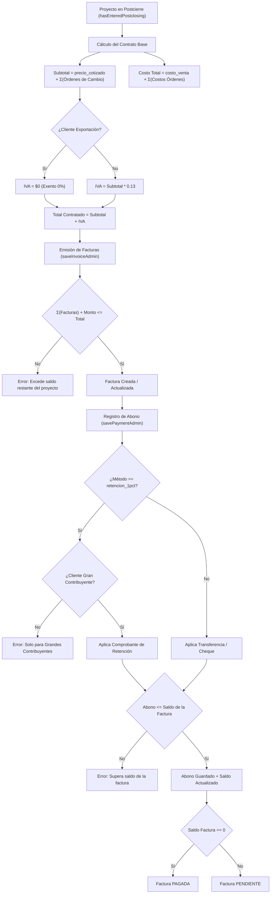
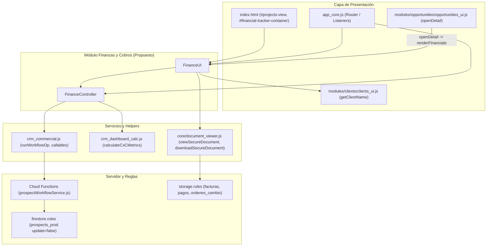

# DUCTSAL ERP — INFORME DE AUDITORÍA TÉCNICA Y ANÁLISIS DE DEPENDENCIAS
## Fase 6.4.0: Finanzas, Facturación, Pagos y Control de Cobros

> **Fecha:** 31 de Octubre de 2026  
> **Estado:** Auditoría Técnica y Levantamiento de Inventario Completo  
> **Área:** Finanzas, Proyectos, Facturación, Abonos, Cuentas por Cobrar (CxC) y Contratos  
> **Línea Base del Repositorio:** `app_core.js` (6,011 líneas), 74/74 suites de prueba aprobadas (2,022/2,022 pruebas unitarias e integrales)

---

## 1. Resumen Ejecutivo

En continuidad con la estrategia de modularización progresiva de [app_core.js](file:///Users/Benjamin/Documents/DUCTSAL/sales-reporting-system-release/app_core.js) (tras completar y validar la Fase 6.1: Document Viewer, la Fase 6.2: Clientes, y la Fase 6.3: Oportunidades Controller y UI), se realizó un levantamiento forense e inventario exhaustivo del subsistema de **Finanzas, Proyectos y Control de Cobros**.

### Hallazgos Principales:
1. **Volumen de Código Identificado:** Se identificaron **23 funciones**, 3 variables de estado global y 1 bloque generador de contratos vinculados directamente a la gestión financiera y operativa de proyectos en postcierre. Suman un total aproximado de **1,034 líneas de código** en [app_core.js](file:///Users/Benjamin/Documents/DUCTSAL/sales-reporting-system-release/app_core.js) (reduciendo el monolito de 6,011 a aproximadamente 4,977 líneas al concluir su extracción).
2. **Modelo de Datos en Firestore:** No existen colecciones independientes para facturas, pagos u órdenes de cambio. Todas las entidades financieras residen como **arrays embebidos** (`facturas[]` y `ordenes_cambio[]`) dentro del documento de la oportunidad en `prospects_prod`. A su vez, los abonos residen dentro de cada factura (`facturas[].pagos[]`).
3. **Seguridad y Reglas de Escritura:** La regla de Firestore `firestore.rules` prohíbe taxativamente la actualización directa desde el cliente (`match /prospects_prod/{prospectId} { allow update: if false; }`). Todas las operaciones de facturación, abonos y órdenes de cambio transitan obligatoriamente por Cloud Functions transaccionales e idempotentes vía [crm_commercial.js](file:///Users/Benjamin/Documents/DUCTSAL/sales-reporting-system-release/crm_commercial.js) y [functions/prospectWorkflowService.js](file:///Users/Benjamin/Documents/DUCTSAL/sales-reporting-system-release/functions/prospectWorkflowService.js).
4. **Aislamiento Comercial del Vendedor:** Se confirmaron e inventariaron los 12 candados de seguridad de la Fase 5.4: el rol `vendedor` tiene acceso estrictamente en **modo solo lectura** (`isFinancialReadOnly = true`), y su listado de proyectos se encuentra estrictamente aislado a sus propios proyectos asignados (`p.vendedorId === currentUserId`).
5. **Acoplamiento de Pruebas Unitarias:** Se identificaron **8 suites de pruebas unitarias** que inspeccionan directamente fragmentos de código fuente (`fs.readFileSync`) de [app_core.js](file:///Users/Benjamin/Documents/DUCTSAL/sales-reporting-system-release/app_core.js) utilizando delimitadores de cadenas sobre funciones financieras (por ejemplo, `renderProjectsList`, `renderFinancials`, `openChangeOrderModal`). Se diseñó la estrategia de compatibilidad con proxies y adaptación simétrica para evitar cualquier regresión en las pruebas.

---

## 2. Inventario de Código (Funciones, Variables, Listeners y UI)

### 2.1 Variables de Estado Global

| Variable | Tipo | Ubicación | Responsabilidad | Dependencias / Uso |
|---|---|---|---|---|
| `projPaymentFilter` | `string` | [app_core.js:L3058](file:///Users/Benjamin/Documents/DUCTSAL/sales-reporting-system-release/app_core.js#L3058) | Estado activo del filtro de cobros: `'pendientes'`, `'pagados'`, `'todos'`. | Leído en `renderProjectsList()`, modificado vía `setProjPaymentFilter()`. |
| `projSortCol` | `string` | [app_core.js:L112](file:///Users/Benjamin/Documents/DUCTSAL/sales-reporting-system-release/app_core.js#L112) | Columna activa de ordenamiento en la tabla de proyectos. | Utilizado por `toggleProjSort()` y `renderProjectsList()`. |
| `projSortDir` | `string` | [app_core.js:L112](file:///Users/Benjamin/Documents/DUCTSAL/sales-reporting-system-release/app_core.js#L112) | Dirección de ordenamiento: `'asc'` o `'desc'`. | Utilizado por `toggleProjSort()` y `updateProjSortIcons()`. |

---

### 2.2 Funciones de Finanzas, Proyectos y Cobranzas en `app_core.js`

#### A. Ordenamiento e Indicadores de Interfaz de Proyectos
1. **`toggleProjSort(column)`**
   - **Ubicación:** [app_core.js:L437-447](file:///Users/Benjamin/Documents/DUCTSAL/sales-reporting-system-release/app_core.js#L437-L447) (11 líneas)
   - **Responsabilidad:** Alterna la dirección o cambia la columna de ordenamiento en la tabla de proyectos.
   - **Invocado por:** Eventos DOM `onclick="toggleProjSort('...')"` en encabezados de `#projectsTable`.
   - **Invoca:** `renderProjectsList()`, `updateProjSortIcons()`.
   - **Exposición en `window`:** Sí.
   - **Dependencias:** `projSortCol`, `projSortDir`.

2. **`updateProjSortIcons()`**
   - **Ubicación:** [app_core.js:L448-464](file:///Users/Benjamin/Documents/DUCTSAL/sales-reporting-system-release/app_core.js#L448-L464) (17 líneas)
   - **Responsabilidad:** Actualiza los glifos de flechas (`▲`, `▼`, `↕`) en los encabezados `#sort-proj-*`.
   - **Invocado por:** `toggleProjSort()`.
   - **Invoca:** Manipulación del DOM.
   - **Exposición en `window`:** Sí.

#### B. Cálculos Financieros y Condición de Pago
3. **`getProjectSubtotal(p)`**
   - **Ubicación:** [app_core.js:L2486-2494](file:///Users/Benjamin/Documents/DUCTSAL/sales-reporting-system-release/app_core.js#L2486-L2494) (9 líneas)
   - **Responsabilidad:** Calcula el subtotal neto del proyecto sumando `precio_cotizado` con las órdenes de cambio aprobadas (`+precio` en aumentos, `-precio` en disminuciones).
   - **Invocado por:** `isProjectFullyPaid`, `renderProjectsList`, `renderFinancials`, `generarContrato`.
   - **Exposición en `window`:** Sí (`const getProjectSubtotal` en ámbito raíz).
   - **Dependencias:** Objeto oportunidad `p`.

4. **`getProjectCosto(p)`**
   - **Ubicación:** [app_core.js:L2496-2504](file:///Users/Benjamin/Documents/DUCTSAL/sales-reporting-system-release/app_core.js#L2496-L2504) (9 líneas)
   - **Responsabilidad:** Calcula el costo presupuestado consolidado sumando `costo_venta` con las órdenes de cambio (`+costo` en aumentos, `-costo` en disminuciones).
   - **Invocado por:** `renderFinancials(p)`.
   - **Exposición en `window`:** Sí (`const getProjectCosto` en ámbito raíz).
   - **Dependencias:** Objeto oportunidad `p`.

5. **`isProjectFullyPaid(p)`**
   - **Ubicación:** [app_core.js:L2506-2536](file:///Users/Benjamin/Documents/DUCTSAL/sales-reporting-system-release/app_core.js#L2506-L2536) (31 líneas)
   - **Responsabilidad:** Determina con precisión de centavos (`totalCobrado >= total - 0.05`) si un proyecto está 100% cobrado, considerando exención de IVA por exportación (`es_exportacion`) y el consolidado de abonos en todas sus facturas.
   - **Invocado por:** `renderProjectsList()` para filtros y contadores.
   - **Invoca:** `getProjectSubtotal(p)`, `clients.find()`.
   - **Exposición en `window`:** Sí.
   - **Dependencias:** `clients`, `getProjectSubtotal`.

#### C. Control de Vistas y Tabla de Proyectos
6. **`getProjPaymentFilter()`**
   - **Ubicación:** [app_core.js:L3060-3063](file:///Users/Benjamin/Documents/DUCTSAL/sales-reporting-system-release/app_core.js#L3060-L3063) (4 líneas)
   - **Responsabilidad:** Retorna el valor actual de `projPaymentFilter`.
   - **Exposición en `window`:** Sí.

7. **`setProjPaymentFilter(filterKey)`**
   - **Ubicación:** [app_core.js:L3064-3070](file:///Users/Benjamin/Documents/DUCTSAL/sales-reporting-system-release/app_core.js#L3064-L3070) (7 líneas)
   - **Responsabilidad:** Valida (`['pendientes', 'pagados', 'todos']`), actualiza el filtro de cobro y refresca la lista.
   - **Invocado por:** Eventos DOM `onclick="setProjPaymentFilter('...')"` en `#filter-proj-*`.
   - **Invoca:** `renderProjectsList()`.
   - **Exposición en `window`:** Sí.

8. **`renderProjectsList()`**
   - **Ubicación:** [app_core.js:L3071-3337](file:///Users/Benjamin/Documents/DUCTSAL/sales-reporting-system-release/app_core.js#L3071-L3337) (267 líneas)
   - **Responsabilidad:** Renderiza la tabla completa de "Proyectos y Control de Cobros" (`#projectsTable`). Aplica:
     - Título dinámico por rol ("Mis Proyectos y Cobros Asignados" vs "Proyectos y Control de Cobros").
     - Aislamiento horizontal de vendedor (`allProjects.filter(p => p.vendedorId === currentUserId)`).
     - Contadores de pills (`countPendientes`, `countPagados`, `countTodos`).
     - Cálculo de métricas: `total`, `totalFacturado`, `totalCobrado`, `saldoCxC`, `porFacturar`, `pctFacturado`, `pctCobrado`.
     - Filtrado en vivo por caja de búsqueda (`#proj-search`).
     - Ordenamiento multi-columna determinista.
     - Filas adaptativas con barras de progreso de facturación/cobro y badges de estado.
     - Navegación al hacer clic en fila mediante `openDetail(p.id)`.
   - **Invocado por:** `showView('projects-view')`, `toggleProjSort()`, `setProjPaymentFilter()`, `#proj-search` `onkeyup`, `reRenderApp()`.
   - **Invoca:** `hasEnteredPostclosing()`, `isProjectFullyPaid()`, `getProjectSubtotal()`, `getClientName()`, `formatCurrency()`, `escapeHtmlDoc()`, `openDetail()`.
   - **Exposición en `window`:** Sí.
   - **Dependencias:** `currentUser`, `prospects`, `clients`, `projPaymentFilter`, `projSortCol`, `projSortDir`.

#### D. Panel de Balance Financiero en el Detalle
9. **`renderFinancials(p)`**
   - **Ubicación:** [app_core.js:L3388-3633](file:///Users/Benjamin/Documents/DUCTSAL/sales-reporting-system-release/app_core.js#L3388-L3633) (246 líneas)
   - **Responsabilidad:** Renderiza el balance financiero tripartito en el modal de detalle (`#financial-tracker-container`):
     - Tarjeta 1 (Contrato Comercial): Subtotal, IVA (13% o 0% exportación), Total contratado, Costo presupuestado, Margen bruto y %.
     - Tarjeta 2 (Facturación): Total facturado acumulado, Pendiente por facturar.
     - Tarjeta 3 (Cobranza y CxC): Total cobrado acumulado, Saldo vivo pendiente CxC (`totalFacturado - totalCobrado`).
     - Alertas tributarias: Advertencia dorada de Agente de Retención (1% Gran Contribuyente) y advertencia azul de Exportación (0% IVA).
     - Desglose de órdenes de cambio con visor seguro y botones editar/eliminar.
     - Tarjetas de facturas modernas con strip de 3 montos, estado `PAGADA`/`PENDIENTE`, chip de PDF, botón `+ Abonar a Factura` y botones de gestión.
     - Historial de abonos por factura con tipo de método (retención fiscal vs normal), referencia, monto, comprobante y botones de edición/borrado.
     - Regla de solo lectura: si el usuario es `vendedor`, oculta todos los botones de creación, edición y eliminación.
   - **Invocado por:** `openDetail(p.id)` (en [modules/opportunities/opportunities_ui.js](file:///Users/Benjamin/Documents/DUCTSAL/sales-reporting-system-release/modules/opportunities/opportunities_ui.js)).
   - **Invoca:** `getProjectSubtotal()`, `getProjectCosto()`, `formatCurrency()`, `formatDate()`, `escapeHtmlDoc()`, `viewSecureDocument()`, `downloadSecureDocument()`, `editChangeOrder()`, `deleteChangeOrder()`, `editInvoice()`, `deleteInvoice()`, `showPaymentForm()`, `editPayment()`, `deletePayment()`.
   - **Exposición en `window`:** Sí.
   - **Dependencias:** `currentUser`, `clients`, `prospects`.

#### E. Gestión de Órdenes de Cambio
10. **`openChangeOrderModal()`**
    - **Ubicación:** [app_core.js:L3634-3644](file:///Users/Benjamin/Documents/DUCTSAL/sales-reporting-system-release/app_core.js#L3634-L3644) (11 líneas)
    - **Responsabilidad:** Valida permisos de rol (bloquea vendedor), reinicia formulario `#changeOrderForm` y abre `#changeOrderModal`.
    - **Invocado por:** DOM `onclick="openChangeOrderModal()"` en botón `#btn-add-co`.
    - **Exposición en `window`:** Sí.

11. **`editChangeOrder(id)`**
    - **Ubicación:** [app_core.js:L3645-3663](file:///Users/Benjamin/Documents/DUCTSAL/sales-reporting-system-release/app_core.js#L3645-L3663) (19 líneas)
    - **Responsabilidad:** Valida rol, carga datos de la orden seleccionada (`#co-id-edit`, `#co-tipo`, `#co-desc`, `#co-precio`, `#co-costo`) y abre modal.
    - **Invocado por:** DOM dinámico en `renderFinancials`.
    - **Exposición en `window`:** Sí.

12. **`runWorkflowOp(loadingMessage, operation)`**
    - **Ubicación:** [app_core.js:L3670-3689](file:///Users/Benjamin/Documents/DUCTSAL/sales-reporting-system-release/app_core.js#L3670-L3689) (20 líneas)
    - **Responsabilidad:** Infraestructura compartida para llamadas seguras al backend. Comprueba sesión sincronizada (`CrmCommercial.hasSessionSync`), activa indicador de carga, ejecuta callable y maneja errores de servidor sin permitir fallback a escrituras directas.
    - **Invocado por:** Todas las operaciones de mutación comercial y financiera.
    - **Exposición en `window`:** Sí.

13. **`processChangeOrder(e)`**
    - **Ubicación:** [app_core.js:L3690-3718](file:///Users/Benjamin/Documents/DUCTSAL/sales-reporting-system-release/app_core.js#L3690-L3718) (29 líneas)
    - **Responsabilidad:** Procesa el envío del formulario `#changeOrderForm`, sube archivos adjuntos a Storage (`uploadFileToStorage(..., 'ordenes_cambio')`), y ejecuta `CrmCommercial.saveChangeOrder()`.
    - **Invocado por:** DOM `onsubmit="processChangeOrder(event)"` en `#changeOrderForm`.
    - **Invoca:** `runWorkflowOp()`, `uploadFileToStorage()`, `CrmCommercial.saveChangeOrder()`, `closeModal()`.
    - **Exposición en `window`:** Sí.

14. **`deleteChangeOrder(id)`**
    - **Ubicación:** [app_core.js:L5817-5829](file:///Users/Benjamin/Documents/DUCTSAL/sales-reporting-system-release/app_core.js#L5817-L5829) (13 líneas)
    - **Responsabilidad:** Confirma con el usuario, bloquea vendedor, y llama a `CrmCommercial.deleteChangeOrder()` vía `runWorkflowOp`.
    - **Invocado por:** DOM dinámico en `renderFinancials`.
    - **Exposición en `window`:** Sí.

#### F. Gestión de Facturación
15. **`showInvoiceForm()`**
    - **Ubicación:** [app_core.js:L3719-3736](file:///Users/Benjamin/Documents/DUCTSAL/sales-reporting-system-release/app_core.js#L3719-L3736) (18 líneas)
    - **Responsabilidad:** Abre formulario drawer `#invoice-form`, oculta formulario de pago, limpia inputs y adapta label de IVA si el cliente es de exportación.
    - **Invocado por:** DOM `onclick="showInvoiceForm()"` en `#btn-add-invoice`.
    - **Exposición en `window`:** Sí.

16. **`editInvoice(id)`**
    - **Ubicación:** [app_core.js:L3737-3759](file:///Users/Benjamin/Documents/DUCTSAL/sales-reporting-system-release/app_core.js#L3737-L3759) (23 líneas)
    - **Responsabilidad:** Carga datos de la factura en `#invoice-form` para edición.
    - **Invocado por:** DOM dinámico en `renderFinancials`.
    - **Exposición en `window`:** Sí.

17. **`processInvoice(e)`**
    - **Ubicación:** [app_core.js:L3760-3785](file:///Users/Benjamin/Documents/DUCTSAL/sales-reporting-system-release/app_core.js#L3760-L3785) (26 líneas)
    - **Responsabilidad:** Valida campos obligatorios, sube PDF de la factura a Storage (`uploadFileToStorage(..., 'facturas')`), y ejecuta `CrmCommercial.saveInvoice()`.
    - **Invocado por:** DOM `onsubmit="processInvoice(event)"` en `#invoice-form`.
    - **Invoca:** `runWorkflowOp()`, `uploadFileToStorage()`, `CrmCommercial.saveInvoice()`.
    - **Exposición en `window`:** Sí.

18. **`deleteInvoice(id)`**
    - **Ubicación:** [app_core.js:L5830-5847](file:///Users/Benjamin/Documents/DUCTSAL/sales-reporting-system-release/app_core.js#L5830-L5847) (18 líneas)
    - **Responsabilidad:** Confirma con el usuario, valida rol, aplica regla estricta de negocio: **la factura de anticipo (`index === 0`) nunca puede eliminarse**, y ejecuta `CrmCommercial.deleteInvoice()`.
    - **Invocado por:** DOM dinámico en `renderFinancials`.
    - **Exposición en `window`:** Sí.

#### G. Registro y Control de Abonos / Pagos
19. **`showPaymentForm(invoiceId, invoiceNumero)`**
    - **Ubicación:** [app_core.js:L3786-3822](file:///Users/Benjamin/Documents/DUCTSAL/sales-reporting-system-release/app_core.js#L3786-L3822) (37 líneas)
    - **Responsabilidad:** Abre formulario drawer `#payment-form`, vincula `invoiceId`, configura opción dinámica de retención 1% (solo habilitada si `client.is_gran_contribuyente === true`), y almacena el total de factura en `dataset.invoiceTotal`.
    - **Invocado por:** DOM dinámico en cada tarjeta de factura en `renderFinancials`.
    - **Exposición en `window`:** Sí.

20. **`handlePaymentMethodChange()`**
    - **Ubicación:** [app_core.js:L3823-3836](file:///Users/Benjamin/Documents/DUCTSAL/sales-reporting-system-release/app_core.js#L3823-L3836) (14 líneas)
    - **Responsabilidad:** Si se selecciona `retencion_1pct`, pre-calcula el 1% de la factura en el input `#pay-monto-nuevo` (manteniéndolo modificable por centavos).
    - **Invocado por:** DOM `onchange="handlePaymentMethodChange()"` en `#pay-metodo`.
    - **Exposición en `window`:** Sí.

21. **`editPayment(invoiceId, paymentIndex)`**
    - **Ubicación:** [app_core.js:L3837-3874](file:///Users/Benjamin/Documents/DUCTSAL/sales-reporting-system-release/app_core.js#L3837-L3874) (38 líneas)
    - **Responsabilidad:** Carga datos de un abono existente para edición. Utiliza la clave canónica (`pay.id || pay.fecha`) para evitar errores por desincronización de índices de array.
    - **Invocado por:** DOM dinámico en `renderFinancials`.
    - **Exposición en `window`:** Sí.

22. **`processPayment(e)`**
    - **Ubicación:** [app_core.js:L3875-3904](file:///Users/Benjamin/Documents/DUCTSAL/sales-reporting-system-release/app_core.js#L3875-L3904) (30 líneas)
    - **Responsabilidad:** Valida comprobante y monto, sube archivo a Storage (`uploadFileToStorage(..., 'pagos')`), y ejecuta `CrmCommercial.savePayment()`.
    - **Invocado por:** DOM `onsubmit="processPayment(event)"` en `#payment-form`.
    - **Invoca:** `runWorkflowOp()`, `uploadFileToStorage()`, `CrmCommercial.savePayment()`.
    - **Exposición en `window`:** Sí.

23. **`deletePayment(invoiceId, paymentIndex)`**
    - **Ubicación:** [app_core.js:L5848-5865](file:///Users/Benjamin/Documents/DUCTSAL/sales-reporting-system-release/app_core.js#L5848-L5865) (18 líneas)
    - **Responsabilidad:** Confirma con el usuario, resuelve la clave canónica del abono (`pay.id || pay.fecha`), y ejecuta `CrmCommercial.deletePayment()`.
    - **Invocado por:** DOM dinámico en `renderFinancials`.
    - **Exposición en `window`:** Sí.

#### H. Formalización Legal y Contractual
24. **`generarContrato(prospectId)`**
    - **Ubicación:** [app_core.js:L5658-5795](file:///Users/Benjamin/Documents/DUCTSAL/sales-reporting-system-release/app_core.js#L5658-L5795) (138 líneas)
    - **Responsabilidad:** Genera el documento legal de contrato marco de fabricación e instalación de ductería en un iframe imprimible (`#print-iframe`). Valida completitud del expediente del cliente (empresa, rep_legal, profesión, domicilio, DUI, NIT para personas jurídicas; nombres, profesión, domicilio, DUI, NIT para naturales). Si faltan campos obligatorios, abre `openClientModal(c.id)` alertando los datos faltantes.
    - **Invocado por:** Opciones de formalización contractual en vistas de cierre/detalle.
    - **Invoca:** `openClientModal()`, manipulación de iframe.
    - **Exposición en `window`:** Sí.

---

## 3. Inventario del Modelo de Datos

### 3.1 Estructura Real Confirmada en Firestore

| Colección | Documento | Campo / Array | Tipo | Descripción y Reglas de Negocio |
|---|---|---|---|---|
| `prospects_{suffix}` | `{prospectId}` | `precio_cotizado` | `number` | Subtotal base cotizado sin IVA (inmutable salvo corrección de digitación o nueva propuesta). |
| `prospects_{suffix}` | `{prospectId}` | `costo_venta` | `number` | Costo directo presupuestado base. |
| `prospects_{suffix}` | `{prospectId}` | `forma_pago` | `string` | Condición comercial: `'100% anticipado'`, `'70/30'`, `'50/50'`. |
| `prospects_{suffix}` | `{prospectId}` | `postcierre_habilitado` | `boolean` | Flag canónico que habilita la gestión en postcierre (Proyectos y Cobros). |
| `prospects_{suffix}` | `{prospectId}` | `ordenes_cambio` | `Array<Object>` | Lista de órdenes de cambio del proyecto: `{ id, fecha, tipo ('aumento'\|'disminucion'), desc, precio, costo, doc_oferta, doc_costos, opId }`. |
| `prospects_{suffix}` | `{prospectId}` | `facturas` | `Array<Object>` | Lista de facturas emitidas: `{ id, numero, monto, doc_factura, fecha, opId, pagos: [...] }`. |
| `prospects_{suffix}` | `{prospectId}` | `facturas[].pagos` | `Array<Object>` | Historial de abonos de la factura: `{ id, monto, metodo ('transferencia'\|'cheque'\|'retencion_1pct'), ref, doc_comprobante, fecha, opId }`. |
| `clients_{suffix}` | `{clientId}` | `es_exportacion` | `boolean` | Si es `true`, aplica 0% IVA. |
| `clients_{suffix}` | `{clientId}` | `is_gran_contribuyente` | `boolean` | Si es `true`, el cliente retiene 1% de IVA; habilita pago vía comprobante de retención. |
| `audit_logs_{suffix}` | `{logId}` | Varios | `Object` | Registro de aviso gerencial tras eliminación de factura, abono u orden de cambio. |
| `commercialAudit_{suffix}` | `{auditId}` | Varios | `Object` | Auditoría transaccional de cada operación con identidad autenticada (`cid`, `uid`, `role`). |

### 3.2 Distinción Crítica: Funcionalidades Confirmadas vs No Implementadas

| Funcionalidad Solicitada | Estado Real en el Código | Detalle Técnico |
|---|---|---|
| **Finanzas y Margen Bruto** | **CONFIRMADO** | Cálculo en tiempo real de subtotal, costo total, margen en dólares y porcentaje. |
| **Cuentas por Cobrar (CxC)** | **CONFIRMADO** | Saldo vivo por proyecto (`totalFacturado - totalCobrado`) y saldo global en Dashboard vía `CrmDashboardCalc.calculateCxCMetrics()`. |
| **Facturación y Topes** | **CONFIRMADO** | Registro de facturas con validación transaccional en backend que impide exceder el total contratado con IVA. |
| **Factura de Anticipo** | **CONFIRMADO** | Generada automáticamente en `advanceStage` según la forma de pago (100%, 70%, 50%). Bloqueada contra eliminación. |
| **Registro y Aplicación de Abonos** | **CONFIRMADO** | Abonos aplicados a facturas específicas con comprobante adjunto y método de pago. |
| **Retención del 1%** | **CONFIRMADO** | Tratada como método de pago (`retencion_1pct`) reservada exclusivamente para clientes con `is_gran_contribuyente === true`. |
| **Órdenes de Cambio** | **CONFIRMADO** | Aumento o disminución con recálculo dinámico de precio y costo. |
| **Estados de Cuenta de Clientes** | **NO IMPLEMENTADO** | No existe una pantalla consolidada de estado de cuenta histórico por cliente ni generador de PDF de estado de cuenta. La información se consulta únicamente a nivel de proyecto individual. |
| **Cartera Vencida (Aging 30/60/90 días)** | **NO IMPLEMENTADO** | **No existe** el campo `fecha_vencimiento` en el modelo de datos de facturas. No se calculan días de mora comercial ni clasificación por antigüedad de vencimiento tributario. El test `financialAndStagnationUi.unit.test.js:L220` valida explícitamente que no se inventen fechas de vencimiento. |
| **Seguimiento Automatizado de Cobros** | **PARCIAL** | Existe el filtrado de proyectos por estado de cobro (`pendientes` vs `pagados`), pero no existen recordatorios automáticos de cobro ni cadencias específicas de cobranza separadas de las comerciales. |

---

## 4. Mapa de Reglas de Negocio



### Reglas Clave:
1. **Tope de Facturación:** El monto total facturado no puede exceder el `Total Contratado`.
2. **Tope de Abono:** Un abono no puede superar el saldo pendiente de la factura específica a la que se aplica.
3. **Inmutabilidad del Anticipo:** La primera factura (`facturas[0]`) no puede eliminarse bajo ninguna circunstancia.
4. **Idempotencia Transaccional:** Cada orden de cambio, factura y abono almacena un `opId` único generado por el cliente. Si la llamada se reintenta por intermitencia de red, el servidor devuelve el registro sin duplicar importes.

---

## 5. Matriz de Permisos por Rol

| Acción / Elemento | Gerente (`manager`) | Gestor (`gestor`) | Vendedor (`vendedor`) | Mecanismo de Control |
|---|---|---|---|---|
| **Ver módulo Proyectos y Cobros** | Sí (Todos) | Sí (Todos) | Sí (Solo sus proyectos asignados) | Filtro `p.vendedorId === currentUserId` en [app_core.js:L3100](file:///Users/Benjamin/Documents/DUCTSAL/sales-reporting-system-release/app_core.js#L3100) |
| **Ver Balance Financiero en Detalle** | Sí | Sí | Sí (Modo solo lectura) | Flag `isFinancialReadOnly` en [app_core.js:L3389](file:///Users/Benjamin/Documents/DUCTSAL/sales-reporting-system-release/app_core.js#L3389) |
| **Emitir / Editar Factura** | Sí | Sí | **DENEGADO** | Frontend oculta botón; Backend bloquea en `saveInvoice: ['manager', 'gestor']` |
| **Eliminar Factura** | Sí (salvo anticipo) | Sí (salvo anticipo) | **DENEGADO** | Frontend y Backend bloquean anticipo y vendedor |
| **Registrar / Editar Abono** | Sí | Sí | **DENEGADO** | Backend bloquea en `savePayment: ['manager', 'gestor']` |
| **Eliminar Abono** | Sí | Sí | **DENEGADO** | Backend bloquea en `deletePayment: ['manager', 'gestor']` |
| **Gestionar Órdenes de Cambio** | Sí | Sí | **DENEGADO** | Backend bloquea en `saveChangeOrder` y `deleteChangeOrder` |
| **Previsualizar Documentos Digitales** | Sí | Sí (proyectos postcierre) | Sí (solo proyectos asignados) | Validado por reglas en [storage.rules:L86-94](file:///Users/Benjamin/Documents/DUCTSAL/sales-reporting-system-release/storage.rules#L86-L94) |
| **Subir Archivos a Facturas/Pagos/OC** | Sí | Sí (proyectos postcierre) | **DENEGADO** | Regla en [storage.rules:L96-104](file:///Users/Benjamin/Documents/DUCTSAL/sales-reporting-system-release/storage.rules#L96-L104) |

---

## 6. Dependencias y Acoplamientos



---

## 7. Suites de Pruebas Afectadas

Las siguientes suites de pruebas interactúan con funciones o delimitadores de Finanzas y Cobranzas, y deberán verificarse minuciosamente:

### 7.1 Pruebas Acopladas Directamente a `app_core.js` (Inspección AST / Cadenas)
1. **[functions/\_\_tests\_\_/financialAndStagnationUi.unit.test.js](file:///Users/Benjamin/Documents/DUCTSAL/sales-reporting-system-release/functions/__tests__/financialAndStagnationUi.unit.test.js)**
   - Inspecciona `appCoreSrc` buscando `renderProjectsList`, `renderFinancials`, `isFinancialReadOnly`, `saldoCxC`, `porFacturar`.
   - Verifica que las 12 funciones financieras bloqueen al vendedor con el mensaje exacto: `"Operación no autorizada: Los vendedores tienen acceso financiero en modo solo lectura."`.
2. **[functions/\_\_tests\_\_/workflowUiFlow.test.js](file:///Users/Benjamin/Documents/DUCTSAL/sales-reporting-system-release/functions/__tests__/workflowUiFlow.test.js)**
   - Extrae código mediante `between(...)` de:
     - `runWorkflowOp` hasta `showInvoiceForm`
     - `processInvoice` hasta `showPaymentForm`
     - `editPayment` hasta `renderTracker`
     - `deleteChangeOrder` hasta `deleteProspect`
3. **[functions/\_\_tests\_\_/crmUi.unit.test.js](file:///Users/Benjamin/Documents/DUCTSAL/sales-reporting-system-release/functions/__tests__/crmUi.unit.test.js)**
   - Utiliza `'function renderProjectsList'` como delimitador de cierre para extraer `PIPELINE_CORE_SRC` (L856, L1446).
   - Busca `renderFinancials(p)` en L2444.
4. **[functions/\_\_tests\_\_/rolePermissionsAndUiAudit.unit.test.js](file:///Users/Benjamin/Documents/DUCTSAL/sales-reporting-system-release/functions/__tests__/rolePermissionsAndUiAudit.unit.test.js)**
   - Utiliza `function renderProjectsList()` como delimitador final del bloque `renderList()` (L411).
5. **[functions/\_\_tests\_\_/clientVisibility.test.js](file:///Users/Benjamin/Documents/DUCTSAL/sales-reporting-system-release/functions/__tests__/clientVisibility.test.js)**
   - Utiliza `between(appCore, 'function renderList', 'function renderProjectsList')` (L347).
6. **[functions/\_\_tests\_\_/dashboardAndOperativeClosure.unit.test.js](file:///Users/Benjamin/Documents/DUCTSAL/sales-reporting-system-release/functions/__tests__/dashboardAndOperativeClosure.unit.test.js)**
   - Verifica `renderProjectsList` en `app_core.js` (L92).
7. **[functions/\_\_tests\_\_/commercialClosureAndPriority.unit.test.js](file:///Users/Benjamin/Documents/DUCTSAL/sales-reporting-system-release/functions/__tests__/commercialClosureAndPriority.unit.test.js)**
   - Invoca `appCore.renderProjectsList()` en un contexto VM (L515, L523).
8. **[functions/\_\_tests\_\_/uiEnhancementsAndPreview.test.js](file:///Users/Benjamin/Documents/DUCTSAL/sales-reporting-system-release/functions/__tests__/uiEnhancementsAndPreview.test.js)**
   - Utiliza `'function renderProjectsList'` como delimitador y comprueba `expect(appCoreSrc).toContain('renderFinancials')`.

### 7.2 Pruebas Funcionales y de Integración con Backend
- **[functions/\_\_tests\_\_/crmCommercial.client.test.js](file:///Users/Benjamin/Documents/DUCTSAL/sales-reporting-system-release/functions/__tests__/crmCommercial.client.test.js)**: Verifica llamadas a `saveInvoice`, `deleteInvoice`, `savePayment`, `deletePayment`, `saveChangeOrder`, `deleteChangeOrder`.
- **[functions/\_\_tests\_\_/dashboardCalculations.unit.test.js](file:///Users/Benjamin/Documents/DUCTSAL/sales-reporting-system-release/functions/__tests__/dashboardCalculations.unit.test.js)**: Valida `calculateCxCMetrics` con listas de prospectos y casos borde.
- **[functions/\_\_tests\_\_/sec04Sec06CommercialBackend.unit.test.js](file:///Users/Benjamin/Documents/DUCTSAL/sales-reporting-system-release/functions/__tests__/sec04Sec06CommercialBackend.unit.test.js)**: Valida que el vendedor esté estrictamente bloqueado en backend para postcierre.
- **[functions/\_\_tests\_\_/postclosingHistoricalCompatibility.unit.test.js](file:///Users/Benjamin/Documents/DUCTSAL/sales-reporting-system-release/functions/__tests__/postclosingHistoricalCompatibility.unit.test.js)**: Valida compatibilidad con facturas y abonos históricos.
- **[functions/isolated-tests/commercialFlow.e2e.iso.js](file:///Users/Benjamin/Documents/DUCTSAL/sales-reporting-system-release/functions/isolated-tests/commercialFlow.e2e.iso.js)**: Pruebas end-to-end con emuladores de Firebase.

---

## 8. Riesgos Técnicos y Financieros

1. **Riesgo de Regresión en Suites de Pruebas Acopladas:**
   - *Severidad:* Alta.
   - *Causa:* Ocho suites de pruebas unitarias extraen código mediante slicing directo de cadenas de `app_core.js`.
   - *Mitigación Obligatoria:* Preservar en `app_core.js` las firmas de función como proxies y los marcadores delimitadores, y actualizar simétricamente las suites para que busquen el código tanto en `app_core.js` como en el nuevo módulo de finanzas (patrón idéntico al implementado exitosamente en Fase 6.2 y Fase 6.3).
2. **Riesgo de Fuga de Aislamiento Comercial del Vendedor:**
   - *Severidad:* Crítica (Confidencialidad).
   - *Causa:* Si en `renderProjectsList` se omite el filtro `p.vendedorId === currentUserId`, el vendedor vería montos facturados, proyectos y clientes de otros asesores.
   - *Mitigación:* Mantener la regla estricta de filtrado previo al cálculo de contadores y renderizado, respaldada por la suite `financialAndStagnationUi.unit.test.js`.
3. **Riesgo de Inconsistencias por Cálculos Fuera de Sincronía:**
   - *Severidad:* Alta.
   - *Causa:* Duplicar o alterar la lógica matemática de `getProjectSubtotal`, `getProjectCosto` o `isProjectFullyPaid` generaría discrepancias entre la pantalla de proyectos, el panel financiero y el dashboard gerencial.
   - *Mitigación:* Centralizar los cálculos matemáticos en `FinanceController`, utilizándolos como única fuente de verdad compartida.
4. **Riesgo de Enlaces Rotos a Documentos en Storage:**
   - *Severidad:* Media.
   - *Causa:* Las llamadas a `viewSecureDocument` y `downloadSecureDocument` exigen el contexto `{ prospectId: p.id }` para que la autorización en Storage resuelva la ruta contextual.
   - *Mitigación:* Garantizar que todas las plantillas dinámicas de facturas, abonos y órdenes de cambio pasen el `prospectId` explícitamente a `DocumentViewer`.

---

## 9. Arquitectura Modular Propuesta

Se propone una estructura en dos capas limpias dentro de `modules/finance/`, reflejando la arquitectura comprobada de `modules/opportunities/`:

```text
modules/
  finance/
    finance_controller.js    // Lógica pura de negocio, cálculos de saldos, filtros, ordenamiento y llamadas al backend
    finance_ui.js            // Renderizado de la tabla de proyectos, panel financiero de detalle, modales y formularios
```

### Justificación Técnica frente a Fragmentación Excesiva:
El prompt sugirió evaluar como punto de partida:
`finance_controller.js`, `invoicing.js`, `payments.js`, `accounts_receivable.js`, `finance_ui.js`.
El análisis del modelo de datos demostró que **facturas, pagos y cuentas por cobrar no son entidades independientes ni colecciones separadas**, sino arrays anidados en el documento de oportunidad (`p.facturas[i].pagos[j]`).
Dividir la lógica en 5 archivos generaría dependencias circulares complejas para operaciones atómicas (por ejemplo, registrar un abono recalcula el saldo de la factura y el saldo total de la oportunidad simultáneamente).
La división en **`finance_controller.js`** y **`finance_ui.js`** garantiza:
- **Separación de Responsabilidades:** Reglas y mutaciones en Controller; manipulación DOM y modales en UI.
- **Fuente Única de Verdad:** `FinanceController` expone los métodos de cálculo canónicos.
- **Trazabilidad:** Cada mutación delega exclusivamente en `CrmCommercial` y `runWorkflowOp`.
- **Cero Dependencias Circulares.**

---

## 10. Secuencia Recomendada de Extracción por Bloques

### Bloque 1 (Fase 6.4.1): `FinanceController`
- **Archivo:** `modules/finance/finance_controller.js`
- **Funcionalidades a extraer:**
  - `getProjectSubtotal(p)`
  - `getProjectCosto(p)`
  - `isProjectFullyPaid(p)`
  - `getProjPaymentFilter()` / `setProjPaymentFilter(filterKey)`
  - `toggleProjSort(column)` / `updateProjSortIcons()`
  - Métodos puente hacia backend: `processChangeOrder`, `processInvoice`, `processPayment`, `deleteChangeOrder`, `deleteInvoice`, `deletePayment`.
- **Acciones en `app_core.js`:**
  - Reemplazar implementaciones por delegaciones a `FinanceController.*`.
  - Exponer `window.FinanceController = api;`.
- **Pruebas:** Ejecutar las 74 suites y validar específicamente `financialAndStagnationUi`, `workflowUiFlow` y `crmCommercial.client.test.js`.

### Bloque 2 (Fase 6.4.2): `FinanceUI`
- **Archivo:** `modules/finance/finance_ui.js`
- **Funcionalidades a extraer:**
  - `renderProjectsList()`
  - `renderFinancials(p)`
  - `openChangeOrderModal()` / `editChangeOrder(id)`
  - `showInvoiceForm()` / `editInvoice(id)`
  - `showPaymentForm(invoiceId, invoiceNumero)` / `handlePaymentMethodChange()` / `editPayment(invoiceId, paymentIndex)`
  - `generarContrato(prospectId)`
- **Acciones en `app_core.js`:**
  - Reemplazar funciones por delegaciones a `FinanceUI.*`.
  - Registrar módulo en `index.html` con cache buster (`modules/finance/finance_ui.js?v=1`).
- **Pruebas y Verificación:**
  - Ejecutar suites completas de Jest (74/74 aprobadas).
  - Auditoría Headless en Google Chrome (CDP) verificando navegación, renderizado visual, tablas responsivas, modales y 0 excepciones de consola.

---

## 11. Estimación de Líneas que se Podrían Extraer

| Sección / Funcionalidad | Líneas en `app_core.js` | Líneas Estimadas |
|---|---|---|
| Ordenamiento de Proyectos (`toggleProjSort`, `updateProjSortIcons`) | L437–464 | 28 líneas |
| Cálculos Financieros (`getProjectSubtotal`, `getProjectCosto`, `isProjectFullyPaid`) | L2486–2533 | 48 líneas |
| Filtros de Estado de Cobro (`projPaymentFilter`, `get/setProjPaymentFilter`) | L3058–3070 | 13 líneas |
| Renderizado de Tabla de Proyectos (`renderProjectsList`) | L3071–3337 | 267 líneas |
| Panel de Balance Financiero y Facturas (`renderFinancials`) | L3388–3633 | 246 líneas |
| Modales y Formularios de Órdenes de Cambio (`open/edit/processChangeOrder`) | L3634–3663, L3690–3718 | 59 líneas |
| Formularios de Facturación (`show/edit/processInvoice`) | L3719–3785 | 67 líneas |
| Formularios de Abonos (`show/edit/processPayment`, `handlePaymentMethodChange`) | L3786–3904 | 119 líneas |
| Generación de Contrato (`generarContrato`) | L5658–5795 | 138 líneas |
| Eliminación Financiera (`deleteChangeOrder`, `deleteInvoice`, `deletePayment`) | L5817–5865 | 49 líneas |
| **Total Estimado de Extracción** | — | **~1,034 líneas** |

*Impacto proyectado en `app_core.js`:* Reducción de **6,011 líneas** a aproximadamente **~4,977 líneas** (~17.2% de reducción en esta fase).

---

## 12. Criterios de Aceptación para Cada Bloque

### Criterios para Bloque 1 (`FinanceController` - Fase 6.4.1):
1. [ ] Crear `modules/finance/finance_controller.js` bajo el patrón UMD/IIFE con inyección de dependencias (`_deps`) y fallbacks tolerantes.
2. [ ] Centralizar los cálculos matemáticos de subtotal, costo, saldo y estado de pago en el controlador.
3. [ ] Mantener proxies delegados en `app_core.js` para preservar la compatibilidad con llamadas en `window`.
4. [ ] Conservar los delimitadores requeridos por las suites de pruebas unitarias (`between(...)` y `extractCode(...)`).
5. [ ] Aprobar el 100% de las pruebas de Jest existentes (74 suites, 2,022 pruebas) sin debilitar aserciones.

### Criterios para Bloque 2 (`FinanceUI` - Fase 6.4.2):
1. [ ] Crear `modules/finance/finance_ui.js` conteniendo `renderProjectsList`, `renderFinancials`, modales de órdenes de cambio, facturas y abonos, y `generarContrato`.
2. [ ] Registrar `modules/finance/finance_controller.js` y `modules/finance/finance_ui.js` en [index.html](file:///Users/Benjamin/Documents/DUCTSAL/sales-reporting-system-release/index.html) en el orden de carga correcto antes de `app_core.js`.
3. [ ] Preservar el aislamiento del vendedor: solo ve sus proyectos en la tabla y tiene acceso financiero de solo lectura.
4. [ ] Mantener operativas las previsualizaciones y descargas de documentos con `DocumentViewer`.
5. [ ] Ejecutar auditoría en navegador Headless en resoluciones de escritorio (1280px), tableta (768px) y móvil (390px) con 0 errores de consola.
6. [ ] Mantener 74/74 suites de prueba aprobadas y `git diff --check` limpio.

---

## 13. Dictamen Final

```text
================================================================================
                    DICTAMEN FINAL DE LA AUDITORÍA FASE 6.4.0
================================================================================
RESULTADO: APTO CON CONDICIONES
================================================================================
```

### Condiciones Obligatorias para Proceder a la Fase 6.4.1:
1. **Preservación de Proxies en `app_core.js`:** Las 23 funciones inventariadas deben conservar una función de compatibilidad en `app_core.js` delegando al módulo correspondiente, garantizando que handlers HTML inline y llamadas dinámicas continúen funcionando sin fricción.
2. **Respeto a Delimitadores de Pruebas:** Al mover el código de [app_core.js](file:///Users/Benjamin/Documents/DUCTSAL/sales-reporting-system-release/app_core.js), se deben mantener intactos los nombres y firmas de delimitación utilizados por `workflowUiFlow.test.js`, `financialAndStagnationUi.unit.test.js`, `crmUi.unit.test.js` y `rolePermissionsAndUiAudit.unit.test.js`, o adaptar simétricamente los tests para que verifiquen ambos orígenes (patrón `getOpenDetailSource`).
3. **Cero Modificación de Backend y Reglas:** No se autoriza ninguna alteración a [firestore.rules](file:///Users/Benjamin/Documents/DUCTSAL/sales-reporting-system-release/firestore.rules), [storage.rules](file:///Users/Benjamin/Documents/DUCTSAL/sales-reporting-system-release/storage.rules) ni [functions/prospectWorkflowService.js](file:///Users/Benjamin/Documents/DUCTSAL/sales-reporting-system-release/functions/prospectWorkflowService.js).
4. **Verificación Continua de Pruebas:** Cada bloque debe mantener 74/74 suites y 2,022/2,022 pruebas aprobadas antes de darse por completado.

---
*Fin del informe de auditoría técnica Fase 6.4.0.*
