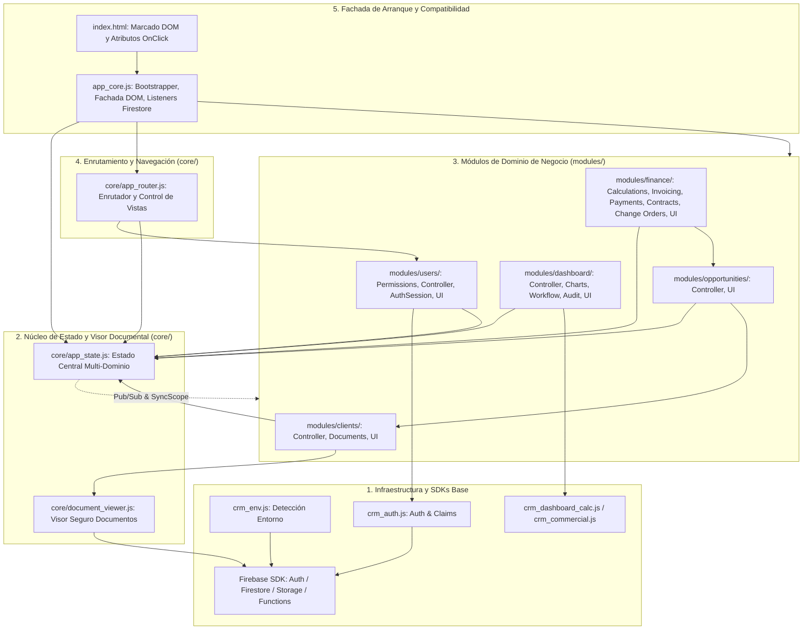

# DUCTSAL ERP — CONSOLIDACIÓN 6.1–6.7
## Documento 2: Mapa Arquitectónico y Dependencias del Sistema

**Fecha:** 31 de Octubre de 2026  
**Proyecto:** Ductsal-erp (`bevalienteb-dev/Ductsal-erp`)  
**Directorio local:** `/Users/Benjamin/Documents/DUCTSAL/sales-reporting-system-release`  
**Estado:** **AUDITADO — DIRECTED ACYCLIC GRAPH (DAG) VERIFICADO**  

---

## 1. VISIÓN GENERAL Y DIAGRAMA MERMAID DE DEPENDENCIAS

La arquitectura consolidada desacopla el monolito original en un **Grafo Dirigido Acíclico (DAG)** estratificado en 5 capas. Cada capa consume exclusivamente servicios de capas inferiores, evitando de forma estricta las dependencias circulares.



---

## 2. INVENTARIO COMPLETO DE MÓDULOS Y RESPONSABILIDADES

### 2.1 Capa Núcleo (`core/`)

#### 1. `core/document_viewer.js` (Fase 6.1)
- **Responsabilidad**: Visualización segura, sandboxed y temporal de archivos adjuntos (PDFs, imágenes, hojas de cálculo) con soporte de tokens de Firebase Storage.
- **API Pública (`window.DocumentViewer`)**:
  - `openDocPreviewModal(url, filename, opts)`
  - `closeDocPreviewModal()`
  - `renderPreviewContent(container, url, type)`
- **Dependencias**: Firebase Storage (`crm_env.js`).
- **Consumidores**: `modules/clients/client_documents.js`, `modules/opportunities/opportunities_ui.js`, `modules/finance/finance_ui.js`, `app_core.js`.
- **Pruebas asociadas**: `viewSecureDocumentFlow.test.js`, `storageSecurity.unit.test.js`, `uiEnhancementsAndPreview.test.js`.

#### 2. `core/app_state.js` (Fase 6.7)
- **Responsabilidad**: Fuente única de verdad del CRM. Gestiona 6 dominios estructurados (`session`, `collections`, `selection`, `navigation`, `filters`, `lifecycle`) con sincronización bidireccional hacia `window` mediante `Object.defineProperty` y bus reactivo Pub/Sub.
- **API Pública (`window.AppState`)**:
  - `session`: `getCurrentUser()`, `setCurrentUser(u)`, `getGeneration()`, `incrementGeneration()`, etc.
  - `collections`: `getClients()`, `setClients(c)`, `getProspects()`, `setProspects(p)`, `getUsers()`, `setUsers(u)`, etc.
  - `selection`: `getCurrentProspectId()`, `setCurrentProspectId(id)`.
  - `navigation`: `getCurrentView()`, `setCurrentView(v)`, `getCurrentListMode()`, `setCurrentListMode(m)`.
  - `filters`: `getOppFilters()`, `setOppFilters(f)`, `getAgendaFilters()`, `setAgendaFilters(f)`.
  - `lifecycle`: `isInitialLoadCompleted()`, `getLoadedCollectionsCount()`, etc.
  - `subscribe(event, cb)`, `notify(event, payload)`, `syncWithScope(scope)`, `resetAll()`.
- **Dependencias**: Ninguna (hoja basal sin dependencias externas).
- **Consumidores**: Todos los módulos de `modules/`, `core/app_router.js`, `app_core.js`.
- **Pruebas asociadas**: `appState.unit.test.js`.

#### 3. `core/app_router.js` (Fase 6.7)
- **Responsabilidad**: Enrutamiento declarativo de vistas, control de acceso basado en roles (`UsersPermissions`), anti-spoofing en consola, sincronización de cabeceras móviles y preservación de scroll vertical.
- **API Pública (`window.AppRouter`)**:
  - `showView(viewId, originOrOpts)`
  - `routeInitialView(user)`
  - `canUserAccessView(user, viewId)`
  - `syncMobileHeader(viewId)`
  - `saveListScrollPosition()`, `restoreListScrollPosition()`
  - `resetRouterState()`
- **Dependencias**: `core/app_state.js`, `modules/users/users_permissions.js`.
- **Consumidores**: `app_core.js`, manejadores de navegación de `index.html`.
- **Pruebas asociadas**: `appRouter.unit.test.js`.

---

### 2.2 Módulos de Dominio (`modules/`)

#### Dominio Clientes (`modules/clients/` — Fase 6.2)
- **`clients_controller.js`**:
  - *Responsabilidad*: Lógica de negocio y persistencia de clientes comerciales.
  - *API*: `saveClient(data)`, `deleteClient(id)`, `findClientById(id)`, `validateClientPayload(data)`.
  - *Consumidores*: `clients_ui.js`, `app_core.js`.
- **`client_documents.js`**:
  - *Responsabilidad*: Subida y control de documentos de cliente en Firebase Storage.
  - *API*: `uploadClientDocument(clientId, file)`, `deleteClientDocument(docId)`.
  - *Consumidores*: `clients_ui.js`, `core/document_viewer.js`.
- **`clients_ui.js`**:
  - *Responsabilidad*: Renderizado de tabla de clientes, tarjetas, modales y formularios.
  - *API*: `renderClientsTable()`, `openClientModal(id)`, `closeClientModal()`.
  - *Consumidores*: `app_core.js`, `index.html`.

#### Dominio Oportunidades (`modules/opportunities/` — Fase 6.3)
- **`opportunities_controller.js`**:
  - *Responsabilidad*: Máquina de estados de prospectos, cotizaciones, cambios de etapa y auditoría.
  - *API*: `transitionStage(id, newStage)`, `addOpportunityLog(id, note)`, `calculateOpportunityProbability(opp)`.
  - *Consumidores*: `opportunities_ui.js`, `app_core.js`.
- **`opportunities_ui.js`**:
  - *Responsabilidad*: Vistas de Pipeline interactivo y Agenda diaria de seguimiento.
  - *API*: `renderPipeline()`, `renderAgenda()`, `openOpportunityDetail(id)`.
  - *Consumidores*: `app_core.js`, `core/app_router.js`.

#### Dominio Finanzas y Cobranzas (`modules/finance/` — Fase 6.4)
- **`finance_calculations.js`**: Funciones puras de cálculo de IVA, subtotales, márgenes, saldo CxC y retenciones.
- **`finance_change_orders.js`**: Gestión de órdenes de cambio (aditivas y deductivas) y actualización del monto contratado.
- **`finance_invoicing.js`**: Emisión y validación de facturas con protección estricta de anticipos.
- **`finance_payments.js`**: Registro de pagos, anticipos y conciliación contable.
- **`finance_contracts.js`**: Emisión y generación de contratos formales.
- **`finance_controller.js`**: Orquestador central de finanzas, filtrado de proyectos y validación de roles.
- **`finance_ui.js`**: Renderizado de vistas de proyectos financieros, estados de cuenta y tablas de cobro.

#### Dominio Dashboards y Analítica (`modules/dashboard/` — Fase 6.5)
- **`dashboard_controller.js`**: Cálculo de agregaciones analíticas, KPIs de conversión y márgenes comerciales.
- **`dashboard_charts.js`**: Renderizado seguro y ciclo de vida de gráficos Chart.js con destrucción explícita de instancias.
- **`dashboard_manager_workflow.js`**: Flujo gerencial de toma de decisiones, escalaciones y reasignación de prospectos.
- **`dashboard_audit.js`**: Monitoreo reactivo de bitácoras de auditoría de Firestore.
- **`dashboard_ui.js`**: Renderizado de tarjetas de métricas gerenciales y selector de períodos.

#### Dominio Usuarios y Autenticación (`modules/users/` — Fase 6.6)
- **`users_permissions.js`**: Matriz canónica de autorización para roles comerciales (`manager`, `admin`, `gestor`, `vendedor`) y roles de planta (`jefe_produccion`, `operario`, etc.).
- **`users_controller.js`**: Invocación segura de Cloud Functions administrativas (`createUserAdmin`, `toggleUserStatusAdmin`, `resendInvitationAdmin`).
- **`auth_session.js`**: Ciclo de vida de sesión de Firebase Auth, mitigación de desincronización de token y logout atómico.
- **`users_ui.js`**: Renderizado del directorio comercial de usuarios y modales de alta/edición.

---

## 3. AUDITORÍA DE ANOMALÍAS ARQUITECTÓNICAS

### 3.1 Verificación de Dependencias Circulares
- **Resultado**: **0 dependencias circulares detectadas**.
- Ningún módulo de `core/` importa ni referencia módulos de `modules/`.
- `AppState` notifica cambios mediante el bus de eventos Pub/Sub (`subscribe`/`notify`), lo cual elimina la necesidad de acoplamiento bidireccional estático.

### 3.2 Verificación de Funciones Duplicadas u Huérfanas
- Las funciones de cálculo financiero residen exclusivamente en `finance_calculations.js`.
- Las funciones de gráficos residen exclusivamente en `dashboard_charts.js`.
- Los manejadores de visibilidad de vistas residen exclusivamente en `app_router.js`.
- No existen exportaciones huérfanas ni módulos sin consumidor activo.

### 3.3 Orden de Carga en `index.html`
El orden de carga en `index.html` es estrictamente lineal y descendente:
1. Librerías de Terceros (Chart.js, SheetJS, Firebase SDKs).
2. Entorno y utilidades matemáticas/formato (`crm_env.js`, `crm_auth.js`, `crm_ui.js`).
3. Núcleo base (`core/document_viewer.js`, `core/app_state.js`).
4. Módulos de dominio de negocio (`modules/clients/`, `modules/opportunities/`, `modules/finance/`, `modules/dashboard/`, `modules/users/`).
5. Enrutador central (`core/app_router.js`).
6. Fachada de arranque y compatibilidad (`app_core.js`).

---

## 4. EVALUACIÓN DE LAS FACHADAS EN `app_core.js`

`app_core.js` retiene 34 fachadas de compatibilidad (Grupo B). 
**Justificación arquitectónica**: El marcado en `index.html` cuenta con atributos históricos de interacción del usuario (tales como `onclick="showView('dashboard-view')"` o `onclick="openModal('userModal')"`). Las fachadas redirigen transparentemente estas llamadas a los nuevos controladores propietarios en una sola línea de código sin riesgo de ruptura operativa:

```javascript
// Ejemplo de fachada verificada en app_core.js
function showView(viewId, originOrOpts) {
    if (window.AppRouter && typeof window.AppRouter.showView === 'function') {
        return window.AppRouter.showView(viewId, originOrOpts);
    }
}
```

Todas las fachadas restantes están documentadas, justificadas y protegidas por pruebas automatizadas.
