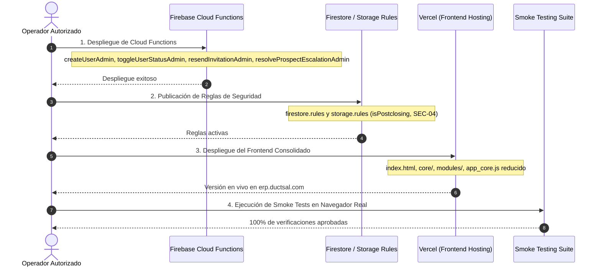

# DUCTSAL ERP — CONSOLIDACIÓN 6.1–6.7
## Documento 6: Plan Estratégico de Despliegue y Rollback en Producción

**Fecha:** 31 de Octubre de 2026  
**Proyecto:** Ductsal-erp (`bevalienteb-dev/Ductsal-erp`)  
**Dominio Productivo:** `https://erp.ductsal.com/`  
**Proyecto Firebase:** `ductsal-erp`  
**Estado:** **PLANIFICADO — PROCEDIMIENTO DE EJECUCIÓN FUTURA**  

---

## 1. OBJETIVO DEL PLAN

Establecer la secuencia óptima, segura y reversible para la futura publicación de los cambios consolidados de las Fases 6.1 a 6.7 en el entorno productivo de DUCTSAL ERP.

> [!IMPORTANT]
> **RESTRICCIÓN ACTIVA:** Este plan es estrictamente documental. No se deben ejecutar comandos de despliegue a producción sin una autorización formal expresa por parte del responsable técnico de DUCTSAL.

---

## 2. ORDEN SECUENCIAL RECOMENDADO DE PUBLICACIÓN

Para evitar condiciones de carrera donde el frontend requiera reglas de seguridad o Cloud Functions que aún no están disponibles en producción, la publicación debe seguir el orden **Backend $\rightarrow$ Reglas de Seguridad $\rightarrow$ Frontend**:



### Paso 1: Publicación de Cloud Functions
- **Comando**:
  ```bash
  firebase deploy --only functions --project ductsal-erp
  ```
- **Verificación**: Comprobar en la consola de Google Cloud / Firebase que las funciones httpsCallable (`createUserAdmin`, `updateUserAdmin`, `toggleUserStatusAdmin`, `resendInvitationAdmin`, `resolveProspectEscalationAdmin`) estén en estado verde y con memoria y cuotas adecuadas.

### Paso 2: Publicación de Reglas de Seguridad
- **Comando**:
  ```bash
  firebase deploy --only firestore:rules,storage:rules --project ductsal-erp
  ```
- **Verificación**: Confirmar que la regla `isPostclosing` y la inmutabilidad de `users_prod` y `prospects_prod` estén aplicadas.

### Paso 3: Despliegue del Frontend en Vercel
- **Comando / Método**:
  - Promoción mediante push a la rama `main` de GitHub o mediante Vercel CLI:
  ```bash
  vercel --prod
  ```
- **Verificación**: Comprobar que el dominio `https://erp.ductsal.com/` sirva el nuevo `index.html` con los 24 módulos y `app_core.js` reducido (versión v=29).

---

## 3. SMOKE TESTS POSTERIORES AL DESPLIEGUE (POST-DEPLOYMENT SMOKE TESTS)

Inmediatamente después de la publicación, se debe ejecutar la siguiente batería de validación manual en vivo sobre `https://erp.ductsal.com/`:

1. **Prueba de Carga Inicial**:
   - Abrir el navegador en ventana de incógnito.
   - Comprobar que `#login-screen` cargue en menos de 2 segundos sin errores en la consola de DevTools (`0 uncaught exceptions`).
2. **Prueba de Inicio de Sesión Comercial**:
   - Iniciar sesión con cuenta de Gerente (`manager`).
   - Validar que la vista inicial sea `dashboard-view`, con KPIs cargados y saludo personalizado.
3. **Prueba de Navegación por Módulos**:
   - Transicionar sucesivamente a `projects-view`, `clients-view`, `users-view` y `list-view`.
   - Comprobar la sincronización de las pestañas activas.
4. **Prueba de Control de Acceso (Anti-Spoofing)**:
   - Iniciar sesión con cuenta de Vendedor (`vendedor`).
   - Intentar acceder manualmente al dashboard. Confirmar que el sistema emita la alerta de restricción y redirija a `list-view`.
5. **Prueba de Visualización de Documentos**:
   - Abrir el modal de previsualización documental sobre un archivo adjunto existente.
   - Verificar carga fluida y cierre limpio del modal.
6. **Prueba de Cierre de Sesión (Logout)**:
   - Presionar "Cerrar sesión".
   - Confirmar que el estado quede en blanco y reaparezca el formulario de autenticación.

---

## 4. CRITERIOS DE ABORTO (ROLLBACK TRIGGERS)

Se debe ordenar el aborto y rollback inmediato si se presenta cualquiera de las siguientes condiciones:
1. **Errores Críticos en Consola**: Excepciones no controladas (`Uncaught ReferenceError`, `TypeError`) al cargar la página principal.
2. **Falla de Autenticación**: Incapacidad de los usuarios comerciales para iniciar sesión con sus credenciales habituales.
3. **Bloqueo Masivo de Permisos**: Rechazo de lecturas legítimas de Firestore por fallo inesperado en las reglas de seguridad.
4. **Disrupción en la Consola de Operador**: Ruptura o incompatibilidad en el acceso independiente de planta (`operador.html`).

---

## 5. PLAN DE ROLLBACK PASO A PASO

En caso de activarse un criterio de aborto, el procedimiento de restitución es el siguiente:

### 5.1 Rollback Inmediato del Frontend (Tiempo estimado: < 1 minuto)
- En el panel de control de Vercel:
  1. Ir a la pestaña **Deployments**.
  2. Localizar el despliegue previo correspondiente al commit `19c01e9`.
  3. Seleccionar **Instant Rollback**.
- Vercel reasigna instantáneamente el tráfico de `erp.ductsal.com` al despliegue estable anterior.

### 5.2 Rollback de Reglas de Seguridad (Tiempo estimado: < 2 minutos)
- Si el inconveniente reside en las reglas de Firestore o Storage:
  ```bash
  git checkout 19c01e9 -- firestore.rules storage.rules
  firebase deploy --only firestore:rules,storage:rules --project ductsal-erp
  ```

### 5.3 Rollback de Cloud Functions (Si aplica)
- Re-desplegar la versión previa de Cloud Functions desde el commit base `19c01e9`:
  ```bash
  git checkout 19c01e9 -- functions/
  firebase deploy --only functions --project ductsal-erp
  ```

---

## 6. MATRIZ DE RESPONSABILIDADES Y PUNTOS DE APROBACIÓN

| Rol | Responsable | Atribución en el Despliegue |
| :--- | :--- | :--- |
| **Líder Técnico / Arquitecto** | Benjamin Valiente | Aprobación del release consolidado y autorización formal para iniciar despliegue. |
| **Operador de Despliegue** | Agente / DevOps | Ejecución estricta de la secuencia de comandos y monitoreo de logs. |
| **Responsable de Validación** | QA / Operador | Ejecución de la batería de Smoke Tests y confirmación de estado operativo. |
