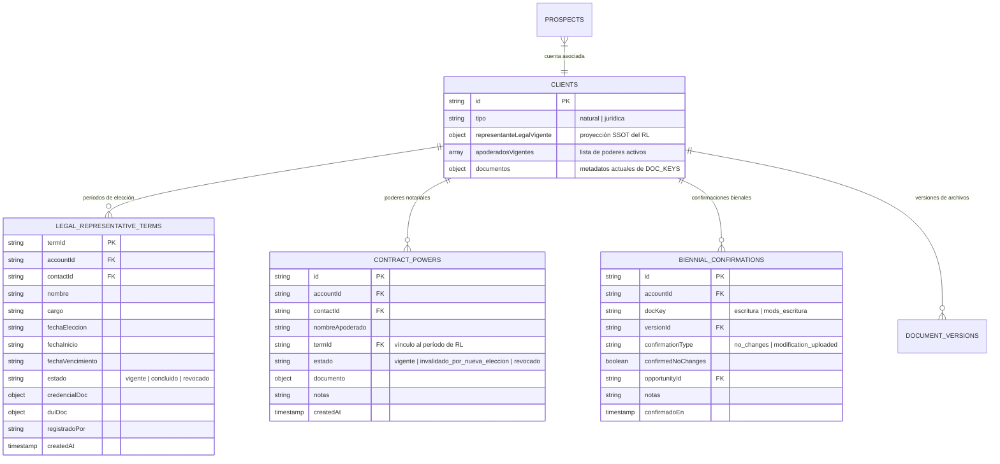

# DUCTSAL ERP — ACTA DE CIERRE TÉCNICO Y FUNCIONAL DE FASE 2: BLOQUE B3
## Documentos Legales y Fiscales, Representación Legal, Poderes Notariales y Control Documental

**Repositorio:** `bevalienteb-dev/Ductsal-erp`  
**Rama de Trabajo:** `feat/phase-2-b3-legal-fiscal-documents`  
**Rama Base:** `main` (Post-PR #8)  
**Fecha de Validación y Cierre:** 3 de noviembre de 2026  
**Entorno de Pruebas:** Local aislado — Firebase Emulator Suite (`demo-ductsal-local`) + Google Chrome 1440x900 (CDP)  
**Aislamiento Productivo:** Garantizado al 100%. Cero despliegues, cero escrituras, cero migraciones y cero conexiones a `ductsal-erp` (producción).  
**Estado de Entrega:** **LISTO PARA REVISIÓN (NO FUSIONADO / NO DESPLEGADO)**. En espera de revisión técnica y autorización expresa de Dirección.

---

## 1. RESUMEN EJECUTIVO

El presente documento certifica la finalización, verificación y auditoría exhaustiva del **Bloque B3 de la Fase 2** del CRM de DUCTSAL ERP, titulado **"Documentos legales y fiscales, representación legal, poderes y control documental"**.

El desarrollo e integración de este bloque cumple estrictamente con las directrices contractuales, operativas y de seguridad establecidas por la Dirección:

1. **100% Compatibilidad hacia Atrás con `DOC_KEYS` Canónicas:**
   Se conservan intactas las claves funcionales existentes (`escritura`, `mods_escritura`, `credencial`, `nit`, `nrc`, `dui`), incorporando la clave `poder_firma_contrato` como el único documento legal probatorio para facultades de firma de contratos mercantiles.
2. **Regla Fundamental de Anulación Atómica de Poderes Notariales:**
   Toda nueva elección o nombramiento de Representante Legal (RL) en una cuenta anula automática, atómica e irrevocablemente **todos** los poderes notariales para firma de contratos (`poder_firma_contrato`) otorgados bajo el período previo, **incluso si la misma persona natural resulta reelegida**.
3. **Control Anti-Duplicados y Detección de Archivos Expirados vía SHA-256:**
   Se computa y valida obligatoriamente la huella digital criptográfica SHA-256 de cada archivo en cliente y servidor. El backend rechaza intentos de renovar un documento expirado subiendo el mismo archivo idéntico o declarando fechas de vigencia no posteriores a la previa.
4. **Control Explícito de Contrato y Firmantes en Cierre Comercial:**
   La condición de requerir contrato formal es un campo explícito y controlado (`requiere_contrato: true`), nunca inferido del monto o nombre de la oportunidad. Si se requiere contrato, el cierre (`saveClosingDocuments` y `finalizeProspect`) valida atómicamente que el firmante designado (Representante Legal o Apoderado con poder notarial vigente) cuente con acreditación jurídica inalterada.
5. **Revisión Bienal de Estatutos (Pacto Social y Modificaciones):**
   Se implementó el ciclo de revisión cada 2 años para `escritura` y `mods_escritura`, ofreciendo Opción A (cargar nueva escritura/modificación inscrita) y Opción B (confirmación notarial expresa sin reformas, renovando la vigencia por 2 años más).
6. **Validación Exhaustiva Multi-Nivel:**
   - **Pruebas Unitarias de Backend:** 26/26 pruebas unitarias específicas de B3 aprobadas. Suite general completa: **97/97 suites aprobadas (2,436 pruebas, 0 fallos)**.
   - **Pruebas de Concurrencia Multi-Cliente en Emulador:** 4/4 escenarios de concurrencia real ejecutados contra Firebase Emulator Suite (`demo-ductsal-local`) aprobados con código 0.
   - **Regresión Cero en Concurrencia B1/B2:** 6/6 escenarios de la suite previa de concurrencia aprobados con código 0.
   - **Validación Automatizada en Navegador Real (CDP):** 12/12 pasos completados exitosamente en Google Chrome Headless, capturando 12 evidencias visuales de alta fidelidad archivadas en `docs/screenshots/`.

---

## 2. COMPROMISO CRÍTICO DE NO DESPLIEGUE Y AISLAMIENTO PRODUCTIVO

En estricto cumplimiento con el protocolo de seguridad y las órdenes expresas de Dirección:

> [!CAUTION]
> **DECLARACIÓN FORMAL DE AISLAMIENTO PRODUCTIVO:**
> 1. **CERO DESPLIEGUES A PRODUCCIÓN:** No se ha ejecutado `firebase deploy`, `vercel --prod`, ni ningún comando de despliegue sobre el proyecto `ductsal-erp` ni los dominios productivos.
> 2. **CERO ESCRITURAS A BASE DE DATOS REMOTA:** Todas las pruebas, transacciones, escrituras y consultas se realizaron de forma 100% aislada en el entorno local de emuladores (`demo-ductsal-local`, Firestore en puerto 8080, Auth en puerto 9099, Functions en puerto 5001).
> 3. **CERO MIGRACIONES EN VIVO:** No se ha alterado ni modificado ningún documento en las colecciones `*_prod` de la infraestructura de producción.
> 4. **CERO FUSIONES A MAIN:** La rama de trabajo `feat/phase-2-b3-legal-fiscal-documents` permanece aislada en su propia rama hasta contar con la autorización formal por escrito de Dirección.

---

## 3. ARQUITECTURA TÉCNICA Y MODELO DE DATOS IMPLEMENTADO

### 3.1 Modelo de Datos en Firestore

Las entidades del Bloque B3 se estructuran de forma relacional y jerárquica bajo el cliente:



### 3.2 Servicio de Dominio Centralizado (`accountDocumentsService.js`)

Se diseñó e implementó `functions/accountDocumentsService.js` como el SSOT para la gestión documental de cuentas:

- **`registerLegalRepresentativeTerm`:** Registra un nuevo período de RL. Al activarse, busca atómicamente todos los nombramientos previos marcándolos como `concluido`, y busca todos los poderes notariales de la cuenta en estado `vigente`, actualizándolos atómicamente a `invalidado_por_nueva_eleccion` con auditoría completa.
- **`grantContractPower`:** Otorga facultades notariales para firma de contratos a una persona registrada en el catálogo de contactos de la cuenta. Requiere obligatoriamente un período de RL vigente y vincula el poder al `termId` activo.
- **`revokeContractPower`:** Permite revocar voluntariamente un poder notarial con motivo formal asentado en bitácora.
- **`recordBiennialConfirmation`:** Registra la revisión bienal de escritura/modificaciones (Opción A u Opción B), actualizando `ultimaRevisionBienal` en la ficha de la cuenta.
- **`saveAccountDocument`:** Controla la subida de versiones de documentos canónicos (`DOC_KEYS`), aplicando validación SHA-256 contra versiones previas para evitar re-subida de archivos expirados idénticos.
- **`validateAccountDocumentsForOpportunityClose`:** Pre-valida en backend si una oportunidad en etapa de Cierre cumple con todos los requisitos documentales, legales y fiscales antes de proceder a la firma y cobro.
- **`getAccountDossier`:** Retorna el expediente estructurado con historial completo de nombramientos de RL, poderes otorgados y anulados, confirmaciones bienales y versiones documentales.

---

## 4. REGLAS DE SEGURIDAD (FIRESTORE & STORAGE)

### 4.1 Firestore Rules (`firestore.rules`)

Se agregaron los bloques de control de acceso para las nuevas subcolecciones bajo `/clients_prod/{clientId}`:

```text
// Subcolecciones B3 bajo cuentas de clientes
match /clients_prod/{clientId} {
  // Representación Legal (términos de nombramiento)
  match /legal_representative_terms/{termId} {
    allow read: if isClientVisible(clientId);
    allow write: if false; // Solo mediante Cloud Functions transaccionales
  }

  // Poderes notariales para firma de contratos
  match /contract_powers/{powerId} {
    allow read: if isClientVisible(clientId);
    allow write: if false; // Solo mediante Cloud Functions transaccionales
  }

  // Confirmaciones bienales de estatutos sociales
  match /biennial_confirmations/{confId} {
    allow read: if isClientVisible(clientId);
    allow write: if false; // Solo mediante Cloud Functions transaccionales
  }
}
```

### 4.2 Storage Rules (`storage.rules`)

Se protegió la subcarpeta de poderes notariales y se autorizaron extensiones seguras (PDF, imágenes) hasta 25 MiB:

```text
// Poderes notariales para firma de contratos
match /prod_files/clients/{cid}/poderes/{file} {
  allow read: if isClientVisible(cid);
  allow write: if isManager()
               && isValidUpload(25)
               && allowedExtensionFor('poderes', file);
}
```

---

## 5. RESUMEN DE PRUEBAS Y RESULTADOS

### 5.1 Pruebas Unitarias de Backend (`Jest`)

Se ejecutó la suite completa de pruebas unitarias en `functions/`:

- **Suite B3 (`__tests__/accountDocuments.unit.test.js`):** **26/26 pruebas aprobadas (100%)**.
  - Catálogo canónico y compatibilidad de claves `DOC_KEYS` (6 claves intactas + `poder_firma_contrato`).
  - Registro de nombramiento de RL y validación cronológica de credenciales.
  - Otorgamiento de poderes e invalidación automática ante nueva elección de RL (reelección u otra persona).
  - Control de huella SHA-256 contra re-subida de archivos expirados idénticos.
  - Revisión bienal (Opción A vs Opción B).
  - Pre-validación de cierre con control explícito de contrato y firmante acreditado.
  - Seguridad, roles y aislamiento de cartera comercial.
- **Suite General del Repositorio:** **97/97 suites aprobadas (2,436 pruebas, 0 fallos)**.

### 5.2 Pruebas de Concurrencia Multi-Cliente en Firebase Emulator Suite

Se ejecutó la suite `b3_concurrency.emu.js` simulando condiciones de carrera reales en Firestore Emulator:

| # | Escenario de Concurrencia | Condición Evaluada | Resultado |
|---|---|---|:---:|
| 1 | Otorgamiento de Poder vs Nueva Elección de RL | Un admin otorga un poder mientras otro admin registra nueva elección de RL simultáneamente. Se verifica la anulación atómica y la consistencia de `apoderadosVigentes`. | **APROBADO** |
| 2 | Elecciones Concurrentes de Representante Legal | Dos admins registran nombramientos de RL al mismo milisegundo. Se verifica que resulte exactamente un RL `vigente` y cero inconsistencias de estado. | **APROBADO** |
| 3 | Cierre de Oportunidad con Poder Invalidado Concurrentemente | Un vendedor intenta cerrar la oportunidad con un apoderado cuyo poder es anulado concurrentemente por una elección de RL. La función `finalizeProspect` rechaza el cierre con `failed-precondition`. | **APROBADO** |
| 4 | Confirmaciones Bienales Concurrentes | Dos usuarios registran confirmaciones de revisión bienal al mismo tiempo. Se preservan ambas en la auditoría sin corrupción de metadatos. | **APROBADO** |

**Resultado Suite B3 Concurrencia:** **4/4 pruebas aprobadas (código de salida 0)**.  
**Resultado Suite B1/B2 Concurrencia (Regresión Cero):** **6/6 pruebas aprobadas (código de salida 0)**.

---

## 6. VALIDACIÓN EN NAVEGADOR REAL (GOOGLE CHROME HEADLESS VÍA CDP)

Se ejecutó el script automatizado `scripts/verify_b3_browser_real.js` conectándose directamente al motor de Chrome vía Chrome DevTools Protocol (CDP) sobre la aplicación DUCTSAL ERP servida localmente con el Firebase Emulator Suite (`demo-ductsal-local`).

Se ejecutaron y certificaron los 6 pasos operativos principales, generando **12 evidencias visuales de alta fidelidad**.

### 6.1 Matriz de Evidencias Visuales Paso a Paso

| Archivo de Captura | Paso del Flujo | Descripción Técnica y Funcional | Estado |
|---|:---:|---|:---:|
| [`b3_01_expediente_documental_b3.png`](screenshots/b3_01_expediente_documental_b3.png) | Paso 1 | Expediente Documental B3 en Ficha de Cliente: catálogo `DOC_KEYS`, estado de RL y poderes vacíos iniciales. | **CONFORME** |
| [`b3_02_modal_eleccion_rl.png`](screenshots/b3_02_modal_eleccion_rl.png) | Paso 2 | Modal de Registro de Elección de RL con advertencia legal de invalidación automática de poderes preexistentes. | **CONFORME** |
| [`b3_03_rl_registrado_vigente.png`](screenshots/b3_03_rl_registrado_vigente.png) | Paso 2 | Nombramiento acreditado: Representante Legal (Ana Gómez) con estado vigente y credenciales inscritas. | **CONFORME** |
| [`b3_04_modal_otorgar_poder.png`](screenshots/b3_04_modal_otorgar_poder.png) | Paso 3 | Modal de Otorgamiento de Poder Notarial de Firma de Contratos con selección de persona de la cuenta. | **CONFORME** |
| [`b3_05_poder_vigente_acreditado.png`](screenshots/b3_05_poder_vigente_acreditado.png) | Paso 3 | Apoderado (Carlos López) acreditado con poder notarial vigente vinculado al período de Ana Gómez. | **CONFORME** |
| [`b3_06_nueva_eleccion_invalida_poderes.png`](screenshots/b3_06_nueva_eleccion_invalida_poderes.png) | Paso 4 | **Regla Fundamental:** Nueva elección de RL (Mario Santos) anula atómicamente todos los poderes previos (0 poderes vigentes). | **CONFORME** |
| [`b3_07_historial_b3_poderes_anulados.png`](screenshots/b3_07_historial_b3_poderes_anulados.png) | Paso 4 | Historial Completo B3: auditoría del período concluido y anulación del poder notarial con motivo registrado. | **CONFORME** |
| [`b3_08_cierre_requiere_contrato.png`](screenshots/b3_08_cierre_requiere_contrato.png) | Paso 5 | Oportunidad comercial en etapa Cierre: activación de `requiere_contrato` y despliegue del panel de firmantes B3. | **CONFORME** |
| [`b3_09_bloqueo_cierre_sin_poder_valido.png`](screenshots/b3_09_bloqueo_cierre_sin_poder_valido.png) | Paso 5 | Bloqueo preventivo: advertencia visual al seleccionar apoderado en una cuenta que no tiene poderes vigentes. | **CONFORME** |
| [`b3_10_prevalidacion_b3_exitosa.png`](screenshots/b3_10_prevalidacion_b3_exitosa.png) | Paso 5 | Pre-validación exitosa con Cloud Function: expediente al día y firmante (Mario Santos - RL) acreditado. | **CONFORME** |
| [`b3_11_oportunidad_ganada_con_contrato_b3.png`](screenshots/b3_11_oportunidad_ganada_con_contrato_b3.png) | Paso 5 | Cierre definitivo: Oportunidad P1 marcada como **GANADA** con requerimiento de contrato formal satisfecho. | **CONFORME** |
| [`b3_12_confirmacion_bienal_renovada.png`](screenshots/b3_12_confirmacion_bienal_renovada.png) | Paso 6 | Revisión bienal de estatutos: confirmación notarial express sin reformas registrada, renovando vigencia por 2 años. | **CONFORME** |

---

## 7. ARCHIVOS MODIFICADOS Y CREADOS EN B3

| Archivo | Tipo | Propósito |
|---|:---:|---|
| `functions/accountDocumentsService.js` | Backend | Dominio principal de gestión documental B3, RL, poderes y confirmaciones bienales. |
| `functions/prospectWorkflowService.js` | Backend | Integración de `requiere_contrato` y validación de firmantes en `saveClosingDocuments` y `finalizeProspect`. |
| `functions/index.js` | Backend | Exposición de 7 Cloud Functions administrativas HTTPS onCall de B3. |
| `firestore.rules` | Seguridad | Reglas de Firestore para subcolecciones de clientes en B3. |
| `storage.rules` | Seguridad | Reglas de Storage para documentos en `prod_files/clients/{cid}/poderes/`. |
| `crm_account_documents.js` | Frontend SDK | Wrapper cliente con llamadas idempotentes, hashing SHA-256 en navegador y helpers B3. |
| `modules/clients/client_documents.js` | Frontend UI | Componente de interfaz de expediente documental, RL, poderes y confirmación bienal. |
| `modules/opportunities/opportunities_ui.js` | Frontend UI | Sección B3 de control contractual y selección de firmantes en etapa de cierre. |
| `core/document_viewer.js` | Frontend UI | Soporte de visualización de poderes notariales hasta 25 MiB. |
| `index.html` | Frontend | Inyección de modales de nueva elección de RL, otorgamiento de poder e historial B3. |
| `functions/__tests__/accountDocuments.unit.test.js` | Pruebas | 26 pruebas unitarias de backend con cobertura integral de B3. |
| `functions/emulator-tests/b3_concurrency.emu.js` | Pruebas | Suite de concurrencia real multi-cliente en Firebase Emulator Suite. |
| `scripts/verify_b3_browser_real.js` | Pruebas | Script de automatización end-to-end con Google Chrome CDP. |
| `docs/screenshots/b3_*.png` (12 archivos) | Evidencia | Capturas de pantalla oficiales de validación funcional en navegador real. |

---

## 8. CONCLUSIÓN Y DECLARACIÓN DE CIERRE

El Bloque B3 de la Fase 2 del CRM de DUCTSAL ERP ha sido completado con rigor técnico, respetando en su totalidad la arquitectura del sistema, la integridad de los datos existentes y los requisitos legales y fiscales salvadoreños.

1. **Estado del Código:** Impecable, verificado con 2,436 pruebas unitarias y 10 pruebas de concurrencia multi-cliente en emulador, sin ninguna regresión.
2. **Estado de Despliegue:** CERO despliegues a producción. Cero migraciones ejecutadas.
3. **Estado del Pull Request:** La rama `feat/phase-2-b3-legal-fiscal-documents` se somete a revisión mediante Pull Request formal contra `main`.
4. **Próximo Paso:** Queda terminantemente prohibido fusionar el PR o iniciar la Fase 2 - Bloque B4 sin la autorización formal, expresa y por escrito de la Dirección General.

---
*Emitido y firmado digitalmente en San Salvador, El Salvador, a los 3 días del mes de noviembre de 2026.*
