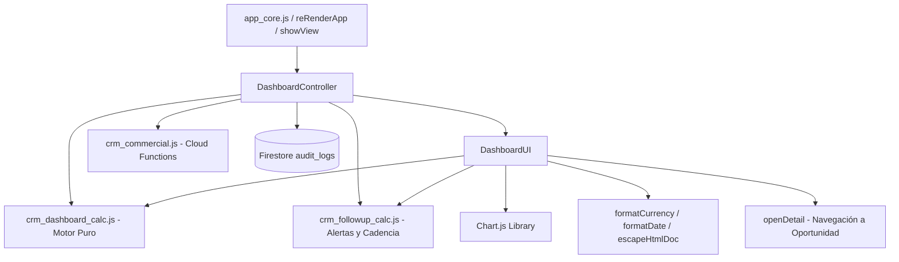
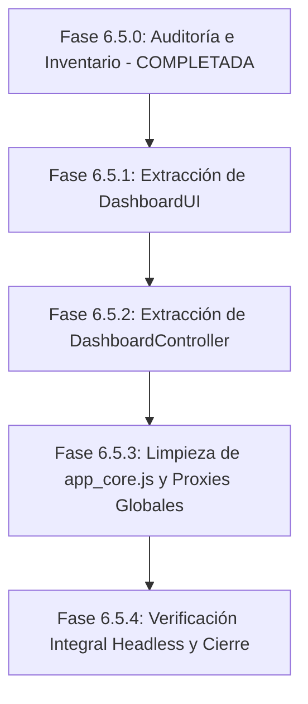

# DUCTSAL ERP — FASE 6.5.0: AUDITORÍA E INVENTARIO PARA MODULARIZACIÓN DE DASHBOARDS
## Subsistema de Inteligencia Comercial, Métricas de Rendimiento y Centro de Mando Gerencial

> **Fecha de Elaboración:** 31 de Octubre de 2026  
> **Auditor y Arquitecto:** Antigravity Senior Technical Auditor  
> **Proyecto:** DUCTSAL ERP (`bevalienteb-dev/Ductsal-erp`)  
> **Entorno de Producción:** `https://erp.ductsal.com/`  
> **Rama de Trabajo:** `main` (commit base `19c01e9`)  
> **Estado de la Auditoría:** 🟢 **COMPLETA — NO SE MODIFICÓ CÓDIGO FUNCIONAL**  
> **Dictamen Final:** **APTO PARA INICIAR 6.5.1** (Con observaciones técnicas preventivas)

---

## 1. Resumen Ejecutivo

### 1.1 Contexto Arquitectónico y Antecedentes
El proyecto DUCTSAL ERP se encuentra en un proceso metódico de desacoplamiento modular para eliminar la deuda técnica concentrada en el archivo monolítico [`app_core.js`](file:///Users/Benjamin/Documents/DUCTSAL/sales-reporting-system-release/app_core.js) (5,622 líneas, ~296 KB). Las fases previas completadas y estabilizadas localmente son:
- **Fase 6.1**: Visor Unificado de Documentos (`core/document_viewer.js`).
- **Fase 6.2**: Catálogo de Clientes y Expedientes (`modules/clients/clients_controller.js`, `client_documents.js`, `clients_ui.js`).
- **Fase 6.3**: Pipeline Comercial y Gestión de Oportunidades (`modules/opportunities/opportunities_controller.js`, `opportunities_ui.js`).
- **Fase 6.4**: Finanzas, Órdenes de Cambio, Facturación y Control de Cobranzas (`modules/finance/finance_calculations.js`, `finance_change_orders.js`, `finance_invoicing.js`, `finance_payments.js`, `finance_contracts.js`, `finance_controller.js`, `finance_ui.js`).

La **Fase 6.5** tiene como objetivo extraer y modularizar el subsistema de Dashboards que aún reside en [`app_core.js`](file:///Users/Benjamin/Documents/DUCTSAL/sales-reporting-system-release/app_core.js) (líneas 4010 a 5391, aproximadamente 1,380 líneas de código).

### 1.2 Diagnóstico General del Subsistema de Dashboards
1. **Existencia de Motor Matemático Previo**: A diferencia de las fases iniciales, el subsistema de Dashboards ya cuenta con un motor puro independiente del DOM: [`crm_dashboard_calc.js`](file:///Users/Benjamin/Documents/DUCTSAL/sales-reporting-system-release/crm_dashboard_calc.js) (1,312 líneas), el cual exporta 17 funciones puras de cálculo matemático, proyecciones ponderadas, transiciones temporales y agregaciones. **Este módulo no debe ser duplicado ni reemplazado**.
2. **Existencia de Motor de Seguimiento y Alertas**: El archivo [`crm_followup_calc.js`](file:///Users/Benjamin/Documents/DUCTSAL/sales-reporting-system-release/crm_followup_calc.js) gestiona la cadencia comercial y el cálculo de oportunidades que requieren atención gerencial (`calculateManagerAttentionItems`).
3. **Lógica Pendiente en [`app_core.js`](file:///Users/Benjamin/Documents/DUCTSAL/sales-reporting-system-release/app_core.js)**:
   - Orquestador del ciclo de vida del dashboard (`renderDashboard`).
   - Gestión y poblado del selector multianual de períodos (`populateTimeFilter`, `getFilteredProspects`).
   - Estado y conmutación de filtro de comerciales activos vs histórico (`setSellerFilterMode`, `getSellerFilterMode`, `updateSellerFilterButtons`).
   - Renderizado de tarjetas KPI de flujo y stock vivo.
   - Renderizado de cuadrícula de tiempos en etapa (`renderDashboardKpiTimes`).
   - Renderizado y filtrado de la tabla de atención gerencial (`renderDashboardActiveTimes`).
   - Flujo modal y transaccional de decisiones gerenciales (`switchManagerDecisionTab`, `openManagerDecisionModal`, `submitManagerDecision`).
   - Suscripción en tiempo real a bitácora de auditoría (`fetchAuditLogs` a `audit_logs`).
   - Generación de gráficos visuales en Chart.js y embudo CSS (`renderCharts` con 8 canvas y 1 contenedor CSS).
4. **Estado de la Suite de Pruebas**: 75/75 suites aprobadas, 2,036/2,036 pruebas unitarias y de integración aprobadas (100% de éxito). Las 56 pruebas vinculadas directamente al subsistema de dashboards aprueban sin fallas.

---

## 2. Inventario Completo de Dashboards y Vistas

Se verificó la existencia real de cada componente solicitado en el código fuente:

| Subsistema / Componente | Estado de Implementación | Ubicación en el Código | Descripción y Comportamiento Verificado |
|---|---|---|---|
| **Centro de Mando Comercial (Dashboard Ejecutivo / Gerencial)** | **Implementado** | [`index.html`](file:///Users/Benjamin/Documents/DUCTSAL/sales-reporting-system-release/index.html#L386-L783)<br>[`app_core.js`](file:///Users/Benjamin/Documents/DUCTSAL/sales-reporting-system-release/app_core.js#L4106-L4322) | Vista principal `#dashboard-view`, exclusiva para el rol `manager`. Integra métricas de flujo contable del período, stock vivo de cartera, cuentas por cobrar, alertas de estancamiento y auditoría. |
| **Rendimiento de Vendedores** | **Implementado** | [`index.html`](file:///Users/Benjamin/Documents/DUCTSAL/sales-reporting-system-release/index.html#L616-L652)<br>[`app_core.js`](file:///Users/Benjamin/Documents/DUCTSAL/sales-reporting-system-release/app_core.js#L5061-L5239) | Gráfico de barras horizontales `#sellerChart` (`chartSeller`). Compara ventas ganadas, margen bruto conocido y cartera activa. Selector 'Solo Activos' vs 'Histórico Completo'. |
| **Rendimiento de Gestores** | **Implementado** | [`crm_dashboard_calc.js`](file:///Users/Benjamin/Documents/DUCTSAL/sales-reporting-system-release/crm_dashboard_calc.js#L936-L947)<br>[`app_core.js`](file:///Users/Benjamin/Documents/DUCTSAL/sales-reporting-system-release/app_core.js#L5147) | Integrado formalmente en el ranking comercial con etiqueta `(Gestor)`. Posee cartera independiente y reglas de atribución propias. |
| **Rendimiento de Gerentes** | **No Implementado (Por diseño)** | N/A | El rol `manager` supervisa la operación global y no compite en los rankings comerciales. Las oportunidades creadas por gerencia sin comercial asignado se atribuyen a 'Sin Asignar'. |
| **Ventas, Facturación y Márgenes** | **Implementado** | [`index.html`](file:///Users/Benjamin/Documents/DUCTSAL/sales-reporting-system-release/index.html#L421-L511)<br>[`app_core.js`](file:///Users/Benjamin/Documents/DUCTSAL/sales-reporting-system-release/app_core.js#L4123-L4178) | Tarjetas KPI `#metric-ganadas`, `#metric-margen`, `#metric-margen-pct`, `#sub-metric-margen`, advertencia `#metric-cost-warning`. Gráfico `#monthlyEvolutionChart` (barras mixtas y línea de rentabilidad). |
| **Pipeline y Oportunidades (Stock)** | **Implementado** | [`index.html`](file:///Users/Benjamin/Documents/DUCTSAL/sales-reporting-system-release/index.html#L523-L580)<br>[`app_core.js`](file:///Users/Benjamin/Documents/DUCTSAL/sales-reporting-system-release/app_core.js#L4224-L4257) | Tarjeta Stock Vivo `#metric-pipeline-ponderado`, `#metric-pipeline-nominal`, `#metric-pipeline-margen`. Embudo HTML/CSS `#css-funnel-container` con 5 etapas comerciales. |
| **Proyectos y Ejecución (Operativo)** | **Implementado en módulo financiero** | [`modules/finance/finance_ui.js`](file:///Users/Benjamin/Documents/DUCTSAL/sales-reporting-system-release/modules/finance/finance_ui.js)<br>[`index.html`](file:///Users/Benjamin/Documents/DUCTSAL/sales-reporting-system-release/index.html#L275-L383) | Vista `#projects-view` ("Proyectos y Cobros"). Clasifica proyectos ganados, saldo por cobrar, abonos y estado de facturación. En el dashboard se refleja la distribución de modalidad en `#projectChart` y `#oppProjectChart`. La ejecución en taller físico reside en la app de planta. |
| **Indicadores Financieros (CxC Global)** | **Implementado** | [`index.html`](file:///Users/Benjamin/Documents/DUCTSAL/sales-reporting-system-release/index.html#L543-L562)<br>[`app_core.js`](file:///Users/Benjamin/Documents/DUCTSAL/sales-reporting-system-release/app_core.js#L4259-L4285) | Tarjeta CxC Global: `#metric-total-cxc`, `#metric-total-cobrado`, `#metric-total-facturado`, porcentaje `#cxc-pct-badge` y barra de progreso `#cxc-bar-cobrado`. Refleja stock vivo acumulado con IVA (13%). |
| **Comparativos por Período** | **Implementado vía selector multianual** | [`index.html`](file:///Users/Benjamin/Documents/DUCTSAL/sales-reporting-system-release/index.html#L404)<br>[`app_core.js`](file:///Users/Benjamin/Documents/DUCTSAL/sales-reporting-system-release/app_core.js#L4013-L4046) | Selector `#dash-time-filter` con auto-descubrimiento de años: `Histórico Completo`, `YTD [Año actual]`, meses individuales, y años pasados completos. Gráfico mensual evolutivo. *(Comparativo dual Año contra Año en pantalla única no existe)*. |
| **Filtro de Fecha / Período** | **Implementado** | [`app_core.js`](file:///Users/Benjamin/Documents/DUCTSAL/sales-reporting-system-release/app_core.js#L4048-L4068) | Handler dinámico `populateTimeFilter` y selector `dash-time-filter`. Divide dataset en flujo del período (`flujoGanadas`, `flujoPerdidas`, `flujoAltas`) y stock actual (`stockActivo`). |
| **Filtro de Comercial (Vendedor / Gestor)** | **Implementado en componentes clave** | [`app_core.js`](file:///Users/Benjamin/Documents/DUCTSAL/sales-reporting-system-release/app_core.js#L4072-L4104)<br>[`app_core.js`](file:///Users/Benjamin/Documents/DUCTSAL/sales-reporting-system-release/app_core.js#L4414-L4438) | Dos filtros implementados: 1) Botones de píldora en ranking (`btn-seller-filter-active` vs `btn-seller-filter-all`); 2) Selector dropdown `#filter-mgr-responsable` en tabla de atención gerencial. *(Filtro global monousuario que altere todo el dashboard no existe)*. |
| **Filtro de Sucursal o Empresa** | **No Implementado (No Aplica)** | N/A | DUCTSAL opera como una entidad comercial única consolidada en El Salvador. No existen sucursales ni esquema multi-empresa en el modelo de datos. |
| **Gráficos, Tablas, Tarjetas y Rankings** | **Implementado** | [`index.html`](file:///Users/Benjamin/Documents/DUCTSAL/sales-reporting-system-release/index.html#L386-L783) | 13 Tarjetas KPI, 6 gráficos Chart.js (`monthlyEvolutionChart`, `conversionChart`, `sellerChart`, `lossChart`, `productChart`, `projectChart`, `oppProductChart`, `oppProjectChart`), 1 embudo HTML/CSS, 1 tabla interactiva `#dashActiveTimesTable`, 1 panel de auditoría `#audit-panel`. |
| **Exportaciones y Reportes (CSV / Excel / PDF)** | **No Implementado** | N/A | No existen botones ni rutinas de exportación a CSV, Excel ni PDF para el Centro de Mando Comercial en la versión actual. |

---

## 3. Inventario Detallado de Funciones y Variables

### 3.1 Variables de Estado Globales en [`app_core.js`](file:///Users/Benjamin/Documents/DUCTSAL/sales-reporting-system-release/app_core.js)
1. `currentSellerFilterMode` (L4070): Almacena `'active_only'` (por defecto) o `'all'`. Determina si el ranking de comerciales excluye colaboradores inactivos.
2. `currentDecisionProspectId` (L4556): Almacena el `id` del prospecto bajo evaluación en el modal `#modal-manager-decision`.
3. Instancias de Gráficos Chart.js (L1524):
   - `chartMonthly`: Gráfico de evolución mensual de ventas y margen bruto.
   - `chartOrigin`: Gráfico de volumen y tasa de conversión por canal.
   - `chartSeller`: Gráfico de barras horizontales de rendimiento comercial.
   - `chartLoss`: Gráfico de dona de motivos de descarte.
   - `chartProduct`: Gráfico de dona de ventas por tipo de producto (Chute vs Ducto).
   - `chartProject`: Gráfico de dona de ventas por tipo de proyecto (Fab e Inst vs Fab).
   - `chartOppProduct`: Gráfico de dona de pipeline activo por tipo de producto.
   - `chartOppProject`: Gráfico de dona de pipeline activo por tipo de proyecto.
   - `chartFunnel`: Declarada en L1524 pero obsoleta (el embudo actual es HTML/CSS en `#css-funnel-container`).
4. `window.auditUnsubscribe` (L4331, L4336): Función de desuscripción de Firestore para la colección `audit_logs`.

### 3.2 Catálogo de Funciones en [`app_core.js`](file:///Users/Benjamin/Documents/DUCTSAL/sales-reporting-system-release/app_core.js)

| # | Función | Líneas | Responsabilidad | Datos que Consume | Origen de Datos | Renderizado / DOM | Eventos Asociados |
|---|---|---|---|---|---|---|---|
| 1 | `populateTimeFilter()` | 4013–4046 | Descubre años con `CrmDashboardCalc.getAvailableYears` y puebla el dropdown `#dash-time-filter`. | `prospects` | Memoria global | Dropdown `#dash-time-filter` | Invocada por `reRenderApp()` |
| 2 | `getFilteredProspects()` | 4048–4068 | Segmenta `prospects` en flujo (`flujoGanadas`, `flujoPerdidas`, `flujoAltas`) y stock (`stockActivo`). | `prospects`, `#dash-time-filter.value` | Memoria global y DOM | Ninguno (retorna objeto de datos) | Invocada por `renderDashboard()` |
| 3 | `setSellerFilterMode(mode)` | 4072–4080 | Cambia entre `'active_only'` y `'all'`, actualiza botones y re-renderiza dashboard. | Argumento `mode` | Evento click | Clase `.active` en botones | `onclick` en `#btn-seller-filter-active` y `#btn-seller-filter-all` |
| 4 | `getSellerFilterMode()` | 4082–4084 | Retorna el modo activo del filtro de vendedores. | `currentSellerFilterMode` | Variable de módulo | Ninguno | Invocada por controladores externos |
| 5 | `updateSellerFilterButtons()` | 4086–4104 | Actualiza visualmente el estado activo de los botones de filtro de vendedores. | `currentSellerFilterMode` | Variable de módulo | `#btn-seller-filter-active`, `#btn-seller-filter-all` | Invocada por `setSellerFilterMode` y `renderCharts` |
| 6 | `renderDashboard()` | 4106–4322 | **Orquestador Central**: Calcula métricas, actualiza cabecera, tarjetas KPI de flujo, stock, CxC y delega sub-renderers. | `prospects`, `users`, `currentUser` | Memoria global y DOM | 15+ elementos de cabecera y tarjetas KPI | Invocada por `reRenderApp`, `showView`, `onchange` en `#dash-time-filter` |
| 7 | `fetchAuditLogs()` | 4324–4359 | Suscribe listener en tiempo real a `audit_logs` en Firestore (límite 20) y renderiza registros. | Snapshot de Firestore | Firestore `audit_logs${DB_SUFFIX}` | `#audit-panel`, `#audit-logs-container` | Invocada en `renderDashboard()` si rol es `manager` |
| 8 | `renderDashboardKpiTimes(filterRes)` | 4361–4404 | Calcula y renderiza promedios de días de transición entre etapas con marcas de límite superado. | Universo de concluidas y activas | `filterRes`, `CrmDashboardCalc.calculateStageTransitionTimes` | Cuadrícula `#kpi-times-grid` | Invocada en `renderDashboard()` |
| 9 | `renderDashboardActiveTimes(activeList)` | 4406–4551 | Renderiza la tabla de Oportunidades que Requieren Atención del Gerente y gestiona sus filtros. | `prospects`, `users`, filtros DOM | `CrmFollowUpCalc.calculateManagerAttentionItems` | `#dash-stagnant-table-wrapper`, `#dash-active-times-body`, badges | Invocada en `renderDashboard()` y `onchange` en filtros gerenciales |
| 10 | `switchManagerDecisionTab(tab)` | 4558–4591 | Conmuta entre pestaña 'Autorizar Continuidad' y 'Ordenar Cierre' en el modal gerencial. | Argumento `tab` | Evento click | `#mgr-tab-autorizar`, `#mgr-tab-cierre`, botones | `onclick` en `#tab-btn-autorizar`, `#tab-btn-cierre` |
| 11 | `openManagerDecisionModal(prospectId)` | 4593–4641 | Valida rol de gerente, prepara formulario, calcula fecha SLA sugerida y abre el modal. | `prospects`, `users`, `currentUser` | Memoria global | Campos de `#modal-manager-decision` | `onclick` en botones de tabla gerencial |
| 12 | `submitManagerDecision(decisionType)` | 4643–4697 | Valida formulario y ejecuta Cloud Function transaccional `resolveFollowUpEscalation`. | Valores de campos de modal | Formulario DOM | Cierra modal y refresca dashboard y detalle | `onclick` en `#btn-submit-mgr-autorizar`, `#btn-submit-mgr-cierre` |
| 13 | `renderCharts(filterRes)` | 4699–5391 | Destruye gráficos previos e instancia los 6 gráficos Chart.js, el embudo CSS y las notas contextuales. | `filterRes`, `users`, variables de gráficos | `CrmDashboardCalc`, Chart.js | 6 `<canvas>` y `#css-funnel-container` | Invocada en `renderDashboard()` |

---

## 4. Mapa de Dependencias y Acoplamientos

### 4.1 Relaciones con Otros Módulos y Subsistemas



### 4.2 Hallazgos de la Auditoría Técnica de Dependencias
1. **Dependencias Circulares**:
   - No existen dependencias circulares directas entre `app_core.js` y `crm_dashboard_calc.js`.
   - `crm_dashboard_calc.js` es estrictamente independiente y autosuficiente (no importa nada de `app_core.js`).
   - El riesgo potencial se encuentra entre `openDetail()` (módulo de oportunidades) y `renderDashboardActiveTimes()`: la tabla de atención gerencial renderiza botones que invocan `openDetail(id)` y `openManagerDecisionModal(id)`. Esto se resuelve conservando los nombres en `window` mediante proxies.
2. **Variables Globales Compartidas**:
   - `prospects` y `users`: Leídas intensivamente por el dashboard. Deben recibirse mediante inyección de dependencias o getters globales seguros.
   - `currentUser`: Usada para validar el rol `manager` en la visualización, renderizado de auditoría y ejecución de decisiones.
   - `DB_SUFFIX`: Utilizado en la consulta de Firestore (`audit_logs${DB_SUFFIX}`) y en los payloads de Cloud Functions.
3. **Funciones Duplicadas Detectadas**:
   - `getProjectSubtotal(p)` y `getProjectCosto(p)`: Aparecen implementadas en `crm_dashboard_calc.js` y en `modules/finance/finance_calculations.js`. En `app_core.js`, la función auxiliar `sumSubtotal` (L5297) comprueba:
     ```javascript
     const sumSubtotal = (arr) => arr.reduce((acc, p) => acc + (typeof CrmDashboardCalc !== 'undefined' ? CrmDashboardCalc.getProjectSubtotal(p) : (Number(p.precio_cotizado) || 0)), 0);
     ```
     La modularización debe usar siempre `CrmDashboardCalc.getProjectSubtotal(p)` y `CrmDashboardCalc.getProjectCosto(p)` para evitar redundancia.
4. **Accesos Directos a Firestore**:
   - La única consulta directa a Firestore es el listener de auditoría en `fetchAuditLogs()`:
     ```javascript
     window.auditUnsubscribe = db.collection(`audit_logs${DB_SUFFIX}`).orderBy('timestamp', 'desc').limit(20).onSnapshot(...);
     ```
     Esta consulta es solo de lectura y cuenta con protección de desuscripción idempotente (`if (window.auditUnsubscribe) return;`). Debe trasladarse al controlador del dashboard o aislarse en un servicio de auditoría.
5. **Funciones Expuestas en `window` y Handlers Inline**:
   - Handlers inline en [`index.html`](file:///Users/Benjamin/Documents/DUCTSAL/sales-reporting-system-release/index.html):
     - `nav-dashboard`: `onclick="showView('dashboard-view')"`
     - `dash-time-filter`: `onchange="renderDashboard()"`
     - `btn-seller-filter-active`: `onclick="setSellerFilterMode('active_only')"`
     - `btn-seller-filter-all`: `onclick="setSellerFilterMode('all')"`
     - `filter-mgr-motivo`: `onchange="renderDashboardActiveTimes()"`
     - `filter-mgr-responsable`: `onchange="renderDashboardActiveTimes()"`
     - `filter-mgr-estado`: `onchange="renderDashboardActiveTimes()"`
     - `tab-btn-autorizar`: `onclick="switchManagerDecisionTab('autorizar')"`
     - `tab-btn-cierre`: `onclick="switchManagerDecisionTab('cierre')"`
     - `btn-submit-mgr-autorizar`: `onclick="submitManagerDecision('autorizar_continuar')"`
     - `btn-submit-mgr-cierre`: `onclick="submitManagerDecision('ordenar_cierre')"`
   - Handlers en plantillas dinámicas:
     - Filas de tabla gerencial: `onclick="openDetail('${item.id}')"`
     - Botón de decisión: `onclick="openManagerDecisionModal('${item.id}')"`
   - Exportaciones en `module.exports`:
     - L3932: `module.exports.renderDashboard = typeof renderDashboard !== 'undefined' ? renderDashboard : undefined;`
6. **Sincronización Reactiva**:
   - `reRenderApp()` invoca `populateTimeFilter()` y `renderDashboard()` si `#dashboard-view` está activa.
   - `showView('dashboard-view')` invoca `renderDashboard()`.
   - `submitManagerDecision()` invoca `renderDashboard()`.
   - Estas dependencias de disparo deben preservarse idénticas mediante la fachada global.

---

## 5. Auditoría de Integridad de Datos y Reglas de Negocio

### 5.1 Reglas de Negocio Comerciales y Financieras
1. **Atribución Comercial a Vendedores y Gestores**:
   - Se procesa a través de `resolveSeller(p)` en `CrmDashboardCalc.calculateSellerPerformance()`.
   - Prioridad determinista: 1) `vendedorId` o `gestorId` explícito con ID; 2) Nombre asignado coincidente con directorio; 3) `createdBy` solo si el creador es vendedor o gestor y no hay comercial asignado; 4) Perfiles ambiguos o administrativos se asignan a `'Sin Asignar'`.
   - La gerencia general (`role === 'manager'`) y los administradores (`role === 'admin'`) **no reciben atribución de ventas en el ranking**, asegurando la separación formal de funciones.
2. **Carteras Independientes**:
   - Vendedores y gestores mantienen carteras independientes. El gráfico `#sellerChart` etiqueta adecuadamente `(Vendedor)` y `(Gestor)`.
   - En la vista `'Solo Activos'`, los colaboradores inactivos se excluyen del gráfico de barras para no distorsionar la evaluación del equipo vigente, pero sus ventas y cartera se reportan en una nota contextual (`dash-seller-inactive-notice`) para conciliar exactamente con el total corporativo.
3. **Tratamiento de Órdenes de Cambio**:
   - Todo subtotal y costo se calcula considerando aumentos (`Math.abs(precio)`) y disminuciones (`-Math.abs(precio)`).
   - El margen bruto se calcula exclusivamente sobre proyectos con costo conocido (`precioConCosto - totalCostoConocido`). Si una oportunidad ganada no tiene costo registrado, se reporta en `#metric-cost-warning` y se calcula la tasa de cobertura porcentual (`coberturaPct`).
4. **Cuentas por Cobrar (CxC Global)**:
   - Es una métrica de **Stock Vivo**. No se ve afectada por el filtro temporal de período contable: evalúa todas las oportunidades ganadas históricas no eliminadas que tengan facturas con saldo pendiente, reflejando fielmente la posición de cobranza actual de la empresa.

---

## 6. Investigación de Problemas Históricos

### 6.1 Problema Histórico 1: Ausencia de Gestores en Indicadores de Rendimiento
- **Antecedente Investigado**: Anteriormente, algunos indicadores de rendimiento comercial excluían a los usuarios con rol `gestor`, atribuyendo métricas únicamente a vendedores o enviando la actividad de los gestores a "Sin Asignar".
- **Estado Actual en el Código**: **TOTALMENTE CORREGIDO**.
- **Evidencia Técnica**:
  1. En `CrmDashboardCalc.calculateSellerPerformance` (líneas 936–947), el directorio de usuarios pre-registra tanto a `vendedor` como a `gestor`:
     ```javascript
     if (role === 'vendedor' || role === 'gestor') {
         const roleLabel = role === 'gestor' ? 'Gestor' : 'Vendedor';
         ...
     ```
  2. La función `resolveSeller(p)` verifica explícitamente `p.gestorId`, `p.gestorRole` y coincidencias de nombres con roles de gestor.
  3. En `app_core.js` (línea 5147), las etiquetas de Chart.js indican formalmente `(Gestor)`:
     ```javascript
     labels: sellers.map(s => s.nombreConRol || (s.role === 'gestor' ? `${s.nombre} (Gestor)` : `${s.nombre} (Vendedor)`)),
     ```
  4. En `functions/__tests__/dashboardCalculations.unit.test.js` (líneas 1723–1727), existen aserciones automatizadas que validan que la gestora Alejandra recibe su atribución comercial íntegra ($20,000) de forma independiente.

### 6.2 Problema Histórico 2: El Caso de Carlos Mendoza (~US$70,000 en Ventas y ~US$28,000 en Margen)
- **Antecedente Investigado**: Anteriormente, al filtrar por un período específico (como YTD 2026), el comercial Carlos Mendoza mostraba aproximadamente US$70,000 en ventas ganadas y US$28,000 en margen, en lugar de las cifras correspondientes exclusivamente a ese ejercicio.
- **Origen Causa Raíz**: En versiones iniciales, la función del gráfico de vendedores recibía el universo histórico total de operaciones (`prospects`) sin aplicar el filtro temporal de período contable, provocando que ventas concluidas en ejercicios anteriores (2025) se sumaran al rendimiento de ejercicios corrientes (2026).
- **Desglose Aritmético Verificado en el Dataset Sintético** ([`seedSyntheticDashboardF3.js`](file:///Users/Benjamin/Documents/DUCTSAL/sales-reporting-system-release/functions/scripts/seedSyntheticDashboardF3.js)):
  - **Operación WON_1 (Enero 2026)**: Venta $20,000, Costo $12,000, Margen $8,000.
  - **Operación WON_3 (Marzo 2026)**: Venta $25,000 (Base $30k - $5k OC), Costo $15,000, Margen $10,000.
  - **Subtotal Ejercicio 2026 (YTD)**: Ventas = **$45,000**, Margen = **$18,000**.
  - **Operación WON_5 (Noviembre 2025)**: Venta $25,000, Costo $15,000, Margen $10,000.
  - **Total Histórico Acumulado (2025 + 2026)**:
    - Ventas: $45,000 + $25,000 = **US$70,000**.
    - Costo: $27,000 + $15,000 = US$42,000.
    - Margen Bruto: $18,000 + $10,000 = **US$28,000**.
- **Estado Actual en el Código**: **TOTALMENTE CORREGIDO**.
- **Evidencia Técnica**:
  1. En `app_core.js` (líneas 5062–5070), el llamado a `calculateSellerPerformance` ya no pasa la lista completa indiscriminada, sino el flujo estrictamente filtrado del período:
     ```javascript
     const wonSellers = filterRes && filterRes.flujoGanadas ? filterRes.flujoGanadas : [];
     const lostSellers = filterRes && filterRes.flujoPerdidas ? filterRes.flujoPerdidas : [];
     const activeSellersList = filterRes && filterRes.stockActivo ? filterRes.stockActivo : [];
     const sellerStats = CrmDashboardCalc.calculateSellerPerformance(wonSellers, lostSellers, activeSellersList, users, { filterMode: currentSellerFilterMode });
     ```
  2. Al seleccionar YTD 2026, `filterRes.flujoGanadas` contiene únicamente WON_1 y WON_3, resultando exactamente en **US$45,000 en ventas y US$18,000 en margen**.
  3. Solo al seleccionar `Histórico Completo` (`filter = 'all'`), Carlos Mendoza reporta los US$70,000 en ventas y US$28,000 en margen.
  4. En `functions/__tests__/dashboardCalculations.unit.test.js` (líneas 1147–1159), la prueba unitaria 24 valida explícitamente:
     ```javascript
     // Carlos Mendoza en YTD 2026
     expect(cm.ventasGanadas).toBe(45000);
     expect(cm.costoGanadas).toBe(27000);
     expect(cm.margen).toBe(18000);
     expect(cm.margenPct).toBeCloseTo(40.0, 1);
     ```

---

## 7. Matriz de Permisos y Gobernanza por Rol

El sistema implementa control de acceso multinivel en Frontend (UI/Navegación) y Backend (Firebase Rules y Cloud Functions):

| Rol | Acceso a `#dashboard-view` | Alcance de Registros Visibles | Restricciones y Filtros Obligatorios | Capa de Aplicación | Riesgo de Exposición Horizontal |
|---|---|---|---|---|---|
| **`manager` (Gerencia General)** | **Permitido (Total)** | Todas las oportunidades, clientes, contratos, finanzas y auditoría. | Sin restricciones. Acceso a filtros de período y comerciales. | Frontend (`showView`) y Backend (Claims de Auth). | Nulo (Máxima autoridad operativa). |
| **`admin` (Administrador Técnico)** | **Denegado (Redirigido a `#users-view`)** | Usuarios, auditoría técnica y configuración de sistema. | No tiene visibilidad comercial en UI. | Frontend (`showView`, `applyRolePermissions`) y Backend. | Mitigado por interfaz. En caso de navegación forzada, `showView` lo desvía inmediatamente a usuarios. |
| **`gestor` (Gestor de Ventas)** | **Denegado (Alerta y redirigido a `#list-view`)** | Cartera comercial general, agenda diaria, y vista operativa de proyectos (`#projects-view`). | Bloqueado de KPIs consolidados corporativos y panel de auditoría. | Frontend (`showView`) y Backend (no puede invocar callables de gerencia). | Mitigado por validación de rol. No puede autorizar continuidades ni ordenar cierres forzados. |
| **`vendedor` (Vendedor)** | **Denegado (Alerta y redirigido a `#list-view`)** | Exclusivamente sus oportunidades asignadas en `#list-view` y "Mis Proyectos" en `#projects-view` (Solo Lectura). | Bloqueado de rentabilidad global, márgenes corporativos y auditoría. | Frontend (`showView`, `applyRolePermissions`) y Backend (Cloud Functions). | Blindado en backend. La manipulación de DOM local no permite mutar registros ajenos. |
| **Roles de Planta (`operario`, `qa`, etc.)** | **Denegado** | Ningún acceso comercial. | Destinados a tablets de estación de trabajo en fábrica. | Autenticación separada por PIN (`plantAuthService.js`). | Aislados físicamente del CRM comercial. |

---

## 8. Inventario y Clasificación de Pruebas Existentes

### 8.1 Clasificación de Suites de Pruebas
1. **Pruebas Unitarias de Cálculos Puros**:
   - [`functions/__tests__/dashboardCalculations.unit.test.js`](file:///Users/Benjamin/Documents/DUCTSAL/sales-reporting-system-release/functions/__tests__/dashboardCalculations.unit.test.js): 40 pruebas que validan subtotales con órdenes de cambio, costos, márgenes conocidos, períodos de tiempo, tasa de cierre, CxC, antigüedad de stock, conversión por canal, rendimiento por vendedor/gestor, colaboradores inactivos y conciliación matemática corporativa.
   - [`functions/__tests__/crmFollowUpCalc.unit.test.js`](file:///Users/Benjamin/Documents/DUCTSAL/sales-reporting-system-release/functions/__tests__/crmFollowUpCalc.unit.test.js): Pruebas de detección de oportunidades estancadas, límites de días hábiles y alertas de 5 intentos sin contacto.
2. **Pruebas de Integración y UI**:
   - [`functions/__tests__/dashboardAndOperativeClosure.unit.test.js`](file:///Users/Benjamin/Documents/DUCTSAL/sales-reporting-system-release/functions/__tests__/dashboardAndOperativeClosure.unit.test.js): 16 pruebas que validan consistencia de SLAs entre capas, botones de filtrado en HTML, cálculo de CxC en stock vivo, simulación de navegación por rol en `showView` e inviolabilidad del aislamiento de fabricación.
3. **Pruebas de Gobernanza y Permisos**:
   - [`functions/__tests__/rolePermissionsAndUiAudit.unit.test.js`](file:///Users/Benjamin/Documents/DUCTSAL/sales-reporting-system-release/functions/__tests__/rolePermissionsAndUiAudit.unit.test.js): 15 pruebas de visibilidad por rol.
   - [`functions/__tests__/initialLoadAndRoleRouting.unit.test.js`](file:///Users/Benjamin/Documents/DUCTSAL/sales-reporting-system-release/functions/__tests__/initialLoadAndRoleRouting.unit.test.js): Enrutamiento inicial tras login.
4. **Pruebas de Atribución Comercial**:
   - [`functions/__tests__/commercialAttributionMigration.unit.test.js`](file:///Users/Benjamin/Documents/DUCTSAL/sales-reporting-system-release/functions/__tests__/commercialAttributionMigration.unit.test.js): Integridad de campos `vendedorId`, `vendedorRole`, `gestorId`.

### 8.2 Pruebas Acopladas al Texto Fuente de [`app_core.js`](file:///Users/Benjamin/Documents/DUCTSAL/sales-reporting-system-release/app_core.js)
Durante la auditoría se identificaron pruebas que leen directamente `app_core.js` mediante `fs.readFileSync`:
1. **`dashboardCalculations.unit.test.js` (Prueba 26)**:
   ```javascript
   const js = fs.readFileSync(path.join(__dirname, '../../app_core.js'), 'utf8');
   expect(js).toContain('dash-funnel-row');
   expect(js).toContain('dash-funnel-label');
   expect(js).toContain('dash-funnel-bar');
   expect(js).toContain('isMobileScreen');
   ```
   *Efecto de la modularización*: Cuando `renderCharts` se traslade a `modules/dashboard/dashboard_ui.js`, esta prueba fallará si no se actualiza la lectura del archivo o si `app_core.js` no conserva las referencias correspondientes. **Deberá adaptarse en la fase de extracción siguiendo el patrón ya probado en Fase 6.4 (`getProjectsListContent`)**.
2. **`dashboardAndOperativeClosure.unit.test.js`**:
   - Prueba 1.2: Verifica `const KPI_LIMITS = { ... }` en `app_core.js`.
   - Prueba 3.1: Verifica la definición de `cxcUniverse` en `app_core.js`.
   - Prueba 4.1 y 4.2: Verifican cadenas de `showView` en `app_core.js`.
   - Prueba 5.1 y 5.2: Verifican cláusulas de fabricación en `app_core.js`.

### 8.3 Resultados de las Pruebas Ejecutadas en la Auditoría
- **Comando Ejecutado**: `npm test` en `functions/`.
- **Suites Ejecutadas**: 75 suites totales.
- **Pruebas Totales**: 2,036 pruebas aprobadas (0 fallidas, 0 omitidas).
- **Tiempo de Ejecución**: 8.169 segundos.

---

## 9. Análisis de Riesgos Técnicos

| Nivel de Riesgo | Identificador | Descripción del Riesgo | Impacto Potencial | Estrategia de Mitigación para Fase 6.5.1+ |
|---|---|---|---|---|
| **ALTO** | `RSK-DASH-01` | **Fugas de Memoria en Instancias de Chart.js** | Al alternar repetidamente el selector de fechas, si no se ejecuta `.destroy()` en cada canvas antes de instanciar uno nuevo, Chart.js genera renders superpuestos y memory leaks. | Implementar un gestor centralizado de ciclo de vida de gráficos en `DashboardUI` con método `destroyAllCharts()` idempotente. |
| **ALTO** | `RSK-DASH-02` | **Ruptura de Pruebas Acopladas a Código Fuente** | El Test 26 de `dashboardCalculations.unit.test.js` inspecciona textualmente `app_core.js` buscando clases del embudo y la variable `isMobileScreen`. | Conservar en `app_core.js` comentarios o delegaciones que referencien al módulo, o actualizar el helper de lectura del test a `(dashboardUiContent \|\| appCoreContent)` como se hizo en Fase 6.4. |
| **MEDIO** | `RSK-DASH-03` | **Pérdida de Sincronización Reactiva en `reRenderApp`** | Cambios en Firestore recibidos en segundo plano deben refrescar los KPIs del dashboard sin perder la selección de período activa en `#dash-time-filter`. | Preservar el valor del selector DOM en `populateTimeFilter` antes de redibujar opciones, delegando a `DashboardController.populateTimeFilter()`. |
| **MEDIO** | `RSK-DASH-04` | **Listeners Duplicados en `audit_logs`** | Entrar y salir repetidamente de `#dashboard-view` podría recrear listeners en Firestore si `window.auditUnsubscribe` no se preserva. | Mantener la guarda estricta `if (window.auditUnsubscribe) return;` en `DashboardController.fetchAuditLogs()`. |
| **BAJO** | `RSK-DASH-05` | **Inconsistencia de Formateadores** | `formatCurrency`, `formatDate` y `escapeHtmlDoc` deben estar disponibles antes de que los submódulos de dashboard rendericen filas o tooltips. | Declarar dependencias explícitas e inyectar formateadores en `DashboardUI.init()`. |

---

## 10. Arquitectura Modular Propuesta (Fase 6.5)

Para mantener la coherencia con las Fases 6.1 a 6.4, se propone una arquitectura modular basada en separación estricta de responsabilidades (SoC), patrón UMD e inyección de dependencias:

```
modules/dashboard/
├── dashboard_ui.js          (Renderizado de UI, Chart.js, embudo CSS, tablas y badges)
└── dashboard_controller.js  (Estado de filtros, orquestación, modales y auditoría)
```

*(Nota: [`crm_dashboard_calc.js`](file:///Users/Benjamin/Documents/DUCTSAL/sales-reporting-system-release/crm_dashboard_calc.js) se mantiene en la raíz como motor de cálculo puro).*

### 10.1 Módulo 1: `modules/dashboard/dashboard_ui.js`
- **Namespace Global**: `window.DashboardUI`.
- **Responsabilidades**:
  - Instanciación, configuración y destrucción de los 6 gráficos Chart.js.
  - Generación de clases semánticas y marcado del embudo de ventas CSS.
  - Renderizado de tarjetas de tiempos de etapa (`renderDashboardKpiTimes`).
  - Renderizado de filas y estados vacíos en la tabla de atención gerencial (`renderDashboardActiveTimes`).
  - Formateo de tooltips y badges de cobertura de costos.
- **Métodos Públicos**:
  - `renderDashboardKpiCards(metricsData)`
  - `renderDashboardKpiTimes(filterRes)`
  - `renderDashboardActiveTimes(activeList)`
  - `renderCharts(filterRes)`
  - `destroyAllCharts()`
- **Dependencias Inyectadas**: `Chart`, `CrmDashboardCalc`, `CrmFollowUpCalc`, `formatCurrency`, `formatDate`, `escapeHtmlDoc`, `getClientName`.

### 10.2 Módulo 2: `modules/dashboard/dashboard_controller.js`
- **Namespace Global**: `window.DashboardController`.
- **Responsabilidades**:
  - Gestión del estado reactivo: `currentSellerFilterMode`, `currentDecisionProspectId`.
  - Poblado dinámico del filtro multianual de fechas (`populateTimeFilter`).
  - Filtrado del dataset de oportunidades (`getFilteredProspects`).
  - Conmutación de filtros de vendedores (`setSellerFilterMode`, `getSellerFilterMode`).
  - Orquestación central de actualización (`renderDashboard`).
  - Flujo de decisiones gerenciales (`switchManagerDecisionTab`, `openManagerDecisionModal`, `submitManagerDecision`).
  - Gestión de la suscripción de auditoría (`fetchAuditLogs`).
- **Métodos Públicos**:
  - `init(deps)`
  - `renderDashboard()`
  - `populateTimeFilter()`
  - `getFilteredProspects()`
  - `setSellerFilterMode(mode)`
  - `getSellerFilterMode()`
  - `updateSellerFilterButtons()`
  - `switchManagerDecisionTab(tab)`
  - `openManagerDecisionModal(prospectId)`
  - `submitManagerDecision(decisionType)`
  - `fetchAuditLogs()`
- **Dependencias Inyectadas**: `DashboardUI`, `CrmDashboardCalc`, `CrmFollowUpCalc`, `CrmCommercial`, `CrmWorkCalendar`, `prospects`, `users`, `currentUser`, `db`, `DB_SUFFIX`, `runWorkflowOp`, `openModal`, `closeModal`, `openDetail`.

### 10.3 Orden de Carga en [`index.html`](file:///Users/Benjamin/Documents/DUCTSAL/sales-reporting-system-release/index.html)
Los nuevos scripts se ubicarán inmediatamente después de los módulos financieros y antes de `app_core.js`:
```html
<script src="modules/finance/finance_ui.js?v=1"></script>
<!-- Módulos de Dashboards (Fase 6.5) -->
<script src="modules/dashboard/dashboard_ui.js?v=1"></script>
<script src="modules/dashboard/dashboard_controller.js?v=1"></script>
<script src="app_core.js?v=29"></script>
```

### 10.4 Proxies Globales de Compatibilidad en `app_core.js`
Para garantizar 0 disrupciones con handlers inline y llamadas entre módulos, se mantendrán proxies en `app_core.js`:
- `window.renderDashboard = () => DashboardController.renderDashboard();`
- `window.populateTimeFilter = () => DashboardController.populateTimeFilter();`
- `window.getFilteredProspects = () => DashboardController.getFilteredProspects();`
- `window.setSellerFilterMode = (m) => DashboardController.setSellerFilterMode(m);`
- `window.getSellerFilterMode = () => DashboardController.getSellerFilterMode();`
- `window.updateSellerFilterButtons = () => DashboardController.updateSellerFilterButtons();`
- `window.renderDashboardKpiTimes = (res) => DashboardUI.renderDashboardKpiTimes(res);`
- `window.renderDashboardActiveTimes = (list) => DashboardUI.renderDashboardActiveTimes(list);`
- `window.renderCharts = (res) => DashboardUI.renderCharts(res);`
- `window.switchManagerDecisionTab = (t) => DashboardController.switchManagerDecisionTab(t);`
- `window.openManagerDecisionModal = (id) => DashboardController.openManagerDecisionModal(id);`
- `window.submitManagerDecision = (t) => DashboardController.submitManagerDecision(t);`
- `window.fetchAuditLogs = () => DashboardController.fetchAuditLogs();`

---

## 11. Secuencia de Ejecución Recomendada (Fase 6.5)



1. **Subfase 6.5.1 — Creación de `modules/dashboard/dashboard_ui.js`**:
   - Extraer `renderDashboardKpiTimes`, `renderDashboardActiveTimes` y `renderCharts`.
   - Encapsular las 8 instancias de Chart.js y el renderizado del embudo CSS.
   - Validar que las pruebas unitarias pasen al 100%.
2. **Subfase 6.5.2 — Creación de `modules/dashboard/dashboard_controller.js`**:
   - Extraer `populateTimeFilter`, `getFilteredProspects`, `setSellerFilterMode`, `renderDashboard`, `fetchAuditLogs` y el flujo modal de `submitManagerDecision`.
   - Conectar con `DashboardUI`.
3. **Subfase 6.5.3 — Desacoplamiento de `app_core.js` y Enlace en `index.html`**:
   - Incluir los dos scripts en `index.html`.
   - Reemplazar las implementaciones originales en `app_core.js` con proxies delegadores.
   - Adaptar pruebas acopladas a la lectura de archivo estático (Test 26).
4. **Subfase 6.5.4 — Verificación Integral y Cierre**:
   - Ejecutar la suite completa de Jest (75 suites).
   - Validar en navegador Headless (CDP) que no existan errores de consola, fallas de renderizado en canvas ni excepciones.
   - Emitir `docs/FASE_6_5_CIERRE.md`.

---

## 12. Criterios de Aceptación de la Fase 6.5

Para autorizar el cierre formal de la Fase 6.5, deberán cumplirse sin excepción los siguientes criterios:

1. **Preservación Matemática Exacta**: Las cifras de ventas ganadas, margen comercial conocido, porcentaje de rentabilidad, pipeline nominal/ponderado y saldo CxC deben coincidir al centavo antes y después de la modularización.
2. **Atribución Comercial Intacta**: Vendedores y gestores conservan su cartera asignada, la separación de perfiles inactivos y el reporte de cobertura de costos.
3. **Gobernanza por Rol Respetada**:
   - El rol `manager` mantiene acceso irrestricto al Centro de Mando Comercial.
   - Los roles `admin`, `gestor`, `vendedor` y personal de planta permanecen estrictamente bloqueados y redirigidos con alerta.
4. **Cero Duplicación de Cálculos**: Ninguna función de `crm_dashboard_calc.js` ni de `crm_followup_calc.js` debe reescribirse dentro de los nuevos módulos.
5. **Aislamiento de Ciclo de Vida en Gráficos**: Cambio de filtros temporales o de vendedor no debe generar canvas duplicados ni excepciones de Chart.js en la consola.
6. **100% de Pruebas Aprobadas**: Las 75 suites y 2,036+ pruebas existentes deben aprobar satisfactoriamente.
7. **Verificación en Navegador Real**: Navegación a `#dashboard-view` en sesión simulada debe reportar 0 errores de consola (`console.error`), 0 advertencias críticas y 0 excepciones no controladas.

---

## 13. Dictamen Final de la Auditoría

Con base en la inspección exhaustiva del código fuente, la confirmación de que los cálculos matemáticos ya se encuentran aislados en [`crm_dashboard_calc.js`](file:///Users/Benjamin/Documents/DUCTSAL/sales-reporting-system-release/crm_dashboard_calc.js), el esclarecimiento técnico de los problemas históricos y la ejecución exitosa del 100% de las suites de prueba:

### **DICTAMEN: APTO PARA INICIAR 6.5.1**
*(Con Observación Técnica Preventiva: En la subfase 6.5.3 deberá preverse la adaptación de la prueba acoplada a texto plano en `dashboardCalculations.unit.test.js:1260` mediante el patrón estándar de compatibilidad).*

---
*Fin del informe de auditoría e inventario FASE 6.5.0.*
