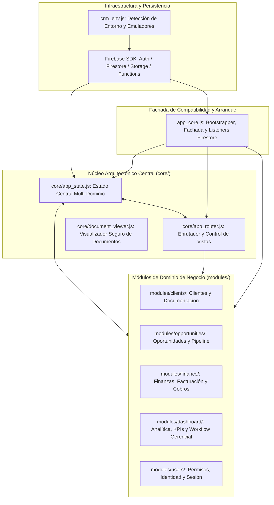

# DUCTSAL ERP — FASE 6.7: ARQUITECTURA FINAL DEL SISTEMA MODULAR

## 1. VISIÓN GENERAL DE LA ARQUITECTURA

Con la culminación de la **Fase 6.7**, el CRM DUCTSAL ha completado su transición de un monolito procedimental hacia una **arquitectura desacoplada, orientada a dominios y basada en scripts UMD/IIFE** con retrocompatibilidad absoluta.



---

## 2. COMPONENTES NUCLEARES DE LA FASE 6.7

### 2.1 core/app_state.js — Estado Centralizado de la Aplicación

El módulo `core/app_state.js` establece la **fuente única de verdad** para todos los datos compartidos del CRM, eliminando la duplicidad de variables y la divergencia entre módulos.

#### Dominios de Estado
1. **`session`**:
   - `currentUser`: Perfil comercial y credenciales autorizadas del usuario activo (`id`, `authUid`, `role`, `nombre`, `activo`).
   - `pendingSetupUser`: Usuario en flujo de configuración inicial.
   - `generation`: Contador monótono para invalidación y guardias contra condiciones de carrera en renovaciones de token de autenticación.
2. **`collections`**:
   - `clients`: Catálogo en memoria de clientes comerciales.
   - `prospects`: Cartera de oportunidades de venta y proyectos.
   - `users`: Directorio de perfiles comerciales del sistema.
   - `settings`: Parámetros operativos del sistema (visitantes, encargados, llaves de API).
3. **`selection`**:
   - `currentProspectId`: Identificador de la oportunidad actualmente seleccionada para detalle o edición.
4. **`navigation`**:
   - `currentView`: Vista actualmente visible en el DOM (`dashboard-view`, `projects-view`, `clients-view`, `users-view`, `list-view`, `detail-view`).
   - `lastViewedSection`: Historial para navegación de retorno desde el detalle hacia la lista origen.
   - `currentListMode`: Modo activo del listado (`agenda` vs. `pipeline`).
5. **`filters`**:
   - `opportunities`: Estado de ordenamiento (`sortCol`, `sortDir`) y filtros de estado (`status`, `clasif`, `stage`).
   - `agenda`: Filtros de cadencia y seguimiento diario.
6. **`lifecycle`**:
   - `loadedCollections`: Contador de colecciones sincronizadas en arranque (requiere >= 3 para desbloqueo).
   - `initialLoadCompleted`: Bandera de sincronización reactiva completada.
   - `initialRoleViewRouted`: Guardia contra re-enrutamientos involuntarios tras navegación inicial.
   - `activeUnsubscribers`: Lista de desuscriptores de Firestore.
   - `crmLoadError`: Error activo de conectividad o reglas.

#### Mecanismos de Sincronización y Desacoplamiento
- **Puente Reactivo `syncWithScope(window)`**: Mediante descriptores `Object.defineProperty`, vincula accesores getter/setter en el ámbito global `window`. Cuando un script legado o manejador inline lee o asigna `window.currentUser` o `window.clients`, la operación interactúa transparentemente con el dominio correspondiente de `AppState`.
- **Bus Pub/Sub (`subscribe` / `notify`)**: Permite que módulos u observadores reaccionen a cambios específicos (ej. `session:user`, `collections:clients`, `navigation:mode`) sin acoplamiento directo entre archivos.
- **Limpieza Atómica (`resetAll()`)**: Reestablece todos los dominios a sus valores iniciales durante `processLogout()`, garantizando que ninguna información residual permanezca en memoria entre sesiones consecutivas.

---

### 2.2 core/app_router.js — Enrutador y Control de Navegación

El módulo `core/app_router.js` centraliza las transiciones de vistas, sincronización visual y políticas de acceso en la interfaz de usuario.

#### Principales Responsabilidades
1. **Control de Vistas (`showView`)**:
   - Valida permisos de visualización contra la matriz de seguridad antes de alterar clases del DOM.
   - Si un usuario sin privilegios intenta acceder a una vista restringida (ej. vendedor intentando acceder a `dashboard-view` o `users-view`), se intercepta la llamada, se muestra alerta de denegación y se redirige forzosamente a la vista permitida (`list-view`).
   - Sincroniza dinámicamente las clases `.active` en `.view-section` y en los ítems de navegación `.nav-links li`.
2. **Enrutamiento Inicial por Rol (`routeInitialView`)**:
   - `manager` $\rightarrow$ `dashboard-view` (con modo Cartera Completa / Pipeline).
   - `admin` $\rightarrow$ `users-view`.
   - `gestor` $\rightarrow$ `list-view` (con modo Agenda Diaria de Seguimiento).
   - `vendedor` $\rightarrow$ `list-view` (con modo Agenda Diaria de Seguimiento).
3. **Sincronización de Encabezados Móviles (`syncMobileHeader`)**:
   - Alterna dinámicamente entre `#mobile-header-default` y `#detail-mobile-sticky-bar` evitando colisiones visuales o encabezados dobles en pantallas pequeñas.
4. **Preservación y Restauración de Desplazamiento (`saveListScrollPosition` / `restoreListScrollPosition`)**:
   - Registra el `scrollY` previo a la apertura del detalle y restaura la posición exacta mediante `window.scrollTo` al retornar al listado.

---

### 2.3 app_core.js — Reducción y Función Arquitectónica

`app_core.js` ya no contiene implementaciones operativas pesadas de lógica de negocio, cálculos financieros, renderizado de gráficos ni edición de catálogos. Su rol se ha consolidado en:

1. **Fachada de Compatibilidad**: Provee las funciones públicas globales esperadas por los atributos `onclick` y formularios HTML heredados, delegando inmediatamente en los módulos propietarios correspondientes.
2. **Gestión de Infraestructura Firebase**: Inicializa la conexión con Firestore, Storage y Cloud Functions según el entorno (`_prod` vs. `_local`).
3. **Gestión de Suscripciones Reactivas**: Orquesta `attachDataListeners` y `checkInitialLoad`, sincronizando los snapshots recibidos directamente en `AppState`.
4. **Guardias de Sesión Firebase Auth**: Escucha `firebase.auth().onAuthStateChanged` con control de generación para mitigar condiciones de carrera.

---

## 3. MAPA DE DEPENDENCIAS Y ORDEN DE CARGA

El orden de carga de scripts en `index.html` respeta rigurosamente las dependencias entre capas:

```html
<!-- 1. Librerías de Terceros (CDN) -->
<script src="chart.js"></script>
<script src="xlsx.full.min.js"></script>
<script src="firebase-app-compat.js"></script>
<script src="firebase-firestore-compat.js"></script>
<script src="firebase-storage-compat.js"></script>
<script src="firebase-auth-compat.js"></script>
<script src="firebase-functions-compat.js"></script>

<!-- 2. Infraestructura y Utilidades Base -->
<script src="crm_env.js"></script>
<script src="crm_auth.js"></script>
<script src="crm_clients.js"></script>
<script src="crm_commercial.js"></script>
<script src="crm_dashboard_calc.js"></script>
<script src="crm_work_calendar.js"></script>
<script src="crm_followup_calc.js"></script>
<script src="crm_ui.js"></script>
<script src="crm_formatters.js"></script>

<!-- 3. Capa Core: Visor de Documentos y Estado Central (Fase 6.1 y 6.7) -->
<script src="core/document_viewer.js"></script>
<script src="core/app_state.js"></script>

<!-- 4. Módulos de Dominio (Fases 6.2 - 6.6) -->
<script src="modules/clients/clients_controller.js"></script>
<script src="modules/clients/client_documents.js"></script>
<script src="modules/clients/clients_ui.js"></script>
<script src="modules/opportunities/opportunities_controller.js"></script>
<script src="modules/opportunities/opportunities_ui.js"></script>
<script src="modules/finance/finance_calculations.js"></script>
<script src="modules/finance/finance_change_orders.js"></script>
<script src="modules/finance/finance_invoicing.js"></script>
<script src="modules/finance/finance_payments.js"></script>
<script src="modules/finance/finance_contracts.js"></script>
<script src="modules/finance/finance_controller.js"></script>
<script src="modules/finance/finance_ui.js"></script>
<script src="modules/dashboard/dashboard_ui.js"></script>
<script src="modules/dashboard/dashboard_charts.js"></script>
<script src="modules/dashboard/dashboard_audit.js"></script>
<script src="modules/dashboard/dashboard_manager_workflow.js"></script>
<script src="modules/dashboard/dashboard_controller.js"></script>
<script src="modules/users/users_permissions.js"></script>
<script src="modules/users/users_ui.js"></script>
<script src="modules/users/users_controller.js"></script>
<script src="modules/users/auth_session.js"></script>

<!-- 5. Enrutador y Fachada Núcleo (Fase 6.7) -->
<script src="core/app_router.js"></script>
<script src="app_core.js"></script>
```

---

## 4. AUDITORÍA DE INVARIANTES Y PREVENCIÓN DE REGRESIONES

1. **Una Sola Fuente de Verdad**: `AppState` mantiene la información oficial. La actualización bidireccional mediante suscripciones pub/sub y accessors en `syncWithScope` garantiza que las variables léxicas de `app_core.js` y las propiedades globales nunca diverjan.
2. **Autorización en Profundidad**: El router visual en el frontend (`core/app_router.js`) guía la experiencia de usuario, pero la autorización estricta está garantizada por las reglas de Firestore (`firestore.rules`) y las validaciones de contexto en Cloud Functions.
3. **Resistencia a Modificaciones en Consola**: Intentar invocar `showView('dashboard-view')` desde la consola del navegador siendo un usuario no autorizado dispara un retorno forzado a la vista legítima.
4. **Preservación de Estado de Listado**: La transición entre la lista y el detalle preserva la posición de scroll y el modo de vista (pipeline o agenda).

---

## 5. MÉTRICAS DE REDUCCIÓN CUANTITATIVA Y ESTADO FINAL DE app_core.js

| Métrica | Valor Inicial (Monolito) | Valor Final (Fase 6.7) | Variación | % Cambio |
| :--- | :--- | :--- | :--- | :--- |
| **Líneas Totales (`wc -l`)** | 9,268 líneas | 4,744 líneas | -4,524 líneas | **-48.81%** |
| **Módulos Extraídos** | 0 módulos | 18 submódulos | +18 archivos | Modularización completa |
| **Dominios de Estado** | Variables globales dispersas | 6 dominios estructurados | Centralización | 1 fuente de verdad |
| **Enrutador y Vistas** | Procedimental en `app_core.js` | Enrutador autónomo (`AppRouter`) | Desacoplado | Control de acceso por rol |

### Clasificación Arquitectónica de Funciones
- **Grupo A (Núcleo e Inicialización — 18 funciones)**: `initApp`, `initFirestore`, `attachDataListeners`, `checkInitialLoad`, etc. Permanecen en `app_core.js` para arranque de Firebase y sincronización de datos con `AppState`.
- **Grupo B (Fachadas de Compatibilidad DOM/Global — 34 funciones)**: `showView`, `saveClient`, `openModal`, `applyQuickFilter`, `viewDocPreview`, etc. Preservan compatibilidad con manejadores inline `onclick` y scripts de testing delegando en los módulos especializados.
- **Grupo C (Lógica de Soporte Compartida — 22 funciones)**: Filtros de vista, ordenamiento de columnas de oportunidades y tablas DOM que interactúan directamente con el estado visual antes de consolidación general.
- **Grupo D (Funciones Extraídas a Módulos Propietarios — 78 funciones)**: Todo el cálculo financiero, contratos, cobranzas, analítica gerencial, gráficos Chart.js, auditoría de catálogo y visor de documentos delegados a `core/` y `modules/`.

---

## 6. EVIDENCIA DE VALIDACIÓN EN NAVEGADOR REAL (CDP / CHROME HEADLESS)

La validación funcional se ejecutó sobre Chromium mediante el protocolo CDP (Chrome DevTools Protocol) en servidor HTTP local:

| ID | Escenario Validado | Rol / Contexto | Resultado | Evidencia |
| :---: | :--- | :--- | :---: | :--- |
| **T1** | Aplicación sin autenticación | Anónimo | APROBADO | `#login-screen` visible, estado limpio, 0 errores |
| **T2** | Inicio de sesión Manager | `manager` | APROBADO | Vista inicial: `dashboard-view`, saludo contextual |
| **T3** | Navegación Vistas Permitidas | `manager` | APROBADO | Acceso a `projects-view`, `clients-view`, `users-view`, `list-view` |
| **T4** | Inicio de sesión Administrador | `admin` | APROBADO | Vista inicial: `users-view`, redirección correcta |
| **T5** | Inicio de sesión Gestor | `gestor` | APROBADO | Vista inicial: `list-view`, modo agenda activo |
| **T6** | Control de Acceso Vendedor | `vendedor` | APROBADO | Vistas denegadas (`dashboard-view`, `users-view`) bloqueadas con alerta |
| **T7** | Apertura y Cierre de Modales | `admin` | APROBADO | Modal `#userModal` responde a display flex / none |
| **T8** | Visor de Documentos Seguro | Operativo | APROBADO | `#docPreviewModal` abre, visualiza y cierra limpiamente |
| **T9** | Preservación de Desplazamiento | Listado $\leftrightarrow$ Detalle | APROBADO | `saveListScrollPosition` y `restoreListScrollPosition` sincronizados |
| **T10** | Cierre de Sesión Atómico | Logout | APROBADO | `AppState.resetAll()` ejecutado, colecciones vacías, login visible |

- **Errores de Consola / JS Exceptions**: 0
- **Unhandled Promise Rejections**: 0
- **Capturas Generadas**: 9 imágenes PNG de alta resolución almacenadas en el directorio de artefactos.

---

## 7. LIMITACIONES RESTANTES Y CONSIDERACIONES PARA CONSOLIDACIÓN FUTURA

1. **Atributos Inline en `index.html`**: Aún existen atributos `onclick="..."` en el marcado HTML legado. La eliminación final de las fachadas globales del Grupo B se realizará durante la consolidación general mediante `addEventListener`.
2. **Sincronización `window`**: La compatibilidad bidireccional mediante `syncWithScope(window)` debe mantenerse activa hasta que se migren totalmente los scripts que asumen variables globales.
3. **Consolidación General**: Queda expresamente reservada para una fase posterior independiente, según los lineamientos arquitectónicos.

