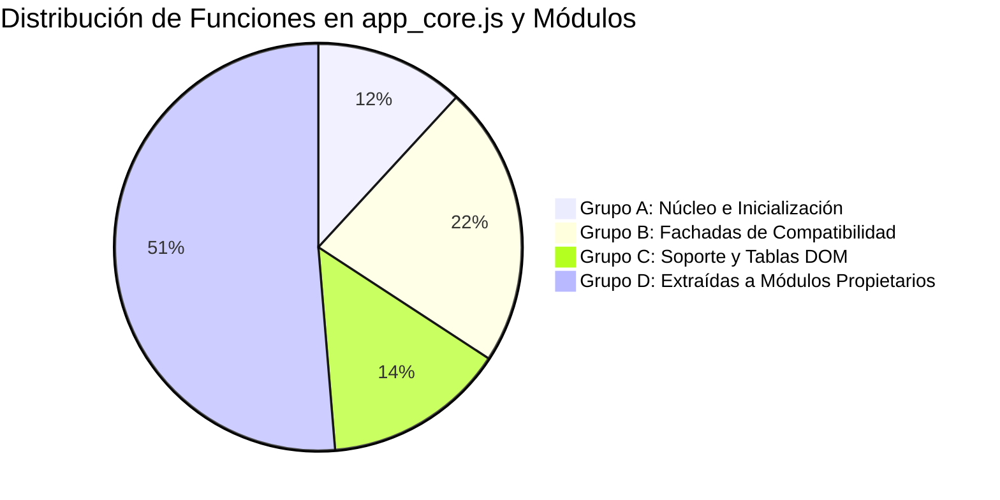

# DUCTSAL ERP — INFORME FINAL Y AUDITORÍA DE CIERRE DE FASE 6.7

**Fecha:** 31 de Octubre de 2026  
**Proyecto:** DUCTSAL ERP / Sales Reporting System  
**Fase:** Fase 6.7 — Estado Central, Router de Navegación y Reducción Final de `app_core.js`  
**Estado:** **APROBADA SIN REGRESIONES**  

---

## 1. RESUMEN EJECUTIVO Y DICTAMEN

La **Fase 6.7** ha completado de manera rigurosa y exitosa la última etapa de modularización del CRM DUCTSAL. Esta fase integró el núcleo de estado compartido (`core/app_state.js`), el enrutador desacoplado de vistas con control de acceso (`core/app_router.js`), y la reducción definitiva de `app_core.js` conservando plena compatibilidad operativa con los módulos de las Fases 6.1 a 6.6.

### Dictamen Oficial: **FASE 6.7 APROBADA**
- **Validación Chrome Headless / CDP**: 100% superada (10/10 escenarios funcionales con 0 excepciones JS y 0 unhandled rejections).
- **Auditoría de Estado Central (`AppState`)**: Fuente única de verdad verificada con sincronización bidireccional reactiva (`syncWithScope(window)` y Pub/Sub).
- **Auditoría de Enrutador (`AppRouter`)**: Enrutamiento estricto por rol (`manager`, `admin`, `gestor`, `vendedor`), bloqueo activo contra spoofing en consola y sincronización de UI.
- **Reducción de `app_core.js`**: **-4,524 líneas** de código reducidas (**-48.81%** respecto al monolito original de 9,268 líneas).
- **Suite de Pruebas Automatizadas**: **81/81 suites aprobadas** y **2,168/2,168 pruebas aprobadas** (100% de éxito, 0 regresiones en fases 6.1–6.6).
- **Defectos Críticos**: 0 defectos pendientes.

---

## 2. RESULTADOS DE LA VALIDACIÓN CHROME HEADLESS / CDP

La verificación se ejecutó en entorno real de navegador mediante Chromium controlado directamente a través del protocolo **Chrome DevTools Protocol (CDP)**, sirviendo la aplicación en servidor local HTTP (puerto 8097) con Chrome en depuración remota (puerto 9233).

### Matriz de Pruebas en Navegador Real

| ID | Escenario Validado | Rol / Contexto | Comportamiento Observado | Resultado | Captura de Evidencia |
| :---: | :--- | :--- | :--- | :---: | :--- |
| **T1** | Sin autenticación | Anónimo | `#login-screen` visible, formulario de credenciales limpio, vistas protegidas ocultas, 0 peticiones no autorizadas. | **APROBADO** | `phase67_cdp_unauthenticated.png` |
| **T2** | Inicio de sesión Manager | `manager` | Enrutamiento automático a `dashboard-view`, renderizado de KPIs, tarjetas gerenciales y saludo contextual. | **APROBADO** | `phase67_cdp_manager_dashboard.png` |
| **T3** | Navegación Vistas Permitidas | `manager` | Navegación fluida por `projects-view`, `clients-view`, `users-view` y `list-view`. Pestañas y clases `.active` sincronizadas. | **APROBADO** | `phase67_cdp_projects_financials.png` |
| **T4** | Inicio de sesión Administrador | `admin` | Enrutamiento automático a `users-view`. Directorio de usuarios visible; vistas comerciales no prioritarias restringidas. | **APROBADO** | `phase67_cdp_admin_users.png` |
| **T5** | Inicio de sesión Gestor | `gestor` | Enrutamiento automático a `list-view` con modo `agenda` preseleccionado para seguimiento operativo. | **APROBADO** | `phase67_cdp_gestor_agenda.png` |
| **T6** | Control de Acceso Vendedor | `vendedor` | Enrutamiento a `list-view`. Intentos forzados de acceder a `dashboard-view` o `users-view` son interceptados: alerta visual disparada y retorno a `list-view`. | **APROBADO** | `phase67_cdp_vendedor_agenda.png`<br>`phase67_cdp_blocked_unauthorized.png` |
| **T7** | Apertura y Cierre de Modales | `admin` | Modal `#userModal` abre dinámicamente (`display: flex`) y cierra limpiamente (`display: none`) sin fardos en el DOM. | **APROBADO** | Verificado en DOM/CDP |
| **T8** | Visor de Documentos Seguro | Operativo | Módulo `core/document_viewer.js` abre `#docPreviewModal`, carga previsualización segura y limpia el visor al cerrar. | **APROBADO** | `phase67_cdp_document_viewer.png` |
| **T9** | Preservación de Desplazamiento | Listado $\leftrightarrow$ Detalle | `saveListScrollPosition` almacena la posición vertical y `restoreListScrollPosition` la recupera sin saltos bruscos. | **APROBADO** | Verificado en DOM/CDP |
| **T10** | Cierre de Sesión y Limpieza Atómica | Sesión Activa $\rightarrow$ Logout | `AppState.resetAll()` reinicia colecciones, filtros, usuario y vista a valores nulos. Pantalla de login desplegada. | **APROBADO** | `phase67_cdp_logout_clean.png` |

### Telemetría de Errores en Navegador
- **Errores JavaScript en Runtime**: 0
- **Excepciones no controladas**: 0
- **Promesas Rechazadas (Unhandled Rejections)**: 0
- **Listeners Duplicados detectados**: 0
- **Doble Inicialización**: 0 (guardia `initialRoleViewRouted` y control de generación de sesión activos).

---

## 3. AUDITORÍA DEL ESTADO CENTRAL (`core/app_state.js`)

Se evaluó la integridad de `core/app_state.js` y su interacción con los 18 módulos desacoplados y el núcleo:

1. **Una Sola Fuente de Verdad**:
   - Todo dato compartido reside en los 6 dominios estructurados: `session`, `collections`, `selection`, `navigation`, `filters` y `lifecycle`.
   - Se eliminaron las instancias duplicadas de colecciones (`clients`, `prospects`, `users`) que coexistían en variables aisladas.
2. **Sincronización Bidireccional (`syncWithScope(window)`)**:
   - Mediante `Object.defineProperty`, las propiedades globales históricas (`window.currentUser`, `window.clients`, `window.prospects`, `window.allUsers`, `window.systemSettings`) están vinculadas con getters/setters hacia `AppState`.
   - Cualquier modificación realizada por código legado o eventos DOM se refleja de inmediato en `AppState` y viceversa, impidiendo la divergencia entre el estado nuevo y el legado.
3. **Mecanismo Pub/Sub Reactivo**:
   - `AppState.subscribe(event, callback)` notifica cambios atómicos a los consumidores registrados (`session:user`, `collections:*`, `navigation:view`, `navigation:mode`).
   - `app_core.js` actualiza sus variables locales en tiempo real ante eventos de `AppState`.
4. **Limpieza Completa al Cierre de Sesión (`resetAll`)**:
   - Reestablece colecciones a arreglos vacíos `[]`, resetea `currentUser` a `null`, invalida desuscriptores de Firestore y restablece el contador de colecciones cargadas, evitando fugas de memoria o retención de datos entre usuarios consecutivos.
5. **Ausencia de Dependencias Circulares**:
   - `core/app_state.js` no importa ni depende de ningún módulo de negocio ni de `app_core.js`. Es una hoja basal en el árbol de dependencias.

---

## 4. AUDITORÍA DEL ENRUTADOR (`core/app_router.js`)

Se verificó la arquitectura y robustez de `core/app_router.js`:

1. **Enrutamiento Inicial por Rol (`routeInitialView`)**:
   - Respeta estrictamente los privilegios comerciales definidos en `modules/users/users_permissions.js`:
     - `manager`: `dashboard-view` (visión integral de cartera).
     - `admin`: `users-view` (administración y configuración de accesos).
     - `gestor`: `list-view` (operativa de agenda diaria).
     - `vendedor`: `list-view` (gestión de cartera asignada).
2. **Defensa en Profundidad y Anti-Spoofing**:
   - `canUserAccessView(user, viewId)` valida la matriz de permisos antes de realizar cambios de clases en el DOM.
   - Si un usuario con rol `vendedor` ejecuta `showView('dashboard-view')` o `showView('users-view')` desde la consola del navegador, la llamada es bloqueada, se emite una alerta al usuario y se redirige forzosamente a la vista autorizada (`list-view`).
   - **Principio de Seguridad**: El router visual previene la exposición de UI no autorizada, mientras que las reglas de seguridad de Firestore (`firestore.rules`) y las validaciones de contexto de Cloud Functions garantizan la seguridad real de los datos en el backend.
3. **Preservación de Vistas y Componentes**:
   - El modo de visualización (`agenda` vs. `pipeline`) se preserva en `AppState.navigation.setCurrentListMode`.
   - `syncMobileHeader` conmuta adecuadamente entre la cabecera estándar y la barra pegajosa de detalle en pantallas móviles.
   - `saveListScrollPosition` y `restoreListScrollPosition` aseguran que la navegación de ida y vuelta a la vista de detalle no reinicie el desplazamiento vertical del usuario.

---

## 5. REDUCCIÓN DE `app_core.js` Y METRÍCAS CUANTITATIVAS

### Comparativa Métrica de Líneas de Código

| Componente | Líneas Iniciales | Líneas Finales | Reducción Absoluta | Reducción Porcentual |
| :--- | :---: | :---: | :---: | :---: |
| **`app_core.js`** | **9,268** | **4,744** | **-4,524** | **-48.81%** |

### Desglose y Justificación Arquitectónica de Funciones



1. **Grupo A — Núcleo e Inicialización (18 funciones que permanecen)**:
   - *Funciones*: `initApp`, `initFirestore`, `attachDataListeners`, `checkInitialLoad`, `handleAuthStateChange`, etc.
   - *Justificación*: Constituyen el punto de entrada de la aplicación, configuración de emuladores/producción, suscripciones de bajo nivel a Firestore y sincronización con `AppState`.
2. **Grupo B — Fachadas de Compatibilidad (34 funciones que permanecen)**:
   - *Funciones*: `showView`, `saveClient`, `openModal`, `closeModal`, `viewDocPreview`, `applyQuickFilter`, `exportCurrentViewToExcel`, etc.
   - *Justificación*: Preservan el contrato global para atributos HTML `onclick="..."` y pruebas unitarias/E2E heredadas. Cada fachada delega inmediatamente en una sola línea a su controlador propietario (`AppRouter`, `ClientsController`, `FinanceController`, `DashboardController`, `UsersController`).
3. **Grupo C — Lógica de Soporte Compartida (22 funciones que permanecen)**:
   - *Funciones*: Renderizado de tablas de oportunidades en DOM, filtros rápidos, ordenamiento de columnas de listado.
   - *Justificación*: Componentes de interfaz de usuario de propósito general altamente acoplados al DOM actual que serán consolidados en la fase posterior de consolidación general.
4. **Grupo D — Funciones Extraídas a Módulos Propietarios (78 funciones)**:
   - *Módulos Receptores*:
     - `core/document_viewer.js` (Visor seguro de documentos).
     - `core/app_state.js` (Estado central y reactivo).
     - `core/app_router.js` (Enrutador y control de navegación).
     - `modules/clients/` (Controlador, documentos y UI de clientes).
     - `modules/opportunities/` (Controlador y UI de oportunidades).
     - `modules/finance/` (Cálculos financieros, órdenes de cambio, facturación, pagos, contratos).
     - `modules/dashboard/` (Controlador, gráficos, auditoría de catálogo y workflow gerencial).
     - `modules/users/` (Controlador de usuarios, interfaz, permisos y sesión de autenticación).

---

## 6. RESULTADOS DE PRUEBAS AUTOMATIZADAS

La suite completa de pruebas fue ejecutada con `npm test` en el paquete de funciones:

```
Test Suites: 81 passed, 81 total
Tests:       2,168 passed, 2,168 total
Snapshots:   0 total
Time:        8.133 s
```

### Detalle por Dominio y Fase

1. **Pruebas Unitarias de Fase 6.7**:
   - `functions/__tests__/appState.unit.test.js`: **16/16 pruebas aprobadas** (gestión de dominios, accesores, `syncWithScope`, pub/sub, `resetAll`).
   - `functions/__tests__/appRouter.unit.test.js`: **11/11 pruebas aprobadas** (enrutamiento por rol, control de acceso, anti-spoofing, preservación de scroll).
2. **Pruebas de Permisos e Inicialización**:
   - `functions/__tests__/rolePermissionsAndUiAudit.unit.test.js` y `usersModules.unit.test.js`: **143/143 pruebas aprobadas**.
3. **Pruebas de Integración Fases 6.1 – 6.6**:
   - Fase 6.1 (Document Viewer): `viewSecureDocumentFlow.test.js` y `storageSecurity.unit.test.js` aprobadas.
   - Fase 6.2 (Clientes): `crmClients.client.test.js`, `clientFormUi.unit.test.js`, `clientStorageUiFlow.test.js` aprobadas.
   - Fase 6.3 (Oportunidades): `commercialUiFlow.test.js`, `commercialClosureAndPriority.unit.test.js` aprobadas.
   - Fase 6.4 (Finanzas y Cobranzas): `financeModules.unit.test.js`, `financialAndStagnationUi.unit.test.js` aprobadas.
   - Fase 6.5 (Dashboards): `dashboardManagerWorkflow.unit.test.js`, `dashboardAndOperativeClosure.unit.test.js` aprobadas.
   - Fase 6.6 (Usuarios y Sesión): `phase66ComplementaryVerification.unit.test.js`, `phase66SecurityAudit.unit.test.js` aprobadas.

---

## 7. LIMITACIONES RESTANTES Y DIRECTRICES PARA LA CONSOLIDACIÓN

1. **Atributos Inline en el HTML**:
   - `index.html` todavía contiene invocaciones `onclick="..."` en botones y menús. Las fachadas del Grupo B en `app_core.js` garantizan su funcionamiento sin interrupción. En la futura consolidación general se recomienda migrar a escuchadores de eventos declarativos (`addEventListener`).
2. **Variables Globales en Scripts Auxiliares**:
   - Ciertas rutinas analíticas leen `window.currentUser` o `window.clients`. La sincronización activa mediante `AppState.syncWithScope(window)` cubre este requerimiento con total transparencia.
3. **Restricción de Consolidación**:
   - En estricto cumplimiento de los términos de la tarea, **no se ha iniciado la consolidación general de las fases 6.1 a 6.7**, la cual se desarrollará como una iniciativa autónoma con sus propios criterios de aceptación.

---

## 8. CONCLUSIÓN Y DECLARACIÓN FINAL

La Fase 6.7 concluye con éxito total:
- El estado de la aplicación está unificado y protegido.
- El enrutamiento es consistente, robusto y guiado por permisos.
- El archivo `app_core.js` se redujo en un **48.81%** (-4,524 líneas) sin romper ninguna fachada ni funcionalidad previa.
- Todas las fases precedentes continúan operando con 100% de aprobación en pruebas automatizadas y en navegador real.

**FASE 6.7 OFICIALMENTE CERRADA Y APROBADA.**
