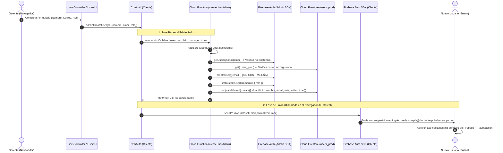
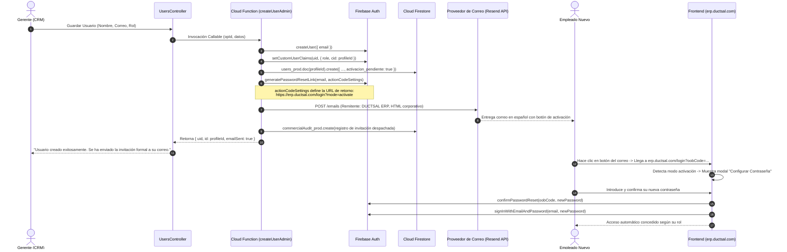
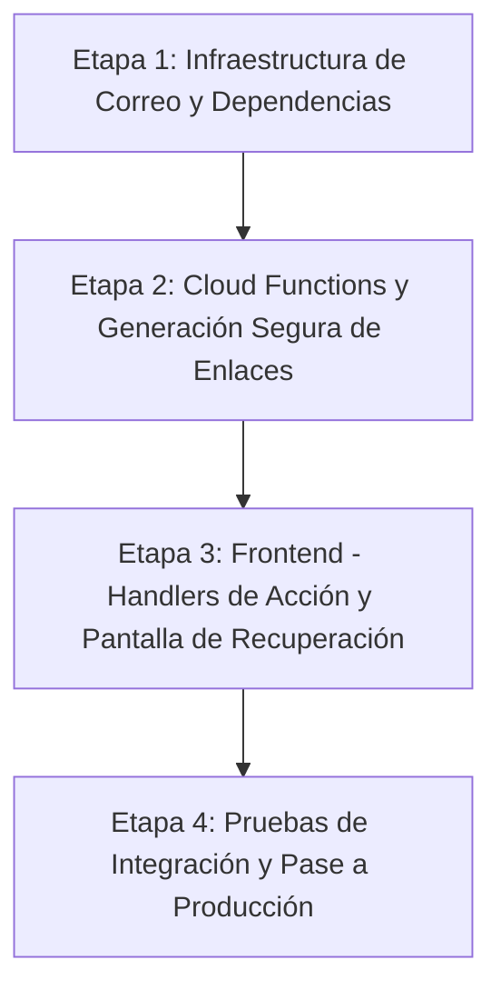

# DUCTSAL ERP — PASO 6.1
# Auditoría Técnica del Ciclo de Vida de Usuarios, Autenticación y Correos

**Fecha de Emisión:** Lunes, 02 de Noviembre de 2026  
**Autor:** Antigravity (Auditoría Técnica de Arquitectura y Seguridad)  
**Destinatarios:** Benjamin Valiente & ChatGPT (Comité de Validación y Release)  
**Alcance:** Inspección exclusiva de solo lectura del módulo de usuarios, flujo de autenticación, ciclo de vida de credenciales, Cloud Functions administrativas y mecanismos de correo electrónico.  
**Estado:** **INFORME TÉCNICO DE AUDITORÍA — NO APLICA MODIFICACIONES DE CÓDIGO**

---

## 1. Arquitectura Actual del Módulo de Usuarios y Autenticación

El sistema DUCTSAL ERP opera bajo una arquitectura híbrida de identidad comercial y autenticación centralizada, diseñada para resolver la transición entre usuarios históricos (creados en esquemas legados previos) y usuarios modernos basados en Firebase Authentication.

### 1.1 Modelo de Separación de Identidad y Perfil Comercial
- **Identidad en Firebase Authentication:** Gestiona credenciales seguras (correo electrónico, hash de contraseñas mediante Scrypt/Argon2 nativo de Google, estado de habilitación `disabled`, y Custom Claims `{ role, cid [, manager: true] }`). Ninguna contraseña en texto claro ni hash criptográfico reside en la base de datos de la aplicación.
- **Perfil Comercial en Cloud Firestore (`users_prod`):** Cada documento representa la identidad comercial operativa del CRM. La clave del documento es el ID comercial histórico (`id`, generado secuencialmente como marca de tiempo, ej. `1776904514932`). El vínculo formal con Firebase Authentication se establece mediante el campo `authUid`, que almacena el UID único generado por Firebase Auth (`cred.user.uid`).
- **Directorio Ligero de Asignación (`userDirectory_prod`):** Proyección de solo lectura (`id`, `nombre`, `role`, `activo`) accesible para todos los roles comerciales con el único fin de poblar selectores de asignación sin exponer datos de sesión.
- **Reglas de Seguridad en Firestore (`firestore.rules`):** La colección `users_prod` tiene configurado `allow write: if false;`. Ningún cliente web puede mutar perfiles de usuario directamente; cualquier alta, baja o modificación de rol debe ser ejecutada de manera obligatoria por el backend privilegiado (Firebase Admin SDK).

### 1.2 Diagrama del Flujo Actual de Creación y Activación



---

## 2. Funcionalidades Existentes y su Ubicación en el Código

| Funcionalidad / Componente | Archivo Fuente y Líneas | Estado Operativo | Comportamiento Técnico Verificado |
| :--- | :--- | :---: | :--- |
| **Creación Idempotente de Usuarios** | [functions/index.js](file:///Users/Benjamin/Documents/DUCTSAL/sales-reporting-system-release/functions/index.js#L209-L548)<br>`exports.createUserAdmin` | **Operativa** | Requiere sesión con Custom Claim `manager: true`. Aplica candado distribuido (`locks/<opId>`), valida unicidad en Auth y Firestore, crea identidad en Auth, asigna custom claims `{ role }`, crea perfil en Firestore y finaliza operación. Ejecuta rollback automático si Firestore falla. |
| **Actualización de Usuarios** | [functions/index.js](file:///Users/Benjamin/Documents/DUCTSAL/sales-reporting-system-release/functions/index.js#L719-L870)<br>`exports.updateUserAdmin` | **Operativa** | Permite actualizar `nombre` y `role` (estrictamente `vendedor` y `gestor`). Bloquea auto-cambio de rol del gerente. Utiliza candado global `role.change.global`. Actualiza claims primero y luego perfil en Firestore con auditoría. Prohíbe cambio de correo electrónico. |
| **Activación / Desactivación de Estado** | [functions/index.js](file:///Users/Benjamin/Documents/DUCTSAL/sales-reporting-system-release/functions/index.js#L565-L667)<br>`exports.toggleUserStatusAdmin` | **Operativa** | Habilita o deshabilita la identidad en Firebase Auth (`disabled: !activo`), revoca tokens de actualización (`revokeRefreshTokens`) y actualiza `activo` en Firestore. |
| **Reenvío de Invitación en Backend** | [functions/index.js](file:///Users/Benjamin/Documents/DUCTSAL/sales-reporting-system-release/functions/index.js#L894-L921)<br>`exports.resendInvitationAdmin` | **Parcial / Incompleta** | Valida que el solicitante sea gerente y que el perfil exista, tenga `authUid` y esté activo. **NO envía ningún correo desde el servidor**: retorna `{ sent: false, delivery: 'client', email }` instruyendo al frontend a disparar el envío. |
| **Reconciliación de Operaciones** | [functions/index.js](file:///Users/Benjamin/Documents/DUCTSAL/sales-reporting-system-release/functions/index.js#L924-L965)<br>`exports.reconcileUserOp` | **Operativa** | Permite consultar el estado de una operación interrumpida o en revisión manual (`userOps/<opId>`). |
| **Vinculación de Usuarios Históricos** | [functions/index.js](file:///Users/Benjamin/Documents/DUCTSAL/sales-reporting-system-release/functions/index.js#L967-L1110)<br>`exports.linkHistoricalUserAdmin` | **Operativa** | Vincula perfiles legacy que carecían de cuenta Auth, crea identidad y asigna claims `{ role, cid }`. |
| **Purga de Contraseñas Legadas** | [functions/index.js](file:///Users/Benjamin/Documents/DUCTSAL/sales-reporting-system-release/functions/index.js#L1112-L1175)<br>`exports.purgeHistoricalPasswordAdmin` | **Operativa** | Elimina campos de contraseñas en texto claro de perfiles históricos tras verificar inicio de sesión en Auth. |
| **Listado Administrativo de Usuarios** | [functions/index.js](file:///Users/Benjamin/Documents/DUCTSAL/sales-reporting-system-release/functions/index.js#L1177-L1240)<br>`exports.listUsersAdmin` | **Operativa** | Cruza usuarios de Firestore con metadatos de Firebase Auth (`disabled`, `lastSignInTime`, `claims`). |
| **Controlador de Usuarios en Frontend** | [modules/users/users_controller.js](file:///Users/Benjamin/Documents/DUCTSAL/sales-reporting-system-release/modules/users/users_controller.js)<br>`UsersController` | **Operativa** | Orquesta `fetchAdminUsers`, `saveUser`, `toggleUserStatus` y `resetUserPassword`. Previene envíos concurrentes con la bandera `userSaveInFlight`. |
| **Matriz de Permisos y Vistas** | [modules/users/users_permissions.js](file:///Users/Benjamin/Documents/DUCTSAL/sales-reporting-system-release/modules/users/users_permissions.js)<br>`UsersPermissions` | **Operativa** | Define roles canónicos (`manager`, `gestor`, `vendedor`), visibilidad de vistas y menús de navegación. |
| **Interfaz Visual de Usuarios** | [modules/users/users_ui.js](file:///Users/Benjamin/Documents/DUCTSAL/sales-reporting-system-release/modules/users/users_ui.js)<br>`UsersUI` | **Operativa** | Renderiza la tabla de usuarios (`#users-body`), gestiona apertura y cierre de `#userModal`. |
| **Cliente de Autenticación CRM** | [crm_auth.js](file:///Users/Benjamin/Documents/DUCTSAL/sales-reporting-system-release/crm_auth.js)<br>`CrmAuth` | **Operativa** | Implementa `loginWithFirebase`, `findLoginUser`, `adminCreateUser`, `adminUpdateUser` y wrappers de funciones callables. |
| **Formulario de Login** | [index.html](file:///Users/Benjamin/Documents/DUCTSAL/sales-reporting-system-release/index.html#L23-L35)<br>`#login-screen` | **Incompleta** | Contiene campos para correo y contraseña. **Carece de enlace para recuperación de contraseña**. |
| **Pantalla de Configuración Inicial** | [index.html](file:///Users/Benjamin/Documents/DUCTSAL/sales-reporting-system-release/index.html#L38-L48)<br>`#setup-screen` | **Obsoleta / Rota** | Código legado desconectado que intenta guardar contraseñas directamente en Firestore vía `saveUserToDB`. |

---

## 3. Deficiencias Técnicas Identificadas

### 3.1 Delegación del Envío de Correos al Cliente Web
En el flujo actual, cuando el gerente crea un usuario o hace clic en "Reset Pass", el servidor no envía el correo. En su lugar, el navegador del gerente invoca directamente:
```javascript
// crm_auth.js: líneas 271-274
const normalized = String(email || '').trim().toLowerCase();
try {
    await sendPasswordSetupEmail(fb, normalized); // fb.auth().sendPasswordResetEmail(email)
    notify('Usuario creado. Se envió un correo a ' + normalized + ' para que establezca su contraseña.');
} catch (e) { ... }
```
**Deficiencias asociadas:**
1. **Falta de Trazabilidad:** El backend desconoce si el correo fue efectivamente entregado, rebotado o bloqueado.
2. **Dependencia de Conectividad del Gerente:** Si el navegador del gerente pierde conexión inmediatamente después de que la Cloud Function crea el usuario pero antes de llamar a `sendPasswordResetEmail`, el usuario queda creado pero jamás recibe su enlace.
3. **Imposibilidad de Registro en Auditoría:** La colección `commercialAudit_prod` no registra el despacho del correo.

### 3.2 Inexistencia de Plantillas Corporativas y Dependencia del Emisor por Defecto
El sistema no cuenta con ninguna librería de envío transaccional (`nodemailer`, `@sendgrid/mail`, `resend`, `postmark` o `@aws-sdk/client-ses`).
- Los correos son despachados por los servidores compartidos de Firebase Authentication.
- El remitente es el genérico `noreply@ductsal-erp.firebaseapp.com`.
- No está configurada la propiedad `firebase.auth().languageCode = 'es'`, por lo que en múltiples navegadores los correos se emiten en **inglés**.
- El contenido del correo carece de la identidad visual de DUCTSAL (colores oro/marino, logotipo hexagonal, tipografía corporativa).

### 3.3 Ausencia de Enlace y Flujo de Recuperación de Contraseña en el Login
En `index.html` (líneas 23–35):
- No existe el hipervínculo tradicional **«¿Olvidaste tu contraseña?»**.
- No existe ningún modal o formulario para que un usuario que olvidó su clave introduzca su correo y solicite el restablecimiento.
- La única forma en que un usuario puede recuperar su acceso es contactando directamente al Gerente para que éste ingrese al CRM, busque al usuario en la tabla y presione el botón *"Reset Pass"*.

### 3.4 Desconexión del Manejo de Enlaces de Acción (OOB Code) en el Frontend
Cuando el usuario recibe el correo de restablecimiento/activación emitido por Firebase, el enlace apunta a la URL genérica de hosting:
`https://ductsal-erp.firebaseapp.com/__/auth/action?mode=resetPassword&oobCode=...`
- El portal web oficial de producción (`https://erp.ductsal.com`) no cuenta con lógica para interceptar los parámetros `mode` y `oobCode`.
- No existen implementaciones de `firebase.auth().verifyPasswordResetCode(code)` ni de `firebase.auth().confirmPasswordReset(code, newPassword)` en el cliente.
- El formulario `#setup-screen` en `index.html` (líneas 38–48) y su función `processFirstTimeSetup` en `app_core.js` (líneas 2449–2464) son un residuo del sistema legado previo a la integración con Firebase Auth: intentan asignar la contraseña en memoria al objeto `pendingSetupUser` y escribirla en Firestore mediante `saveUserToDB(pendingSetupUser)`, lo cual es rechazado por las reglas de seguridad actuales.

### 3.5 Divulgación de Cuentas (User Enumeration Vulnerability)
En `app_core.js` (línea 2338), si un usuario introduce un correo que no está presente en la memoria local:
```javascript
if (!user) {
    if (typeof firebase !== 'undefined' && typeof firebase.auth === 'function' && pass) {
        return processDirectFirebaseAuthLogin(email, pass);
    }
    return alert("Usuario no encontrado o inactivo.");
}
```
El mensaje explícito `"Usuario no encontrado o inactivo."` confirma a un atacante potencial si un correo corporativo existe o no dentro del sistema comercial.

---

## 4. Análisis de Riesgos y Problemas de Consistencia

| Factor de Riesgo | Nivel de Severidad | Causa Raíz | Impacto Operativo |
| :--- | :---: | :--- | :--- |
| **Entrega Fallida Invisible** | **ALTO** | El cliente web llama a `sendPasswordResetEmail`. Si falla la cuota de Firebase Auth o el correo cae en spam, el gerente asume que el usuario fue invitado con éxito. | Empleados nuevos no pueden ingresar al ERP; reclamos operativos al soporte gerencial. |
| **Inconsistencia de Claims en Reintentos** | **MEDIO** | `createUserAdmin` solo asigna `{ role }` en Custom Claims; el vinculador `linkHistoricalUserAdmin` asigna `{ role, cid }`. En `processDirectFirebaseAuthLogin`, si el claim `cid` no está presente, la sesión directa falla. | Si la colección `users` no está precargada en el cliente, un usuario nuevo creado por Cloud Function puede ser rechazado al autenticarse de forma directa. |
| **Suplantación de Marca en Correos** | **MEDIO** | Emisión desde `@ductsal-erp.firebaseapp.com` sin registros SPF/DKIM/DMARC asociados al dominio `ductsal.com`. | Los correos de activación son clasificados como phishing o spam por servidores corporativos (Google Workspace / Microsoft 365). |
| **Bloqueo por Cuota de Firebase Auth** | **MEDIO** | Firebase Authentication impone límites estrictos en el envío de correos desde el SDK cliente para prevenir abuso (`too-many-requests`). | Múltiples reintentos de activación bloquean temporalmente la cuenta del usuario. |
| **Expiración de Enlace No Gestionada** | **BAJO** | El enlace de Firebase Auth expira a las 24 horas por defecto; el usuario no tiene mecanismo autoservicio para solicitar un nuevo enlace desde la pantalla de login. | Dependencia forzada del gerente para regenerar el enlace. |

---

## 5. Evaluación Comparativa de Alternativas de Envío de Correos

Para conseguir el envío de correos corporativos en español con la identidad gráfica de DUCTSAL, se evaluaron cuatro alternativas técnicas:

| Criterio de Evaluación | Alternativa 1: Resend (Recomendada) | Alternativa 2: SendGrid (Twilio) | Alternativa 3: Amazon SES | Alternativa 4: Firebase Auth SMTP Relay |
| :--- | :--- | :--- | :--- | :--- |
| **Tipo de Integración** | API REST / SDK Node.js moderno (`resend`) en Cloud Functions. | API REST / SDK Node.js (`@sendgrid/mail`) en Cloud Functions. | SDK Node.js (`@aws-sdk/client-ses`) en Cloud Functions. | Configuración SMTP nativa en la consola de Firebase Auth. |
| **Control de Plantillas HTML** | **Total:** Plantillas HTML5 responsivas con branding DUCTSAL. | **Total:** Plantillas HTML dinámicas en código o Dashboard. | **Total:** Plantillas HTML administradas en código. | **Muy Limitado:** Solo texto plano o HTML básico sin estilos avanzados. |
| **Dominio Remitente** | `notificaciones@ductsal.com` o `soporte@ductsal.com` (DKIM/SPF). | `notificaciones@ductsal.com` (DKIM/SPF). | `notificaciones@ductsal.com` (DKIM/SPF). | Remitente corporativo vía credenciales SMTP. |
| **Complejidad de Mantenimiento** | **Mínima:** API limpia, excelente DX, soporte para Node 20+. | **Media:** Consola compleja, configuración de IP pools y API keys. | **Alta:** Requiere cuenta AWS, salida de Sandbox y configuración IAM. | **Baja:** Sin código adicional, pero sin flexibilidad de diseño. |
| **Costo Operativo** | Gratuito hasta 3,000 correos/mes (100/día). Luego $20/mes (50k). | Gratuito hasta 100 correos/mes. Luego $19.95/mes (50k). | $0.10 por cada 1,000 correos (Costo prácticamente $0.00). | Sin costo adicional sobre el proveedor de correo actual. |
| **Monitoreo y Trazabilidad** | Logs de entrega, apertura y rebote en tiempo real vía webhooks/API. | Métricas completas de entrega y rebote. | CloudWatch métricas y eventos SNS. | Cero métricas accesibles por API. |

---

## 6. Arquitectura Recomendada para DUCTSAL ERP

Se recomienda implementar una **Arquitectura Híbrida Desacoplada y Centralizada en Backend**, manteniendo Firebase Authentication como el almacén criptográfico de identidades, pero trasladando la generación de enlaces y el despacho de correos transaccionales a Cloud Functions mediante **Resend** (o alternativamente **SendGrid**).

### 6.1 Flujo Propuesto: Alta de Usuario (Invitación Corporativa)


### 6.2 Flujo Propuesto: Recuperación Autoservicio de Contraseña
```mermaid
sequenceDiagram
    autonumber
    actor User as Usuario (Olvido de Clave)
    participant Login as Pantalla Login (erp.ductsal.com)
    participant CF as Cloud Function (requestPasswordReset)
    participant Auth as Firebase Auth
    participant Mail as Proveedor de Correo (Resend API)
    actor Inbox as Buzón del Usuario

    User->>Login: Clic en «¿Olvidaste tu contraseña?»
    Login->>Login: Despliega modal de recuperación
    User->>Login: Introduce su correo electrónico
    Login->>CF: requestPasswordReset({ email })
    CF->>CF: Valida existencia del usuario en users_prod (sin filtrar al cliente)
    alt Usuario Existe y está Activo
        CF->>Auth: generatePasswordResetLink(email, actionCodeSettings)
        CF->>Mail: Despacha correo corporativo "Restablecer tu Contraseña DUCTSAL"
    end
    CF-->>Login: Retorna éxito SIEMPRE ({ status: 'dispatched' })
    Login-->>User: "Si tu correo está registrado, recibirás un enlace de restablecimiento en breve."
    Note over User,Login: Mitigación total de enumeración de usuarios
    Inbox->>User: Abre enlace seguro en erp.ductsal.com
    User->>Login: Ingresa nueva clave
    Login->>Auth: confirmPasswordReset(oobCode, newPassword)
    Login-->>User: Contraseña actualizada; redirige a inicio de sesión
```

### 6.3 Especificación de la Plantilla de Correo Corporativa
- **Remitente:** `DUCTSAL ERP <notificaciones@ductsal.com>`
- **Identidad Visual:**
  - Encabezado: Fondo Azul Marino (#0f172a), Logotipo Hexagonal Oficial de DUCTSAL con acento Dorado (#f59e0b).
  - Tipografía: Inter / Helvetica Neue, escala tipográfica legible en clientes móviles.
  - Botón de Acción Principal (CTA): Botón centrado color Dorado/Oro con texto en contraste `#0f172a` y padding táctil (min 44px de altura).
  - Pie de Página: Datos fiscales de DUCTSAL S.A. DE C.V., indicación de validez del enlace (24 horas) y leyenda de seguridad: *"Si tú no solicitaste este acceso, puedes ignorar este mensaje."*

---

## 7. Matriz de Pruebas Propuesta

Para la validación controlada de la nueva arquitectura (una vez autorizada su fase de implementación), se diseña la siguiente matriz con cuentas sintéticas:

| ID Caso | Escenario de Prueba | Datos de Entrada | Comportamiento Esperado | Criterio de Aprobación |
| :---: | :--- | :--- | :--- | :--- |
| **TC-01** | Creación exitosa de vendedor | `nombre: "Carlos Vendedor"`, `email: "carlos.test@ductsal.com"`, `role: "vendedor"` | Crea usuario en Auth, perfil en Firestore, Custom Claims `{ role: 'vendedor', cid }`, genera enlace y despacha correo vía API. | HTTP 200 de Resend, documento en `users_prod`, correo recibido con botón activo. |
| **TC-02** | Creación exitosa de gestor | `nombre: "Elena Gestora"`, `email: "elena.test@ductsal.com"`, `role: "gestor"` | Mismo flujo que TC-01 con Custom Claims `{ role: 'gestor', cid }`. | Claims verificados, perfil activo. |
| **TC-03** | Rechazo de creación con rol manager | `role: "manager"` | Cloud Function rechaza con `permission-denied`. No crea Auth ni Firestore. | Error `permission-denied`, cero mutaciones. |
| **TC-04** | Creación con correo duplicado | Correo ya existente en Firebase Auth o Firestore | Rechazo atómico con código `already-exists`. Operación registrada como `conflict`. | Error informativo al gerente, cero cuentas huérfanas. |
| **TC-05** | Activación y primer ingreso | Enlace del correo con `oobCode` válido | Abre modal de contraseña en `erp.ductsal.com`, valida código, establece clave y accede al CRM. | Contraseña aceptada, sesión iniciada con rol asignado. |
| **TC-06** | Enlace de activación expirado (>24h) | `oobCode` expirado artificialmente | Muestra mensaje claro: *"El enlace ha expirado. Solicita un nuevo enlace a tu administrador o mediante recuperación."* | Captura limpia de error `auth/expired-action-code`. |
| **TC-07** | Reutilización de enlace | `oobCode` ya utilizado previamente | Muestra mensaje de enlace inválido o ya consumido. | Error `auth/invalid-action-code` manejado limpiamente. |
| **TC-08** | Recuperación autoservicio (correo existente) | `email: "carlos.test@ductsal.com"` en modal login | Despacha correo de restablecimiento, interfaz muestra mensaje genérico. | Correo recibido con enlace funcional. |
| **TC-09** | Recuperación autoservicio (correo inexistente) | `email: "fantasma@ductsal.com"` en modal login | Interfaz muestra el **mismo mensaje neutro de éxito**. Backend no emite correo ni lanza error. | Cero correos emitidos, cero filtración de información. |
| **TC-10** | Reenvío de invitación por Gerente | Clic en "Reset Pass" en tabla de usuarios | Cloud Function genera nuevo enlace y despacha correo actualizado. | Mensaje de éxito al gerente, correo recibido. |
| **TC-11** | Simulación de fallo de red en envío | API de correo no disponible (error 500 / timeout) | Cloud Function registra el fallo en `userOps`, pero mantiene al usuario creado e informa al gerente para reintento. | Estado reflejado en base de datos; botón de reintento funcional. |
| **TC-12** | Desactivación de cuenta | Gerente presiona "Desactivar" | Auth account pasa a `disabled: true`, tokens revocados; login inmediato rechazado. | Error `user-disabled` al intentar ingresar. |

---

## 8. Plan de Implementación en Etapas Graduales

Para asegurar cero disrupciones en la operación actual y total verificabilidad, la implementación debe dividirse en 4 etapas secuenciales:



### Etapa 1: Infraestructura de Correo y Dependencias Backend
1. Selección y provisión de la cuenta transaccional (Resend recomendado).
2. Configuración de registros DNS en el dominio `ductsal.com`:
   - SPF (`v=spf1 include:... ~all`)
   - DKIM (firmas CNAME para validación criptográfica)
   - DMARC (`v=DMARC1; p=none; ...`)
3. Incorporación del SDK oficial en `functions/package.json` (`resend`).
4. Configuración segura de la API Key mediante Firebase Secrets Manager (`firebase functions:secrets:set RESEND_API_KEY`).
5. Maquetación del módulo de plantillas HTML responsivas en `functions/emailTemplates.js`.

### Etapa 2: Modernización de Cloud Functions
1. Actualización de `createUserAdmin`:
   - Incluir `cid: candidate` en los custom claims generados (alineándolo con el login directo).
   - Invocar `admin.auth().generatePasswordResetLink(email, actionCodeSettings)` con `url: 'https://erp.ductsal.com/login?mode=activate'`.
   - Despachar el correo directamente desde el backend.
   - Registrar el evento en `commercialAudit_prod`.
2. Creación de la Cloud Function `requestPasswordReset`:
   - Función pública callable protegida por App Check / rate limiting.
   - Respuestas neutras para evitar enumeración.
3. Actualización de `resendInvitationAdmin`:
   - Trasladar el envío desde el cliente hacia el servidor mediante la API transaccional.

### Etapa 3: Modernización del Frontend (`erp.ductsal.com`)
1. **Actualización de `index.html`:**
   - Incorporar enlace «¿Olvidaste tu contraseña?» debajo del botón de ingreso en `#login-form`.
   - Incorporar el modal `#forgotPasswordModal` con formulario para captura de correo.
   - Eliminar el bloque obsoleto `#setup-screen` (que guardaba claves en Firestore).
   - Incorporar el modal `#actionCodeModal` para captura y validación de nueva clave.
2. **Actualización de `crm_auth.js` y `app_core.js`:**
   - Detección en la carga inicial de parámetros URL (`mode=resetPassword`, `mode=activate`, `oobCode=...`).
   - Implementación de `handleActionCode`: validación con `verifyPasswordResetCode` y confirmación con `confirmPasswordReset`.
   - Depurar mensajes de error de login para evitar enumeración de usuarios.

### Etapa 4: Validación y Pruebas E2E
1. Ejecución de la matriz de pruebas TC-01 a TC-12 en el emulador local.
2. Verificación de entregabilidad y formato visual en clientes reales (Gmail, Outlook, iOS Mail).
3. Auditoría de seguridad post-implementación (Jest suites actualizadas).

---

## 9. Archivos que Eventualmente Requerirían Cambios

Cuando la implementación sea formalmente autorizada, los cambios se concentrarán en los siguientes archivos:

1. [functions/package.json](file:///Users/Benjamin/Documents/DUCTSAL/sales-reporting-system-release/functions/package.json):
   - Adición de la dependencia del cliente de correo (ej. `"resend": "^3.2.0"`).
2. [functions/index.js](file:///Users/Benjamin/Documents/DUCTSAL/sales-reporting-system-release/functions/index.js):
   - Inclusión del servicio de envío de correos.
   - Actualización de `createUserAdmin` y `resendInvitationAdmin` para despachar el correo desde el servidor.
   - Creación de la función `requestPasswordReset`.
3. `functions/emailTemplates.js` *(Nuevo Archivo)*:
   - Funciones generadoras del HTML corporativo con diseño adaptativo y variables dinámicas.
4. [index.html](file:///Users/Benjamin/Documents/DUCTSAL/sales-reporting-system-release/index.html):
   - Inclusión del enlace «¿Olvidaste tu contraseña?».
   - Reemplazo del modal obsoleto `#setup-screen` por el nuevo modal de establecimiento de contraseña.
   - Adición del modal para solicitar recuperación de contraseña.
5. [crm_auth.js](file:///Users/Benjamin/Documents/DUCTSAL/sales-reporting-system-release/crm_auth.js):
   - Retiro de la llamada en cliente a `sendPasswordResetEmail`.
   - Funciones para gestionar códigos OOB (`verifyPasswordResetCode`, `confirmPasswordReset`).
   - Función para solicitar recuperación de contraseña vía Cloud Function.
6. [app_core.js](file:///Users/Benjamin/Documents/DUCTSAL/sales-reporting-system-release/app_core.js):
   - Neutralización del mensaje de error en login para evitar enumeración.
   - Intercepción de parámetros en la carga de la página (`window.location.search`).
7. [modules/users/users_controller.js](file:///Users/Benjamin/Documents/DUCTSAL/sales-reporting-system-release/modules/users/users_controller.js):
   - Ajuste en `resetUserPassword` para reflejar la confirmación de envío directo desde el servidor.

---

## 10. Confirmación de Restricciones Operativas

En estricto apego a las instrucciones del Paso 6.1:
- **Cero modificaciones de código:** No se editó ningún archivo fuente existente de la aplicación, backend o estilos.
- **Cero modificaciones de configuración:** No se alteraron `.firebaserc`, `firebase.json` ni variables de entorno.
- **Cero alteraciones en reglas de seguridad:** `firestore.rules` y `storage.rules` permanecen intactas.
- **Cero mutaciones en producción:** No se crearon, modificaron ni eliminaron usuarios en Firebase Auth ni en Firestore.
- **Cero envíos de correo:** No se disparó ningún correo electrónico hacia buzones reales ni de prueba.
- **Cero operaciones de Git:** No se crearon commits, no se hizo push, ni se abrieron Pull Requests.
- **Cero despliegues:** No se ejecutó despliegue alguno hacia Firebase ni Vercel.

---

## 11. Dictamen Final

$$\text{\bf DICTAMEN: APTO PARA IMPLEMENTACIÓN CON OBSERVACIONES}$$

### Justificación Técnica:
1. **Solidez de la Base Actual:** El núcleo backend (`createUserAdmin`, `updateUserAdmin`, `toggleUserStatusAdmin`) cuenta con una arquitectura de candados distribuidos, idempotencia y segregación de identidades de nivel empresarial que no requiere ser reconstruida, sino únicamente complementada con el despacho transaccional de correos.
2. **Deficiencias Precisamente Acotadas:** Se identificaron con exactitud quirúrgica los cuatro puntos ciegos del sistema (delegación del envío al cliente, ausencia de interfaz de recuperación, pantalla `#setup-screen` obsoleta y falta de plantillas en español con dominio corporativo).
3. **Observaciones Relevantes para la Aprobación:**
   - La implementación requiere que el propietario del sistema configure una cuenta en un proveedor de correo transaccional (Resend o SendGrid) y apruebe la configuración de registros DNS (SPF/DKIM/DMARC) en el dominio `ductsal.com`.
   - Se debe mantener estricta prudencia para no romper la compatibilidad con los usuarios históricos existentes durante la modernización del formulario de login.

*Este informe queda formalmente a disposición de **Benjamin Valiente** y **ChatGPT** para su análisis y autorización previa a cualquier inicio de trabajo de la Fase 6.*
