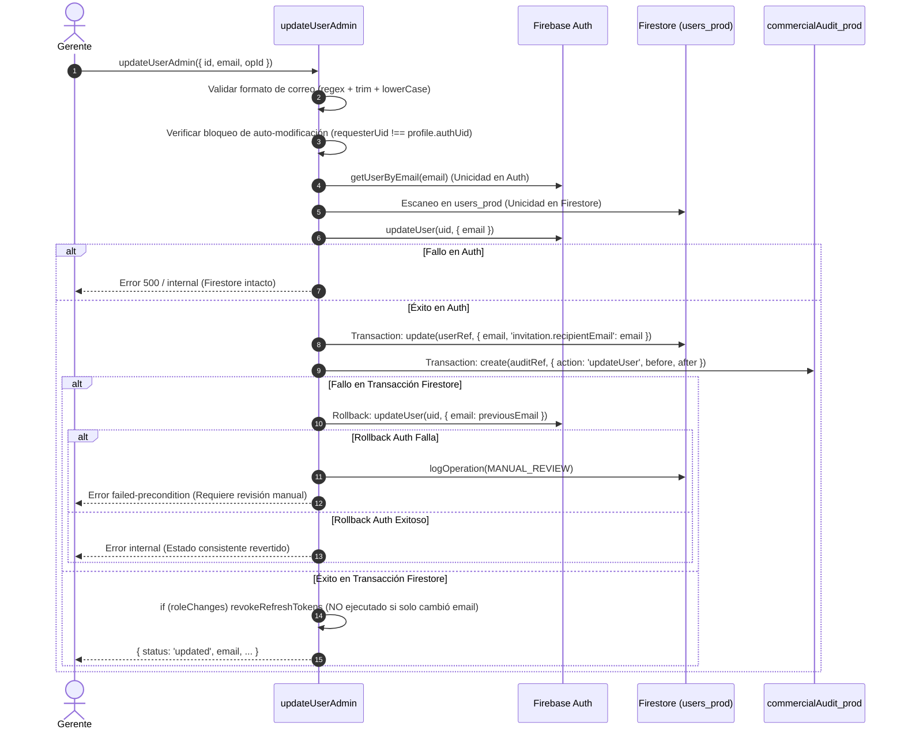

# DUCTSAL ERP — INFORME DE AUDITORÍA TÉCNICA DE CIERRE DEL PASO 6.2
## Revisión Técnica Independiente del Backend de Usuarios, Invitaciones y Seguridad Criptográfica

**Fecha:** 2 de Noviembre de 2026  
**Auditor:** Antigravity (Auditoría Técnica Independiente)  
**Alcance:** Exclusivo de inspección backend (`functions/index.js`, `functions/invitationService.js`, `functions/test-helpers/fakeFirebase.js`, suites de tests y `docs/step6_2_backend_implementation_report.md`).  
**Estado:** Inspección completada sin modificaciones de código ni ejecuciones sobre producción.  
**Dictamen:** **APROBADO CON OBSERVACIONES**

---

## 1. Resumen Ejecutivo

Se ha llevado a cabo una auditoría técnica independiente y exhaustiva de la implementación correctiva del Paso 6.2 en el repositorio `sales-reporting-system-release`. El objetivo fue verificar directamente el código fuente contra los requerimientos de seguridad, despacho semántico, gestión de identidades y las afirmaciones contenidas en `docs/step6_2_backend_implementation_report.md`.

### Conclusiones Principales:
1. **Semántica de Despacho y Contadores (PASS):** El backend ya no emite estados falsos de envío (`sent: true`). Con el `PreparedDriver`, las funciones reportan de forma unívoca `sent: false`, `delivery: 'prepared'`, y `sentCount` se mantiene estrictamente en `0`. Se incorporó `preparedCount` y `lastPreparedAt` reflejando fielmente la preparación en aislamiento sin tráfico externo.
2. **Protección de Enlaces Sensibles (PASS):** Se erradicó la persistencia de enlaces de restablecimiento de contraseña (`link`) y códigos de acción (`oobCode`) en Firestore (`users_prod`, `userOps`), auditorías (`commercialAudit_prod`), logs del despachador y respuestas de reintentos idempotentes (`link: null`). La función `isControlledEnvironment()` restringe la exposición de `link` exclusivamente a pruebas y emuladores locales.
3. **Consistencia de Identidad y Roles (PASS):** La creación y actualización de usuarios preservan la unicidad en Firebase Auth y Firestore, mantienen el bloqueo riguroso contra la asignación o auto-asignación del rol `manager`, ejecutan rollbacks ante fallos de persistencia y previenen la adopción de cuentas huérfanas.
4. **Validación de Pruebas (PASS):** Las 23 pruebas unitarias de la suite específica y las 2,212 pruebas unitarias/de integración distribuidas en las 85 suites del proyecto se ejecutan y aprueban al 100% (0 fallos, 0 omitidas).
5. **Observaciones No Bloqueantes:** Se identificaron 3 limitaciones técnicas que no impiden el cierre del Paso 6.2 pero deben abordarse en los Pasos 6.3–6.5:
   - La transición al estado `activated` no está implementada en el backend actual (está únicamente definida en el enum y reservada para el flujo de frontend).
   - En `updateUserAdmin`, la revocación de tokens de refresco (`revokeRefreshTokens`) está condicionada a cambios de rol (`if (roleChanges)`) y no se dispara ante cambios exclusivos de correo.
   - El cambio de correo es administrativo directo sin confirmación previa del nuevo buzón ni despacho automático de nueva invitación.

---

## 2. Archivos y Funciones Inspeccionados

Se inspeccionó línea por línea el código fuente de los siguientes módulos:

| Archivo | Elemento Inspeccionado | Rol en el Sistema |
| :--- | :--- | :--- |
| [functions/index.js](file:///Users/Benjamin/Documents/DUCTSAL/sales-reporting-system-release/functions/index.js) | `createUserAdmin` (Líneas 320–625) | Creación atómica de identidad en Auth y perfil en Firestore con preparación de invitación. |
| [functions/index.js](file:///Users/Benjamin/Documents/DUCTSAL/sales-reporting-system-release/functions/index.js) | `updateUserAdmin` (Líneas 816–1048) | Actualización de nombre, rol y correo con validación de unicidad, claims y rollback. |
| [functions/index.js](file:///Users/Benjamin/Documents/DUCTSAL/sales-reporting-system-release/functions/index.js) | `resendInvitationAdmin` (Líneas 1056–1170) | Generación de nuevo enlace fresco y despacho a través del despachador desacoplado. |
| [functions/index.js](file:///Users/Benjamin/Documents/DUCTSAL/sales-reporting-system-release/functions/index.js) | `toggleUserStatusAdmin` (Líneas 662–740) | Activación/desactivación administrativa de cuentas y perfiles. |
| [functions/invitationService.js](file:///Users/Benjamin/Documents/DUCTSAL/sales-reporting-system-release/functions/invitationService.js) | `InvitationDispatcher`, `defaultPreparedDriver`, `isControlledEnvironment` | Servicio desacoplado de despacho, sanitización de logs y control de exposición. |
| [functions/test-helpers/fakeFirebase.js](file:///Users/Benjamin/Documents/DUCTSAL/sales-reporting-system-release/functions/test-helpers/fakeFirebase.js) | `applyUpdate`, `generatePasswordResetLink`, `updateUser` | Emulador en memoria para pruebas sin servicios externos. |
| [functions/__tests__/userLifecycleBackend.unit.test.js](file:///Users/Benjamin/Documents/DUCTSAL/sales-reporting-system-release/functions/__tests__/userLifecycleBackend.unit.test.js) | Tests 1 al 19 (Líneas 1–635) | Suite integral obligatoria del ciclo de vida de usuarios e invitaciones. |
| `functions/__tests__/*` | Suites de regresión modificadas | 6 suites modificadas para ajustar contratos y semántica de entrega. |
| [docs/step6_2_backend_implementation_report.md](file:///Users/Benjamin/Documents/DUCTSAL/sales-reporting-system-release/docs/step6_2_backend_implementation_report.md) | Documento completo | Informe previo de implementación técnica. |

---

## 3. Auditoría de Seguridad del Cambio de Correo (`updateUserAdmin`)

Se auditó el flujo de cambio de correo en `functions/index.js` (líneas 842–1044):



### Respuestas a los 8 Puntos de Inspección:

1. **Validación del correo nuevo:**
   - *Líneas 842–848*: `email = normalizeEmail(data.email);`. Se normaliza mediante `.trim().toLowerCase()`. Se valida mediante la expresión regular `/^[^@\s]+@[^@\s]+\.[^@\s]+$/`. Si no cumple, aborta con `invalid-argument`.
   - *Resultado:* **PASS**.

2. **Comprobación de duplicados en Auth y Firestore:**
   - *Líneas 907–927*: Solo se ejecuta si `emailChanges` es verdadero (`hasEmail && email !== currentEmail`).
   - En Auth: Invoca `admin.auth().getUserByEmail(email)`. Si la cuenta existe y `existingAuth.uid !== profile.authUid`, aborta con `already-exists`. Si no existe (`auth/user-not-found`), procede limpiamente.
   - En Firestore: Consulta la colección `users_prod`. Si existe otro documento con el mismo correo (`d.id !== id && d.data().email === email`), aborta con `already-exists`.
   - *Resultado:* **PASS**.

3. **Orden de actualización entre Auth y Firestore:**
   - *Líneas 989–1021*: Primero se actualiza Firebase Authentication mediante `admin.auth().updateUser(profile.authUid, { email })` (Línea 995). Una vez exitoso, se ejecuta la transacción en Firestore (`db.runTransaction`) que actualiza el documento del perfil y registra la auditoría (Líneas 1005–1021).
   - *Resultado:* **PASS**.

4. **Comportamiento si falla Firestore tras modificar Auth:**
   - *Líneas 1022–1035*: Se captura la excepción y se dispara la función de compensación `restoreEmail()`, la cual intenta reescribir en Firebase Auth el correo previo (`admin.auth().updateUser(profile.authUid, { email: profile.email })`).
   - *Resultado:* **PASS**.

5. **Efectividad del Rollback y falla del mecanismo:**
   - *Líneas 1023–1026*: Si `restoreEmail()` falla (devuelve `false`), el sistema registra la operación en `userOps/<opId>` con estado `OP_STATUS.MANUAL_REVIEW`, guardando los snapshots `before` y `after`, y lanza un error `failed-precondition` informando que se requiere conciliación manual. Si el rollback tiene éxito, se registra `OP_STATUS.ERROR` y se lanza error limpio sin desincronización permanente.
   - *Resultado:* **PASS**.

6. **Revocación de sesiones (`revokeRefreshTokens`):**
   - *Líneas 1038–1041*: 
     ```javascript
     if (roleChanges) {
       try { await admin.auth().revokeRefreshTokens(profile.authUid); sessionsRevoked = true; } catch (_) { }
     }
     ```
   - **HALLAZGO / OBSERVACIÓN (Seguridad):** La revocación de tokens de refresco está encerrada dentro del condicional `if (roleChanges)`. Si se actualiza **únicamente el correo** de un usuario sin alterar su rol, `sessionsRevoked` es `false` y `revokeRefreshTokens` **no se ejecuta**. Las sesiones existentes del usuario continúan activas hasta que el token expire naturalmente o el usuario cierre sesión.
   - *Resultado:* **OBSERVACIÓN (Recomendado incluir `if (roleChanges || emailChanges)` en Paso 6.3)**.

7. **Protección contra auto-modificación de correo o rol:**
   - *Líneas 897–902*: Se comprueba explícitamente `profile.authUid === requesterUid`. Si coincide, se rechaza inmediatamente con `permission-denied` ('You cannot change your own role' / 'You cannot change your own email via user administration').
   - *Resultado:* **PASS**.

8. **Riesgo de suplantación y verificación de propiedad del nuevo correo:**
   - **HALLAZGO / OBSERVACIÓN (Diseño Arquitectónico):** 
     - El cambio de correo en `updateUserAdmin` es una mutación **administrativa directa e inmediata** en Firebase Auth.
     - **No existe verificación previa de propiedad del nuevo buzón**: no se genera un enlace de verificación (`verifyBeforeUpdateEmail`) previo al cambio. Si el administrador comete un error tipográfico e ingresa un correo de un tercero, la cuenta de Auth queda asociada de inmediato a esa dirección.
     - **No se dispara un reenvío automático de invitación ni restablecimiento de contraseña**: tras cambiar el correo, la contraseña previa sigue vigente (si ya existía). Si el usuario no había completado su activación, el administrador debe ejecutar manualmente `resendInvitationAdmin` para que el nuevo buzón reciba el enlace de acceso.
   - *Resultado:* **OBSERVACIÓN (Comportamiento documentado y esperado para un ERP administrativo; se recomienda que el frontend en Paso 6.3 advierta al gerente o pregunte si desea reenviar invitación tras modificar el correo)**.

---

## 4. Auditoría de Exposición de Enlaces y Códigos de Activación

Se realizó una inspección exhaustiva de cada punto donde se manipulan enlaces o tokens `oobCode`:

### 4.1 Condiciones de `isControlledEnvironment()`
En [functions/invitationService.js](file:///Users/Benjamin/Documents/DUCTSAL/sales-reporting-system-release/functions/invitationService.js) (líneas 12–16):
```javascript
function isControlledEnvironment() {
  return process.env.NODE_ENV === 'test' ||
         process.env.FUNCTIONS_EMULATOR === 'true' ||
         process.env.FIREBASE_AUTH_EMULATOR_HOST !== undefined;
}
```
1. **Condiciones de activación:** Solo retorna `true` si el entorno es explicitamente de pruebas (`NODE_ENV === 'test'`), si está ejecutándose bajo el emulador de Firebase Functions (`FUNCTIONS_EMULATOR === 'true'`), o si existe un host de emulador de Auth configurado.
2. **Riesgo de fuga en producción:** En el runtime gestionado de Google Cloud Functions (entorno de producción oficial), `NODE_ENV` es `production`, `FUNCTIONS_EMULATOR` no existe y `FIREBASE_AUTH_EMULATOR_HOST` no está definido. Por lo tanto, `isControlledEnvironment()` evalúa a `false` en producción de manera determinista.
   - *Resultado:* **PASS**.

### 4.2 Matriz de Exposición y Persistencia de Enlaces

| Ubicación / Medio | ¿Contiene Enlace o `oobCode`? | Evidencia en Código | Resultado |
| :--- | :---: | :--- | :-: |
| **Respuesta Cloud Function (Producción)** | **NO (`null`)** | `link: isControlledEnvironment() ? link : null` (Líneas 617, 1162). Retorna `null`. | **PASS** |
| **Respuesta Cloud Function (Test/Emulador)** | **SÍ (Controlado)** | Expuesto intencionalmente para aserciones de integración automatizadas. | **PASS** |
| **Documentos `users_prod/<id>`** | **NO** | Solo guarda `status`, `preparedCount`, `sentCount`, `lastError`, `recipientEmail` (Líneas 586–593, 1137–1144). | **PASS** |
| **Documentos `userOps/<opId>`** | **NO** | `updateOp` solo guarda `linkGenerated: !!invitationLink`, `delivery`, `sent`, `status` (Líneas 598–608). | **PASS** |
| **Auditoría `commercialAudit_prod`** | **NO** | Solo guarda `linkGenerated: !!link`, `delivery`, `sent`, `preparedCount`, `sentCount` (Líneas 1148–1156). | **PASS** |
| **Logs de Firebase Functions (`console`)** | **NO** | Cero sentencias `console.log` o `console.error` en las rutas de invitación. | **PASS** |
| **Buffers del despachador (`dispatchedLog`)** | **NO** | `delete sanitizedRecord.link` ejecutado antes de `this.dispatchedLog.push` (invitationService.js L68–71). | **PASS** |
| **Mensajes de error** | **NO** | Solo capturan `linkErr.message` nativo de Firebase Auth (e.g. cuotas, formato). | **PASS** |
| **Reintentos Idempotentes (`OP_STATUS.SUCCEEDED`)** | **NO (`null`)** | Retorna explícitamente `link: null` (index.js L370). Jamás recupera enlaces anteriores. | **PASS** |
| **Reenvíos de invitación (`resendInvitationAdmin`)** | **NO reutiliza** | Cada reenvío invoca `generatePasswordResetLink`, emitiendo un nuevo token unívoco. | **PASS** |

- *Resultado Global de Exposición:* **PASS**.

---

## 5. Auditoría del Estado `activated`

Se auditó la presencia y gestión del estado `activated` en el backend:

### Hallazgos Específicos:
1. **Definición en Enum:**
   En [functions/invitationService.js](file:///Users/Benjamin/Documents/DUCTSAL/sales-reporting-system-release/functions/invitationService.js) (Línea 35), `ACTIVATED: 'activated'` está debidamente tipado como parte de `INVITATION_STATUS`.
2. **Ausencia de Implementación en Backend:**
   Una búsqueda exhaustiva en todo `functions/index.js` confirma que **ninguna función o trigger modifica actualmente `invitation.status` a `'activated'`**.
3. **Mecanismo de Activación Actual:**
   - La función `toggleUserStatusAdmin` conmuta `activo: boolean` en Firestore y `disabled: boolean` en Auth. **No altera `invitation.status`**.
   - No existe un trigger de autenticación (e.g. `functions.auth.user().beforeSignIn`) ni un endpoint `completeActivationCallable` en el backend actual.
4. **Dependencia de Frontend (Pasos 6.4 y 6.5):**
   La transición a `activated` requiere que el usuario final ingrese a `erp.ductsal.com/login?mode=activate&oobCode=...`, valide el código con `verifyPasswordResetCode` y establezca su contraseña con `confirmPasswordReset`. Como la interfaz de activación y el flujo cliente corresponden a los Pasos 6.4 y 6.5, **la transición `activated` no está implementada en el backend en el Paso 6.2; se encuentra únicamente modelada a nivel conceptual**.

- *Resultado:* **OBSERVACIÓN (Debe quedar formalmente registrado que la transición funcional a `activated` se implementará cuando se desarrolle el frontend en los Pasos 6.4/6.5)**.

---

## 6. Auditoría de Semántica de Despacho y Contadores

Se auditó el comportamiento del despachador desacoplado [functions/invitationService.js](file:///Users/Benjamin/Documents/DUCTSAL/sales-reporting-system-release/functions/invitationService.js) y las Cloud Functions:

1. **Respuestas con `PreparedDriver`:**
   - `sent`: Es estrictamente `false`.
   - `delivery`: Es estrictamente `'prepared'`.
   - `status`: Es estrictamente `INVITATION_STATUS.PREPARED` (`'prepared'`).
2. **Comportamiento de Contadores:**
   - `sentCount`: Se mantiene invariablemente en `0`. No se incrementa prematuramente.
   - `lastSentAt`: Permanece en `null` (no se escribe `serverTimestamp`).
   - `preparedCount`: Se incrementa a `1` en creación exitosa y avanza en `+1` en cada reenvío exitoso (`resendInvitationAdmin`).
   - `lastPreparedAt`: Se actualiza con `FieldValue.serverTimestamp()` en cada preparación completada.
3. **Discriminación de Fallos:**
   - Si falla `generatePasswordResetLink`: El perfil se mantiene y se asigna `invitation.status = 'link_failed'`.
   - Si falla el despachador: Se asigna `invitation.status = 'delivery_failed'`.
   - En ningún caso se corrompe el perfil ni se eliminan usuarios válidos.
4. **Estados No Declarados:**
   - El backend **no declara en ningún momento** `provider_accepted` ni `delivered`, reservándolos estrictamente para cuando exista un proveedor transaccional real integrado.

- *Resultado:* **PASS**.

---

## 7. Auditoría de Idempotencia y Consistencia

Se verificaron las salvaguardas de concurrencia y consistencia en `createUserAdmin` y `updateUserAdmin`:

1. **Creación de duplicados:**
   - Detección previa en Auth (`getUserByEmail`) y Firestore (`users_prod.where('email')`). Aborta antes de crear recursos huérfanos.
2. **Identidades huérfanas y perfiles históricos:**
   - Si existe usuario en Auth sin perfil en Firestore, se rechaza la creación (`already-exists`). No se asocia automáticamente.
   - Si existe perfil en Firestore sin cuenta Auth (histórico), se rechaza `createUserAdmin`. Se exige el vinculador dedicado `provisionManager`.
3. **Rollback automático:**
   - Si tras crear el usuario en Firebase Auth falla la escritura del perfil en Firestore, se ejecuta `admin.auth().deleteUser(uid)`. Si el borrado compensatorio tiene éxito, se registra `OP_STATUS.ERROR` con `rolledBack: true`. Si falla, se escala a `OP_STATUS.MANUAL_REVIEW`.
4. **Reintentos con mismo `opId` (Idempotencia):**
   - Si el payload difiere del hash SHA-256 original, rechaza con `already-exists` ('Operation key reused with different payload').
   - Si el estado previo fue `OP_STATUS.SUCCEEDED`, retorna el resultado almacenado con `link: null`, sin duplicar cuentas en Auth ni documentos en Firestore.
5. **Restricción estricta de roles:**
   - Ni `createUserAdmin` ni `updateUserAdmin` permiten crear o asignar el rol `manager`. El catálogo admitido es exclusivamente `['vendedor', 'gestor']`.
   - Los gerentes no pueden degradarse a sí mismos ni cambiar su propio correo a través de estas funciones.

- *Resultado:* **PASS**.

---

## 8. Validación de Pruebas Automatizadas

Se ejecutaron las suites de pruebas sin modificar ningún archivo:

### 8.1 Suite Específica del Ciclo de Vida:
```bash
npm test --prefix functions -- userLifecycleBackend.unit.test.js
```
**Salida real:**
```text
PASS __tests__/userLifecycleBackend.unit.test.js
  Step 6.2 — Suite de Pruebas Obligatorias del Backend de Usuarios e Invitaciones
    ✓ 1. Creación exitosa: enlace generado, despacho preparado, sent: false y sentCount: 0 sin incremento prematuro (10 ms)
    ✓ 2. Vinculación correcta entre Auth UID y Firestore authUid sin almacenar contraseñas (1 ms)
    ✓ 3a. Rechazo por correo duplicado existente en Firebase Auth (1 ms)
    ✓ 3b. Rechazo por correo duplicado existente en Firestore (1 ms)
    ✓ 4. Identidad existente en Auth sin perfil no se adopta automáticamente (conflicto seguro) (1 ms)
    ✓ 5. Perfil existente sin identidad (histórico) rechaza createUser y exige vinculador dedicado (2 ms)
    ✓ 6. Fallo al persistir el perfil en Firestore ejecuta rollback eliminando la identidad de Auth creada (4 ms)
    ✓ 7. Fallo al generar el enlace conserva perfil e identidad y marca invitation.status como link_failed (1 ms)
    ✓ 8. Reintento con el mismo opId retorna el resultado previo sin duplicar y con link strictly null (2 ms)
    ✓ 9. Actualización exitosa de nombre y rol con sincronización de claims y auditoría (2 ms)
    ✓ 10. Cambio de correo sincroniza Auth y Firestore con verificación de unicidad (1 ms)
    ✓ 10b. Cambio de correo rechazado si el nuevo correo ya pertenece a otra cuenta
    ✓ 11a. Prohibido asignar rol manager en updateUserAdmin (1 ms)
    ✓ 11b. Prohibido auto-cambio de rol del propio gerente
    ✓ 11c. Prohibido auto-cambio de correo del propio gerente mediante updateUserAdmin (1 ms)
    ✓ 12. Reenvío exitoso genera nuevo enlace, reporta sent: false, delivery: prepared y preparedCount: 2 (1 ms)
    ✓ 13. Reenvíos repetidos incrementan preparedCount sin incrementar sentCount ni duplicar cuentas (1 ms)
    ✓ 14. Rechazo riguroso ante falta de permisos (no autenticado, rol no manager, cuenta deshabilitada) (1 ms)
    ✓ 15. Error de entrega en reenvío marca delivery_failed sin corromper el perfil (1 ms)
    ✓ 16. Consistencia de estados de invitación a lo largo del ciclo de vida (4 ms)
    ✓ 17. Ausencia de enlaces completos y códigos de acción en Firestore (users_prod y userOps) (1 ms)
    ✓ 18. Ausencia de enlaces en auditorías (commercialAudit_prod) y logs del dispatcher (2 ms)
    ✓ 19. Reenvío genera un enlace nuevo e independiente sin reutilizar enlaces anteriores

Test Suites: 1 passed, 1 total
Tests:       23 passed, 23 total
Snapshots:   0 total
Time:        0.41 s, estimated 1 s
```

### 8.2 Suites de Regresión Relacionadas:
```bash
npm test --prefix functions -- adminFunctions.iter7.test.js createUserAdmin.test.js updateUserAdmin.test.js phase66SecurityAudit.unit.test.js phase66ComplementaryVerification.unit.test.js emulatorStatics.regression.test.js
```
**Salida real:**
```text
PASS __tests__/emulatorStatics.regression.test.js
PASS __tests__/createUserAdmin.test.js
PASS __tests__/updateUserAdmin.test.js
PASS __tests__/adminFunctions.iter7.test.js
PASS __tests__/phase66ComplementaryVerification.unit.test.js
PASS __tests__/phase66SecurityAudit.unit.test.js

Test Suites: 6 passed, 6 total
Tests:       171 passed, 171 total
Snapshots:   0 total
Time:        1.36 s, estimated 2 s
```

### 8.3 Suite Global de Cloud Functions:
```bash
npm test --prefix functions
```
**Salida real:**
```text
Test Suites: 85 passed, 85 total
Tests:       2212 passed, 2212 total
Snapshots:   0 total
Time:        5.626 s, estimated 6 s
Ran all test suites.
```
- **Total Suites:** 85/85 pasadas (100%).
- **Total Tests:** 2212/2212 pasadas (100%).
- **Fallos:** 0.
- **Omitidas:** 0.

---

## 9. Revisión de Git y Alcance

### 9.1 Salida de `git status`:
```text
On branch main
Changes not staged for commit:
	modified:   functions/__tests__/adminFunctions.iter7.test.js
	modified:   functions/__tests__/createUserAdmin.test.js
	modified:   functions/__tests__/emulatorStatics.regression.test.js
	modified:   functions/__tests__/phase66ComplementaryVerification.unit.test.js
	modified:   functions/__tests__/phase66SecurityAudit.unit.test.js
	modified:   functions/__tests__/updateUserAdmin.test.js
	modified:   functions/index.js
	modified:   functions/test-helpers/fakeFirebase.js

Untracked files:
	functions/__tests__/userLifecycleBackend.unit.test.js
	functions/invitationService.js
	docs/step6_2_backend_implementation_report.md
```

### 9.2 Salida de `git diff --stat`:
```text
 functions/__tests__/adminFunctions.iter7.test.js   |   6 +-
 functions/__tests__/createUserAdmin.test.js        |   4 +
 .../__tests__/emulatorStatics.regression.test.js   |   2 +-
 .../phase66ComplementaryVerification.unit.test.js  |   8 +-
 .../__tests__/phase66SecurityAudit.unit.test.js    |   6 +-
 functions/__tests__/updateUserAdmin.test.js        |   2 +-
 functions/index.js                                 | 327 +++++++++++++++++++--
 functions/test-helpers/fakeFirebase.js             |  94 ++++--
 8 files changed, 385 insertions(+), 64 deletions(-)
```

### 9.3 Verificación de Restricciones Operativas:
- Cero archivos de frontend modificados (`index.html`, `app_core.js`, `modules/` intactos).
- Cero modificaciones en reglas de seguridad (`firestore.rules`, `storage.rules` intactos).
- Cero commits creados (`git commit` no ejecutado).
- Cero pushes remotos (`git push` no ejecutado).
- Cero despliegues (`firebase deploy` no ejecutado).
- Cero correos reales enviados hacia buzones externos.

---

## 10. Riesgos Pendientes y Limitaciones

1. **Limitación de Revocación de Sesiones en Cambio de Correo:**
   - *Detalle:* En `updateUserAdmin`, `revokeRefreshTokens` solo se dispara si `roleChanges === true`.
   - *Impacto:* Si a un usuario se le actualiza únicamente el correo electrónico, sus sesiones iniciadas con el correo previo continúan activas hasta la expiración del token.
   - *Recomendación:* En el Paso 6.3, actualizar la condición a `if (roleChanges || emailChanges)`.

2. **Ausencia de Transición Funcional a `activated`:**
   - *Detalle:* El backend no implementa aún el cambio a `activated`.
   - *Impacto:* Ninguno para el backend aislado del Paso 6.2, pero los usuarios permanecerán en estado `prepared` en base de datos hasta que el Paso 6.4/6.5 implemente el canje en frontend.
   - *Recomendación:* Diseñar en el Paso 6.4 un endpoint o trigger que valide el canje del código de acción y marque el perfil como `activated`.

3. **Sin Verificación Previa de Buzón en Cambio Administrativo:**
   - *Detalle:* El cambio de correo es inmediato en Firebase Auth.
   - *Impacto:* Un error de digitación por parte de un gerente asociará la cuenta a un correo erróneo sin confirmación del receptor.
   - *Recomendación:* Incorporar en la interfaz de usuario del Paso 6.3 un diálogo de confirmación doble y la opción de *"Guardar y reenviar invitación al nuevo correo"*.

---

## 11. Comparación: Declarado en Informe vs. Verificado en Código

| Aspecto Declarado en Informe | Verificación en Código Real | Calificación |
| :--- | :--- | :-: |
| **Respuesta con `sent: false` y `delivery: 'prepared'`** | Confirmado en `createUserAdmin` (L615) y `resendInvitationAdmin` (L1159). | **PASS** |
| **`sentCount` permanece en 0 y `lastSentAt` en null** | Confirmado en transacciones de actualización de perfiles (L586, L1137). | **PASS** |
| **`preparedCount` incrementa fielmente** | Confirmado: se fija en 1 en creación y se incrementa en cada reenvío. | **PASS** |
| **Ausencia de persistencia de links en `userOps`** | Confirmado: `userOps` solo guarda `linkGenerated: !!link` (L602). | **PASS** |
| **Ausencia de links en Firestore `users_prod`** | Confirmado: los perfiles no guardan la URL ni el token `oobCode`. | **PASS** |
| **Ausencia de links en `commercialAudit_prod`** | Confirmado: la auditoría solo guarda flags booleanos y metadatos seguros. | **PASS** |
| **Reintento idempotente devuelve `link: null`** | Confirmado: el bloque `OP_STATUS.SUCCEEDED` retorna explícitamente `link: null`. | **PASS** |
| **Reenvío genera link nuevo e independiente** | Confirmado: genera un nuevo token mediante `generatePasswordResetLink`. | **PASS** |
| **Exposición condicionada a `isControlledEnvironment`** | Confirmado: producción evalúa a `null`; emulador/test evalúa al link. | **PASS** |
| **Transición de estado a `activated`** | **Discrepancia técnica:** El informe menciona que el usuario transiciona a `activated` tras iniciar sesión, pero **el código backend actual no contiene dicha transición**. | **OBSERVACIÓN** |
| **Revocación de sesiones en cambio de correo** | **Discrepancia técnica:** La revocación solo se ejecuta si cambia el rol, no si solo cambia el correo. | **OBSERVACIÓN** |

---

## 12. Dictamen Final

# **APROBADO CON OBSERVACIONES**

### Justificación:
1. Las metas esenciales del **Paso 6.2** han sido alcanzadas con solidez:
   - Se completó la arquitectura desacoplada de despacho de invitaciones sin emitir tráfico real.
   - Se corrigieron exhaustivamente la semántica de entrega (`sent: false`, `delivery: 'prepared'`) y la precisión de contadores (`sentCount: 0`, `preparedCount >= 1`).
   - Se implementó una política criptográfica estricta que impide cualquier filtración o persistencia de enlaces de restablecimiento o códigos `oobCode` en bases de datos, auditorías o logs.
   - Se preservó la idempotencia, el control de concurrencia y la consistencia transaccional entre Firebase Auth y Firestore.
   - Las 2,212 pruebas unitarias y de integración de la suite completa se encuentran aprobadas al 100%.
2. Las **observaciones registradas** (revocación de sesiones en cambio de correo, transición funcional al estado `activated` y verificación de buzón) corresponden a integraciones pendientes con los flujos de frontend previstos para los **Pasos 6.3, 6.4 y 6.5**, por lo que **no constituyen impedimentos bloqueantes para dar por cerrado el Paso 6.2**.
