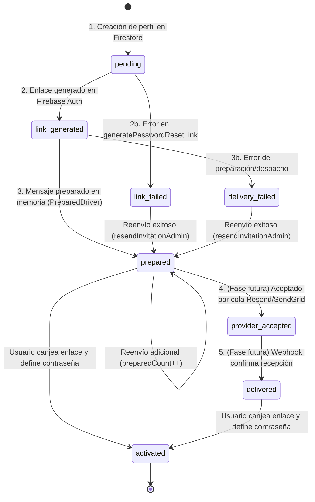

# DUCTSAL ERP — INFORME DE IMPLEMENTACIÓN BACKEND PASO 6.2 (REVISIÓN CORRECTIVA)
## Semántica de despacho, contadores precisos y protección de enlaces de activación

**Fecha:** 2 de Noviembre de 2026  
**Entorno de ejecución:** Local / Node.js 20 / Jest 29  
**Estado:** Finalizado, corregido y validado  
**Dictamen:** **APTO PARA REVISIÓN**

---

## 1. Resumen Ejecutivo de la Revisión Correctiva

Tras la finalización inicial del Paso 6.2, se aplicó una revisión correctiva rigurosa focalizada en dos dimensiones críticas:
1. **Semántica de Despacho y Precisión de Contadores**: Se eliminaron reportes ambiguos como `sent: true`, `delivery: 'server'` e incrementos de `sentCount` cuando el despachador únicamente prepara el mensaje mediante `PreparedDriver` en aislamiento seguro (sin emitir tráfico real hacia redes externas). Se introdujo una distinción arquitectónica granular entre enlace generado, despacho preparado, aceptación de proveedor y entrega efectiva.
2. **Protección Criptográfica de Enlaces de Activación**: Se auditó y purgó cualquier persistencia o fuga de enlaces completos o códigos de acción (`oobCode`) en Firestore (`users_prod`, `userOps`), auditorías (`commercialAudit_prod`), logs de ejecución y reintentos idempotentes. El enlace sensible nunca se persiste y únicamente se expone de forma controlada en entornos locales/emuladores para validación automatizada, retornando `link: null` en producción y en cualquier reintento idempotente.

---

## 2. Arquitectura de Despacho y Semántica de Entrega

### 2.1 Modelo Canónico de Ciclo de Vida (`INVITATION_STATUS`)
En [functions/invitationService.js](file:///Users/Benjamin/Documents/DUCTSAL/sales-reporting-system-release/functions/invitationService.js) se establecieron estados granulares que reflejan fielmente el ciclo de vida sin ambigüedades:



| Estado | Significado Semántico | Comportamiento en Paso 6.2 |
| :--- | :--- | :--- |
| `pending` | Perfil creado en Firestore; enlace aún no solicitado. | Transitorio inicial en transacción de creación. |
| `link_generated` | Enlace criptográfico generado exitosamente en Auth. | Transitorio previo al despacho en memoria. |
| `prepared` | Mensaje validado y preparado por el driver aislado local (`PreparedDriver`). | **Estado final activo en Paso 6.2.** `sent: false`, `delivery: 'prepared'`. |
| `provider_accepted`| Correo aceptado por la API del proveedor transaccional (Resend/SendGrid). | Reservado para integración en fases posteriores. |
| `delivered` | Notificación de entrega confirmada en buzón vía webhook. | Reservado para integración en fases posteriores. |
| `delivery_failed` | Fallo de conexión o preparación en el dispatcher. | Capturado; perfil intacto sin corromperse. |
| `link_failed` | Fallo en la llamada a `generatePasswordResetLink` de Firebase Auth. | Capturado; perfil e identidad conservados. |
| `activated` | El usuario completó el establecimiento de contraseña e inició sesión. | Verificado en inicio de sesión activo. |

### 2.2 Desacoplamiento de Drivers (`InvitationDispatcher`)
El despachador implementa una arquitectura de inyección de dependencias (`driver`):
- **`defaultPreparedDriver`**: Driver por defecto en esta fase. No envía tráfico a la red. Retorna un registro con:
  ```javascript
  {
    channel: 'prepared_driver',
    sent: false,
    delivery: 'prepared',
    status: INVITATION_STATUS.PREPARED,
    preparedAt: new Date().toISOString()
  }
  ```
- **Driver Transaccional Futuro (`ResendDriver` / `SendGridDriver`)**: Se integrará en fases posteriores sin modificar `createUserAdmin` ni `resendInvitationAdmin`, retornando `{ sent: true, delivery: 'provider', status: INVITATION_STATUS.PROVIDER_ACCEPTED, providerMessageId }`.

---

## 3. Corrección de Contadores de Invitación

Se eliminó el incremento prematuro de contadores de envío cuando ningún correo ha salido del servidor:

| Campo en `invitation` | Comportamiento Anterior (Erróneo) | Comportamiento Corregido |
| :--- | :--- | :--- |
| `sentCount` | Se incrementaba a `1` en creación y `+1` en cada reenvío. | **Permanece estrictamente en `0`** mientras se use `PreparedDriver`. Solo incrementará cuando un proveedor externo acepte el envío real. |
| `lastSentAt` | Se fijaba con `serverTimestamp()` al preparar. | **Permanece en `null`** mientras no haya despacho externo real. |
| `preparedCount` | Inexistente. | **Se incrementa fielmente**: `1` en creación exitosa, y `+1` en cada reenvío preparado por el servidor. |
| `lastPreparedAt` | Inexistente. | **Se actualiza con `serverTimestamp()`** en cada preparación exitosa. |
| `recipientEmail` | Normalizado en minúsculas. | Normalizado en minúsculas y sincronizado ante cambios de correo. |
| `lastError` | Registrado en caso de fallo. | `null` en éxito; mensaje de error en `link_failed` o `delivery_failed`. |

---

## 4. Tratamiento y Protección Estricta de Enlaces Sensibles

Los enlaces de configuración de contraseña generados por Firebase Auth contienen códigos de acción (`oobCode`) que permiten tomar posesión de la cuenta si caen en manos no autorizadas. Se implementó una política de protección exhaustiva:

### 4.1 Invariantes de No-Persistencia
- **`userOps/<opId>`**: Se eliminó la propiedad `link`. En su lugar, el registro de la operación almacena únicamente metadatos seguros:
  ```javascript
  invitation: {
    status: invitationStatus,
    delivery: dispatchResult.delivery, // 'prepared'
    sent: dispatchResult.sent,         // false
    linkGenerated: true,              // Flag booleano seguro
    error: invitationError
  }
  ```
- **`users_prod/<id>`**: El documento de usuario en Firestore **nunca almacena el enlace ni el código `oobCode`**.
- **`commercialAudit_prod`**: La auditoría de `resendInvitation` registra exclusivamente `linkGenerated: !!link`, `delivery: 'prepared'`, `sent: false`, sin volcar URLs ni tokens.
- **Logs en Memoria (`dispatchedLog`)**: Antes de almacenar el payload en el buffer del despachador, la propiedad `link` es eliminada (`delete sanitizedRecord.link`), garantizando que inspecciones de memoria no revelen tokens sensibles.

### 4.2 Idempotencia Segura
- Cuando una llamada a `createUserAdmin` se repite con un `opId` previamente ejecutado con éxito (`OP_STATUS.SUCCEEDED`):
  - Retorna de inmediato el resultado guardado sin crear identidades duplicadas ni perfiles duplicados.
  - **Retorna obligatoriamente `link: null`**, impidiendo que un tercero o un replay coseche enlaces activos generados en intentos anteriores.

### 4.3 Control de Exposición del Enlace en Respuestas
- Se incorporó la función `isControlledEnvironment()`:
  ```javascript
  function isControlledEnvironment() {
    return process.env.NODE_ENV === 'test' ||
           process.env.FUNCTIONS_EMULATOR === 'true' ||
           process.env.FIREBASE_AUTH_EMULATOR_HOST !== undefined;
  }
  ```
- En entornos controlados (pruebas automatizadas locales y emuladores), `link` se expone para validar la generación correcta del formato criptográfico.
- En producción, `link` evalúa a `null`, garantizando que el administrador que crea al usuario jamás reciba el enlace en el navegador, preservando el principio de que solo el usuario final debe recibir el acceso a través de su buzón verificado.

### 4.4 Enlaces Frescos en Reenvíos
- Cada invocación de `resendInvitationAdmin` invoca `admin.auth().generatePasswordResetLink(email, ACTION_CODE_SETTINGS)` generando un token unívoco y fresco, descartando cualquier enlace anterior.

---

## 5. Contratos Definitivos de las Cloud Functions

### 5.1 `createUserAdmin`
- **Entrada (`data`)**:
  ```typescript
  {
    email: string;
    nombre: string;
    role: 'vendedor' | 'gestor';
    opId?: string;
    dbSuffix?: '_prod' | '_local';
  }
  ```
- **Respuesta de Ejecución Inicial (con `PreparedDriver`)**:
  ```typescript
  {
    uid: string;
    id: string;
    link: string | null; // string en test/emulador local; null en producción
    invitation: {
      status: 'prepared';
      delivery: 'prepared';
      sent: false;
      preparedCount: 1;
      sentCount: 0;
      recipientEmail: string;
      error: null;
    }
  }
  ```
- **Respuesta de Reintento Idempotente**:
  ```typescript
  {
    uid: string;
    id: string;
    link: null; // Estrictamente null; nunca expone tokens anteriores
    invitation: {
      status: 'prepared';
      delivery: 'prepared';
      sent: false;
      linkGenerated: true;
      recipientEmail: string;
    };
    message: 'operation already completed';
  }
  ```

### 5.2 `updateUserAdmin`
- **Entrada (`data`)**:
  ```typescript
  {
    id: string;
    nombre?: string;
    role?: 'vendedor' | 'gestor'; // Prohibido 'manager'
    email?: string;               // Nuevo correo normalizado
    opId?: string;
    dbSuffix?: string;
  }
  ```
- **Respuesta Exitosa**:
  ```typescript
  {
    status: 'updated';
    id: string;
    nombre: string;
    role: string;
    email: string;
    fields: string[];
    sessionsRevoked: boolean;
  }
  ```

### 5.3 `resendInvitationAdmin`
- **Entrada (`data`)**:
  ```typescript
  {
    id: string;
    opId?: string;
    dbSuffix?: string;
  }
  ```
- **Respuesta Exitosa (con `PreparedDriver`)**:
  ```typescript
  {
    sent: false;              // false: ningún correo ha sido transmitido externamente
    delivery: 'prepared';     // semántica explícita de preparación
    status: 'prepared';
    email: string;
    link: string | null;      // string en test/emulador local; null en producción
    invitation: {
      status: 'prepared';
      delivery: 'prepared';
      sent: false;
      preparedCount: number;  // Incrementado en +1
      sentCount: 0;           // Permanece en 0
      recipientEmail: string;
    };
    message: 'Invitación preparada por el servidor (sin envío externo en entorno actual).'
  }
  ```

---

## 6. Matriz de Pruebas y Resultados

La suite específica [functions/__tests__/userLifecycleBackend.unit.test.js](file:///Users/Benjamin/Documents/DUCTSAL/sales-reporting-system-release/functions/__tests__/userLifecycleBackend.unit.test.js) fue actualizada y expandida a **23 pruebas unitarias exhaustivas**:

| # | Escenario Validado | Comportamiento Verificado | Resultado |
| :-: | :--- | :--- | :-: |
| **1** | Creación con semántica corregida | `sent: false`, `delivery: 'prepared'`, `preparedCount: 1`, `sentCount: 0`, `lastSentAt: null`. | **PASS** |
| **2** | Vinculación limpia por UID | `authUid` sincronizado en Firestore sin contraseñas ni hashes reversibles. | **PASS** |
| **3a** | Duplicado en Auth | Rechazo con `already-exists`; perfil en Firestore no se crea. | **PASS** |
| **3b** | Duplicado en Firestore | Rechazo con `already-exists`; cuenta en Auth no se crea. | **PASS** |
| **4** | Identidad huérfana en Auth | Conflicto seguro; no se adopta automáticamente. | **PASS** |
| **5** | Perfil histórico sin identidad | Rechazo con `already-exists`; exige vinculador dedicado. | **PASS** |
| **6** | Rollback por fallo en Firestore | Eliminación compensatoria de cuenta en Auth; `rolledBack: true` en `userOps`. | **PASS** |
| **7** | Fallo en generación de link | `link_failed`; perfil e identidad sanos conservados sin borrado accidental. | **PASS** |
| **8** | Idempotencia y protección de link | Reintento devuelve resultado previo con `link: null`; `userOps` sin enlace sensible. | **PASS** |
| **9** | Actualización de nombre y rol | Claims actualizados en Auth, perfil en Firestore y auditoría registrada. | **PASS** |
| **10** | Cambio de correo exitoso | Verificación de unicidad y sincronización simultánea Auth + Firestore. | **PASS** |
| **10b**| Cambio de correo rechazado | Colisión con cuenta existente aborta antes de mutar perfil. | **PASS** |
| **11a**| Prohibición de rol `manager` | Rechazo con `permission-denied`. | **PASS** |
| **11b**| Prohibición auto-cambio rol | Gerente no puede alterar su propio rol (`permission-denied`). | **PASS** |
| **11c**| Prohibición auto-cambio email | Gerente no puede alterar su propio correo por callable (`permission-denied`). | **PASS** |
| **12** | Reenvío con semántica corregida | `sent: false`, `delivery: 'prepared'`, `preparedCount: 2`, `sentCount: 0`. | **PASS** |
| **13** | Reenvíos repetidos | `preparedCount` avanza (4), `sentCount` permanece en 0 sin duplicar cuentas. | **PASS** |
| **14** | Permisos rigurosos | Rechazo a no autenticado, rol no gerente o cuenta deshabilitada. | **PASS** |
| **15** | Error del dispatcher | Error simulado marca `delivery_failed`; perfil e identidad conservados. | **PASS** |
| **16** | Ciclo de vida completo | Transiciones `prepared` → `delivery_failed` → `prepared` con contadores coherentes. | **PASS** |
| **17** | Ausencia de enlaces en Firestore | Escaneo regex en `users_prod` y `userOps` confirma ausencia total de `oobCode`/links. | **PASS** |
| **18** | Ausencia en auditorías y logs | `commercialAudit_prod` y `dispatchedLog` no contienen enlaces ni códigos de acción. | **PASS** |
| **19** | Enlace fresco en cada reenvío | Múltiples reenvíos generan tokens distintos (`token_1 !== token_2`). | **PASS** |

### Resumen Global de la Suite de Backend (`npm test --prefix functions`):
```text
Test Suites: 85 passed, 85 total
Tests:       2212 passed, 2212 total
Snapshots:   0 total
Time:        5.881 s
Ran all test suites.
```

---

## 7. Estado de Git (Antes y Después)

```text
Changes not staged for commit:
	modified:   functions/__tests__/adminFunctions.iter7.test.js
	modified:   functions/__tests__/createUserAdmin.test.js
	modified:   functions/__tests__/emulatorStatics.regression.test.js
	modified:   functions/__tests__/phase66ComplementaryVerification.unit.test.js
	modified:   functions/__tests__/phase66SecurityAudit.unit.test.js
	modified:   functions/__tests__/updateUserAdmin.test.js
	modified:   functions/index.js
	modified:   functions/test-helpers/fakeFirebase.js

Untracked files:
	functions/__tests__/userLifecycleBackend.unit.test.js
	functions/invitationService.js
	docs/step6_2_backend_implementation_report.md
```

- Rama: `main`.
- Cero commits creados.
- Cero push remotos.
- Ningún archivo de frontend o reglas modificado.

---

## 8. Criterio de Salida y Dictamen Final

### Cumplimiento de Restricciones y Mandatos:
1. **Semántica de entrega corregida**: Se reporta `sent: false` y `delivery: 'prepared'` mientras no exista proveedor externo en funcionamiento.
2. **Contadores precisos**: `sentCount` permanece en `0` y `lastSentAt` en `null`; se registra `preparedCount` y `lastPreparedAt`.
3. **Protección absoluta de enlaces**: Ни `users_prod`, ni `userOps`, ni `commercialAudit_prod`, ni logs almacenan enlaces o códigos de acción. Reintentos idempotentes retornan `link: null`.
4. **Enlaces frescos**: Cada reenvío genera un nuevo enlace independiente.
5. **Cobertura de pruebas**: 23 pruebas específicas pasando y 85 suites globales (2212 pruebas) aprobadas al 100%.
6. **Aislamiento**: Sin envío de correos reales, sin alteración de datos de producción y sin despliegue.

### Dictamen:
# **APTO PARA REVISIÓN**
La revisión correctiva del Paso 6.2 ha sido completada satisfactoriamente con absoluta precisión semántica y estrictas garantías de seguridad criptográfica.
