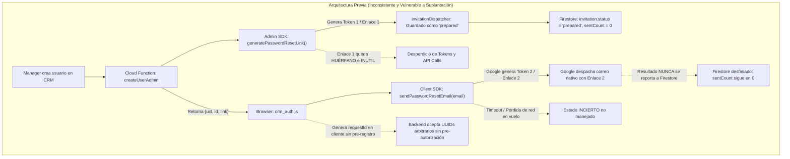
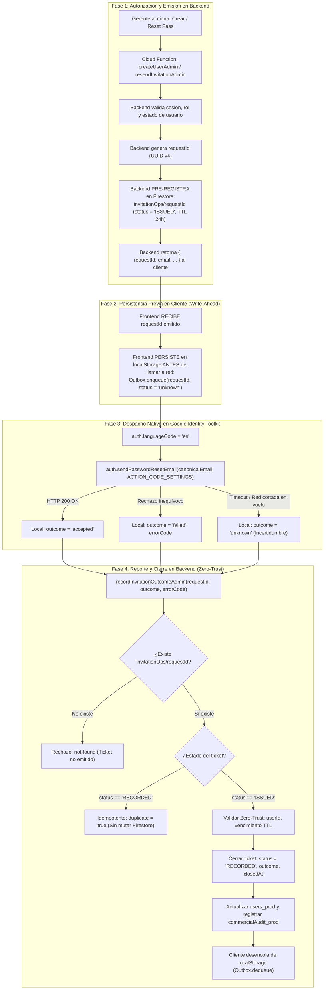
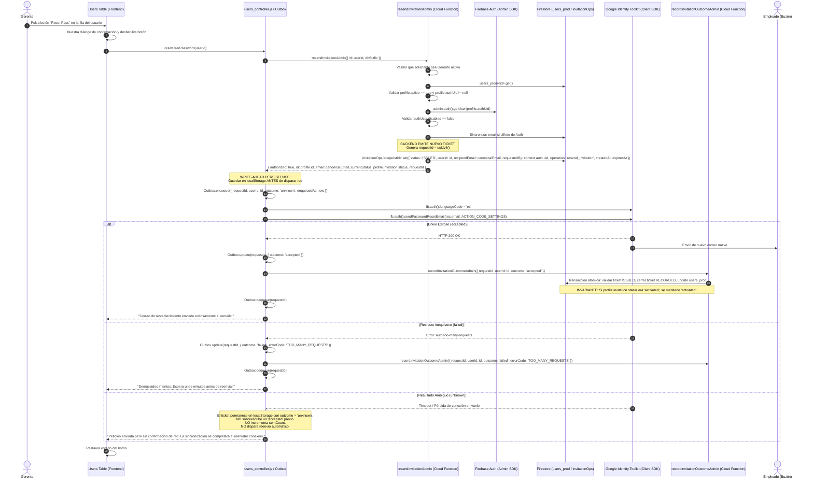
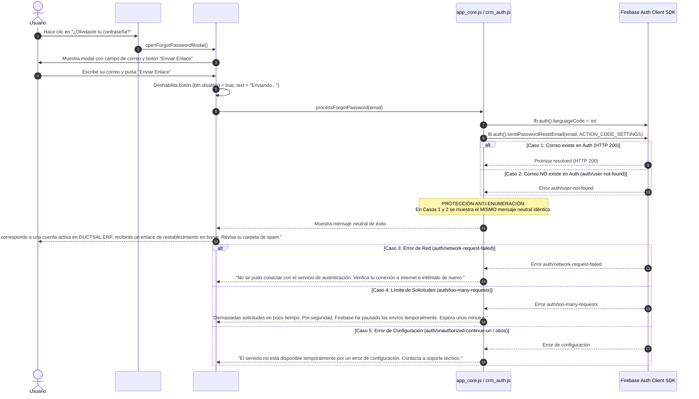
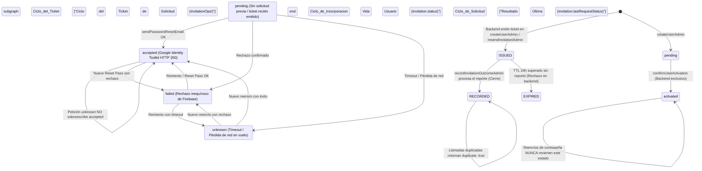
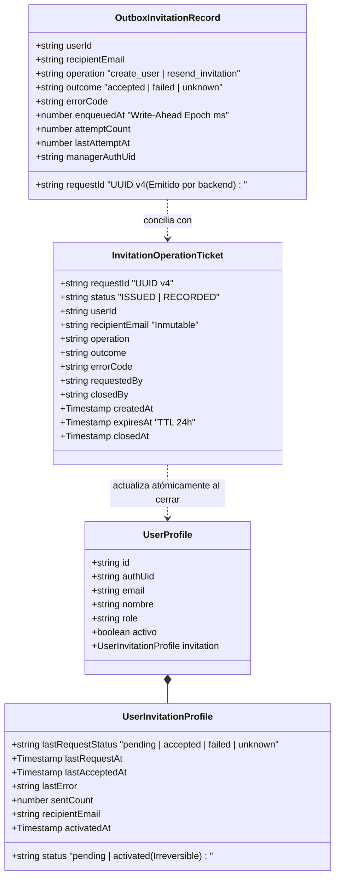
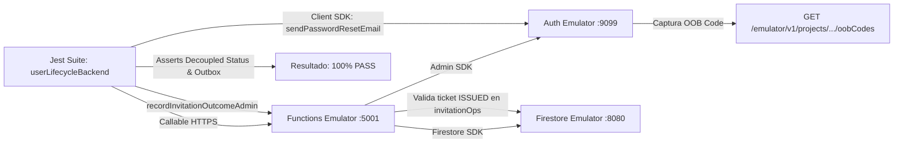

# DUCTSAL ERP — PASO 6.3.2 / 6.3.2.3
## Cierre Técnico del Diseño: Integración con Firebase Authentication Nativo
### Integridad de Solicitudes, Backend Ticket Authority y Persistencia Previa al Envío (Write-Ahead)

**Fecha:** 2 de Noviembre de 2026  
**Autor:** Antigravity (Auditoría Técnica y Arquitectura de Software)  
**Proyecto:** DUCTSAL ERP (`ductsal-erp`)  
**Fase:** Fase 6.3 — Integración de Correo Nativo de Firebase Authentication  
**Subfase:** Paso 6.3.2.3 — Integridad de Solicitudes y Persistencia Previa al Envío  
**Alcance:** Exclusivamente diseño técnico, contratos de API, especificación de autoridad de solicitudes, persistencia local previa (write-ahead), conciliación y controles de seguridad zero-trust. Tarea 100% documental. Sin cambios de código ni pruebas en esta etapa.  
**Estado:** Documento de diseño técnico definitivo, blindado y cerrado.  
**Dictamen Técnico:** **APROBADO — DISEÑO TÉCNICO DEFINITIVO CON PRE-REGISTRO Y PERSISTENCIA PREVIA (LISTO PARA PASO 6.3.3)**

---

## 1. Diagnóstico de la Arquitectura Actual

Se analizó la interacción real entre los componentes de backend y frontend involucrados en el ciclo de vida de usuarios, autenticación y recuperación de credenciales:

### 1.1 Componentes Reales Inspeccionados

1. **`functions/index.js`:**
   - **`createUserAdmin` ([Líneas 320–645](file:///Users/Benjamin/Documents/DUCTSAL/sales-reporting-system-release/functions/index.js#L320-L645)):**
     - Valida sesión de gerente y datos de entrada.
     - Aplica bloqueo atómico (`locks/<opId>`) y control de idempotencia (`userOps/<opId>`).
     - Crea la identidad en Firebase Authentication (`admin.auth().createUser`).
     - Asigna Custom Claims `{ role, cid }`.
     - Crea el perfil en Firestore `users_prod/<id>` con `invitation: buildInitialInvitation(email)`.
     - Invoca `admin.auth().generatePasswordResetLink(email, ACTION_CODE_SETTINGS)` mediante el Admin SDK.
     - Envía el enlace a `invitationDispatcher.dispatchInvitation()` que utiliza `defaultPreparedDriver` (devolviendo `sent: false`, `delivery: 'prepared'`).
     - Retorna `{ uid, id, link, invitation }`.
   - **`resendInvitationAdmin` ([Líneas 1056–1192](file:///Users/Benjamin/Documents/DUCTSAL/sales-reporting-system-release/functions/index.js#L1056-L1192)):**
     - Valida que el solicitante sea gerente activo.
     - Valida que el perfil exista en Firestore, tenga `authUid` y esté activo.
     - Lee la cuenta en Firebase Auth, valida que no esté deshabilitada y sincroniza el correo si cambió.
     - Invoca `admin.auth().generatePasswordResetLink(profile.email, ACTION_CODE_SETTINGS)` con Admin SDK.
     - Despacha a través de `invitationDispatcher`, actualiza `preparedCount` en Firestore y genera un registro de auditoría.
     - Retorna `{ sent: false, delivery: 'prepared', status: 'prepared', email, link, invitation }`.
   - **`updateUserAdmin` ([Líneas 816–1048](file:///Users/Benjamin/Documents/DUCTSAL/sales-reporting-system-release/functions/index.js#L816-L1048)):**
     - Valida unicidad dual de correo (Auth y Firestore).
     - Modifica correo y claims con rollback compensatorio en caso de fallo.
     - *Observación identificada:* En la línea 1039, `revokeRefreshTokens` se ejecuta únicamente `if (roleChanges)`. Si se produce `emailChanges`, las sesiones activas no son revocadas inmediatamente.
2. **`functions/invitationService.js` ([Líneas 1–180](file:///Users/Benjamin/Documents/DUCTSAL/sales-reporting-system-release/functions/invitationService.js)):**
   - Exporta `ACTION_CODE_SETTINGS` (`url: 'https://erp.ductsal.com/login?mode=activate'`, `handleCodeInApp: false`).
   - Define estados `INVITATION_STATUS` (`pending`, `link_generated`, `prepared`, `provider_accepted`, `delivered`, `delivery_failed`, `link_failed`, `activated`).
   - Contiene `generateInvitationLink`, `defaultPreparedDriver` y la clase `InvitationDispatcher`.
3. **`crm_auth.js` ([Líneas 116–120, 256–280](file:///Users/Benjamin/Documents/DUCTSAL/sales-reporting-system-release/crm_auth.js)):**
   - En `sendPasswordSetupEmail(fb, email)`: Invoca `fb.auth().sendPasswordResetEmail(email)` **sin** pasar `ACTION_CODE_SETTINGS` y **sin** configurar `fb.auth().languageCode = 'es'`.
   - En `adminCreateUser`: Llama primero a `createUserViaFunction(fb, ...)`. Inmediatamente después de que la Cloud Function resuelve, ejecuta en el navegador `await sendPasswordSetupEmail(fb, normalized)`.
4. **`modules/users/users_controller.js` ([Líneas 335–347](file:///Users/Benjamin/Documents/DUCTSAL/sales-reporting-system-release/modules/users/users_controller.js#L335-L347)):**
   - Al pulsar "Reset Pass", invoca `resendInvitationViaFunction(fb, { id, dbSuffix })`.
   - Al recibir `{ sent: false, delivery: 'prepared' }`, el controlador entra al fallback del cliente e invoca `await authModule.sendPasswordSetupEmail(fb, targetEmail)`.
5. **`index.html` y `app_core.js` ([index.html:22–48](file:///Users/Benjamin/Documents/DUCTSAL/sales-reporting-system-release/index.html#L22-L48), [app_core.js:2449–2464](file:///Users/Benjamin/Documents/DUCTSAL/sales-reporting-system-release/app_core.js#L2449-L2464)):**
   - `#login-screen` solo contiene campos para `login-email`, `login-password` y botón de inicio. No posee enlace ni modal para recuperación de contraseña.
   - `#setup-screen` y `processFirstTimeSetup` representan código legado obsoleto que intentaba escribir contraseñas en texto plano en Firestore, rechazado por las reglas de seguridad.

---

## 2. Problemas Identificados en la Arquitectura Previa



1. **Duplicación Inútil de Enlaces (Token Churn):**  
   El backend genera un enlace criptográfico con `generatePasswordResetLink()` que luego nadie envía. Segundos después, el frontend invoca `sendPasswordResetEmail()`, provocando que Google Identity Toolkit genere **un segundo enlace con otro token independiente** y envíe este último. El primer enlace queda huérfano.
2. **Confusión y Acoplamiento de Estados (`invitation.status`):**  
   El diseño anterior mezclaba en un solo campo (`status`) el ciclo de vida del usuario (`pending` / `activated`) con el resultado de las solicitudes de correo (`request_accepted` / `request_failed`). Esto causaba que un reenvío posterior pudiera sobreescribir un estado `activated`, o que un fallo transitorio de red degradara el estado de activación de un usuario existente.
3. **Ausencia de Autoridad de Backend sobre `requestId` (Vulnerabilidad de Suplantación):**  
   Si el frontend genera el UUID de cada solicitud y el backend se limita a registrar lo que el cliente le envía, el backend renuncia a su rol de autoridad emisora. Un cliente alterado o una extensión maliciosa podría fabricar identificadores arbitrarios, asociarlos a otros usuarios o generar ráfagas de reportes falsos. **El backend debe ser la única entidad que emite y pre-registra cada ticket de solicitud autorizada**.
4. **Riesgo de Pérdida de Reportes por Persistencia Tardía:**  
   Si el cliente intenta persistir en almacenamiento local *después* de llamar a Firebase o confía en eventos de cierre de ventana (`beforeunload`), un cierre repentino de pestaña o caída de proceso deja al sistema sin registro de la solicitud. **La persistencia local debe ocurrir antes de emitir la llamada de red (Write-Ahead Persistence)**.
5. **Falta de Tratamiento de Resultados Ambiguos (`unknown`):**  
   Si una solicitud sufría un timeout del navegador, desconexión TCP antes del HTTP 200 o caída en vuelo, el sistema quedaba ciego: no sabía si el correo fue encolado o si fracasó, llevando a conteos erróneos o reenvíos automáticos contraproducentes.
6. **Ausencia de Idempotencia en el Reporte de Resultados:**  
   Si el cliente reintentaba reportar el resultado, no existía un identificador unívoco de solicitud (`requestId`), permitiendo que fluctuaciones de red incrementaran `sentCount` de forma errática o duplicaran registros de auditoría.
7. **Ausencia de Autoservicio de Recuperación:**  
   Un usuario legítimo que olvida su clave no tiene forma de recuperarla de forma autónoma desde la pantalla de inicio de sesión (`#login-screen`).
8. **Vulnerabilidad de Enumeración de Cuentas en Login:**  
   En `app_core.js` (línea 2338), si un correo no existe, el sistema muestra `"Usuario no encontrado o inactivo"`, permitiendo a terceros sondear qué correos están registrados.
9. **Idioma no Forzado en Correos de Autenticación:**  
   Al no invocarse `firebase.auth().languageCode = 'es'`, navegadores en inglés generaban correos en inglés.
10. **Omisión de Revocación de Sesiones al Cambiar Correo:**  
    En `updateUserAdmin`, si un gerente cambia el correo de un usuario, no se revocaban las sesiones activas en Firebase Auth.
11. **Reglas de Seguridad Estrictas en Firestore:**  
    En [firestore.rules:52](file:///Users/Benjamin/Documents/DUCTSAL/sales-reporting-system-release/firestore.rules#L52), `users_prod` tiene `allow write: if false;`. El cliente requiere una Cloud Function dedicada con control de idempotencia para asentar resultados.

---

## 3. Arquitectura Propuesta Definitiva: Backend Ticket Authority y Persistencia Previa

La arquitectura definitiva establece una **separación estricta de responsabilidades, pre-registro de solicitudes en backend, persistencia write-ahead en cliente y validación Zero-Trust**:



### Principios Fundamentales del Modelo
1. **Autoridad Absoluta de Backend sobre Tickets (`requestId`):**  
   El cliente **jamás inventa un `requestId`**. El identificador es generado, sellado y registrado en Firestore por el backend antes de que el cliente pueda si quiera intentar llamar al SDK de Firebase.
2. **Persistencia Previa al Envío (Write-Ahead):**  
   El cliente guarda el registro en su cola local con estado `unknown` **antes** de emitir la promesa de red hacia Firebase Auth. Si el navegador colapsa o la conexión se apaga en pleno vuelo, el ticket ya está en `localStorage` con su estado de incertidumbre registrado para conciliación.
3. **Seguridad Zero-Trust respecto al Almacenamiento Local:**  
   Los datos leídos de `localStorage` son considerados **potencialmente alterados o maliciosos**. El backend no confía en `recipientEmail` ni en `managerAuthUid` provistos por el cliente; utiliza exclusivamente los datos grabados de forma inmutable en `invitationOps/<requestId>` durante la emisión.

---

## 4. Flujo Detallado de Creación de Usuarios (`createUserAdmin`)

### 4.1 Secuencia Paso a Paso con Emisión Previa y Persistencia Write-Ahead

```mermaid
sequenceDiagram
    autonumber
    actor Gerente
    participant UI as Users Modal (Frontend)
    participant AuthClient as crm_auth.js / Outbox
    participant CF_Create as createUserAdmin (Cloud Function)
    participant FB_Auth as Firebase Auth (Admin SDK)
    participant FS as Firestore (users_prod / invitationOps)
    participant GoogleMail as Google Identity Toolkit (Client SDK)
    participant CF_Record as recordInvitationOutcomeAdmin (Cloud Function)
    actor Empleado as Empleado (Buzón)

    Gerente->>UI: Completa formulario y pulsa "Guardar"
    UI->>UI: Deshabilita botón (userSaveInFlight = true)
    UI->>AuthClient: adminCreateUser(fb, { nombre, email, role, dbSuffix })
    AuthClient->>CF_Create: createUserAdmin({ email, nombre, role, opId, dbSuffix })
    
    CF_Create->>CF_Create: Validar sesión de gerente y datos de entrada
    CF_Create->>FB_Auth: admin.auth().getUserByEmail(email) (Verificar colisión)
    CF_Create->>FB_Auth: admin.auth().createUser({ email, displayName })
    CF_Create->>FB_Auth: admin.auth().setCustomUserClaims(uid, { role, cid })
    
    Note over CF_Create: BACKEND AUTORIZA Y EMITE TICKET:<br/>Genera requestId = uuidv4()
    
    CF_Create->>FS: users_prod/<id>.create({ ..., invitation: { status: 'pending', lastRequestStatus: 'pending', sentCount: 0 } })
    CF_Create->>FS: invitationOps/<requestId>.set({ status: 'ISSUED', userId: id, recipientEmail, requestedBy: context.auth.uid, operation: 'create_user', createdAt, expiresAt })
    CF_Create->>FS: userOps/<opId>.update({ status: 'SUCCEEDED', requestId })
    CF_Create-->>AuthClient: { uid, id, email: normalizedEmail, status: 'created', requestId, invitation }
    
    Note over AuthClient: PASO CRÍTICO WRITE-AHEAD:<br/>Persistir en localStorage ANTES de tocar la red
    
    AuthClient->>AuthClient: Outbox.enqueue({ requestId, userId: id, outcome: 'unknown', enqueuedAt: now })
    
    AuthClient->>GoogleMail: fb.auth().languageCode = 'es'
    AuthClient->>GoogleMail: fb.auth().sendPasswordResetEmail(email, ACTION_CODE_SETTINGS)
    
    alt Caso A: Envío Exitoso (Promise Resolved - HTTP 200)
        GoogleMail-->>AuthClient: HTTP 200 OK
        GoogleMail->>Empleado: Entrega correo nativo con enlace de activación
        AuthClient->>AuthClient: Outbox.update(requestId, { outcome: 'accepted' })
        AuthClient->>CF_Record: recordInvitationOutcomeAdmin({ requestId, userId: id, outcome: 'accepted' })
        CF_Record->>FS: Transacción atómica: validar ticket ISSUED, cerrar ticket RECORDED, update users_prod
        CF_Record-->>AuthClient: { recorded: true, duplicate: false }
        AuthClient->>AuthClient: Outbox.dequeue(requestId)
        AuthClient-->>UI: "Usuario creado. Se envió correo de activación a <email>."
    else Caso B: Fallo Inequívoco (auth/too-many-requests / auth/invalid-email)
        GoogleMail-->>AuthClient: Error inequívoco
        AuthClient->>AuthClient: Outbox.update(requestId, { outcome: 'failed', errorCode: 'TOO_MANY_REQUESTS' })
        AuthClient->>CF_Record: recordInvitationOutcomeAdmin({ requestId, userId: id, outcome: 'failed', errorCode: 'TOO_MANY_REQUESTS' })
        CF_Record-->>AuthClient: { recorded: true }
        AuthClient->>AuthClient: Outbox.dequeue(requestId)
        AuthClient-->>UI: "Usuario creado en el sistema, pero el correo no pudo enviarse por límite de Firebase. Usa 'Reset Pass' para reenviarlo."
    else Caso C: Resultado Ambiguo (Timeout / Red cortada durante la petición)
        GoogleMail--xAuthClient: Timeout / Network Disconnect en vuelo
        Note over AuthClient: Outbox YA CONTIENE outcome = 'unknown' (Persistido previamente).<br/>NO se incrementa sentCount.<br/>NO se asume fallo definitivo.
        AuthClient-->>UI: "Usuario creado. Conexión inestable; el sistema intentará confirmar el estado en segundo plano."
    end
    UI->>UI: Cierra modal y refresca tabla
```

### 4.2 Contrato Actualizado de `createUserAdmin`

```typescript
// Solicitud (Callable)
interface CreateUserAdminRequest {
  email: string;
  nombre: string;
  role: 'vendedor' | 'gestor';
  opId: string;
  dbSuffix?: string;
}

// Respuesta Exitosa
interface CreateUserAdminResponse {
  uid: string;
  id: string;
  email: string;
  status: 'created';
  requestId: string;                    // UUID v4 emitido y pre-registrado por el backend
  invitation: {
    status: 'pending';
    lastRequestStatus: 'pending';
    lastRequestAt: null;
    lastAcceptedAt: null;
    lastError: null;
    sentCount: 0;
    recipientEmail: string;
  };
  message: string;
}
```

---

## 5. Flujo Detallado de Reenvío de Invitaciones (`resendInvitationAdmin`)

### 5.1 Secuencia Paso a Paso con Emisión de Ticket de Reenvío



### 5.2 Contrato Actualizado de `resendInvitationAdmin`

```typescript
// Solicitud
interface ResendInvitationAdminRequest {
  id: string;
  dbSuffix?: string;
}

// Respuesta
interface ResendInvitationAdminResponse {
  authorized: true;
  id: string;
  email: string;
  currentStatus: 'pending' | 'activated';
  requestId: string;                    // UUID v4 emitido y pre-registrado por el backend
  message: string;
}
```

---

## 6. Flujo de Recuperación de Contraseña (Autoservicio) y Anti-Enumeración

Se mantiene el diseño público protegido con **estricta mitigación anti-enumeración**, asegurando que terceros no puedan sondear cuentas activas desde `#login-screen`.



---

## 7. Modelo Desacoplado de Estados y Ciclo de Vida del Ticket

El modelo separa taxativamente dos dimensiones en el usuario, más una dimensión transaccional para el ticket de solicitud:

1. **`invitation.status` (`pending` | `activated`):** Estado ontológico del colaborador en la plataforma (Irreversible).
2. **`invitation.lastRequestStatus` (`pending` | `accepted` | `failed` | `unknown`):** Estado operacional del último intento de despacho hacia Google Identity Toolkit.
3. **`invitationOps.status` (`ISSUED` | `RECORDED`):** Ciclo de vida del ticket de autorización emitido por el backend.



### 7.1 Estructura Completa del Objeto `invitation` en Firestore (`users_prod`)

```typescript
interface UserInvitationProfile {
  // Estado de incorporación en la plataforma (Irreversible)
  status: 'pending' | 'activated';
  
  // Resultado de la última petición de correo (incluye resultado ambiguo)
  lastRequestStatus: 'pending' | 'accepted' | 'failed' | 'unknown';
  
  // Marcas de tiempo de solicitudes
  lastRequestAt: FirebaseFirestore.Timestamp | null;
  lastAcceptedAt: FirebaseFirestore.Timestamp | null;
  
  // Auditoría y contadores
  lastError: string | null;            // Código sanitizado (ej: 'TOO_MANY_REQUESTS', 'CLIENT_TIMEOUT')
  sentCount: number;                   // Contador acumulado de envíos confirmados con HTTP 200
  recipientEmail: string;              // Correo canónico sincronizado con Firebase Auth
  
  // Activación en plataforma (sellado exclusivo en backend)
  activatedAt?: FirebaseFirestore.Timestamp | null;
}
```

---

## 8. Contrato, Validación Zero-Trust e Idempotencia de `recordInvitationOutcomeAdmin`

### 8.1 Contrato de la Cloud Function

```typescript
// Solicitud (Callable)
interface RecordInvitationOutcomeRequest {
  requestId: string;                            // Identificador OBLIGATORIO pre-emitido por backend
  userId: string;                               // ID del perfil en users_prod (ej: '1000000000001')
  outcome: 'accepted' | 'failed' | 'unknown';   // Resultado confirmado o ambiguo
  errorCode?: string | null;                    // Código sanitizado (obligatorio en 'failed' y 'unknown')
  dbSuffix?: string;                            // Sufijo de base de datos si aplica
}

// Respuesta
interface RecordInvitationOutcomeResponse {
  recorded: boolean;
  duplicate: boolean;
  reconciled: boolean;
  requestId: string;
  userId: string;
  sentCount: number;
  lastRequestStatus: 'accepted' | 'failed' | 'unknown';
}
```

### 8.2 Validaciones de Seguridad Zero-Trust en Backend

El backend trata **todos los datos del cliente como no confiables**:

1. **Autenticación y Autorización del Solicitante:**  
   `context.auth` obligatorio con claims `role === 'manager'` y perfil activo en `users_prod`.
2. **Existencia Previa del Ticket (`invitationOps/<requestId>`):**  
   El backend busca el documento `invitationOps/${requestId}`. Si el documento **no existe**, la función rechaza inmediatamente con `not-found: "Invalid or unissued request identifier"`. El cliente no puede inventar identificadores.
3. **Idempotencia y Detección de Tickets ya Cerrados:**  
   Si el ticket existe y `status === 'RECORDED'`, se trata de una llamada repetida por reintento de red. Retorna inmediatamente `{ recorded: true, duplicate: true, ... }` sin modificar contadores, perfiles ni auditorías.
4. **Validación de Correspondencia de Usuario (`userId`):**  
   El backend valida que `opData.userId === request.userId`. Si no coincide, rechaza con `permission-denied: "Ticket does not match specified user"`.
5. **Comprobación de Expiración (TTL del Ticket):**  
   Si `opData.expiresAt.toMillis() < Date.now()`, el ticket ha caducado. La función rechaza con `failed-precondition: "Invitation request ticket has expired"`.
6. **Destinatario Canónico Inmutable:**  
   El backend **no acepta `recipientEmail` provisto por el cliente**. El correo al que se autorizó el envío se extrae directamente de `opData.recipientEmail`, el cual fue sellado en el momento de la emisión.
7. **Sanitización de Códigos de Error (Lista Blanca Estricta):**  
   - `'TOO_MANY_REQUESTS'` (auth/too-many-requests)
   - `'NETWORK_ERROR'` (auth/network-request-failed)
   - `'UNAUTHORIZED_DOMAIN'` (auth/unauthorized-continue-uri)
   - `'INVALID_RECIPIENT'` (auth/invalid-email o auth/user-not-found)
   - `'CLIENT_TIMEOUT'` (timeout en cliente antes de respuesta)
   - `'NETWORK_DISCONNECTED_IN_FLIGHT'` (desconexión detectada con petición en vuelo)
   - `'UNKNOWN_CLIENT_ERROR'`
   - Se rechaza cualquier string arbitrario o traza de depuración.

### 8.3 Transacción Atómica de Cierre

```javascript
await db.runTransaction(async (transaction) => {
  const opRef = db.doc(`invitationOps/${requestId}`);
  const opSnap = await transaction.get(opRef);

  // 1. Validación de emisión previa en backend
  if (!opSnap.exists) {
    throw new HttpsError('not-found', 'Identificador de solicitud no registrado o inexistente.');
  }

  const opData = opSnap.data();

  // 2. Control de Idempotencia: ¿Ticket ya cerrado previamente?
  if (opData.status === 'RECORDED') {
    return {
      recorded: true,
      duplicate: true,
      reconciled: false,
      requestId,
      userId: opData.userId,
      sentCount: opData.sentCountAtTime,
      lastRequestStatus: opData.outcome
    };
  }

  // 3. Verificación de vigencia y correspondencia
  if (opData.userId !== userId) {
    throw new HttpsError('permission-denied', 'El ticket no corresponde al usuario indicado.');
  }

  if (opData.expiresAt && opData.expiresAt.toMillis() < Date.now()) {
    throw new HttpsError('failed-precondition', 'El ticket de solicitud ha caducado (TTL superado).');
  }

  // 4. Lectura del perfil del usuario
  const userRef = db.doc(`users_prod/${userId}`);
  const userSnap = await transaction.get(userRef);
  if (!userSnap.exists) throw new HttpsError('not-found', 'Perfil de usuario no encontrado.');
  const user = userSnap.data();

  const currentSentCount = user.invitation?.sentCount || 0;
  const currentStatus = user.invitation?.lastRequestStatus || 'pending';

  // 5. Aplicación de reglas según resultado
  const updates = {
    'invitation.lastRequestAt': FieldValue.serverTimestamp(),
    'invitation.updatedAt': FieldValue.serverTimestamp()
  };

  let newSentCount = currentSentCount;

  if (outcome === 'accepted') {
    newSentCount = currentSentCount + 1;
    updates['invitation.lastRequestStatus'] = 'accepted';
    updates['invitation.sentCount'] = FieldValue.increment(1);
    updates['invitation.lastAcceptedAt'] = FieldValue.serverTimestamp();
    updates['invitation.lastError'] = null;
  } else if (outcome === 'failed') {
    updates['invitation.lastRequestStatus'] = 'failed';
    updates['invitation.lastError'] = sanitizedErrorCode;
  } else if (outcome === 'unknown') {
    // REGLA CRÍTICA DE UNKNOWN:
    // No incrementa sentCount.
    // NO sobreescribe un 'accepted' confirmado previamente.
    if (currentStatus !== 'accepted') {
      updates['invitation.lastRequestStatus'] = 'unknown';
    }
    updates['invitation.lastError'] = sanitizedErrorCode || 'CLIENT_TIMEOUT';
  }

  // 6. Cierre del ticket (status = 'RECORDED')
  transaction.update(opRef, {
    status: 'RECORDED',
    outcome,
    errorCode: sanitizedErrorCode || null,
    closedBy: context.auth.uid,
    closedAt: FieldValue.serverTimestamp(),
    sentCountAtTime: newSentCount
  });

  // 7. Aplicación atómica al perfil
  transaction.update(userRef, updates);

  // 8. Auditoría comercial única
  const auditRef = db.collection('commercialAudit_prod').doc();
  transaction.set(auditRef, {
    action: 'recordInvitationOutcome',
    userId,
    targetEmail: opData.recipientEmail,
    operation: opData.operation,
    outcome,
    errorCode: sanitizedErrorCode || null,
    requestId,
    performedBy: context.auth.uid,
    timestamp: FieldValue.serverTimestamp()
  });

  return {
    recorded: true,
    duplicate: false,
    reconciled: outcome === 'unknown',
    requestId,
    userId,
    sentCount: newSentCount,
    lastRequestStatus: updates['invitation.lastRequestStatus'] || currentStatus
  };
});
```

---

## 9. Persistencia Previa al Envío (Write-Ahead) y Cola Local

Para erradicar la pérdida de estados ante cierres súbitos de pestaña o caídas de proceso, la persistencia local se rige por el principio de **escritura anticipada (Write-Ahead Local Persistence)**.

### 9.1 Secuencia Exacta de 7 Pasos Operativos

1. **Backend autoriza y pre-registra la solicitud:**  
   `createUserAdmin` o `resendInvitationAdmin` emite el `requestId`, crea `invitationOps/<requestId>` con `status = 'ISSUED'` y retorna `{ requestId, email, ... }`.
2. **Frontend persiste localmente el registro ANTES de llamar a Firebase:**  
   En `localStorage` (`ductsal_invitation_outbox_v1`), el cliente almacena de inmediato el registro con `outcome: 'unknown'`.  
   *Regla de oro:* No se depende de `beforeunload` ni de eventos de cierre de ventana. La persistencia ocurre sincrónicamente antes de emitir la promesa de red.
3. **Frontend ejecuta `sendPasswordResetEmail`:**  
   Llama a `fb.auth().sendPasswordResetEmail(canonicalEmail, ACTION_CODE_SETTINGS)`.
4. **Si recibe respuesta positiva (HTTP 200):**  
   Actualiza el registro local a `outcome: 'accepted'`.
5. **Si recibe rechazo inequívoco de Firebase (`auth/too-many-requests`, etc.):**  
   Actualiza el registro local a `outcome: 'failed'` con el código sanitizado.
6. **Si pierde la capacidad de determinar el resultado (timeout, red cortada en vuelo):**  
   Conserva el estado `outcome: 'unknown'`.
7. **El reporte se envía al backend utilizando el `requestId` pre-emitido:**  
   Invoca `recordInvitationOutcomeAdmin`. Si el backend responde éxito o duplicado, el registro se elimina de la cola local (`Outbox.dequeue(requestId)`).

### 9.2 Estructura del Registro en Cola Local (`OutboxInvitationRecord`)

```typescript
interface OutboxInvitationRecord {
  requestId: string;                           // Identificador PREVIO emitido por backend
  userId: string;                              // ID del perfil en Firestore
  recipientEmail: string;                      // Correo canónico devuelto por backend
  operation: 'create_user' | 'resend_invitation';
  outcome: 'accepted' | 'failed' | 'unknown';  // Inicializado en 'unknown', actualizado según respuesta
  errorCode: string | null;                    // Código sanitizado
  enqueuedAt: number;                          // Timestamp epoch ms de cuando se guardó previamente
  attemptCount: number;                        // Intentos de llamada a recordInvitationOutcomeAdmin
  lastAttemptAt: number | null;                // Timestamp epoch ms del último intento
  managerAuthUid: string;                      // UID del gerente que tiene la sesión activa
}
```

> [!CAUTION]
> **RESTRICCIÓN ABSOLUTA DE SEGURIDAD EN ALMACENAMIENTO LOCAL:**  
> La cola local **TIENE ESTRICTAMENTE PROHIBIDO ALMACENAR CREDENCIALES, CONTRASEÑAS, TOKENS DE SESIÓN, ENLACES DE RECUPERACIÓN O CÓDIGOS `oobCode`**.  
> Solo almacena metadatos operativos de trazabilidad pública.

### 9.3 Distinción Conceptual Estricta en Reconciliación

Es imperativo diferenciar tres operaciones conceptualmente distintas:

| Operación | Condición Inicial | Acción del Sistema | Efecto en Correo / Backend |
| :--- | :--- | :--- | :--- |
| **1. Reintentar reporte de resultado ya conocido** | El cliente recibió HTTP 200 (`accepted`) o rechazo (`failed`), pero la llamada a `recordInvitationOutcomeAdmin` falló por desconexión. | El cliente reintenta enviar el reporte con el mismo `requestId` cuando se reanuda la red. | El backend asienta el resultado ya ocurrido. **No envía ningún correo**. |
| **2. Reconciliar solicitud con resultado `unknown`** | La petición a Google sufrió timeout o caída en vuelo; el cliente desconoce si Google procesó o no el correo. | El cliente reporta `outcome: 'unknown'` para cerrar el ticket en backend sin incrementar `sentCount`. | **Reintentar el reporte NO informa si el correo llegó al usuario**. La solicitud `unknown` **NUNCA debe provocar automáticamente otro envío**. El gerente debe verificar si el colaborador recibió el acceso o si ya se activó. |
| **3. Generar una nueva solicitud de envío** | Decisión consciente del gerente de disparar un nuevo correo (ej. pulsando nuevamente "Reset Pass"). | Llama a `resendInvitationAdmin` para obtener un **NUEVO `requestId`** con ciclo de vida independiente. | El backend pre-registra un nuevo ticket y autoriza un nuevo intento formal. |

### 9.4 Aislamiento de Sesión y Política de Caducidad (TTL)
- **Aislamiento de Sesión:** Si un gerente cierra sesión o cambia de usuario en el navegador, la cola local valida `record.managerAuthUid === currentAuth.uid`. Los registros de otro gerente no se despachan para preservar la autoría estricta de auditoría.
- **Caducidad (TTL 24 h):** Los tickets tienen una vigencia máxima de 24 horas. Transcurrido ese plazo, son purgados localmente por el *sweeper* y rechazados en backend con `failed-precondition`.

---

## 10. Especificación Definitiva de Activación en Backend (`confirmUserActivation`)

### 10.1 Principio de Autoridad Exclusiva de Backend

> [!IMPORTANT]
> **RESTRICCIÓN ARQUITECTÓNICA DE ACTIVACIÓN:**  
> La transición `invitation.status = 'activated'` **SOLO PUEDE SER ESTABLECIDA MEDIANTE UNA OPERACIÓN DE BACKEND** tras verificar fehacientemente la identidad autenticada y la consistencia del perfil en Firestore.  
> Las reglas de seguridad impiden escrituras directas desde el cliente (`users_prod: allow write: false;`).

### 10.2 Verificaciones y Propiedades Obligatorias
1. **Verificación Estricta de Identidad:** Valida `context.auth.uid`. Solo puede modificar el documento de `users_prod` donde `profile.authUid === context.auth.uid`.
2. **Rechazo de Cuentas Inactivas:** Si `profile.activo === false` o la cuenta en Firebase Auth está deshabilitada (`disabled === true`), rechaza con `permission-denied`.
3. **Transición Atómica:** En un solo batch de Firestore, escribe `invitation.status = 'activated'`, `invitation.activatedAt = serverTimestamp()` y el registro de auditoría en `commercialAudit_prod`.
4. **Idempotencia Absoluta:** Si `invitation.status === 'activated'`, retorna `{ alreadyActive: true }` de inmediato en memoria **sin realizar ninguna escritura en Firestore**.
5. **Irreversibilidad:** Ningún flujo administrativo (reenvío, reseteo de clave, cambio de datos) puede regresar `status` a `'pending'`.

```javascript
exports.confirmUserActivation = functions.https.onCall(async (data, context) => {
  if (!context.auth || !context.auth.uid) {
    throw new functions.https.HttpsError('unauthenticated', 'Debe estar autenticado.');
  }

  const authUid = context.auth.uid;

  const userQuery = await db.collection('users_prod')
    .where('authUid', '==', authUid)
    .limit(1)
    .get();

  if (userQuery.empty) {
    throw new functions.https.HttpsError('not-found', 'Perfil de usuario no encontrado.');
  }

  const userDoc = userQuery.docs[0];
  const userData = userDoc.data();

  if (userData.activo === false) {
    throw new functions.https.HttpsError('permission-denied', 'Usuario desactivado en la plataforma.');
  }

  // GUARDA CRÍTICA DE IDEMPOTENCIA
  if (userData.invitation?.status === 'activated') {
    return { activated: true, alreadyActive: true };
  }

  // Transición atómica de activación
  const batch = db.batch();

  batch.update(userDoc.ref, {
    'invitation.status': 'activated',
    'invitation.activatedAt': FieldValue.serverTimestamp(),
    'invitation.updatedAt': FieldValue.serverTimestamp()
  });

  const auditRef = db.collection('commercialAudit_prod').doc();
  batch.set(auditRef, {
    action: 'userActivated',
    userId: userDoc.id,
    authUid: authUid,
    email: userData.email,
    role: userData.role,
    timestamp: FieldValue.serverTimestamp()
  });

  await batch.commit();

  return { activated: true, newlyActivated: true };
});
```

---

## 11. Política de Dominio, Remitente y Configuración DNS

### 11.1 Subdominio Corporativo Propuesto
Se mantiene la propuesta de utilizar el subdominio dedicado:
`auth.ductsal.com`

**Propósito:** Aislar la reputación de los correos transaccionales del ERP respecto al dominio corporativo principal (`ductsal.com`), mejorando la entregabilidad y reduciendo el riesgo de clasificación como spam.

### 11.2 Restricción Estricta sobre Registros DNS

> [!WARNING]
> **PROHIBICIÓN DE REGISTROS DNS FICTICIOS O ESTIMADOS:**  
> Este diseño **NO define registros DNS ficticios ni asume valores para SPF, DKIM, DMARC o CNAME**.  
> Los valores definitivos serán provistos por Firebase Console cuando se autorice el registro del dominio personalizado en producción.

### 11.3 Estado Operativo Transitorio
Mientras no se configure el dominio personalizado en Firebase Console y DNS:
- Los correos continuarán saliendo desde el remitente predeterminado de Firebase:  
  `noreply@ductsal-erp.firebaseapp.com`
- El sistema es 100% funcional bajo este remitente predeterminado tanto en local con emuladores como en pruebas autorizadas.

---

## 12. Decisiones Técnicas Consolidadas (Paso 6.3.2.3)



### 12.1 Matriz Comparativa de Decisiones de Diseño

| Dimensión de Diseño | Diseño Previo | Diseño Definitivo Cerrado (Paso 6.3.2.3) | Beneficio Técnico |
| :--- | :--- | :--- | :--- |
| **Autoridad de `requestId`** | Frontend generaba el UUID libremente. | **Backend emite y pre-registra el ticket en `invitationOps` (`status = 'ISSUED'`).** | Backend rechaza identificadores no emitidos, expirados o manipulados. |
| **Momento de Persistencia Local** | Tras recibir la respuesta o en eventos de ventana. | **Write-Ahead:** Persistencia local *antes* de iniciar la llamada de red. | Inmune a cuelgues del navegador o caídas de red en pleno vuelo. |
| **Validación de Datos en Backend** | Confiaba en `recipientEmail` y parámetros del cliente. | **Zero-Trust:** El backend utiliza exclusivamente los datos sellados en el ticket emitido. | Imposibilidad de alterar destinatarios o suplantar identidades en los reportes. |
| **Manejo de Incertidumbre (`unknown`)** | Tratado como error o ignorado. | Estado explícito `unknown`; no altera `sentCount`, no dispara reenvíos automáticos. | Protección de estadísticas y prevención de spam accidental. |
| **Activación de Usuario** | Difusa o dependiente del cliente. | **Exclusiva de Backend (`confirmUserActivation`)**, atómica, idempotente e irreversible. | Seguridad estricta; cero escrituras en logins posteriores. |
| **Entorno de Pruebas** | Menciones heredadas a staging. | **Exclusivamente local con Firebase Emulators (`demo-ductsal-local`).** | Cumplimiento total de la Directriz Permanente sobre Entornos. |

---

## 13. Plan de Pruebas Automatizadas Propuesto

Todas las pruebas deben ejecutarse en el entorno local de **Firebase Auth Emulator** (`demo-ductsal-local`) y **Firestore Emulator**, garantizando cero impacto en producción:



### Matriz de Casos de Prueba (18 Escenarios Obligatorios)

| # | Escenario de Prueba | Entrada / Condición | Comportamiento Esperado |
| :-: | :--- | :--- | :--- |
| **1** | **Emisión de ticket en creación** | Gerente llama a `createUserAdmin`. | Perfil creado en `users_prod`. Ticket pre-registrado en `invitationOps/<requestId>` con `status = 'ISSUED'`. Función retorna `requestId`. |
| **2** | **Emisión de ticket en reenvío** | Gerente llama a `resendInvitationAdmin`. | Ticket pre-registrado en `invitationOps/<requestId>` con `status = 'ISSUED'`. Función retorna `requestId` y `canonicalEmail`. |
| **3** | **Rechazo de `requestId` no emitido por backend** | Cliente llama a `recordInvitationOutcomeAdmin` con un UUID inventado. | Backend rechaza inmediatamente con `not-found`. |
| **4** | **Rechazo de ticket correspondiente a otro usuario** | Cliente llama a `recordInvitationOutcomeAdmin` con `requestId` perteneciente al Usuario A pero pasando `userId` del Usuario B. | Backend rechaza con `permission-denied`. |
| **5** | **Rechazo de ticket expirado (>24h)** | Ticket en `invitationOps` con `expiresAt < now`. | Backend rechaza con `failed-precondition`. |
| **6** | **Reporte exitoso de despacho (`accepted`)** | Cliente reporta `outcome: 'accepted'` sobre ticket `ISSUED`. | Ticket pasa a `RECORDED`. Perfil actualiza `lastRequestStatus = 'accepted'`, `sentCount = 1`, `lastAcceptedAt != null`. `status` sigue `'pending'`. |
| **7** | **Idempotencia en ticket ya cerrado** | Segunda llamada con el mismo `requestId` sobre ticket `RECORDED`. | Retorna `duplicate: true`. `sentCount` **no se incrementa**. No se duplican auditorías. |
| **8** | **Reporte de fallo inequívoco (`failed`)** | Cliente reporta `outcome: 'failed'`, `errorCode: 'TOO_MANY_REQUESTS'`. | Ticket pasa a `RECORDED`. `lastRequestStatus = 'failed'`, `lastError = 'TOO_MANY_REQUESTS'`. `sentCount` intacto. |
| **9** | **Reporte de resultado ambiguo (`unknown`)** | Cliente reporta `outcome: 'unknown'`, `errorCode: 'CLIENT_TIMEOUT'`. | `lastRequestStatus = 'unknown'`. `sentCount` no incrementa. No dispara reenvíos. |
| **10**| **`unknown` no sobreescribe `accepted` previo** | Perfil con `lastRequestStatus = 'accepted'` recibe reporte rezagado `unknown`. | `lastRequestStatus` permanece inmutablemente en `'accepted'`. |
| **11**| **Rechazo de código de error no sanitizado** | Cliente envía `errorCode: 'sql_or_xss_injection'`. | Rechazo con `invalid-argument`. |
| **12**| **Reenvío exitoso preserva activación** | Usuario con `status = 'activated'` recibe reenvío con éxito. | `lastRequestStatus = 'accepted'`, `sentCount++`, pero **`status` se mantiene inmutablemente en `'activated'`**. |
| **13**| **Activación atómica en backend (`confirmUserActivation`)** | Usuario en `'pending'` invoca la función tras autenticarse. | `invitation.status` transita a `'activated'`, `activatedAt` sellado y auditado. |
| **14**| **Idempotencia de activación en logins posteriores** | Usuario ya activado invoca `confirmUserActivation` por segunda vez. | Retorna `{ alreadyActive: true }`. Cero escrituras en Firestore. |
| **15**| **Rechazo de activación para usuario inactivo** | Usuario con `activo: false` intenta invocar `confirmUserActivation`. | Rechazo con `permission-denied`. |
| **16**| **Aislamiento de Outbox por cambio de gerente** | Cola con registros de Gerente A no es despachada por Gerente B. | Registros quedan latentes o expiran tras TTL de 24 h sin ejecutarse bajo identidad errónea. |
| **17**| **Recuperación anti-enumeración (Existente vs Inexistente)** | `sendPasswordResetEmail` para usuario existente vs inexistente en Auth. | Ambos retornan **exactamente el mismo mensaje neutral** al usuario. |
| **18**| **Revocación de sesiones en cambio de correo** | `updateUserAdmin` modifica el correo de un colaborador. | `revokeRefreshTokens(uid)` es invocado y verificado. |

---

## 14. Archivos y Funciones que Deberán Modificarse en el Paso 6.3.3

| Archivo | Sección / Función | Modificación Concreta a Implementar |
| :--- | :--- | :--- |
| **`functions/index.js`** | `createUserAdmin` | Pre-registrar ticket en `invitationOps/<requestId>` (`status = 'ISSUED'`). Retornar `requestId` y retirar llamada a `generatePasswordResetLink`. |
| **`functions/index.js`** | `resendInvitationAdmin` | Pre-registrar ticket de reenvío en `invitationOps/<requestId>` (`status = 'ISSUED'`). Retornar `{ authorized: true, id, email, currentStatus, requestId }`. |
| **`functions/index.js`** | *Nueva Función:* `recordInvitationOutcomeAdmin` | Función Callable con transacción atómica: valida existencia previa del ticket, vigencia TTL, Zero-Trust de destinatario, lista blanca de errores y cierre a `RECORDED`. |
| **`functions/index.js`** | *Nueva Función:* `confirmUserActivation` | Función Callable de backend para transición atómica e irreversible a `activated` con validación de `context.auth.uid` y guarda de idempotencia. |
| **`functions/index.js`** | `updateUserAdmin` | Asegurar `revokeRefreshTokens(uid)` ante cambios de correo (`if (roleChanges || emailChanges)`). |
| **`crm_auth.js`** | `adminCreateUser` & Outbox Queue | Consumir `requestId` del backend, ejecutar persistencia previa write-ahead en `localStorage`, llamar a SDK cliente y reportar resultado. |
| **`modules/users/users_controller.js`** | `resetUserPassword` | Consumir nuevo contrato de `resendInvitationAdmin` con `requestId`, persistir previamente y gestionar Outbox. |
| **`index.html`** | `#login-screen` | Añadir enlace «¿Olvidaste tu contraseña?» y modal `#forgot-password-modal`. Eliminar modal obsoleto `#setup-screen`. |
| **`app_core.js`** | `processForgotPassword` / Login | Implementar función pública de recuperación de contraseña con estricta respuesta neutral anti-enumeración. |

---

## 15. Dictamen Técnico Definitivo del Paso 6.3.2

# **APROBADO — DISEÑO TÉCNICO DEFINITIVO CON PRE-REGISTRO Y PERSISTENCIA PREVIA (LISTO PARA PASO 6.3.3)**

### Justificación Técnica del Dictamen:
1. **Autoridad Absoluta de Backend:** Se elimina la generación de identificadores en el cliente; todo `requestId` es emitido, sellado y pre-registrado en Firestore por el backend antes de cualquier llamada a red.
2. **Persistencia Anticipada (Write-Ahead):** El cliente persiste el ticket en `localStorage` antes de invocar a Firebase Auth, blindando al sistema contra cierres repentinos de navegador o caídas de red en pleno vuelo.
3. **Validación Zero-Trust:** El backend nunca confía en destinatarios o autorías provistos por el almacenamiento local del cliente; utiliza estrictamente los metadatos inmutables grabados en el ticket durante la emisión.
4. **Claridad de Reconciliación:** Se distingue formalmente entre reintentar reportes conocidos, tratar la incertidumbre de solicitudes `unknown` y generar nuevas solicitudes administrativas.
5. **Activación Blindada:** Se garantiza que la activación es exclusiva del backend, atómica, idempotente e irreversible, sin escrituras redundantes.
6. **Alineación con la Directriz Permanente sobre Entornos:** Se eliminó cualquier dependencia de staging; las validaciones futuras se realizarán exclusivamente de forma local con Firebase Emulators (`demo-ductsal-local`).

#### Condiciones Previas para Iniciar el Paso 6.3.3:
- [x] Documento de diseño técnico `docs/step6_3_2_firebase_native_email_design.md` cerrado, blindado y aprobado con especificación de pre-registro y persistencia write-ahead.
- [ ] Autorización explícita y separada del usuario para dar inicio a la implementación de código y pruebas del **Paso 6.3.3**.
- [ ] Confirmación de que el proyecto de producción permanece 100% intocado y protegido sin despliegues ni mutaciones de cuentas reales.

---
*Fin del Documento de Diseño Técnico Definitivo — Paso 6.3.2.3.*
