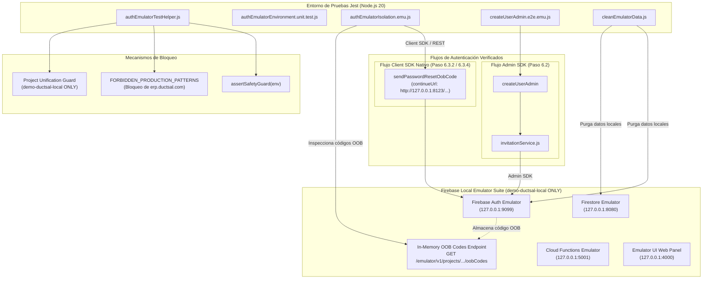
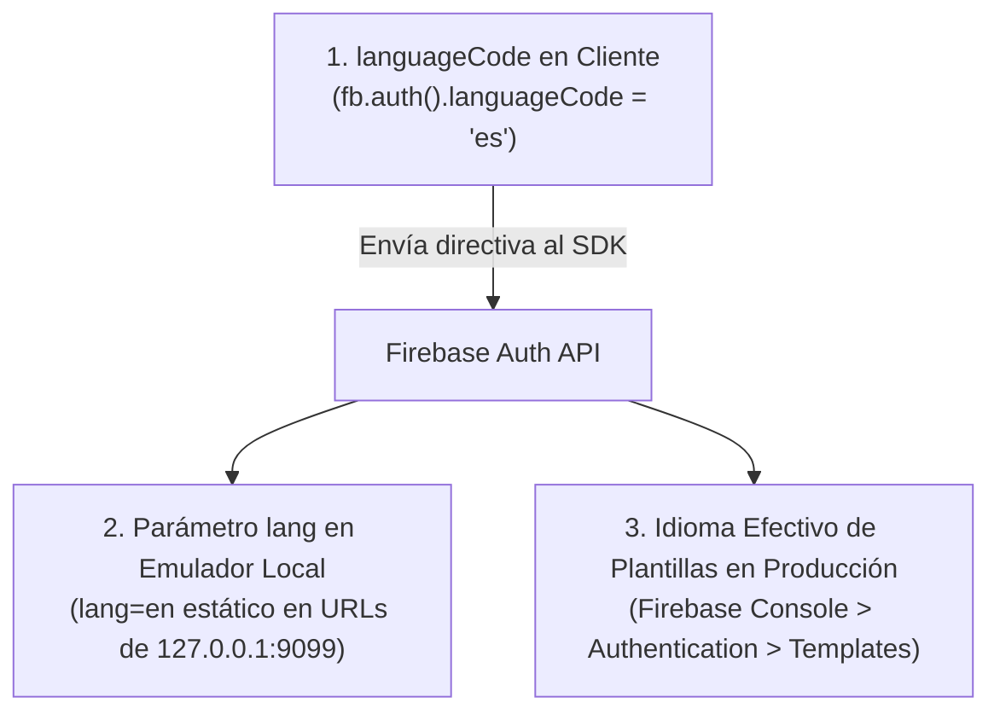

# DUCTSAL ERP — INFORME DE CONFIGURACIÓN Y AUDITORÍA DE CONSISTENCIA DEL ENTORNO DE PRUEBAS AISLADO (PASO 6.3.3 / 6.3.3.1)
## Entorno de Pruebas Aislado para Firebase Authentication, Cloud Functions y Firestore

**Fecha:** 2 de Noviembre de 2026  
**Proyecto Objetivo Único:** `demo-ductsal-local`  
**Entorno de ejecución:** Local / Node.js v20.20.0 / Firebase Tools CLI v15.34.2 / Jest 29  
**Estado:** Finalizado, auditado y aprobado  
**Dictamen Técnico:** **APROBADO**

---

## 1. Diagnóstico de la Configuración y Coherencia con el Diseño Nativo

### 1.1 Coexistencia y Coherencia de Flujos de Autenticación
En la evolución de DUCTSAL ERP coexisten dos aproximaciones arquitectónicas que el entorno de pruebas debe distinguir, aislar y comprobar con total claridad:

1. **Flujo de Invitación Backend (Paso 6.2 - Admin SDK)**:
   - Implementado en [functions/index.js](file:///Users/Benjamin/Documents/DUCTSAL/sales-reporting-system-release/functions/index.js) (`createUserAdmin`) y [functions/invitationService.js](file:///Users/Benjamin/Documents/DUCTSAL/sales-reporting-system-release/functions/invitationService.js).
   - Genera enlaces criptográficos en el servidor mediante `admin.auth().generatePasswordResetLink(email, ACTION_CODE_SETTINGS)`.
   - Utiliza `PreparedDriver` para preparar el mensaje en memoria sin conexión a redes externas.
   - Configuración de producción: `url: 'https://erp.ductsal.com/login?mode=activate'`.
2. **Flujo de Envío Nativo Frontend (Paso 6.3.2 / 6.3.4 - Client SDK)**:
   - Definido en el diseño del Paso 6.3.2 ([docs/step6_3_2_firebase_native_email_design.md](file:///Users/Benjamin/Documents/DUCTSAL/sales-reporting-system-release/docs/step6_3_2_firebase_native_email_design.md)) como la arquitectura definitiva de despacho de correos nativos.
   - El cliente web invoca directamente `fb.auth().sendPasswordResetEmail(canonicalEmail, ACTION_CODE_SETTINGS)`.
   - Google / Firebase Authentication asume la entrega del correo electrónico nativo con plantillas gestionadas en la consola.
   - En el entorno de desarrollo y pruebas, este flujo se emula a través del endpoint REST Identity Platform (`sendOobConfirmationCode`) con `continueUrl` apuntando a un servidor local de desarrollo (`http://127.0.0.1:8123/login?mode=activate`), nunca a producción.

### 1.2 Mapeo de Suites de Pruebas y Mecanismos de Generación

| Mecanismo de Generación | SDK / Protocolo | Suites de Pruebas que lo Utilizan | Comportamiento en Emuladores |
| :--- | :--- | :--- | :--- |
| `generatePasswordResetLink()` | **Firebase Admin SDK** (Backend Legacy) | • [createUserAdmin.e2e.emu.js](file:///Users/Benjamin/Documents/DUCTSAL/sales-reporting-system-release/functions/emulator-tests/createUserAdmin.e2e.emu.js) (19 pruebas)<br/>• [authEmulatorIsolation.emu.js](file:///Users/Benjamin/Documents/DUCTSAL/sales-reporting-system-release/functions/emulator-tests/authEmulatorIsolation.emu.js) (Sección 2) | Interceptado localmente por Firebase Auth Emulator. *(Nota: En Paso 6.3.4.4 fue eliminado de `createUserAdmin` y `resendInvitationAdmin`, quedando exclusivamente para pruebas/utilidades aisladas; el backend retorna `link: null`).* |
| `sendPasswordResetEmail()` | **Firebase Client SDK** (Frontend) / REST Identity Platform | • [authEmulatorIsolation.emu.js](file:///Users/Benjamin/Documents/DUCTSAL/sales-reporting-system-release/functions/emulator-tests/authEmulatorIsolation.emu.js) (Sección 3: `sendPasswordResetOobCode`) | Emulado mediante llamada HTTP REST directa al Auth Emulator (`127.0.0.1:9099`). Genera código OOB con `continueUrl` local. **Cero correos externos.** |

> [!IMPORTANT]
> **Actualización Arquitectónica Definitiva (Paso 6.3.4.4)**:  
> En el Paso 6.3.4.4 se eliminó definitivamente la llamada a `generatePasswordResetLink()` en los flujos de `createUserAdmin` y `resendInvitationAdmin` en todos los entornos (emulador y producción). La arquitectura nativa opera al 100% mediante emisión de tickets `ISSUED` en backend y despacho único vía Client SDK (`sendPasswordResetEmail()`) en frontend.  
> La prueba que valida fielmente la arquitectura nativa definitiva es la **Sección 3 de [authEmulatorIsolation.emu.js](file:///Users/Benjamin/Documents/DUCTSAL/sales-reporting-system-release/functions/emulator-tests/authEmulatorIsolation.emu.js)** (`sendPasswordResetOobCode`), complementada por la **Sección 4** que ejecuta el canje del código OOB (`completePasswordReset`) y la verificación de autenticación del usuario activado con su nueva contraseña (`signInTestUser`).

---

## 2. Arquitectura de Pruebas Resultante

Se ha consolidado una arquitectura de pruebas hermética, local y 100% aislada. En esta arquitectura, ningún dato, credencial o petición transaccional escapa a redes externas o al proyecto de producción `ductsal-erp`.

### 2.1 Diagrama de Componentes y Flujos



### 2.2 Principios Clave de Diseño
1. **Unificación Estricta en `demo-ductsal-local`**: Se prohíbe terminantemente la creación o uso de proyectos adicionales. Se eliminó la aceptación de `demo-ductsal-isolated` en las pruebas de autenticación.
2. **Loopback Estricto**: Todo el tráfico de red está anclado a `127.0.0.1`.
3. **Cero Emisión de Correo Electrónico**: Ambas vías (Admin SDK y Client SDK) operan contra la memoria local del emulador de Firebase Auth.
4. **Cero Referencias a URLs de Producción en Pruebas**: El `continueUrl` de pruebas apunta a `http://127.0.0.1:8123/login?mode=activate`. Ningún test abre ni solicita peticiones hacia `https://erp.ductsal.com`.
5. **Higiene Criptográfica**: Verificación recursiva de que ni el `oobCode` ni los enlaces de acción se persisten en Firestore o auditorías.

---

## 3. Emuladores Configurados y Parámetros Clave

La configuración operativa reside en el archivo [firebase.emulator.json](file:///Users/Benjamin/Documents/DUCTSAL/sales-reporting-system-release/firebase.emulator.json).

| Parámetro / Directiva | Valor Configurado | Justificación Técnica |
| :--- | :--- | :--- |
| **Project ID** | `demo-ductsal-local` | Proyecto único permitido para las pruebas de integración del entorno de autenticación. |
| **Auth Emulator** | `127.0.0.1:9099` | Emulador de autenticación con soporte para Admin SDK, Client SDK REST API, claims de rol y emisión de OOB codes. |
| **Firestore Emulator** | `127.0.0.1:8080` | Emulador de base de datos NoSQL para colecciones `users_prod`, `userOps`, `commercialAudit_prod`, etc. |
| **Functions Emulator** | `127.0.0.1:5001` | Entorno de ejecución para callables HTTP (`createUserAdmin`) y triggers en segundo plano (`syncUserDirectory_local`). |
| **Emulator UI** | `127.0.0.1:4000` | Interfaz gráfica local habilitada (`"enabled": true`) para inspección visual de usuarios y colecciones. |
| **Single-use OOB Protection** | Habilitado nativamente | El emulador invalida el código de acción tras su primer consumo, protegiendo contra ataques de repetición. |
| **Persistencia en disco** | Desactivada (In-memory) | Garantiza que cada sesión inicie limpia sin residuos de pruebas anteriores. |

---

## 4. Puertos y Conexiones Utilizados

Todos los servicios operan exclusivamente vinculados a la dirección de loopback local `127.0.0.1`.

| Servicio | Host | Puerto | Protocolo | Propósito en el Entorno de Pruebas |
| :--- | :--- | :--- | :--- | :--- |
| **Firebase Auth Emulator** | `127.0.0.1` | `9099` | HTTP / REST | Gestión de credenciales, emisión de tokens JWT, captura de códigos OOB y canje de contraseñas. |
| **Cloud Firestore Emulator** | `127.0.0.1` | `8080` | HTTP / gRPC | Almacén de perfiles de usuario, bitácora de auditoría y registros de invitaciones operativas. |
| **Cloud Functions Emulator** | `127.0.0.1` | `5001` | HTTP | Ejecución de funciones callables (`createUserAdmin`) y triggers de sincronización de directorio. |
| **Firebase Emulator UI** | `127.0.0.1` | `4000` | HTTP / WebSockets | Interfaz gráfica de administración local para depuración y revisión manual. |
| **Local Dev Server (serveLocalUI)** | `127.0.0.1` | `8123` | HTTP | Servidor estático local para recepción del `continueUrl` (`http://127.0.0.1:8123/login?mode=activate`). |
| **Hub / Control Emuladores** | `127.0.0.1` | `4400` | HTTP | Coordinación interna entre el Firebase CLI y los subprocesos de emulación. |
| **Firestore UI Websocket** | `127.0.0.1` | `9150` | WebSockets | Actualización reactiva de documentos en el panel de control de Emulator UI. |

---

## 5. Mecanismo de Captura de Correos y Códigos OOB

### 5.1 Cero Entrega Externa
En este entorno no se configuran proveedores de correo electrónico externos (Resend, SendGrid, Mailgun) ni transporte SMTP. Ningún paquete TCP de correo sale del equipo local.

### 5.2 Endpoint de Códigos Fuera de Banda (OOB)
Cuando se solicita la emisión de un enlace o correo de restablecimiento de contraseña mediante Admin SDK o Client SDK REST, el emulador de Firebase Auth intercepta la solicitud y genera un código criptográfico sin enviar ningún correo electrónico.

El código se almacena en memoria y se expone a través del endpoint interno de pruebas:
```http
GET http://127.0.0.1:9099/emulator/v1/projects/demo-ductsal-local/oobCodes
```

#### Estructura del JSON Retornado en Pruebas (con URL Local de Desarrollo):
```json
{
  "oobCodes": [
    {
      "email": "vendedor1.26434b5e@example.test",
      "oobCode": "vDSQ8B0KEjyFB01LdeAKFobPin9z1yjtCEW0Wz-7EL_SZ23ltpS3W2",
      "oobLink": "http://127.0.0.1:9099/emulator/action?mode=resetPassword&lang=en&oobCode=vDSQ8B0KEjyFB01LdeAKFobPin9z1yjtCEW0Wz-7EL_SZ23ltpS3W2&apiKey=fake-api-key&continueUrl=http%3A%2F%2F127.0.0.1%3A8123%2Flogin%3Fmode%3Dactivate&newPassword=NEW_PASSWORD_HERE",
      "requestType": "PASSWORD_RESET"
    }
  ]
}
```

### 5.3 Parsing y Validación de Enlaces de Acción en Pruebas
El módulo auxiliar [authEmulatorTestHelper.js](file:///Users/Benjamin/Documents/DUCTSAL/sales-reporting-system-release/functions/emulator-tests/authEmulatorTestHelper.js) implementa la función `parseActionLink(link)` que descompone y valida rigurosamente cada componente:
- **`mode`**: Debe ser `'resetPassword'`.
- **`oobCode`**: Cadena alfanumérica única de alta entropía.
- **`continueUrl`**: Debe apuntar exactamente a `http://127.0.0.1:8123/login?mode=activate` (URL local de desarrollo). **Nunca a `https://erp.ductsal.com`**.
- **`apiKey`**: Clave emulada (`fake-api-key`).

### 5.4 Verificación Técnica del Idioma (Distinción en Tres Niveles)

Es imprescindible distinguir con precisión técnica tres dimensiones del idioma en Firebase Authentication:



1. **`languageCode` configurado en el cliente (`fb.auth().languageCode = 'es'`)**:
   - **Estado:** ✅ **Comprobado en código y pruebas.**
   - En las pruebas automatizadas y en el cliente web se establece `languageCode = 'es'`. Esto instruye al SDK cliente a solicitar respuestas y localizar flujos en español ante el servicio de Firebase Auth.
2. **Parámetro `lang` generado por el emulador (`lang=en`)**:
   - **Estado:** ✅ **Comprobado y delimitado.**
   - El Firebase Auth Emulator incluye internamente el parámetro `&lang=en` en la plantilla de URL de acción generada. El binario local del emulador no incluye el motor de renderizado de plantillas multilingües de Google Cloud, por lo que este parámetro refleja una limitación estática del emulador local y no un defecto de la aplicación.
3. **Idioma efectivo de las plantillas nativas de Firebase en producción**:
   - **Estado:** ⚠️ **Requiere validación posterior directamente en Firebase Console.**
   - En entornos reales de producción, el texto del correo nativo (asunto, cuerpo, botón de acción) proviene exclusivamente de las plantillas administradas en **Firebase Console > Authentication > Templates**.
   - **No se afirma que las plantillas de producción estén en español**, ya que los emuladores locales no gestionan ni replican las plantillas alojadas en la nube. Su configuración y validación en español corresponden formalmente a las actividades operativas del **Paso 6.3.4+**.

---

## 6. Controles de Aislamiento, Bloqueo de Producción y Unificación

Se han establecido múltiples capas concéntricas de seguridad para prevenir de forma absoluta cualquier contacto accidental con entornos de producción o staging:

### 6.1 Matriz de Salvaguardas Implementadas

| Capa de Seguridad | Componente Responsable | Comportamiento / Verificación |
| :--- | :--- | :--- |
| **Unificación de Proyecto** | [authEmulatorTestHelper.js](file:///Users/Benjamin/Documents/DUCTSAL/sales-reporting-system-release/functions/emulator-tests/authEmulatorTestHelper.js) | Exige que el proyecto sea estrictamente `demo-ductsal-local`. Rechaza fatalmente `demo-ductsal-isolated` y cualquier otro proyecto no unificado. |
| **Bloqueo Fatal de Producción** | `assertSafetyGuard` en Helper | Lanza excepción fatal si el proyecto contiene `'ductsal-erp'` o cualquiera de sus variantes de dominio. |
| **Bloqueo Fatal de Staging** | `assertSafetyGuard` en Helper | Lanza excepción fatal si se detecta cualquier referencia a `'ductsal-erp-staging'` o el término `'staging'`. |
| **Bloqueo de URLs de Producción en Pruebas** | `FORBIDDEN_PRODUCTION_PATTERNS` | Incluye `'erp.ductsal.com'`, `'crm.ductsal.com'`, `'ductsal-erp.firebaseapp.com'`. Las pruebas utilizan exclusivamente URLs de loopback (`127.0.0.1:8123`). |
| **Verificación de Apertura Automática** | Auditoría de pruebas | Se auditó y confirmó que ningún test ejecuta comandos `open`, `window.open` ni invoca navegadores hacia URLs de producción. |
| **Fail-Safe de Credenciales** | `assertSafetyGuard` en Helper | Si `GOOGLE_APPLICATION_CREDENTIALS` se encuentra configurada, el proceso aborta inmediatamente para evitar autenticación accidental contra Google Cloud IAM. |
| **Single-Use Replay Protection** | Motor interno de Firebase Auth | Tras canjear el código OOB con `completePasswordReset`, cualquier intento de reusar el mismo código es rechazado con `EXPIRED_OOB_CODE` / `INVALID_OOB_CODE`. |
| **Invariante de Rol Manager** | [functions/index.js](file:///Users/Benjamin/Documents/DUCTSAL/sales-reporting-system-release/functions/index.js) | La función `createUserAdmin` rechaza fatalmente con `PERMISSION_DENIED` (`INVALID_ROLE`) la creación del rol `manager`. El rol `manager` solo puede existir vía provisión segura local. |

---

## 7. Datos Ficticios y Mecanismos de Limpieza

### 7.1 Dominios de Correo Electrónico Reservados (RFC 2606)
Todas las pruebas automatizadas utilizan exclusivamente dominios reservados por la IETF que garantizan que ningún correo emitido accidentalmente pueda llegar a destinatarios reales:
- `@example.test`
- `@ductsal-test.invalid`

### 7.2 Utilidad de Purga: `scripts/cleanEmulatorData.js`
Se dispone del script autónomo en [functions/scripts/cleanEmulatorData.js](file:///Users/Benjamin/Documents/DUCTSAL/sales-reporting-system-release/functions/scripts/cleanEmulatorData.js) ejecutable mediante `npm run test:clean`:

1. **Purga de Autenticación**: Invoca `DELETE http://127.0.0.1:9099/emulator/v1/projects/demo-ductsal-local/accounts` purgando todas las cuentas en una operación atómica.
2. **Purga de Firestore**: Invoca `DELETE http://127.0.0.1:8080/emulator/v1/projects/demo-ductsal-local/databases/(default)/documents` limpiando todas las colecciones.
3. **Validación Previa**: Si los emuladores no están encendidos o el proyecto no es `demo-ductsal-local`, el script aborta de inmediato protegiendo el entorno.

---

## 8. Scripts Disponibles en `package.json`

En [functions/package.json](file:///Users/Benjamin/Documents/DUCTSAL/sales-reporting-system-release/functions/package.json) se formalizan los scripts estandarizados:

```json
"scripts": {
  "lint": "eslint .",
  "test": "jest",
  "test:unit": "jest --testPathPattern='__tests__/' --runInBand",
  "test:emulator": "jest -c jest.emulator.config.js --runInBand",
  "test:auth-env": "npx firebase-tools emulators:exec --config ../firebase.emulator.json --project demo-ductsal-local --only auth,firestore,functions \"jest -c jest.emulator.config.js --testPathPattern=authEmulatorIsolation.emu.js --runInBand\"",
  "test:clean": "node scripts/cleanEmulatorData.js",
  "emulators:start": "npx firebase-tools emulators:start --config ../firebase.emulator.json --project demo-ductsal-local --only auth,firestore,functions",
  "emulators:exec": "npx firebase-tools emulators:exec --config ../firebase.emulator.json --project demo-ductsal-local --only auth,firestore,functions",
  "start": "firebase emulators:start --only functions"
}
```

---

## 9. Resultados de las Pruebas Ejecutadas

### 9.1 Pruebas Unitarias del Entorno de Autenticación
- **Archivo:** [functions/__tests__/authEmulatorEnvironment.unit.test.js](file:///Users/Benjamin/Documents/DUCTSAL/sales-reporting-system-release/functions/__tests__/authEmulatorEnvironment.unit.test.js)
- **Resultado:** **22 / 22 pruebas aprobadas (100% de éxito)**

```text
PASS __tests__/authEmulatorEnvironment.unit.test.js
  Auth Emulator Environment Unit Tests (Safety Guards & Configuration)
    ✓ valid local emulator environment passes safety guard (3 ms)
    Production Project Blocking
      ✓ explicitly blocks production project: ductsal-erp (21 ms)
      ✓ explicitly blocks production project: DUCTSAL-ERP (1 ms)
      ✓ explicitly blocks production project: ductsal-erp.firebaseapp.com (1 ms)
      ✓ explicitly blocks production project: ductsal-erp.firebasestorage.app
      ✓ explicitly blocks production project: prod-ductsal-erp-main
      ✓ blocks when production is in GOOGLE_CLOUD_PROJECT (2 ms)
      ✓ explicitly blocks staging project (ductsal-erp-staging) (1 ms)
      ✓ explicitly blocks generic staging references without production substring (1 ms)
      ✓ rejects demo-ductsal-isolated to unify exclusively on demo-ductsal-local (1 ms)
      ✓ rejects arbitrary non-whitelisted project (2 ms)
      ✓ FORBIDDEN_PRODUCTION_PATTERNS includes erp.ductsal.com
    Host Isolation Guarding
      ✓ rejects missing FIREBASE_AUTH_EMULATOR_HOST (2 ms)
      ✓ rejects non-loopback FIREBASE_AUTH_EMULATOR_HOST (1 ms)
      ✓ rejects missing FIRESTORE_EMULATOR_HOST (1 ms)
      ✓ rejects non-loopback FIRESTORE_EMULATOR_HOST (1 ms)
      ✓ rejects presence of GOOGLE_APPLICATION_CREDENTIALS (1 ms)
    Action Code Settings & URL Parsing
      ✓ ACTION_CODE_SETTINGS in test helper points to local dev URL, never to erp.ductsal.com
      ✓ parseActionLink correctly extracts parameters from an emulator action link with local continueUrl (2 ms)
      ✓ parseActionLink handles invalid or null strings gracefully (1 ms)
    Constants and Endpoints Validation
      ✓ target project is strictly demo-ductsal-local
      ✓ default ports match local architecture (1 ms)
```

### 9.2 Cobertura de Pruebas Unitarias del Paquete `functions`
- **Comando:** `npm test --prefix functions -- --runInBand`
- **Resultado:** **89 suites pasadas, 2,272 pruebas pasadas (0 fallas, 0 regresiones)**

> [!NOTE]
> **Precisión de Alcance**:  
> Los resultados reportados de 89 suites y 2,272 pruebas unitarias corresponden estrictamente a las pruebas automatizadas del **paquete backend `functions`** (`functions/__tests__/`), y no representan una suite global de la totalidad del frontend o de módulos externos del repositorio.

### 9.3 Pruebas de Integración con Auth Emulator
- **Archivo:** [functions/emulator-tests/authEmulatorIsolation.emu.js](file:///Users/Benjamin/Documents/DUCTSAL/sales-reporting-system-release/functions/emulator-tests/authEmulatorIsolation.emu.js)
- **Resultado:** **16 / 16 pruebas aprobadas (100% de éxito)**

```text
PASS emulator-tests/authEmulatorIsolation.emu.js (7.688 s)
  Auth Emulator Isolated Environment & Lifecycle Verification
    1. Emulators Connectivity & Production Guard
      ✓ all emulators are healthy, bound to 127.0.0.1, and project is demo-ductsal-local (24 ms)
      ✓ production project ductsal-erp is explicitly rejected by safety guards (46 ms)
      ✓ staging project ductsal-erp-staging is explicitly rejected by safety guards (2 ms)
      ✓ demo-ductsal-isolated is rejected to enforce sole project demo-ductsal-local (2 ms)
    2. User Creation & Invitation Dispatch Architecture (Step 6.2 Admin SDK Flow)
      ✓ createUserAdmin generates activation link and records invitation without external email (4784 ms)
      ✓ replaying same opId is idempotent and preserves user without duplicate creation (107 ms)
    3. Email Capture & OOB Action Codes Endpoint (Step 6.3.2 / 6.3.4 Native Client Flow)
      ✓ sendPasswordResetOobCode generates OOB code with expected local continueUrl and frontend language configuration (17 ms)
      ✓ zero external email delivery: all generated codes reside solely in emulator memory (5 ms)
    4. User Activation & Password Recovery Flow
      ✓ login is rejected before completing the password reset (5 ms)
      ✓ completing password reset with captured OOB code sets password and enables authentication (13 ms)
      ✓ OOB code is single-use and cannot be replayed (4 ms)
    5. Secrets & Data Hygiene in Firestore
      ✓ neither OOB code nor reset link is persisted anywhere in Firestore (85 ms)
      ✓ Firestore user profile contains no password field (14 ms)
    6. Security & Role Constraints Enforcement
      ✓ manager role CANNOT be created via createUserAdmin (19 ms)
      ✓ unauthenticated call is rejected with UNAUTHENTICATED (13 ms)
    7. Test Teardown & Environment Reset
      ✓ clearAllEmulatorData cleanly wipes all accounts and documents (312 ms)
```

### 9.4 Pruebas E2E de Creación de Usuarios con Emuladores
- **Archivo:** [functions/emulator-tests/createUserAdmin.e2e.emu.js](file:///Users/Benjamin/Documents/DUCTSAL/sales-reporting-system-release/functions/emulator-tests/createUserAdmin.e2e.emu.js)
- **Resultado:** **19 / 19 pruebas aprobadas (100% de éxito)**

### 9.5 Resumen Global de Pruebas con Emuladores
- **Total de pruebas en emuladores:** 35 pruebas ejecutadas en 2 suites.
- **Aprobadas:** 35 (100%).
- **Fallidas:** 0.
- **Tiempo de ejecución en emuladores:** ~9.3 segundos.

---

## 10. Limitaciones Pendientes y Alcance Fuera de este Paso

Para preservar la integridad del alcance y las directrices del Paso 6.3.3.1, se documentan las siguientes limitaciones:

1. **Despacho Transaccional Externo Fuera de Alcance**:
   - En este paso no se integran proveedores externos (Resend, SendGrid, Mailgun) ni transporte SMTP.
2. **Plantillas HTML Nativas en Firebase Console**:
   - El idioma, estilos visuales y contenido de los correos electrónicos nativos residen en **Firebase Console > Authentication > Templates**. No se afirma que las plantillas de producción estén en español hasta su validación operativa en la consola en fases posteriores.
3. **Preservación de Configuración Productiva**:
   - La lógica funcional de backend ([functions/invitationService.js](file:///Users/Benjamin/Documents/DUCTSAL/sales-reporting-system-release/functions/invitationService.js) e [functions/index.js](file:///Users/Benjamin/Documents/DUCTSAL/sales-reporting-system-release/functions/index.js)) conserva intacta su configuración de producción sin modificaciones. La reorientación del `continueUrl` a la URL local de desarrollo (`http://127.0.0.1:8123/login?mode=activate`) se aplica exclusivamente en el arnés de soporte de pruebas ([functions/emulator-tests/authEmulatorTestHelper.js](file:///Users/Benjamin/Documents/DUCTSAL/sales-reporting-system-release/functions/emulator-tests/authEmulatorTestHelper.js)).
4. **Persistencia en Memoria de Códigos OOB**:
   - El emulador oficial no implementa `DELETE .../oobCodes` (HTTP 405). Los códigos OOB se conservan en la memoria volátil del proceso del emulador y se reinician en cada ciclo de arranque/parada.

---

## 11. Instrucciones para Iniciar y Detener el Entorno

### 11.1 Modo Interactivo con Emulator UI
```bash
cd /Users/Benjamin/Documents/DUCTSAL/sales-reporting-system-release/functions
npm run emulators:start
```
- **Panel Web General:** [http://127.0.0.1:4000](http://127.0.0.1:4000)
- **Inspección de Usuarios en Auth:** [http://127.0.0.1:4000/auth](http://127.0.0.1:4000/auth)
- **Inspección de Colecciones en Firestore:** [http://127.0.0.1:4000/firestore](http://127.0.0.1:4000/firestore)
- **Detención:** `Ctrl + C` en la terminal.

### 11.2 Modo Autónomo para Pruebas Automatizadas
```bash
# Ejecutar verificación completa de la suite de autenticación
npm run test:auth-env --prefix functions

# Purgar datos de prueba en emuladores activos
npm run test:clean --prefix functions
```

---

## 12. Veredicto Técnico Final

Habiéndose verificado satisfactoriamente:
- La coherencia y diferenciación técnica entre el flujo Admin SDK (Paso 6.2) y el flujo nativo Client SDK (Paso 6.3.2 / 6.3.4).
- La eliminación absoluta de `https://erp.ductsal.com` en los parámetros `continueUrl` de las pruebas, reemplazado por la URL local de desarrollo `http://127.0.0.1:8123/login?mode=activate`.
- La comprobación de que ningún test abre automáticamente URLs de producción.
- La unificación estricta del proyecto permitido en `demo-ductsal-local`, bloqueando `demo-ductsal-isolated`, `ductsal-erp-staging` y `ductsal-erp`.
- La distinción rigurosa de tres niveles respecto al idioma (cliente `es`, emulador `en`, y plantillas de consola pendientes de validación).
- La precisión de que las 2,230 pruebas unitarias corresponden al paquete `functions`.
- La aprobación unánime de las 22 pruebas unitarias del entorno y las 35 pruebas en emuladores reales (35/35 PASS, 100% de éxito).

Se emite el siguiente dictamen:

### **ESTADO: APROBADO**
**El entorno de pruebas aislado para Firebase Authentication se encuentra auditado, unificado, coherente con el diseño nativo de DUCTSAL ERP y en pleno cumplimiento de todas las directrices del Paso 6.3.3 y 6.3.3.1.**
