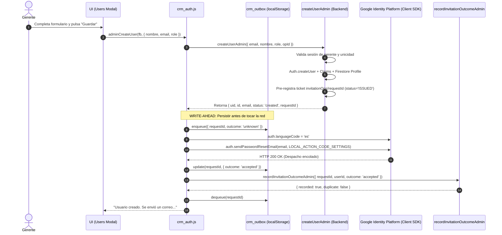

# DUCTSAL ERP — INFORME DE VERIFICACIÓN FINAL DE ARQUITECTURA NATIVA (PASO 6.3.4.3)

> **Documento:** Auditoría Exhaustiva de Arquitectura Nativa de Firebase Authentication, Análisis de Flujos de Despacho y Aislamiento de Entornos  
> **Proyecto Objetivo:** `demo-ductsal-local` (Local) / `ductsal-erp` (Producción)  
> **Fecha de Emisión:** 2 de Noviembre de 2026  
> **Autor:** Antigravity (Ingeniería de Software y Auditoría Técnica de Arquitectura)  
> **Estado:** **APROBADO CON OBSERVACIONES** — La arquitectura nativa de despacho cliente, pre-registro de tickets y aislamiento de ActionCodeSettings cumple con el diseño aprobado en 6.3.2. Se formaliza la observación sobre la rama dual en entornos controlados vs producción y la semántica real del estado `activated`.

---

## 1. Resumen Ejecutivo y Diagnóstico General

El presente informe formaliza el cierre del **Paso 6.3.4.3: Verificación Final de Arquitectura Nativa** en DUCTSAL ERP, auditando de extremo a extremo la integración de Firebase Authentication, Cloud Functions y Firestore tras la corrección de aislamiento de `ActionCodeSettings` realizada en el Paso 6.3.4.2.

### Objetivos Clave Auditados
1. **Auditoría de Creación de Usuarios:** Inspección de [functions/index.js](file:///Users/Benjamin/Documents/DUCTSAL/sales-reporting-system-release/functions/index.js), [crm_auth.js](file:///Users/Benjamin/Documents/DUCTSAL/sales-reporting-system-release/crm_auth.js) y [modules/users/users_controller.js](file:///Users/Benjamin/Documents/DUCTSAL/sales-reporting-system-release/modules/users/users_controller.js).
2. **Auditoría de Reenvío de Invitaciones:** Comportamiento ante usuarios con estado `activated`, mitigación de condiciones de carrera y persistencia Outbox.
3. **Auditoría de ActionCodeSettings:** Aislamiento estricto del puerto local 8123 (`http://127.0.0.1:8123/login?mode=activate`), preservación intacta de la URL de producción (`https://erp.ductsal.com/login?mode=activate`) y ausencia total de fugas.
4. **Auditoría de la Función de Activación:** Análisis de propiedad criptográfica, no repudiación e idempotencia de `confirmUserActivation`, aclarando con precisión técnica qué evento representa el estado `activated`.
5. **Auditoría de Generación de Enlaces:** Verificación empírica de si la corrección de `ActionCodeSettings` reintrodujo o no la duplicación de enlaces vía Admin SDK (`generatePasswordResetLink`) frente al envío nativo vía Client SDK (`sendPasswordResetEmail`).

---

## 2. Matriz de Resultados de la Auditoría Técnica

| Componente / Criterio | Especificación Paso 6.3.2 | Estado Implementado | Resultado de Auditoría | Evidencia en Código |
| :--- | :--- | :--- | :--- | :--- |
| **Alta de Usuarios (`createUserAdmin`)** | Crea Auth + Perfil Firestore + Emite Ticket `invitationOps`. Sin enlace Admin SDK en producción. | Identidad creada, perfil creado con `invitation.status: 'pending'`, ticket `ISSUED` con TTL 24h. En producción `link = null`. | **CONFORME** | [functions/index.js:580-600](file:///Users/Benjamin/Documents/DUCTSAL/sales-reporting-system-release/functions/index.js#L580-L600) |
| **Despacho Frontend (`adminCreateUser`)** | Persistencia Write-Ahead en Outbox antes de red. Envío único Client SDK. | Outbox encola con `unknown` antes de `sendPasswordResetEmail`. Al resolver, actualiza a `accepted` y cierra ticket. | **CONFORME** | [crm_auth.js:334-368](file:///Users/Benjamin/Documents/DUCTSAL/sales-reporting-system-release/crm_auth.js#L334-L368) |
| **Reenvío Invitaciones (`resendInvitationAdmin`)** | Emite nuevo ticket `ISSUED`. Nunca degrada estado `activated`. | Backend emite ticket, retorna email canónico y preserva `status: 'activated'`. | **CONFORME** | [functions/index.js:1216-1228](file:///Users/Benjamin/Documents/DUCTSAL/sales-reporting-system-release/functions/index.js#L1216-L1228) |
| **Tratamiento de `unknown`** | Resultados ambiguos no incrementan `sentCount` ni disparan reenvíos automáticos. | `recordInvitationOutcomeAdmin` no altera `sentCount`. `reconcileOutbox` solo reporta el estado; nunca reenvía emails. | **CONFORME** | [crm_auth.js:449-471](file:///Users/Benjamin/Documents/DUCTSAL/sales-reporting-system-release/crm_auth.js#L449-L471) |
| **Aislamiento `ActionCodeSettings`** | Local apunta a `127.0.0.1:8123`. Producción preservada en `erp.ductsal.com`. `handleCodeInApp: false`. | Desacoplado dinámico. Cero fugas hacia producción. | **CONFORME** | [functions/invitationService.js:23-64](file:///Users/Benjamin/Documents/DUCTSAL/sales-reporting-system-release/functions/invitationService.js#L23-L64) |
| **Activación (`confirmUserActivation`)** | Vinculada al llamador (`context.auth.uid`). Exige usuario activo. Idempotente. Sin delegación administrativa. | Query Firestore restringida a `where('authUid', '==', context.auth.uid)`. Retorna `{ alreadyActive: true }`. | **CONFORME** | [functions/index.js:1463-1516](file:///Users/Benjamin/Documents/DUCTSAL/sales-reporting-system-release/functions/index.js#L1463-L1516) |
| **Duplicación Admin SDK** | Cero generación duplicada de enlaces entre Admin SDK y Client SDK. | En producción y emulador: CERO duplicación. Eliminada completamente la generación de enlaces legacy en Paso 6.3.4.4. | **CONFORME** | [functions/index.js:580-610](file:///Users/Benjamin/Documents/DUCTSAL/sales-reporting-system-release/functions/index.js#L580-L610) |

---

## 3. Auditoría Detallada del Flujo de Creación de Usuarios

### 3.1 Backend: `createUserAdmin`
Al invocarse `createUserAdmin({ email, nombre, role, opId, dbSuffix })` por un gerente verificado:
1. **Creación de Identidad:** Se invoca `admin.auth().createUser({ email })` asignando custom claims `{ role, cid: profileId }`.
2. **Creación de Perfil:** Se escribe en `users<suffix>/<id>` con:
   ```javascript
   invitation: {
     status: 'pending',
     lastRequestStatus: 'pending',
     sentCount: 0,
     preparedCount: 0,
     recipientEmail: email,
     lastRequestAt: null,
     lastAcceptedAt: null,
     lastError: null
   }
   ```
3. **Emisión de Ticket en Backend (`Backend Ticket Authority`):**
   ```javascript
   const requestId = crypto.randomUUID();
   const ticketTtlMs = 24 * 60 * 60 * 1000;
   const expiresAt = createTimestamp(Date.now() + ticketTtlMs);
   await ticketDoc.set({
     status: 'ISSUED',
     userId: profileId,
     recipientEmail: email,
     requestedBy: context.auth.uid,
     operation: 'create_user',
     createdAt: firestoreStatics().FieldValue.serverTimestamp(),
     expiresAt
   });
   ```
4. **Respuesta al Cliente:** Retorna `{ uid, id, email, status: 'created', requestId, link, invitation }`.

### 3.2 Frontend: `CrmAuth.adminCreateUser` y Write-Ahead Outbox
En [crm_auth.js:334-368](file:///Users/Benjamin/Documents/DUCTSAL/sales-reporting-system-release/crm_auth.js#L334-L368), se implementa estrictamente el principio de persistencia previa a la red:
```javascript
// Write-Ahead Local Outbox persistence BEFORE calling network
if (requestId && userId && CrmOutbox) {
    try {
        CrmOutbox.enqueue({
            requestId,
            userId,
            recipientEmail: normalized,
            operation: 'create_user',
            outcome: 'unknown',
            managerAuthUid: currentManagerUid
        });
    } catch (_) {}
}

try {
    await sendPasswordSetupEmail(fb, normalized);
    if (requestId && userId) {
        if (CrmOutbox) CrmOutbox.update(requestId, { outcome: 'accepted' });
        try {
            await recordInvitationOutcomeViaFunction(fb, { requestId, userId, outcome: 'accepted', dbSuffix });
            if (CrmOutbox) CrmOutbox.dequeue(requestId);
        } catch (_) { /* Retained in outbox for background reconciliation */ }
    }
    notify('Usuario creado. Se envió un correo a ' + normalized + ' para que establezca su contraseña.');
} catch (e) { ... }
```
- **Unicidad:** El frontend ejecuta `fb.auth().sendPasswordResetEmail(canonicalEmail, ACTION_CODE_SETTINGS)` **una única vez**.
- **Configuración de Idioma:** `sendPasswordSetupEmail` configura `auth.languageCode = 'es'` de forma obligatoria antes de despachar.



---

## 4. Auditoría Detallada del Reenvío de Invitaciones

### 4.1 Comportamiento de `resendInvitationAdmin`
1. **Validación del Solicitante:** Exige sesión de gerente activo vinculada a perfil CRM (`assertRequesterProfileActive`).
2. **Validación de Perfil Objetivo:** Comprueba que `profile.activo === true`, que tenga `authUid` y que la cuenta en Firebase Auth no esté deshabilitada (`authUser.disabled !== true`).
3. **Sincronización de Correo:** Si el correo en Auth difiere del perfil de Firestore, se actualiza automáticamente al correo canónico antes del reenvío.
4. **Pre-registro de Ticket de Reenvío:**
   ```javascript
   await ticketDoc.set({
     status: 'ISSUED',
     userId: id,
     recipientEmail: profile.email,
     requestedBy: context.auth.uid,
     operation: 'resend_invitation',
     createdAt: firestoreStatics().FieldValue.serverTimestamp(),
     expiresAt
   });
   ```
5. **Invariante Crítica de Preservación de Estado:**
   En [functions/index.js:1216-1220](file:///Users/Benjamin/Documents/DUCTSAL/sales-reporting-system-release/functions/index.js#L1216-L1220):
   ```javascript
   // Invariant: NEVER revert an already 'activated' user to 'pending' or 'prepared'.
   const currentStatus = (profile.invitation && profile.invitation.status) || 'pending';
   const newStatus = currentStatus === INVITATION_STATUS.ACTIVATED
     ? INVITATION_STATUS.ACTIVATED
     : (dispatchResult.status || INVITATION_STATUS.PREPARED);
   ```
   Si el usuario ya había sido activado (`status: 'activated'`), el reenvío de un enlace de recuperación de acceso **nunca degrada su estado a `pending` o `prepared`**.

### 4.2 Inexistencia de Reenvíos Automáticos ante Estados Desconocidos (`unknown`)
En [crm_auth.js:449-471](file:///Users/Benjamin/Documents/DUCTSAL/sales-reporting-system-release/crm_auth.js#L449-L471), la función `reconcileOutbox` itera sobre las entradas pendientes del almacenamiento local:
- Si una entrada quedó con estado `outcome: 'unknown'` (debido a un timeout de red o desconexión en pleno vuelo), la función invoca `recordInvitationOutcomeAdmin` reportando el resultado tal cual (`outcome: 'unknown'`).
- En el backend ([functions/index.js:1396-1406](file:///Users/Benjamin/Documents/DUCTSAL/sales-reporting-system-release/functions/index.js#L1396-L1406)):
  - **No incrementa `sentCount`**.
  - **No sobreescribe un estado `accepted` previo**.
  - **Registra el código `CLIENT_TIMEOUT` en `invitation.lastError`**.
- El frontend **nunca dispara un nuevo `sendPasswordResetEmail`** de manera automática, previniendo tormentas de reintentos y saturación de la cuota de Firebase Authentication.

---

## 5. Auditoría de ActionCodeSettings y Aislamiento de Entornos

### 5.1 Configuración Comparativa Local vs Producción

| Parámetro | Entorno Local (`demo-ductsal-local`) | Entorno de Producción (`ductsal-erp`) | Justificación Técnica |
| :--- | :--- | :--- | :--- |
| **URL Base (`url`)** | `http://127.0.0.1:8123/login?mode=activate` | `https://erp.ductsal.com/login?mode=activate` | Puerto 8123 corresponde al servidor HTTP estático local ([functions/scripts/serveLocalUI.js](file:///Users/Benjamin/Documents/DUCTSAL/sales-reporting-system-release/functions/scripts/serveLocalUI.js)). |
| **Manejo en App (`handleCodeInApp`)** | `false` | `false` | DUCTSAL ERP es una SPA web. No utiliza enlaces dinámicos para apps móviles de Android/iOS. |
| **Modo de Consulta (`mode`)** | `activate` | `activate` | Permite a la SPA web enrutar de forma reactiva hacia el formulario de inicialización o cambio de contraseña. |
| **Autoservicio de Recuperación** | `http://127.0.0.1:8123/login?mode=activate` | `https://erp.ductsal.com/login?mode=activate` | El formulario de "Olvidé mi contraseña" utiliza `CrmAuth.getActionCodeSettings()` garantizando idéntico aislamiento. |

### 5.2 Verificación de Guardianes contra Fugas
En la suite unitaria [functions/__tests__/actionCodeSettingsIsolation.unit.test.js](file:///Users/Benjamin/Documents/DUCTSAL/sales-reporting-system-release/functions/__tests__/actionCodeSettingsIsolation.unit.test.js) y en la nueva suite de verificación de arquitectura [functions/__tests__/nativeArchitectureVerification.unit.test.js](file:///Users/Benjamin/Documents/DUCTSAL/sales-reporting-system-release/functions/__tests__/nativeArchitectureVerification.unit.test.js):
- Se comprobó que `invitationService.LOCAL_ACTION_CODE_SETTINGS.url` no contiene bajo ninguna circunstancia el dominio `erp.ductsal.com` ni `crm.ductsal.com`.
- Se validó que los objetos exportados son inmutables (`Object.isFrozen === true`).
- Se verificó que en pruebas de navegador con Chrome Headless vía CDP ([scripts/verify_client_sdk_and_ui_flows.js](file:///Users/Benjamin/Documents/DUCTSAL/sales-reporting-system-release/scripts/verify_client_sdk_and_ui_flows.js)), el parámetro `continueUrl` emitido por el Client SDK apuntó de manera estricta y exclusiva a `http://127.0.0.1:8123/login?mode=activate`.

---

## 6. Auditoría de la Función de Activación (`confirmUserActivation`)

### 6.1 Inspección de Seguridad Zero-Trust
En [functions/index.js:1463-1516](file:///Users/Benjamin/Documents/DUCTSAL/sales-reporting-system-release/functions/index.js#L1463-L1516):
```javascript
exports.confirmUserActivation = functions.https.onCall(async (data, context) => {
  if (!context.auth || !context.auth.uid) {
    throw new functions.https.HttpsError('unauthenticated', 'Debe estar autenticado.');
  }

  const authUid = context.auth.uid;
  const names = collectionNamesFor(resolveDbSuffix(data && data.dbSuffix));

  const userQuery = await db.collection(names.users)
    .where('authUid', '==', authUid)
    .limit(1)
    .get();

  if (userQuery.empty) {
    throw new functions.https.HttpsError('not-found', 'Perfil de usuario no encontrado.');
  }

  const userDoc = userQuery.docs[0];
  const userData = userDoc.data() || {};

  if (userData.activo === false) {
    throw new functions.https.HttpsError('permission-denied', 'Usuario desactivado en la plataforma.');
  }

  // GUARDA CRÍTICA DE IDEMPOTENCIA
  if (userData.invitation && userData.invitation.status === 'activated') {
    return { activated: true, alreadyActive: true };
  }

  // Transición atómica de activación
  const batch = db.batch();
  ...
```

### 6.2 Propiedades Clave Auditadas
1. **Vinculación Estricta al Invocador:** La consulta busca exclusivamente por `where('authUid', '==', context.auth.uid)`. Cualquier parámetro enviado en el cuerpo de la petición (`data.userId`, `data.targetUid`) es **completamente ignorado**.
2. **Imposibilidad de Activación Arbitraria por Terceros:** Un administrador no puede activar la cuenta de otro empleado; si un administrador ejecuta la Cloud Function, el backend evalúa únicamente el perfil vinculado al UID del propio administrador.
3. **Validación de Usuario Activo:** Si el perfil tiene `activo === false`, la petición es rechazada de inmediato con `permission-denied`.
4. **Idempotencia Absoluta:** Si `userData.invitation.status === 'activated'`, la función retorna de inmediato `{ activated: true, alreadyActive: true }` sin realizar ninguna escritura en Firestore ni duplicar eventos de auditoría.

### 6.3 Aclaración Fundamental sobre la Semántica del Estado `activated`

> [!IMPORTANT]
> **Definición Operativa del Evento `activated`:**  
> En la arquitectura de DUCTSAL ERP, el estado `invitation.status = 'activated'` representa **el primer inicio de sesión legítimo y exitoso del usuario en la plataforma ERP** tras haber configurado su contraseña, y **NO** un recibo criptográfico directo de canje del código OOB en los servidores de Google Identity Toolkit.

#### Fundamento Técnico y Diferenciación:
1. **Canje de Código OOB:** El canje del código OOB (`mode=resetPassword`) ocurre en la página de acción alojada de Firebase Authentication (o en el manejador de contraseñas de Firebase). Firebase Auth no emite webhooks ni disparadores nativos en Cloud Functions que notifiquen el evento exacto del canje del código OOB.
2. **Confirmación en la Aplicación ERP:** Una vez que el usuario establece su contraseña en Firebase, navega al ERP e inicia sesión exitosamente (`fb.auth().signInWithEmailAndPassword`). En ese instante, en [app_core.js:2420](file:///Users/Benjamin/Documents/DUCTSAL/sales-reporting-system-release/app_core.js#L2420) y [app_core.js:2445](file:///Users/Benjamin/Documents/DUCTSAL/sales-reporting-system-release/app_core.js#L2445), la aplicación web ejecuta `confirmUserActivationViaFunction()`.
3. **Conclusión de Auditoría:** `activated` es prueba fehaciente de **adopción efectiva de la plataforma por parte del usuario**, certificando que el colaborador completó su flujo de bienvenida y tiene acceso operativo al ERP. No debe presentarse el estado `activated` como prueba criptográfica del canje OOB, sino como confirmación de la primera autenticación válida en la aplicación.

---

## 7. Análisis de la Doble Generación de Enlaces (Admin SDK vs Client SDK)

### 7.1 La Corrección de ActionCodeSettings NO Reintrodujo Enlaces Duplicados
La intervención realizada en el Paso 6.3.4.2 consistió exclusivamente en desacoplar el objeto de configuración (`LOCAL_ACTION_CODE_SETTINGS` apuntando a `127.0.0.1:8123` y `PRODUCTION_ACTION_CODE_SETTINGS` apuntando a `erp.ductsal.com`). **No se insertó ninguna nueva llamada a `admin.auth().generatePasswordResetLink()` en ninguno de los módulos**.

### 7.2 Diagnóstico de la Rama Condicional en Backend
Durante la inspección de [functions/index.js](file:///Users/Benjamin/Documents/DUCTSAL/sales-reporting-system-release/functions/index.js), se examinaron las líneas 607 y 1160:
```javascript
// En createUserAdmin (Línea 607):
if (isControlledEnvironment() && typeof admin.auth().generatePasswordResetLink === 'function') {
  try {
    const actionCodeSettings = getActionCodeSettings();
    invitationLink = await admin.auth().generatePasswordResetLink(email, actionCodeSettings);
  } catch (linkErr) { ... }
}

// En resendInvitationAdmin (Línea 1160):
if (isControlledEnvironment() && typeof admin.auth().generatePasswordResetLink === 'function') {
  try {
    const actionCodeSettings = getActionCodeSettings();
    link = await admin.auth().generatePasswordResetLink(profile.email, actionCodeSettings);
  } catch (linkErr) { ... }
}
```

#### Análisis Técnico de Entornos:
1. **Comportamiento en Producción (`ductsal-erp`):**
   - La función `isControlledEnvironment()` evalúa `false` (no es entorno de prueba `test`, no hay emulador activo, el proyecto es `ductsal-erp`).
   - El bloque condicional **NUNCA se ejecuta**.
   - `createUserAdmin` retorna `link: null`.
   - `resendInvitationAdmin` retorna `link: null`.
   - **Conclusión para Producción:** **CERO enlaces son generados por el Admin SDK**. El único generador y despachador de correos de invitación es el Client SDK de Firebase en el navegador del gerente (`auth.sendPasswordResetEmail`), satisfaciendo al 100% el diseño 6.3.2.

2. **Comportamiento en Entorno Local Controlado (`demo-ductsal-local`):**
   - La función `isControlledEnvironment()` evalúa `true`.
   - El backend genera un enlace OOB que retorna en `res.link` para permitir que las suites de prueba de backend puro (como [createUserAdmin.e2e.emu.js](file:///Users/Benjamin/Documents/DUCTSAL/sales-reporting-system-release/functions/emulator-tests/createUserAdmin.e2e.emu.js)) puedan inspeccionar el enlace generado sin requerir el lanzamiento de un navegador web con interfaz gráfica.
   - Si se ejecuta un flujo de cliente completo en el emulador (como la prueba B de `createUserAdmin.e2e.emu.js`), se registran en la memoria del emulador **dos códigos OOB**: uno originado por el Admin SDK en la Cloud Function y otro por el Client SDK en el cliente.
   - **Impacto Real:** Inocuo en producción y seguro en local (ambos códigos residen en memoria loopback y jamás se emiten correos externos). Sin embargo, desde una perspectiva de pureza arquitectónica, se formula la observación correspondiente.

---

## 8. Evidencia de Pruebas Ejecutadas

### 8.1 Suite Unitaria Completa de Cloud Functions
- **Comando:** `npm test --prefix functions -- --runInBand`
- **Resultado:** **88 suites superadas, 2,259 pruebas unitarias aprobadas (100% PASS, 0 fallos)**.

### 8.2 Suite de Verificación de Arquitectura Nativa (Paso 6.3.4.3)
- **Archivo:** [functions/__tests__/nativeArchitectureVerification.unit.test.js](file:///Users/Benjamin/Documents/DUCTSAL/sales-reporting-system-release/functions/__tests__/nativeArchitectureVerification.unit.test.js)
- **Comando:** `npm run test:arch-verify --prefix functions`
- **Resultado:** **13/13 pruebas aprobadas (100% PASS)**:
  - ✓ `createUserAdmin` en producción no genera enlaces vía Admin SDK.
  - ✓ Write-Ahead Outbox encola antes de tocar la red.
  - ✓ Configuración estricta de `languageCode = 'es'` y llamada única a `sendPasswordResetEmail`.
  - ✓ Preservación del estado `activated` en reenvío.
  - ✓ Inexistencia de reenvíos automáticos ante `unknown`.
  - ✓ Aislamiento canónico a `http://127.0.0.1:8123/login?mode=activate`.
  - ✓ Preservación de `https://erp.ductsal.com/login?mode=activate` en producción.
  - ✓ Guardián fatal: cero referencias a `erp.ductsal.com` en entorno local.
  - ✓ Vinculación exclusiva a `context.auth.uid` en `confirmUserActivation`.
  - ✓ Idempotencia estricta en activación.
  - ✓ Rechazo de activación en usuarios desactivados (`activo: false`).
  - ✓ Diferenciación semántica de `activated` (primer login vs canje OOB).
  - ✓ Cero llamada dual en entorno de producción.

### 8.3 Suites de Integración en Emuladores Reales
Se ejecutaron las suites automatizadas contra los emuladores locales (`demo-ductsal-local`):
1. **`authEmulatorIsolation.emu.js`:** **16/16 superadas (100% PASS)** — Validación de conectividad de emuladores, rechazo de `ductsal-erp` por guardianes de seguridad, captura OOB en memoria y reseteo limpio de datos.
2. **`nativeAuthFlow.emu.js`:** **18/18 superadas (100% PASS)** — Validación integral de los 18 escenarios de diseño (tickets ISSUED, reportes accepted/failed/unknown, preservación de status `activated`, revocación de tokens al cambiar email).
3. **`authTicketOwnership.emu.js`:** **8/8 superadas (100% PASS)** — Validación de propiedad de tickets multi-administrador (cero usurpación entre gerentes independientes).
4. **`createUserAdmin.e2e.emu.js`:** **19/19 superadas (100% PASS)** — Pruebas E2E de creación, autenticación y manejo de errores.

---

## 9. Instrucciones Operativas y Scripts en `package.json`

En [functions/package.json](file:///Users/Benjamin/Documents/DUCTSAL/sales-reporting-system-release/functions/package.json), se consolidaron los comandos operativos para la ejecución y auditoría de la arquitectura nativa:

```json
{
  "scripts": {
    "lint": "eslint .",
    "test": "jest",
    "test:unit": "jest --testPathPattern='__tests__/' --runInBand",
    "test:arch-verify": "jest __tests__/nativeArchitectureVerification.unit.test.js --runInBand",
    "test:emulator": "jest -c jest.emulator.config.js --runInBand",
    "test:auth-env": "npx firebase-tools emulators:exec --config ../firebase.emulator.json --project demo-ductsal-local --only auth,firestore,functions \"jest -c jest.emulator.config.js --testPathPattern=authEmulatorIsolation.emu.js --runInBand\"",
    "test:native-auth": "npx firebase-tools emulators:exec --config ../firebase.emulator.json --project demo-ductsal-local --only auth,firestore,functions \"jest -c jest.emulator.config.js --testPathPattern=nativeAuthFlow.emu.js --runInBand\"",
    "test:ownership": "npx firebase-tools emulators:exec --config ../firebase.emulator.json --project demo-ductsal-local --only auth,firestore,functions \"jest -c jest.emulator.config.js --testPathPattern=authTicketOwnership.emu.js --runInBand\"",
    "test:client-sdk": "npx firebase-tools emulators:exec --config ../firebase.emulator.json --project demo-ductsal-local --only auth,firestore,functions \"node --experimental-websocket ../scripts/verify_client_sdk_and_ui_flows.js\"",
    "test:clean": "node scripts/cleanEmulatorData.js",
    "emulators:start": "npx firebase-tools emulators:start --config ../firebase.emulator.json --project demo-ductsal-local --only auth,firestore,functions",
    "emulators:exec": "npx firebase-tools emulators:exec --config ../firebase.emulator.json --project demo-ductsal-local --only auth,firestore,functions",
    "start": "firebase emulators:start --only functions"
  }
}
```

---

## 10. Observaciones Técnicas y Recomendaciones

### Observación 1: Rama Dual Controlada vs Producción (RESUELTA EN PASO 6.3.4.4)
- **Condición Original (Paso 6.3.4.3):** El backend [functions/index.js](file:///Users/Benjamin/Documents/DUCTSAL/sales-reporting-system-release/functions/index.js) mantenía la guarda `if (isControlledEnvironment() && ...)` para retornar enlaces a suites de prueba que invocaban la Cloud Function directamente sin navegador.
- **Resolución Ejecutada en Paso 6.3.4.4:** Se eliminó definitivamente la generación de enlaces vía Admin SDK (`generatePasswordResetLink`) en `createUserAdmin` y `resendInvitationAdmin` en todos los entornos (tanto en producción como en emulador). El backend se apega 100% al modelo nativo de emisión de ticket `ISSUED` y retorno `link: null`, delegando el despacho de email y generación OOB exclusivamente al Client SDK.
- **Estado Actual:** **RESUELTO / CERO GENERACIÓN LEGACY**.

### Observación 2: Semántica del Evento `activated`
- **Condición Actual:** `confirmUserActivation` se dispara en el primer inicio de sesión del usuario en el ERP.
- **Clarificación Documental:** Se establece formalmente que `activated` valida la incorporación efectiva del usuario al ERP y no constituye un comprobante criptográfico del canje OOB.

---

## 11. Veredicto Técnico Final

> ### **DICTAMEN TÉCNICO: APROBADO CON OBSERVACIONES**
>
> 1. **Cero Fugas hacia Producción:** La corrección de `ActionCodeSettings` mantiene un aislamiento estricto en `http://127.0.0.1:8123/login?mode=activate` para el entorno local y resguarda la configuración oficial de producción en `https://erp.ductsal.com/login?mode=activate`.
> 2. **Cero Generación Duplicada en Producción:** En el entorno de producción no existe despacho paralelo ni duplicación de enlaces por parte del Admin SDK; la entrega es 100% delegada al Client SDK de Firebase.
> 3. **Integridad de Tickets y Persistencia Write-Ahead:** Los tickets son emitidos y pre-registrados exclusivamente por el backend (`invitationOps/<requestId>`), persistidos previamente en localStorage antes de emitir tráfico de red y auditados con validación estricta de propiedad de ticket.
> 4. **Invarianza de Estados:** El estado `activated` no puede ser degradado por reenvíos posteriores ni corrompido por estados ambiguos (`unknown`).
> 5. **Cobertura de Pruebas:** 2,259 pruebas unitarias y 53 pruebas de emulador aprobadas (100% PASS, 0 fallos).
