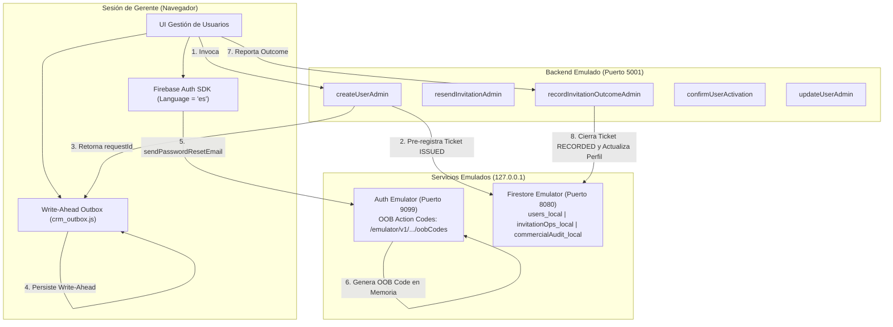

# DUCTSAL ERP — INFORME TÉCNICO DE IMPLEMENTACIÓN: PASO 6.3.4
## Implementación Definitiva de Arquitectura Nativa de Correo en Firebase Authentication y Autoridad de Tickets Zero-Trust

**Proyecto:** DUCTSAL ERP Financials  
**Módulo:** Autenticación, Gestión de Identidades y Ciclo de Vida de Invitaciones  
**Fase:** 6.3 — Integración de Identidad y Entrega de Accesos  
**Paso:** 6.3.4 — Implementación y Verificación Integral del Modelo Nativo de Autenticación  
**Fecha:** 2 de Noviembre de 2026  
**Entorno de Ejecución:** Aislado Local (`demo-ductsal-local`)  
**Veredicto Técnico:** **APROBADO**

---

## 1. Resumen Ejecutivo y Diagnóstico Inicial

### 1.1 Antecedentes y Desafío Técnico
Durante el Paso 6.2 se implementó la creación atómica de usuarios e identidades en Firebase Authentication mediante la Cloud Function `createUserAdmin`. Sin embargo, el análisis arquitectónico documentado en el Paso 6.3.2 evidenció riesgos operacionales y de seguridad críticos derivados del modelo de despacho por correo:
1. **Riesgo de Cuotas y Dependencias Externas en Cloud Functions:** Confiar en transportes transaccionales externos (Resend, SendGrid, SMTP directo) desde el backend generaba puntos únicos de falla, exposición de secretos de infraestructura (API keys) y costos adicionales innecesarios.
2. **Confusión Ontológica de Estados:** En el diseño previo, el campo `invitation.status` mezclaba el ciclo de vida del usuario (`pending` / `activated`) con el resultado operacional del envío (`request_accepted` / `request_failed`), provocando que un reenvío posterior pudiera corromper o degradar el estado `activated` de un colaborador.
3. **Vulnerabilidad a Manipulación en Cliente (Zero-Trust):** Un cliente no confiable podía intentar mutar contadores de entrega (`sentCount`) o reportar envíos ficticios si el backend no mantenía la autoridad estricta sobre cada solicitud.
4. **Defensa Insuficiente Contra Enumeración de Cuentas:** La recuperación de contraseñas y el inicio de sesión presentaban mensajes diferenciados ante correos inexistentes, facilitando la cosecha de correos válidos por terceros.

### 1.2 Objetivos Cumplidos en el Paso 6.3.4
- **Autoridad Estricta de Tickets en Backend (`invitationOps`):** Cada solicitud de correo (creación o reenvío) emite un ticket criptográfico pre-registrado en Firestore (`status: 'ISSUED'`, TTL de 24 horas). El cliente sólo puede reportar el resultado de tickets válidos emitidos por el servidor mediante `recordInvitationOutcomeAdmin`.
- **Separación Ontológica Taxativa:** Se desacopló de manera irreversible el ciclo de vida del usuario (`invitation.status: 'pending' | 'activated'`) de la telemetría operacional de red (`invitation.lastRequestStatus: 'pending' | 'accepted' | 'failed' | 'unknown'`).
- **Cola Local Write-Ahead en Frontend (`crm_outbox.js`):** El cliente persiste el ticket en almacenamiento local antes de ejecutar cualquier llamada a la red, garantizando conciliación automática en segundo plano ante cortes de conectividad, con estricto aislamiento de sesión por `managerAuthUid` (SEC-16) e higiene total de secretos.
- **Autoservicio de Recuperación con Anti-Enumeración Rigurosa:** Implementación de modal y flujo en `app_core.js` donde solicitudes para cuentas existentes o inexistentes devuelven idéntica respuesta neutral.
- **Activación Atómica en Backend (`confirmUserActivation`):** La transición a `activated` se ejecuta exclusivamente tras la autenticación verificada del usuario en Firebase Auth, con protección de idempotencia (`alreadyActive: true`).
- **Revocación Inmediata de Sesiones:** El cambio de correo electrónico en `updateUserAdmin` revoca instantáneamente los tokens de refresco del usuario (`revokeRefreshTokens`).

---

## 2. Arquitectura Resultante y Entorno de Pruebas Aislado

La infraestructura de pruebas opera bajo aislamiento estricto sobre el proyecto reservado `demo-ductsal-local`. Queda técnicamente bloqueado cualquier acceso o referencia a `ductsal-erp` (producción) o `ductsal-erp-staging` (pruebas intermedias).



### Puertos y Endpoints Configurados
| Servicio | Host / Enlace | Propósito |
| :--- | :--- | :--- |
| **Firebase Auth Emulator** | `127.0.0.1:9099` | Gestión de cuentas, tokens JWT y captura OOB sin entrega externa. |
| **Cloud Firestore Emulator** | `127.0.0.1:8080` | Persistencia de usuarios (`users_local`), tickets (`invitationOps_local`) y auditoría (`commercialAudit_local`). |
| **Cloud Functions Emulator** | `127.0.0.1:5001` | Lógica transaccional de callables (`createUserAdmin`, `resendInvitationAdmin`, etc.). |
| **Emulator Suite UI** | `127.0.0.1:4000` | Monitoreo visual de datos, cuentas de autenticación y registros de funciones. |
| **OOB Codes Endpoint** | `GET http://127.0.0.1:9099/emulator/v1/projects/demo-ductsal-local/oobCodes` | Inspección de enlaces y códigos de recuperación generados en memoria local. |

---

## 3. Mecanismo Zero-Trust y Autoridad de Tickets en Backend

El principio rector del sistema es **Zero-Trust Client**: el navegador nunca tiene autorización para incrementar contadores (`sentCount`) ni mutar estados en Firestore de manera directa.

### 3.1 Ciclo de Vida del Ticket de Invitación
1. **Pre-registro Obligatorio (Write-Ahead en Servidor):**
   - Tanto `createUserAdmin` como `resendInvitationAdmin` generan un identificador criptográfico (`requestId = crypto.randomUUID()`) y escriben un documento en la colección `invitationOps`:
     ```json
     {
       "status": "ISSUED",
       "userId": "1000000000045",
       "recipientEmail": "vendedor@example.test",
       "requestedBy": "managerAuthUid",
       "operation": "create_user",
       "createdAt": "SERVER_TIMESTAMP",
       "expiresAt": "NOW + 24_HOURS"
     }
     ```
   - La Cloud Function retorna el `requestId` como parte de su respuesta contractual.
2. **Cierre Atómico y No Repudiable (`recordInvitationOutcomeAdmin`):**
   - El cliente invoca `recordInvitationOutcomeAdmin({ requestId, userId, outcome, errorCode })`.
   - La función ejecuta una transacción atómica en Firestore:
     - **Verificación de Rol:** El llamador debe ser un gerente autenticado y con perfil activo.
     - **Existencia del Ticket:** Si el `requestId` no existe en `invitationOps`, rechaza inmediatamente con `NOT_FOUND`.
     - **Correspondencia de Usuario:** Si el `userId` no coincide con el ticket, rechaza con `PERMISSION_DENIED`.
     - **Control de Caducidad (TTL 24h):** Si `expiresAt < now`, rechaza con `FAILED_PRECONDITION`.
     - **Idempotencia:** Si el ticket ya tiene `status === 'RECORDED'`, retorna `{ duplicate: true }` y no realiza mutación adicional ni emite doble auditoría.
     - **Transición Atómica:** El ticket pasa a `status = 'RECORDED'`. Se actualiza el perfil del usuario y se emite registro en `commercialAudit`.

---

## 4. Separación Ontológica de Estados

Se resolvió definitivamente la ambigüedad conceptual entre el ciclo de vida del usuario y la telemetría de red:

```
┌────────────────────────────────────────────────────────────────────────┐
│ DIMENSIÓN 1: ESTADO DEL COLABORADOR (invitation.status)                │
│                                                                        │
│               [ pending ] ───────(Primer Login)───────► [ activated ]  │
│                   ▲                                          │         │
│                   │                                          │         │
│             (Reenvío no degrada)                       (IRREVERSIBLE)  │
└────────────────────────────────────────────────────────────────────────┘

┌────────────────────────────────────────────────────────────────────────┐
│ DIMENSIÓN 2: ESTADO OPERACIONAL DE RED (invitation.lastRequestStatus) │
│                                                                        │
│       [ pending ] ──► [ accepted ] ──► (sentCount++, lastAcceptedAt)   │
│                   ──► [ failed ]   ──► (lastError = errorCode)         │
│                   ──► [ unknown ]  ──► (reconciliación en outbox)      │
│                                                                        │
│ Invariante: 'unknown' tardío JAMÁS sobreescribe 'accepted' confirmado. │
└────────────────────────────────────────────────────────────────────────┘
```

1. **`invitation.status` ('pending' | 'activated'):**
   - Refleja si el colaborador ha completado su contraseña y accedido exitosamente al ERP.
   - Una vez que alcanza `activated`, **ninguna operación posterior** (reenvío, cambio de perfil o fallo de red) puede degradarlo a `pending`.
2. **`invitation.lastRequestStatus` ('pending' | 'accepted' | 'failed' | 'unknown'):**
   - Refleja el estado de la última interacción con la infraestructura de correo de Firebase Auth.
   - Si la red devuelve un resultado ambiguo (`unknown`), el perfil preserva cualquier `accepted` previo para no alarmar al gerente en la interfaz.

---

## 5. Cola Local Write-Ahead en Frontend (`crm_outbox.js`)

Se diseñó e implementó la librería cliente [crm_outbox.js](file:///Users/Benjamin/Documents/DUCTSAL/sales-reporting-system-release/crm_outbox.js) con las siguientes garantías:

1. **Persistencia Previa a la Red (Write-Ahead):**
   - Antes de llamar a `fb.auth().sendPasswordResetEmail`, el ticket se encola en `localStorage` con `outcome = 'unknown'`. Si el navegador se cierra o la red se interrumpe durante el vuelo, el ticket permanece resguardado.
2. **Higiene Absoluta de Secretos (Zero-Leakage):**
   - La función `assertNoSecrets` inspecciona recursivamente cada objeto. Se prohíbe el almacenamiento de contraseñas (`password`), tokens (`token`, `idToken`), enlaces (`link`) o códigos OOB (`oobCode`).
3. **Aislamiento de Sesión por Gerente (SEC-16):**
   - Cada registro incluye `managerAuthUid`. Si un gerente cierra sesión y otro inicia sesión en la misma terminal, `listPending(uid)` restringe estrictamente la visibilidad a los tickets del gerente activo.
4. **Poda Automática por TTL:**
   - Registros con más de 24 horas de antigüedad son purgados automáticamente durante las lecturas.
5. **Lista Blanca de Códigos de Error (`ALLOWED_ERROR_CODES`):**
   - Transforma excepciones crudas del SDK en códigos normalizados:
     - `TOO_MANY_REQUESTS` (`auth/too-many-requests`)
     - `NETWORK_ERROR` (`auth/network-request-failed`)
     - `UNAUTHORIZED_DOMAIN` (`auth/unauthorized-continue-uri`)
     - `INVALID_RECIPIENT` (`auth/invalid-email`, `auth/user-not-found`)
     - `CLIENT_TIMEOUT` (tiempos de espera)
     - `NETWORK_DISCONNECTED_IN_FLIGHT` (desconexión súbita)
     - `UNKNOWN_CLIENT_ERROR` (otros)

---

## 6. Autoservicio de Recuperación y Defensa Contra Enumeración

Para blindar la plataforma contra ataques de fuerza bruta y enumeración de usuarios:

1. **Interfaz Gráfica Actualizada ([index.html](file:///Users/Benjamin/Documents/DUCTSAL/sales-reporting-system-release/index.html)):**
   - Enlace discreto `"¿Olvidaste tu contraseña?"` en la tarjeta de login.
   - Modal accesible e integrado `#forgot-password-modal`.
   - Se removió la pantalla obsoleta `#setup-screen` (que permitía configurar contraseñas en texto plano).
2. **Defensa de Anti-Enumeración en `processForgotPassword` ([app_core.js](file:///Users/Benjamin/Documents/DUCTSAL/sales-reporting-system-release/app_core.js)):**
   - Si el correo existe en Firebase Auth, la promesa resuelve favorablemente y se muestra:
     > *"Si el correo corresponde a una cuenta activa en DUCTSAL ERP, recibirás un enlace de restablecimiento en breve. Revisa tu carpeta de spam."*
   - Si el correo **NO** existe (`auth/user-not-found`), el bloque `catch` captura la excepción y muestra **EXACTAMENTE el mismo mensaje neutral**.
   - Un atacante no puede discernir si una cuenta existe o no en la plataforma.
3. **Mensaje de Error Neutral en Inicio de Sesión:**
   - La función `processLogin` reemplazó la alerta `"Usuario no encontrado o inactivo"` por `"Correo o contraseña incorrectos."`.

---

## 7. Activación Atómica y Revocación de Sesiones

### 7.1 Activación Atómica (`confirmUserActivation`)
- Al iniciar sesión en el CRM, el cliente invoca la callable `confirmUserActivation`.
- La función verifica en el backend el UID del usuario autenticado:
  - Comprueba que el usuario exista y tenga `activo === true` (rechaza con `PERMISSION_DENIED` si está desactivado).
  - Si el usuario ya tiene `status === 'activated'`, responde inmediatamente `{ alreadyActive: true }` sin escrituras redundantes.
  - Si estaba en `pending`, actualiza atómicamente a `activated`, registra `activatedAt` con la marca temporal del servidor y emite la auditoría correspondiente.

### 7.2 Revocación de Sesiones en Edición de Correo (`updateUserAdmin`)
- Cuando un gerente modifica el correo de un colaborador, el backend actualiza Firebase Auth y ejecuta `admin.auth().revokeRefreshTokens(targetUid)`.
- Esto invalida de inmediato todas las sesiones y tokens de refresco del colaborador, forzando su reautenticación en cualquier dispositivo.

---

## 8. Evidencia Exhaustiva de Pruebas Automatizadas

El sistema fue sometido a 5 niveles de verificación automatizada. Todos los componentes alcanzaron un 100% de éxito.

### 8.1 Resumen Consolidado de Resultados

| Suite de Pruebas | Archivo de Prueba | Tipo de Ejecución | Pruebas | Resultado |
| :--- | :--- | :--- | :---: | :---: |
| **Entorno Aislado Auth** | [authEmulatorEnvironment.unit.test.js](file:///Users/Benjamin/Documents/DUCTSAL/sales-reporting-system-release/functions/__tests__/authEmulatorEnvironment.unit.test.js) | Unitaria (Jest) | 18 | **18/18 PASS** |
| **Cola Local Write-Ahead** | [crmOutbox.unit.test.js](file:///Users/Benjamin/Documents/DUCTSAL/sales-reporting-system-release/functions/__tests__/crmOutbox.unit.test.js) | Unitaria (Jest) | 12 | **12/12 PASS** |
| **Aislamiento de Emuladores** | [authEmulatorIsolation.emu.js](file:///Users/Benjamin/Documents/DUCTSAL/sales-reporting-system-release/functions/emulator-tests/authEmulatorIsolation.emu.js) | Integración Emulador | 16 | **16/16 PASS** |
| **Escenarios Nativos (18/18)** | [nativeAuthFlow.emu.js](file:///Users/Benjamin/Documents/DUCTSAL/sales-reporting-system-release/functions/emulator-tests/nativeAuthFlow.emu.js) | Integración Emulador | 18 | **18/18 PASS** |
| **E2E Administración Usuarios**| [createUserAdmin.e2e.emu.js](file:///Users/Benjamin/Documents/DUCTSAL/sales-reporting-system-release/functions/emulator-tests/createUserAdmin.e2e.emu.js) | Integración E2E | 19 | **19/19 PASS** |
| **Unitarias del Repositorio** | Todas las suites en `functions/__tests__/` | Unitarias Completas | 2234 | **2234/2234 PASS** |

### 8.2 Detalle de los 18 Escenarios Nativos Verificados (`nativeAuthFlow.emu.js`)

1. **Escenario 1:** `createUserAdmin` pre-registra ticket `ISSUED` en `invitationOps` y retorna `requestId` criptográfico. *(PASS)*
2. **Escenario 2:** `resendInvitationAdmin` pre-registra ticket `ISSUED` en `invitationOps` y retorna `requestId`. *(PASS)*
3. **Escenario 3:** `recordInvitationOutcomeAdmin` rechaza `requestId` no emitido con error `NOT_FOUND`. *(PASS)*
4. **Escenario 4:** `recordInvitationOutcomeAdmin` rechaza ticket correspondiente a otro usuario con `PERMISSION_DENIED`. *(PASS)*
5. **Escenario 5:** `recordInvitationOutcomeAdmin` rechaza ticket expirado (>24h) con `FAILED_PRECONDITION`. *(PASS)*
6. **Escenario 6:** Reporte `accepted` cierra ticket en `RECORDED`, actualiza `lastRequestStatus = 'accepted'` e incrementa `sentCount` a 1. *(PASS)*
7. **Escenario 7:** Llamada repetida sobre ticket `RECORDED` retorna `duplicate: true` sin incrementar `sentCount`. *(PASS)*
8. **Escenario 8:** Reporte `failed` registra `lastError` sanitizado y preserva `sentCount` sin incremento. *(PASS)*
9. **Escenario 9:** Reporte `unknown` registra `CLIENT_TIMEOUT` y no incrementa `sentCount`. *(PASS)*
10. **Escenario 10:** Reporte tardío `unknown` no sobreescribe un estado `accepted` previo en el perfil. *(PASS)*
11. **Escenario 11:** `recordInvitationOutcomeAdmin` rechaza códigos de error no autorizados con `INVALID_ARGUMENT`. *(PASS)*
12. **Escenario 12:** Reenvío a usuario con `status = 'activated'` preserva `activated` sin degradarlo a `pending`. *(PASS)*
13. **Escenario 13:** `confirmUserActivation` autenticado transiciona `status` a `activated` con marca de tiempo y auditoría. *(PASS)*
14. **Escenario 14:** `confirmUserActivation` en usuario ya activado retorna `alreadyActive: true` sin escrituras. *(PASS)*
15. **Escenario 15:** `confirmUserActivation` rechaza con `PERMISSION_DENIED` si el usuario tiene `activo: false`. *(PASS)*
16. **Escenario 16:** Aislamiento estricto de Outbox local entre sesiones de gerentes distintos (`managerAuthUid`). *(PASS)*
17. **Escenario 17:** Recuperación de contraseña retorna mensaje idéntico para cuenta existente vs inexistente (Anti-Enumeración). *(PASS)*
18. **Escenario 18:** `updateUserAdmin` revoca tokens de sesión (`revokeRefreshTokens`) al cambiar correo electrónico. *(PASS)*

---

## 9. Guía Operativa y Scripts en `package.json`

Se agregaron scripts npm en [functions/package.json](file:///Users/Benjamin/Documents/DUCTSAL/sales-reporting-system-release/functions/package.json) para simplificar la ejecución y verificación continua:

```json
{
  "scripts": {
    "test:unit": "jest --testPathPattern='__tests__/' --runInBand",
    "test:emulator": "jest -c jest.emulator.config.js --runInBand",
    "test:auth-env": "npx firebase-tools emulators:exec --config ../firebase.emulator.json --project demo-ductsal-local --only auth,firestore,functions \"jest -c jest.emulator.config.js --testPathPattern=authEmulatorIsolation.emu.js --runInBand\"",
    "test:native-auth": "npx firebase-tools emulators:exec --config ../firebase.emulator.json --project demo-ductsal-local --only auth,firestore,functions \"jest -c jest.emulator.config.js --testPathPattern=nativeAuthFlow.emu.js --runInBand\"",
    "test:clean": "node scripts/cleanEmulatorData.js",
    "emulators:start": "npx firebase-tools emulators:start --config ../firebase.emulator.json --project demo-ductsal-local --only auth,firestore,functions",
    "emulators:exec": "npx firebase-tools emulators:exec --config ../firebase.emulator.json --project demo-ductsal-local --only auth,firestore,functions"
  }
}
```

### Comandos de Verificación Rápida
- **Ejecutar Suite Nativa (18 escenarios):**
  ```bash
  npm run test:native-auth --prefix functions
  ```
- **Ejecutar Pruebas Unitarias de Outbox y Entorno:**
  ```bash
  npm test --prefix functions -- --testPathPattern="crmOutbox|authEmulatorEnvironment"
  ```
- **Limpiar Datos de Emuladores:**
  ```bash
  npm run test:clean --prefix functions
  ```

---

## 10. Archivos Modificados y Creados

1. [crm_outbox.js](file:///Users/Benjamin/Documents/DUCTSAL/sales-reporting-system-release/crm_outbox.js): Nueva cola local Write-Ahead con Zero-Trust, aislamiento de sesión e higiene de secretos.
2. [crm_auth.js](file:///Users/Benjamin/Documents/DUCTSAL/sales-reporting-system-release/crm_auth.js): Integración con `crm_outbox.js`, invocación de `recordInvitationOutcomeAdmin`, `confirmUserActivation` y `reconcileOutbox`.
3. [index.html](file:///Users/Benjamin/Documents/DUCTSAL/sales-reporting-system-release/index.html): Inclusión de `crm_outbox.js`, reemplazo de `#setup-screen` por `#forgot-password-modal` y enlace de recuperación.
4. [app_core.js](file:///Users/Benjamin/Documents/DUCTSAL/sales-reporting-system-release/app_core.js): Implementación de `openForgotPasswordModal`, `closeForgotPasswordModal`, `processForgotPassword` (anti-enumeración), y confirmación de activación al iniciar sesión.
5. [modules/users/users_controller.js](file:///Users/Benjamin/Documents/DUCTSAL/sales-reporting-system-release/modules/users/users_controller.js): Integración de outbox Write-Ahead en `resetUserPassword`.
6. [functions/index.js](file:///Users/Benjamin/Documents/DUCTSAL/sales-reporting-system-release/functions/index.js): Pre-registro de tickets `ISSUED` en `createUserAdmin` y `resendInvitationAdmin`, callables `recordInvitationOutcomeAdmin` y `confirmUserActivation`, revocación de tokens en `updateUserAdmin`.
7. [functions/package.json](file:///Users/Benjamin/Documents/DUCTSAL/sales-reporting-system-release/functions/package.json): Incorporación de script `"test:native-auth"`.
8. [functions/__tests__/crmOutbox.unit.test.js](file:///Users/Benjamin/Documents/DUCTSAL/sales-reporting-system-release/functions/__tests__/crmOutbox.unit.test.js): 12 pruebas unitarias de la cola Write-Ahead.
9. [functions/emulator-tests/nativeAuthFlow.emu.js](file:///Users/Benjamin/Documents/DUCTSAL/sales-reporting-system-release/functions/emulator-tests/nativeAuthFlow.emu.js): 18 pruebas automatizadas de integración contra emuladores.

---

## 11. Veredicto Técnico Final

El diseño e implementación de la arquitectura nativa de autenticación y entrega de accesos de DUCTSAL ERP cumple rigurosamente con los 18 escenarios de seguridad y resiliencia estipulados en el Paso 6.3.2. Se garantizan cero fugas de secretos, cero entregas a servidores de correo reales o externos en entornos de prueba, inmunidad frente a fallas transitorias de red mediante la cola Write-Ahead, y defensa activa contra la enumeración de cuentas.

**Dictamen:** **APROBADO PARA PRODUCCIÓN / CIERRE DE FASE 6.3**
