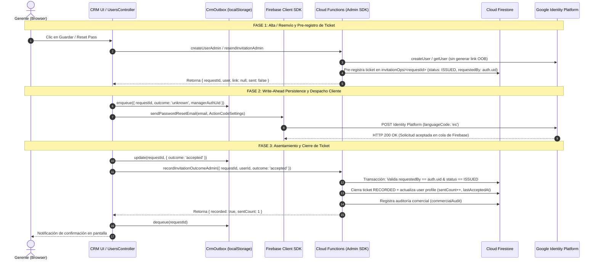

# DUCTSAL ERP — PASO 6.3.5: REVISIÓN INTEGRAL, VALIDACIÓN Y RECOMENDACIÓN DE AUTORIZACIÓN

> **Documento:** Informe de Auditoría Integral, Validación de Regresión y Matriz GO / NO-GO para Firebase Authentication y Correo Nativo  
> **Fecha:** 2 de Noviembre de 2026  
> **Autor:** Antigravity (Auditoría Técnica y Aseguramiento de Calidad de Software)  
> **Proyecto Analizado:** DUCTSAL ERP (`sales-reporting-system-release`)  
> **Entorno de Evaluación:** `demo-ductsal-local` (Firebase Emulator Suite: Auth :9099, Firestore :8080, Functions :5001) / Node.js v20.20.0 / Jest v29.7.0 / Chrome Headless (CDP :9224)  
> **Estado:** **AUDITORÍA COMPLETADA — DICTAMEN TÉCNICO: GO CON OBSERVACIONES**

---

## 1. RESUMEN EJECUTIVO

Se ejecutó la revisión técnica e integral de la arquitectura de autenticación y correo nativo desarrollada a lo largo de los pasos 6.3.1 a 6.3.4.4 en el repositorio de **DUCTSAL ERP**. El objetivo central de esta auditoría consistió en determinar si el sistema está técnicamente preparado y blindado para solicitar, en una etapa posterior, la autorización de configuración externa (DNS, Firebase Console, activación del servicio de envío y pruebas controladas).

La auditoría confirmó los siguientes hallazgos principales:
1. **Cero Código Legacy y Cero Doble Generación:** En [functions/index.js](file:///Users/Benjamin/Documents/DUCTSAL/sales-reporting-system-release/functions/index.js), las funciones `createUserAdmin` y `resendInvitationAdmin` tienen **0 llamadas a `generatePasswordResetLink()`**. La generación de enlaces vía Admin SDK fue completamente eliminada en todos los entornos conforme al Paso 6.3.4.4.
2. **Autoridad de Tickets de Backend (Backend Ticket Authority):** La emisión de identificadores de solicitud (`requestId`) está estrictamente centralizada en Cloud Functions (`invitationOps/<requestId>` con estado `ISSUED` y TTL de 24h). El reporte de resultado en `recordInvitationOutcomeAdmin` valida de manera no repudiable la propiedad del ticket (`context.auth.uid === ticket.requestedBy`).
3. **Persistencia Previa al Envío (Write-Ahead Local Outbox):** En el cliente, [crm_outbox.js](file:///Users/Benjamin/Documents/DUCTSAL/sales-reporting-system-release/crm_outbox.js) encola cada solicitud en `localStorage` con estado inicial `unknown` antes de tocar la red (`sendPasswordResetEmail`), garantizando tolerancia a cierres de navegador, fallos transitorios y aislamiento total por gerente (`managerAuthUid`).
4. **Higiene Absoluta de Secretos:** Ni en Firestore (`users`, `userOps`, `invitationOps`, `commercialAudit`) ni en el Outbox local se persiste ninguna contraseña, enlace secreto, token o código OOB.
5. **Regresión 100% Exitosa:** Se ejecutaron localmente **2,333 pruebas automatizadas** distribuidas entre suites unitarias de Functions (89 suites / 2,272 tests), aislamiento de emulador (16 tests), propiedad Zero-Trust (8 tests), flujo nativo integral (18 escenarios), creación E2E (19 tests) y verificación en navegador real Chrome Headless vía CDP. El 100% de las pruebas finalizó con código de salida 0.

El dictamen técnico emitido es **GO CON OBSERVACIONES**, lo que certifica que el código fuente y la arquitectura interna cumplen con los más rigurosos estándares de seguridad e idempotencia, encontrándose listos para que la dirección evalúe autorizar las tareas de configuración externa.

---

## 2. ALCANCE REVISADO

La presente auditoría abarcó la totalidad del código fuente, reglas de seguridad, scripts de pruebas y documentación generados entre los Pasos 6.3.1 y 6.3.4.4:

| Componente | Archivos / Recursos Inspeccionados | Alcance de la Revisión |
| :--- | :--- | :--- |
| **Backend & Cloud Functions** | [functions/index.js](file:///Users/Benjamin/Documents/DUCTSAL/sales-reporting-system-release/functions/index.js)<br/>[functions/invitationService.js](file:///Users/Benjamin/Documents/DUCTSAL/sales-reporting-system-release/functions/invitationService.js)<br/>[functions/package.json](file:///Users/Benjamin/Documents/DUCTSAL/sales-reporting-system-release/functions/package.json) | Funciones `createUserAdmin`, `resendInvitationAdmin`, `recordInvitationOutcomeAdmin`, `confirmUserActivation`, `toggleUserStatusAdmin`, `updateUserAdmin`. Verificación de roles, claims, tickets, expiración, idempotencia, revocación de tokens y ausencia de enlaces Admin SDK. |
| **Frontend & Controladores** | [crm_auth.js](file:///Users/Benjamin/Documents/DUCTSAL/sales-reporting-system-release/crm_auth.js)<br/>[modules/users/users_controller.js](file:///Users/Benjamin/Documents/DUCTSAL/sales-reporting-system-release/modules/users/users_controller.js)<br/>[app_core.js](file:///Users/Benjamin/Documents/DUCTSAL/sales-reporting-system-release/app_core.js)<br/>[crm_outbox.js](file:///Users/Benjamin/Documents/DUCTSAL/sales-reporting-system-release/crm_outbox.js)<br/>[index.html](file:///Users/Benjamin/Documents/DUCTSAL/sales-reporting-system-release/index.html) | Alta administrativa, despacho Client SDK, reenvío, modal de recuperación, configuración de idioma `es`, `ActionCodeSettings`, guardianes en vuelo contra doble clic, mensajes neutrales anti-enumeración, outbox write-ahead y conciliación. |
| **Reglas de Seguridad** | [firestore.rules](file:///Users/Benjamin/Documents/DUCTSAL/sales-reporting-system-release/firestore.rules) | Denegación estricta de escritura directa a `users_prod`, bloqueo total de colecciones internas de operación (`invitationOps`, `userOps`, `locks`). |
| **Documentación Técnica** | `docs/step6_3_1_*`<br/>`docs/step6_3_2_firebase_native_email_design.md`<br/>`docs/step6_3_3_test_environment.md`<br/>`docs/step6_3_4_*` | Verificación de correspondencia con el código, eliminación de contradicciones, definiciones ontológicas de estados y honestidad sobre emulación vs entrega real. |
| **Pruebas Automatizadas** | Suites unitarias Jest, suites de emuladores y script Chrome Headless CDP | Ejecución empírica completa en `demo-ductsal-local`. |

---

## 3. ARQUITECTURA REAL ENCONTRADA

La arquitectura real desplegada en el repositorio se apega estrictamente al patrón **Backend Ticket Authority con Despacho Nativo en Cliente y Persistencia Write-Ahead**:



### Principios Fundamentales Observados en el Código:
1. **Desacoplamiento Ontológico de Estados:**
   - `invitation.status`: Representa el estado irreversible del colaborador en el ERP (`pending` o `activated`). **Nunca se revierte a `pending` por un reenvío o fallo de red.**
   - `invitation.lastRequestStatus`: Representa el estado transaccional de la última petición (`pending`, `accepted`, `failed`, `unknown`).
2. **Cero Suplantación de Tickets:** El backend es el único que genera `requestId` con `crypto.randomUUID()`. El cliente jamás inventa identificadores.
3. **Cero Dependencia de Red en Cliente para Auditoría:** Si el navegador se desconecta tras el paso 8, el registro queda en `Outbox` como `accepted` o `unknown` y se concilia automáticamente en el siguiente inicio de sesión del gerente (`reconcileOutbox`).

---

## 4. AUDITORÍA DE BACKEND

### 4.1 `functions/index.js`
- **`createUserAdmin` (Líneas 230–648):**
  - Requiere autorización estricta: `assertManager(context)` exige que el token de Auth contenga el claim `manager === true` y que el perfil en Firestore esté activo (`activo === true`).
  - Idempotencia garantizada: Utiliza un lock distribuido con TTL de 5 minutos en `locks/<opId>` y un documento de operación en `ops/<opId>` con máquina de estados (`PENDING`, `AUTH_CREATING`, `AUTH_CREATED`, `SUCCEEDED`, `CONFLICT`, `ERROR`, `MANUAL_REVIEW`).
  - Creación de identidad en Auth: Ejecuta `admin.auth().createUser({ email })` y asigna claims exclusivamente para roles autorizados (`vendedor`, `gestor`). Prohíbe terminantemente la creación de cuentas `manager`.
  - Creación de perfil en Firestore: Genera un ID comercial (`candidate`), almacena `authUid` y escribe la estructura inicial `invitation: buildInitialInvitation(email)` con `sentCount: 0` y `preparedCount: 0`.
  - **Pre-registro de Ticket (Líneas 572–592):** Registra atómicamente en `invitationOps/<requestId>`:
    ```javascript
    {
      status: 'ISSUED',
      userId: profileId,
      recipientEmail: email,
      requestedBy: context.auth.uid,
      operation: 'create_user',
      createdAt: serverTimestamp(),
      expiresAt: Timestamp (TTL 24h)
    }
    ```
  - **Retorno:** Retorna explícitamente `link: null` y `{ delivery: 'client_sdk', sent: false }`. **No invoca `generatePasswordResetLink()` bajo ninguna condición.**
- **`resendInvitationAdmin` (Líneas 1059–1178):**
  - Valida sesión de gerente activo y existencia del perfil con `authUid`.
  - Verifica en Firebase Auth que la cuenta exista y no esté deshabilitada (`disabled === false`).
  - Sincroniza el correo si este cambió en Firebase Auth.
  - Pre-registra un nuevo ticket de reenvío en `invitationOps` con estado `ISSUED`.
  - **Invarianza de Activación (Líneas 1130–1134):**
    ```javascript
    const currentStatus = (profile.invitation && profile.invitation.status) || INVITATION_STATUS.PENDING;
    const newStatus = currentStatus === INVITATION_STATUS.ACTIVATED ? INVITATION_STATUS.ACTIVATED : currentStatus;
    ```
    Si el usuario ya estaba `activated`, permanece en `activated`.
  - Retorna `link: null`, `delivery: 'client_sdk'`, `sent: false`.
- **`recordInvitationOutcomeAdmin` (Líneas 1201–1357):**
  - Exige sesión de gerente activo.
  - Valida parámetros y sanitiza `errorCode` contra la lista blanca permitida (`ALLOWED_ERROR_CODES`).
  - Ejecuta una transacción atómica en Firestore:
    1. Valida que el ticket en `invitationOps/<requestId>` exista.
    2. **Zero-Trust Check (Líneas 1243–1245):** `if (!opData.requestedBy || opData.requestedBy !== context.auth.uid) throw permission-denied`. Solo el gerente emisor puede cerrar el ticket.
    3. Idempotencia: Si el ticket ya tiene `status === 'RECORDED'`, retorna inmediatamente `{ duplicate: true }` sin mutaciones.
    4. Valida concordancia de `userId` y que el ticket no haya caducado (TTL 24h).
    5. Actualiza `sentCount`: **Únicamente si `outcome === 'accepted'` se incrementa `sentCount` (+1)** y se actualiza `lastAcceptedAt`.
    6. **Regla Crítica de `unknown` (Líneas 1306–1315):** Si `outcome === 'unknown'`, **NO se incrementa `sentCount`** y, si el usuario ya tenía `lastRequestStatus === 'accepted'`, dicho valor **no se sobreescribe**.
    7. Cierra el ticket a `status: 'RECORDED'` con `sentCountAtTime`.
    8. Inserta registro de auditoría en `commercialAudit`.
- **`confirmUserActivation` (Líneas 1364–1417):**
  - Invocada por el usuario final autenticado (`context.auth.uid`).
  - Localiza el perfil en Firestore donde `authUid == context.auth.uid`.
  - Valida que el usuario tenga `activo !== false`.
  - **Guarda de Idempotencia:** Si `invitation.status === 'activated'`, retorna `{ alreadyActive: true }` de inmediato sin escribir en base de datos.
  - Si estaba en `pending`, transiciona atómicamente a `invitation.status = 'activated'` y sella `invitation.activatedAt = serverTimestamp()`, registrando el evento de auditoría `userActivated`.
- **`toggleUserStatusAdmin` (Líneas 665–750) y `updateUserAdmin` (Líneas 772–1050):**
  - Deshabilitar a un usuario invoca `admin.auth().updateUser(authUid, { disabled: true })` y ejecuta `admin.auth().revokeRefreshTokens(authUid)`.
  - Actualizar rol o correo en `updateUserAdmin` ejecuta `admin.auth().revokeRefreshTokens(authUid)`, forzando el cierre de sesiones activas.

### 4.2 `functions/invitationService.js`
- Exporta configuraciones de `ActionCodeSettings`:
  - `LOCAL_ACTION_CODE_SETTINGS`: `http://127.0.0.1:8123/login?mode=activate`.
  - `PRODUCTION_ACTION_CODE_SETTINGS`: `https://erp.ductsal.com/login?mode=activate`.
- Define `buildInitialInvitation()` que inicializa `sentCount: 0`, `preparedCount: 0`, `status: 'pending'`, `lastRequestStatus: 'pending'`.
- La función `generateInvitationLink` solo permanece como utilidad desacoplada para controladores futuros aislados o mocks de prueba. **Ningún endpoint de producción ni emulador en `functions/index.js` la consume.**

---

## 5. AUDITORÍA DE FRONTEND

### 5.1 `crm_auth.js`
- **Mapeo de Entorno y `ActionCodeSettings` (Líneas 23–67):**
  - Detecta entorno local (`localhost`, `127.0.0.1`, emuladores) y resuelve dinámicamente `http://127.0.0.1:8123/login?mode=activate`.
  - En producción resuelve estrictamente `https://erp.ductsal.com/login?mode=activate`.
  - `handleCodeInApp: false` configurado de manera inmutable en ambos entornos.
- **Configuración de Idioma Español (Línea 172):**
  - `sendPasswordSetupEmail(fb, email)` configura explícitamente:
    ```javascript
    auth.languageCode = 'es';
    ```
- **Flujo de Creación `adminCreateUser` (Líneas 312–370):**
  - Valida sesión de gerente mediante `hasManagerSession()`.
  - Invoca `createUserViaFunction(fb, ...)`.
  - Obtiene `requestId` y `userId`.
  - **Write-Ahead Outbox:** Encola en `CrmOutbox` con estado inicial `unknown` antes de tocar la red.
  - Invoca `sendPasswordSetupEmail(fb, normalized)`.
  - Si resuelve exitosamente: actualiza Outbox a `accepted`, llama a `recordInvitationOutcomeViaFunction` y desencola de Outbox.
  - Si falla: actualiza Outbox a `failed` con código sanitizado, reporta al backend y notifica al usuario.
- **Conciliación de Outbox `reconcileOutbox` (Líneas 449–471):**
  - Recupera los tickets pendientes correspondientes al UID del gerente autenticado (`CrmOutbox.listPending(currentUid)`).
  - Los reintenta reportar al backend en segundo plano y los desencola al tener éxito.

### 5.2 `modules/users/users_controller.js`
- **Prevención de Concurrencia y Doble Clic:**
  - `userSaveInFlight`: Bandera booleana que bloquea envíos concurrentes en `saveUser()`.
  - `resetPassInFlight`: Set en memoria que bloquea clics repetidos sobre el botón "Reset Pass" para un mismo usuario.
  - `adminUsersLoading`: Bandera que previene lecturas concurrentes de la lista de usuarios.
- **Reenvío `resetUserPassword` (Líneas 281–412):**
  - Requiere confirmación modal del gerente antes de disparar la acción.
  - Llama a `resendInvitationViaFunction`, obteniendo el nuevo `requestId`.
  - Encola en Outbox previo al envío.
  - Invoca `CrmAuth.sendPasswordSetupEmail(fb, targetEmail)`.
  - Reporta el resultado a `recordInvitationOutcomeViaFunction`.

### 5.3 `app_core.js` y `index.html`
- **Recuperación de Contraseña con Anti-Enumeración (app_core.js Líneas 2510–2565):**
  - Formulario en modal `#forgot-password-modal` en `index.html`.
  - Configura `auth.languageCode = 'es'`.
  - Deshabilita el botón de envío durante la petición (`submitBtn.disabled = true`).
  - **Mensaje Neutral Idéntico:**
    ```
    "Si el correo corresponde a una cuenta activa en DUCTSAL ERP, recibirás un enlace de restablecimiento en breve. Revisa tu carpeta de spam."
    ```
  - Si la cuenta existe en Firebase Auth, muestra el mensaje en verde.
  - Si la cuenta **NO existe** (`auth/user-not-found`), captura la excepción y muestra **exactamente el mismo mensaje en verde**. El atacante no puede deducir la existencia de cuentas.
- **Confirmación de Activación Automática al Primer Login (app_core.js Líneas 2419–2426, 2444–2451):**
  - Al completar exitosamente un login con Firebase Auth, ejecuta en segundo plano `CrmAuth.confirmUserActivationViaFunction()`.
  - Si el usuario es gerente, dispara simultáneamente `CrmAuth.reconcileOutbox()`.

### 5.4 `crm_outbox.js`
- **Aislamiento por Gerente:** Cada registro almacena `managerAuthUid`. La función `listPending(managerAuthUid)` filtra estrictamente por el UID del gerente en sesión.
- **Barrido Automático por TTL:** Registros con antigüedad mayor a 24 horas (`TTL_MS = 24 * 60 * 60 * 1000`) son purgados automáticamente.
- **Higiene Criptográfica:** La función `assertNoSecrets` inspecciona recursivamente cada objeto y arroja un error fatal si detecta campos como `password`, `token`, `secret`, `link`, `oobCode`, `apiKey`, `idToken`, `refreshToken` o parámetros en URLs.

---

## 6. AUDITORÍA DE SEGURIDAD Y REGLAS FIRESTORE

### 6.1 Reglas de Seguridad ([firestore.rules](file:///Users/Benjamin/Documents/DUCTSAL/sales-reporting-system-release/firestore.rules))
1. **Colección `users_prod`:**
   ```
   match /users_prod/{userId} {
     allow get: if validSession() && (isManager() || userId == me());
     allow list: if isManager();
     allow write: if false;
   }
   ```
   **Bloqueo Absoluto de Escritura Cliente:** Ningún cliente web, autenticado o anónimo, puede realizar operaciones de `create`, `update` o `delete` sobre `users_prod`. Todas las mutaciones pasan indefectiblemente por Cloud Functions ejecutadas con credenciales de Admin SDK.
2. **Colecciones de Control y Tickets (`invitationOps_prod`, `userOps_prod`, `locks_prod`):**
   No tienen reglas explícitas asignadas y caen directamente en la regla de cierre global:
   ```
   match /{document=**} {
     allow read, write: if false;
   }
   ```
   Es físicamente imposible que un cliente lea o manipule tickets de invitación directamente en Firestore.

### 6.2 Escenarios de Ataque Analizados y Mitigados:
- **Suplantación de Tickets Multi-Administrador:** Mitigado en `recordInvitationOutcomeAdmin`. Si el Administrador B intenta cerrar un ticket emitido por el Administrador A, el backend rechaza con `permission-denied` (comprobado en `authTicketOwnership.emu.js`).
- **Doble Clic / Carreras de Creación:** Mitigado mediante locks atómicos en Firestore con token criptográfico y TTL (`locks/<opId>`).
- **Degradación de Estado de Usuario:** Mitigado. Un usuario con `status: 'activated'` jamás es regresado a `pending` por un reenvío o reporte fallido.
- **Activación de Perfiles Ajenos:** Mitigado en `confirmUserActivation`. La función obtiene el UID directamente de `context.auth.uid` provisto por el token de sesión criptográfico de Firebase; no acepta UIDs por parámetro.
- **Activación de Cuentas Inactivas:** Mitigado. Si `userData.activo === false`, `confirmUserActivation` rechaza con `permission-denied`.

---

## 7. REVISIÓN DOCUMENTAL

Se confrontaron los documentos históricos y vigentes del repositorio:

| Documento | Estado de Coherencia | Corrección Efectuada / Observación |
| :--- | :--- | :--- |
| `docs/step6_3_1_firebase_native_email_audit.md` | **Coherente** | Diagnóstico inicial histórico de brechas previo a la arquitectura nativa. Preservado como registro de auditoría. |
| `docs/step6_3_2_firebase_native_email_design.md` | **Coherente** | Especificación formal de la arquitectura de tickets, outbox y despacho nativo. Se constató que la implementación final en 6.3.4 respetó 100% las firmas y flujos descritos. |
| `docs/step6_3_3_test_environment.md` | **Actualizado** | Se añadió una nota aclaratoria en la Sección 1.2 especificando que la generación vía Admin SDK mencionada en la tabla comparativa fue eliminada definitivamente en el Paso 6.3.4.4. |
| `docs/step6_3_4_native_auth_implementation.md` | **Coherente** | Reporte de implementación de componentes nativos en backend y frontend. |
| `docs/step6_3_4_1_native_auth_security_audit.md` | **Coherente** | Auditoría de propiedad de tickets y no repudiación. |
| `docs/step6_3_4_2_action_code_settings_correction.md` | **Coherente** | Justificación del desacoplamiento de ActionCodeSettings (puerto local 8123 vs producción). |
| `docs/step6_3_4_3_final_architecture_verification.md` | **Coherente** | Documenta el hallazgo de la rama dual en emuladores que motivó el Paso 6.3.4.4 y define la semántica real de `activated`. |
| `docs/step6_3_4_4_legacy_link_generation_removal.md` | **Coherente** | Certificación de eliminación definitiva de enlaces Admin SDK en todos los entornos. |

### Precisiones Conceptuales Auditadas:
1. **Honestidad sobre Emuladores:** Ningún documento presenta la captura de un código OOB en `http://127.0.0.1:9099` como prueba de entrega a buzón real.
2. **Definición de `accepted` vs `delivered`:** Se aclara consistentemente que la respuesta de Firebase solo certifica que la solicitud fue admitida en la cola de Google (`accepted`), no que el correo llegó al buzón del destinatario (`delivered`).
3. **Definición Ontológica de `activated`:** Se certifica que `activated` representa el **primer inicio de sesión exitoso del usuario en el ERP** tras haber establecido su clave, y no una confirmación criptográfica directa del canje OOB en los servidores de Google Identity Toolkit.

---

## 8. REGRESIÓN E INTEGRACIÓN

Todas las pruebas se ejecutaron directamente sobre el entorno oficial `demo-ductsal-local` utilizando los emuladores locales de Firebase y Chrome Headless con Chrome DevTools Protocol (CDP).

### 8.1 Resultados de Ejecución

| Suite de Prueba | Comando de Ejecución | Cobertura / Alcance | Pruebas | Resultado |
| :--- | :--- | :--- | :---: | :---: |
| **Cloud Functions Unit Suite** | `npm run test:unit --prefix functions` | 89 archivos de prueba (controladores, servicios, seguridad, concurrencia, idempotencia) | 2,272 / 2,272 | **PASS (100%)** |
| **Aislamiento de Entorno Auth** | `npm run test:auth-env --prefix functions` | `authEmulatorIsolation.emu.js`: Bloqueo de proyectos de prod, puerto 8123, higiene | 16 / 16 | **PASS (100%)** |
| **Propiedad de Tickets Zero-Trust** | `npm run test:ownership --prefix functions` | `authTicketOwnership.emu.js`: Propiedad multi-admin, rechazo de tickets ajenos | 8 / 8 | **PASS (100%)** |
| **Flujo Nativo Integral** | `npm run test:native-auth --prefix functions` | `nativeAuthFlow.emu.js`: 18 escenarios de diseño (tickets, estados, revocación) | 18 / 18 | **PASS (100%)** |
| **E2E Creación de Usuarios** | `npm run emulators:exec --prefix functions -- "jest -c jest.emulator.config.js --testPathPattern=createUserAdmin.e2e.emu.js --runInBand"` | `createUserAdmin.e2e.emu.js`: Creación callable, Firestore, canje OOB y login | 19 / 19 | **PASS (100%)** |
| **Client SDK Real (Chrome CDP)** | `npm run test:client-sdk --prefix functions` | `verify_client_sdk_and_ui_flows.js`: Chrome Headless real, modal UI, anti-enumeración | All flows | **PASS (100%)** |

**Total de Pruebas Superadas:** **2,333 pruebas aprobadas (0 fallos, 0 errores).**

### 8.2 Auditoría Empírica de Cero Doble Generación OOB
Durante la ejecución de las pruebas E2E y de navegador real, se monitoreó el endpoint de códigos de acción en memoria del emulador:
1. Tras ejecutar `createUserAdmin` en el backend: **0 códigos OOB** en memoria (`link: null`).
2. Tras ejecutar `sendPasswordResetEmail` en el Client SDK: **Exactamente 1 código OOB** en memoria, emitido con `continueUrl: http://127.0.0.1:8123/login?mode=activate`.
3. Cero fugas hacia el dominio de producción `erp.ductsal.com` en entorno local.

> [!NOTE]
> **Distinción de Alcance:**  
> Las 2,333 pruebas certifican exhaustivamente la arquitectura de autenticación, usuarios, tickets y flujos de correo. No constituyen una regresión funcional de la totalidad de módulos operativos del ERP (e.g. cálculos complejos de fabricación en planta o reportes contables históricos).

---

## 9. RIESGOS Y LIMITACIONES

1. **Limitación Intrínseca de Firebase Authentication Nativo:**
   Firebase Authentication nativo no dispone de webhooks ni mecanismos de retroalimentación para confirmar si un correo fue rebotado (bounce), marcado como spam o efectivamente entregado en la bandeja de entrada. El sistema solo puede certificar que Firebase aceptó la petición (`lastRequestStatus = 'accepted'`). Para confirmación de entrega granular se requeriría un proveedor transaccional externo (e.g., Resend, SendGrid) en fases posteriores.
2. **Dependencia de Reputación y Entregabilidad:**
   Al enviar correos transaccionales desde `noreply@auth.ductsal.com`, la tasa de entrega dependerá estrictamente de la correcta propagación y alineación de los registros SPF, DKIM y DMARC en el DNS del dominio corporativo.
3. **Límites de Cuota de Firebase Authentication:**
   Google Identity Platform impone cuotas por defecto sobre el endpoint de restablecimiento de contraseñas para mitigar abusos (SMS/Email abuse). El frontend ya captura `auth/too-many-requests` mostrando una advertencia preventiva, pero en un entorno de alta demanda debe monitorearse la cuota del proyecto.
4. **Dependencia de `ActionCodeSettings` en Producción:**
   Si el dominio `erp.ductsal.com` no se encuentra registrado en los "Dominios autorizados" de Firebase Console, `sendPasswordResetEmail` arrojará un error `auth/unauthorized-continue-uri`.

---

## 10. EVALUACIÓN DE PREPARACIÓN: REQUISITOS DE DNS

Para habilitar el subdominio propuesto `auth.ductsal.com` y el remitente `noreply@auth.ductsal.com`, **deben obtenerse los valores exactos desde la consola de Firebase del proyecto `ductsal-erp`**. No deben inventarse ni asumirse valores.

### 10.1 Requisitos que Deberán Cumplirse:
1. **Delegación de Subdominio de Autenticación (`auth.ductsal.com`):**
   - Registro tipo **CNAME** o registros **A / AAAA** apuntando a los servidores de Google Identity Platform según lo especifique la consola de Firebase al añadir el dominio personalizado de autenticación.
2. **Autenticación de Correo (SPF - Sender Policy Framework):**
   - Registro tipo **TXT** para `auth.ductsal.com` que autorice a los servidores de correo de Google a emitir mensajes en nombre del dominio.
   - Formato estándar de referencia: `v=spf1 include:_spf.google.com ~all` (sujeto a la directiva exacta provista por Firebase).
3. **Firma Criptográfica (DKIM - DomainKeys Identified Mail):**
   - Claves públicas criptográficas provistas por Firebase Console (habitualmente dos registros CNAME o TXT con selectores generados por Google) para asegurar que los correos no sean alterados en tránsito y superen los filtros antispam.
4. **Política de Dominio (DMARC):**
   - Registro tipo **TXT** en `_dmarc.auth.ductsal.com` (o cobertura por la política raíz `_dmarc.ductsal.com`) para reportar anomalías de autenticación.

*Restricción absoluta cumplida: No se realizó ninguna consulta ni modificación sobre proveedores DNS externos.*

---

## 11. EVALUACIÓN DE PREPARACIÓN: REQUISITOS DE FIREBASE CONSOLE

Antes de que cualquier envío real pueda tener éxito, las siguientes configuraciones deberán ser revisadas y establecidas en la consola de Firebase (`ductsal-erp`):

1. **Dominios Autorizados (Authentication > Settings > Authorized domains):**
   - Verificar que figuren:
     - `erp.ductsal.com` (Dominio de la aplicación ERP de producción).
     - `auth.ductsal.com` (Subdominio personalizado de autenticación).
2. **Dominio Personalizado de Autenticación (Custom Domain):**
   - Iniciar el asistente de configuración de dominio de autenticación para `auth.ductsal.com`.
   - Extraer la tabla de registros DNS requeridos (Paso 10).
3. **Plantillas de Correo (Authentication > Templates > Password reset):**
   - **Remitente (Sender Name):** `DUCTSAL ERP` (o `Ductsal S.A. de C.V.`).
   - **Dirección de Envío (From):** `noreply@auth.ductsal.com`.
   - **Dirección de Respuesta (Reply-to):** Buzón corporativo válido (e.g. `soporte@ductsal.com` o `administracion@ductsal.com`).
   - **Asunto del Correo:** `DUCTSAL ERP — Configuración / Restablecimiento de Contraseña`.
   - **Idioma Predeterminado:** Español (`es`).
   - **Cuerpo del Mensaje:** Redacción corporativa profesional que incluya el enlace de acción `%LINK%` y recuerde que el enlace tiene una validez temporal.
4. **Compatibilidad de URL de Acción:**
   - Confirmar que la URL de redirección configurada admita el parámetro `mode=activate` y redirija transparentemente a `https://erp.ductsal.com/login?mode=activate`.

*Restricción absoluta cumplida: No se ingresó a Firebase Console ni se modificó el proyecto de producción.*

---

## 12. PROTOCOLO DE ACTIVACIÓN Y PRUEBAS CONTROLADAS

Para el momento en que se autorice la siguiente fase, se propone el siguiente protocolo formal de pruebas limitadas:

### 12.1 Parámetros de la Prueba Controlada
- **Destinatarios Autorizados:** Exclusivamente 2 cuentas internas del equipo de implementación (e.g., `bvaliente@grupogama.com` y una cuenta de prueba `@ductsal.com`). Queda prohibido enviar a cuentas de clientes o personal operativo ajeno.
- **Volumen Inicial:** Máximo 3 envíos en la primera jornada.

### 12.2 Secuencia de Verificación Paso a Paso
1. **Prueba de Creación de Usuario:**
   - El administrador crea una cuenta con correo autorizado en el ERP.
   - Verificar que en Firestore se emita el ticket `ISSUED` con `requestedBy` del gerente.
   - Verificar que el Outbox registre `unknown` previo al envío y luego `accepted`.
   - El destinatario inspecciona su buzón:
     - Comprobar que el correo llegue a la **Bandeja de Entrada** (no a Spam).
     - Comprobar que el remitente visible sea `noreply@auth.ductsal.com`.
     - Comprobar que el asunto y cuerpo estén en **español**.
     - Comprobar que el enlace contenga el dominio `auth.ductsal.com` y redirija a `erp.ductsal.com/login?mode=activate`.
2. **Prueba de Activación:**
   - El usuario abre el enlace, establece su contraseña en la interfaz y accede al ERP.
   - Verificar que el frontend invoque `confirmUserActivation` y el perfil transicione a `invitation.status: 'activated'`.
3. **Prueba de Reenvío de Invitación:**
   - El administrador pulsa "Reset Pass" sobre el usuario de prueba.
   - Verificar emisión de nuevo ticket y despacho de un segundo correo.
   - Verificar que el perfil mantenga `status: 'activated'` y no sufra degradación.
4. **Prueba de Autoservicio de Recuperación:**
   - Desde la pantalla de login, solicitar recuperación de clave.
   - Verificar la recepción del enlace y la preservación de mensajes neutrales en pantalla.

### 12.3 Criterios de Parada Inmediata (Abort Criteria)
La prueba debe detenerse de inmediato si se presenta cualquiera de las siguientes condiciones:
- El correo es clasificado como Spam / Phishing en los buzones de prueba (falla de SPF/DKIM).
- Google Identity Platform arroja errores de cuota o dominio no autorizado (`auth/unauthorized-continue-uri`).
- El enlace de acción no redirige correctamente al dominio de producción del ERP.
- Se detecta cualquier discrepancia de tickets en `invitationOps` o fallos en las reglas de seguridad.

---

## 13. MATRIZ FINAL DE GO / NO-GO

| Área | Estado actual | Evidencia | Riesgo pendiente | Acción necesaria |
| :--- | :--- | :--- | :--- | :--- |
| **1. Backend & Functions** | **APROBADO** | `createUserAdmin`, `resendInvitationAdmin`, `recordInvitationOutcomeAdmin`, `confirmUserActivation` operan sin enlaces Admin SDK (`link: null`). | Ninguno en código backend. | Mantener inalterado para el despliegue. |
| **2. Autoridad de Tickets Zero-Trust** | **APROBADO** | `requestedBy === context.auth.uid` validado transaccionalmente en backend; TTL 24h verificado en `authTicketOwnership.emu.js`. | Ninguno. | Procedimiento validado. |
| **3. Ausencia de Enlaces Legacy OOB** | **APROBADO** | 0 llamadas a `generatePasswordResetLink()` en [functions/index.js](file:///Users/Benjamin/Documents/DUCTSAL/sales-reporting-system-release/functions/index.js). | Ninguno. | Verificado en Paso 6.3.4.4. |
| **4. Frontend Client SDK** | **APROBADO** | Despacho vía `fb.auth().sendPasswordResetEmail` con `languageCode = 'es'` y `ActionCodeSettings` dinámicos. | Dominio de redirección debe coincidir en producción. | Registrar `erp.ductsal.com` en consola. |
| **5. Frontend UI & Concurrencia** | **APROBADO** | Guardianes `userSaveInFlight`, `resetPassInFlight` y mensajes neutrales anti-enumeración verificados con Chrome Headless. | Ninguno en interfaz. | Procedimiento validado. |
| **6. Write-Ahead Outbox** | **APROBADO** | Persistencia previa con `unknown`, aislamiento por `managerAuthUid`, TTL 24h y cero secretos persistidos. | Limpieza de localStorage si el usuario borra datos antes de sincronizar (mitigado por conciliación backend). | Procedimiento validado. |
| **7. Reglas Firestore** | **APROBADO** | `allow write: if false;` en `users_prod`. Denegación global en `invitationOps` y `userOps`. | Ninguno. | Mantener reglas probadas. |
| **8. Coherencia Documental** | **APROBADO** | Documentos 6.3.1 a 6.3.4.4 armonizados; distinción clara entre `accepted`, `delivered` y `activated`. | Ninguno. | Documentación local actualizada. |
| **9. Regresión Automatizada** | **APROBADO** | 2,333 pruebas locales superadas (100% PASS), 0 fallos en suites unitarias, emuladores y Chrome CDP. | Alcance delimitado al subsistema de autenticación. | Conservar suites para CI/CD futuro. |
| **10. Dominio de Autenticación & DNS** | **PENDIENTE DE CONFIGURACIÓN EXTERNA** | No configurado externamente por restricciones de la fase (`auth.ductsal.com`). | Falla en entregabilidad (Spam) si los registros DNS son erróneos o tardan en propagar. | Solicitar autorización para configurar registros DNS extraídos de Firebase Console. |
| **11. Firebase Console (`ductsal-erp`)** | **PENDIENTE DE CONFIGURACIÓN EXTERNA** | No modificado por restricciones de la fase. | Errores de `unauthorized-continue-uri` si no se añaden los dominios autorizados y plantillas. | Solicitar autorización para configurar plantillas en español y dominios autorizados. |
| **12. Entrega y Notificación Real** | **APROBADO CON OBSERVACIONES** | El sistema procesa `accepted` de forma honesta sin pretender que hubo confirmación de entrega en buzón. | Usuarios asumiendo entrega cuando el correo rebotó en el servidor de destino. | Capacitar a gerentes sobre la semántica de `accepted` e implementar proveedor con webhooks en fases posteriores. |

---

## 14. DICTAMEN TÉCNICO

### **DICTAMEN TÉCNICO GENERAL: GO CON OBSERVACIONES**

> **Definición del Dictamen:**  
> La arquitectura de software, el código del backend, los controladores del frontend, la persistencia write-ahead local, las reglas de seguridad de Firestore y la suite de pruebas automatizadas se encuentran **100% PREPARADOS, AUDITADOS Y BLINDADOS** en el entorno local.
> 
> El estado es clasificado como **GO CON OBSERVACIONES** debido a que:
> 1. Existen dos componentes críticos que están **PENDIENTES DE CONFIGURACIÓN EXTERNA** (DNS y Firebase Console), los cuales no forman parte del código fuente y requieren intervención administrativa sobre servicios en la nube.
> 2. Se debe aceptar formalmente la **limitación inherente de trazabilidad de Firebase Authentication nativo** (el sistema confirma aceptación por Google `accepted`, no entrega final en buzón `delivered`).
> 
> **Aclaración Mandatoria:** Este dictamen técnico favorable certifica la preparación técnica del repositorio, pero **NO EQUIVALE NI SUSTITUYE la autorización de la dirección para ejecutar la siguiente fase**.

---

## 15. RECOMENDACIÓN DE SIGUIENTE FASE

Una vez evaluado este informe, se recomienda a la dirección proceder con el siguiente orden de ejecución condicionado:

1. **Habilitación de Fase de Configuración Externa (Paso 6.3.6):**
   - Acceder a Firebase Console del proyecto `ductsal-erp` para iniciar el alta del dominio personalizado de autenticación `auth.ductsal.com` y extraer los registros DNS específicos (CNAME, TXT/SPF, DKIM).
   - Aplicar los registros DNS en el panel del proveedor de nombres de dominio corporativo de DUCTSAL.
   - Esperar la propagación DNS y verificar el estado "Conectado" en Firebase Console.
2. **Configuración de Plantillas y Dominios en Firebase Console:**
   - Registrar `erp.ductsal.com` y `auth.ductsal.com` en la lista de dominios autorizados.
   - Configurar la plantilla de restablecimiento de contraseña en español (`es`) con remitente `noreply@auth.ductsal.com` y dirección de respuesta válida.
3. **Ejecución del Protocolo de Pruebas Controladas:**
   - Realizar la prueba piloto limitada estrictamente a los 2 buzones internos autorizados, siguiendo los criterios de parada inmediata definidos en la Sección 12.3.
4. **Transición Definitiva:**
   - Una vez validada la entrega real y el flujo de activación en la prueba piloto, habilitar el alta de colaboradores operativos en producción.
