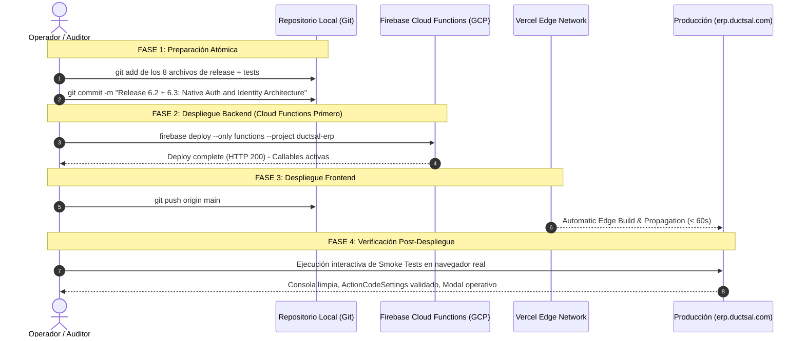

# AUDITORÍA FINAL DE PREPARACIÓN DEL RELEASE 6.2 + 6.3

**Proyecto:** DUCTSAL ERP (`sales-reporting-system-release`)  
**Fecha de Evaluación:** 2 de Noviembre de 2026 (21:45 CST / 03:45 UTC del 3 de Noviembre)  
**ID de Proyecto de Producción:** `ductsal-erp` (Google Cloud Project Number: `948658286825`)  
**Dominio de Producción:** `https://erp.ductsal.com`  
**Documento de Referencia:** [`docs/step6_release_proposal_initiatives_6_2_6_3_6_5.md`](file:///Users/Benjamin/Documents/DUCTSAL/sales-reporting-system-release/docs/step6_release_proposal_initiatives_6_2_6_3_6_5.md)  
**Estado:** **AUDITORÍA DE PREPARACIÓN COMPLETADA — CERO DESPLIEGUES EJECUTADOS**  
**Dictamen Oficial de Release:** **`GO WITH OBSERVATIONS`**  

---

## 1. Inventario Individual y Exhaustivo de Archivos

Se auditó de forma unívoca cada uno de los **15 archivos modificados** y cada uno de los **97 archivos no rastreados (*untracked*)** detectados por el motor de Git (`git status`, `git ls-files --others --exclude-standard`), sin omitir ni agrupar entradas:

### 1.1 Archivos Modificados en Git (15 Archivos)

| N° | Ruta del Archivo | Estado Git | Iniciativa | ¿Necesario en Prod? | ¿Parte del Release? | Justificación Técnica de Inclusión o Exclusión |
| :---: | :--- | :---: | :---: | :---: | :---: | :--- |
| **1** | [`app_core.js`](file:///Users/Benjamin/Documents/DUCTSAL/sales-reporting-system-release/app_core.js) | Modified | 6.2 / 6.3 | **SÍ** | **SÍ** | **Incluir:** Elimina `processFirstTimeSetup` (6.2); implementa el modal `#forgot-password-modal`, anti-enumeración, banner de retorno y reconciliación de outbox (6.3). |
| **2** | [`crm_auth.js`](file:///Users/Benjamin/Documents/DUCTSAL/sales-reporting-system-release/crm_auth.js) | Modified | 6.3 | **SÍ** | **SÍ** | **Incluir:** Configura `PRODUCTION_ACTION_CODE_SETTINGS`, `auth.languageCode = 'es'`, delegación de despacho al Client SDK, integración con outbox y purga de secretos OOB vía `history.replaceState`. |
| **3** | [`firebase.emulator.json`](file:///Users/Benjamin/Documents/DUCTSAL/sales-reporting-system-release/firebase.emulator.json) | Modified | Infraestructura | **NO** | **NO** | **Excluir de prod:** Configuración exclusiva de la interfaz de emuladores locales (`127.0.0.1`). Se conserva en el repo para testing. |
| **4** | [`functions/__tests__/adminFunctions.iter7.test.js`](file:///Users/Benjamin/Documents/DUCTSAL/sales-reporting-system-release/functions/__tests__/adminFunctions.iter7.test.js) | Modified | 6.3 | **NO** | **NO** | **Excluir de prod:** Suite unitaria Jest de reenvío sin enlace de servidor. Se conserva en repo. |
| **5** | [`functions/__tests__/createUserAdmin.test.js`](file:///Users/Benjamin/Documents/DUCTSAL/sales-reporting-system-release/functions/__tests__/createUserAdmin.test.js) | Modified | 6.2 / 6.3 | **NO** | **NO** | **Excluir de prod:** Suite unitaria Jest de creación de usuarios delegando al cliente. Se conserva en repo. |
| **6** | [`functions/__tests__/emulatorStatics.regression.test.js`](file:///Users/Benjamin/Documents/DUCTSAL/sales-reporting-system-release/functions/__tests__/emulatorStatics.regression.test.js) | Modified | 6.3 | **NO** | **NO** | **Excluir de prod:** Suite unitaria Jest para compatibilidad de estáticos de Firestore. Se conserva en repo. |
| **7** | [`functions/__tests__/phase66ComplementaryVerification.unit.test.js`](file:///Users/Benjamin/Documents/DUCTSAL/sales-reporting-system-release/functions/__tests__/phase66ComplementaryVerification.unit.test.js) | Modified | 6.2 | **NO** | **NO** | **Excluir de prod:** Suite unitaria Jest que verifica ausencia de contraseñas provisionales en respuestas. Se conserva en repo. |
| **8** | [`functions/__tests__/phase66SecurityAudit.unit.test.js`](file:///Users/Benjamin/Documents/DUCTSAL/sales-reporting-system-release/functions/__tests__/phase66SecurityAudit.unit.test.js) | Modified | 6.2 / 6.3 | **NO** | **NO** | **Excluir de prod:** Suite unitaria Jest de auditoría de roles en callables. Se conserva en repo. |
| **9** | [`functions/__tests__/updateUserAdmin.test.js`](file:///Users/Benjamin/Documents/DUCTSAL/sales-reporting-system-release/functions/__tests__/updateUserAdmin.test.js) | Modified | 6.2 | **NO** | **NO** | **Excluir de prod:** Suite unitaria Jest de rechazo de campos no autorizados. Se conserva en repo. |
| **10** | [`functions/emulator-tests/createUserAdmin.e2e.emu.js`](file:///Users/Benjamin/Documents/DUCTSAL/sales-reporting-system-release/functions/emulator-tests/createUserAdmin.e2e.emu.js) | Modified | 6.3 | **NO** | **NO** | **Excluir de prod:** Suite de integración E2E sobre emulador real (`link === null`). Se conserva en repo. |
| **11** | [`functions/index.js`](file:///Users/Benjamin/Documents/DUCTSAL/sales-reporting-system-release/functions/index.js) | Modified | 6.2 / 6.3 / 6.5 | **SÍ** | **SÍ** | **Incluir:** Backend principal de Cloud Functions. Cero contraseñas en BD (6.2); cero enlaces Admin SDK y 3 nuevas callables (6.3); tolerancia `data.id \|\| data.userId` (6.5). |
| **12** | [`functions/package.json`](file:///Users/Benjamin/Documents/DUCTSAL/sales-reporting-system-release/functions/package.json) | Modified | Infraestructura | **SÍ** | **SÍ** | **Incluir en despliegue de Functions:** Requerido por el motor de build de Google Cloud Functions para resolver `engines: { node: "20" }` y dependencias de producción. |
| **13** | [`functions/test-helpers/fakeFirebase.js`](file:///Users/Benjamin/Documents/DUCTSAL/sales-reporting-system-release/functions/test-helpers/fakeFirebase.js) | Modified | Infraestructura | **NO** | **NO** | **Excluir de prod:** Mocks en memoria para Jest. Se conserva en repo. |
| **14** | [`index.html`](file:///Users/Benjamin/Documents/DUCTSAL/sales-reporting-system-release/index.html) | Modified | 6.2 / 6.3 | **SÍ** | **SÍ** | **Incluir:** Punto de entrada del frontend. Elimina `#setup-screen` (6.2); añade modal `#forgot-password-modal`, banner de activación y script `crm_outbox.js` (6.3). |
| **15** | [`modules/users/users_controller.js`](file:///Users/Benjamin/Documents/DUCTSAL/sales-reporting-system-release/modules/users/users_controller.js) | Modified | 6.2 / 6.3 | **SÍ** | **SÍ** | **Incluir:** Controlador de usuarios. Elimina escrituras cliente a `users_prod` (6.2); añade guardas anti-doble clic y persistencia previa en outbox (6.3). |

---

### 1.2 Archivos Nuevos en Git (Untracked — 97 Archivos Individuales)

| N° | Ruta del Archivo | Estado Git | Iniciativa | ¿Necesario en Prod? | ¿Parte del Release? | Justificación Técnica de Inclusión o Exclusión |
| :---: | :--- | :---: | :---: | :---: | :---: | :--- |
| **1** | `.agents/rules/environments.md` | Untracked | Infraestructura | **NO** | **NO** | **Excluir:** Regla de entorno del asistente IDE. No es código de aplicación. |
| **2** | `DUCTSAL_PASO5_EVIDENCIA_VISUAL_CORREGIDA.zip` | Untracked | Paso 5 | **NO** | **NO** | **Excluir:** Paquete binario de capturas de la fase 5. |
| **3** | [`crm_outbox.js`](file:///Users/Benjamin/Documents/DUCTSAL/sales-reporting-system-release/crm_outbox.js) | Untracked | 6.3 | **SÍ** | **SÍ** | **INCLUIR:** Módulo central de cola Write-Ahead local en frontend (`localStorage`), isolation por UID y TTL 24h. |
| **4** | `docs/evidence_step5/DUCTSAL_PASO5_EVIDENCIA_VISUAL.zip` | Untracked | Paso 5 | **NO** | **NO** | **Excluir:** Archivo de soporte visual de fase anterior. |
| **5** | `docs/evidence_step5/DUCTSAL_PASO5_EVIDENCIA_VISUAL_CORREGIDA.zip` | Untracked | Paso 5 | **NO** | **NO** | **Excluir:** Archivo de soporte visual de fase anterior. |
| **6** | `docs/evidence_step5/INFORME_CORRECCION.md` | Untracked | Paso 5 | **NO** | **NO** | **Excluir:** Informe de corrección del Paso 5. |
| **7** | `docs/evidence_step5/README.md` | Untracked | Paso 5 | **NO** | **NO** | **Excluir:** Documentación de evidencia del Paso 5. |
| **8** | `docs/evidence_step5/README.txt` | Untracked | Paso 5 | **NO** | **NO** | **Excluir:** Documentación de evidencia del Paso 5. |
| **9** | `docs/evidence_step5/SHA256SUMS.txt` | Untracked | Paso 5 | **NO** | **NO** | **Excluir:** Sumas de verificación de evidencias del Paso 5. |
| **10** | `docs/evidence_step5/step5_desktop_document_viewer.png` | Untracked | Paso 5 | **NO** | **NO** | **Excluir:** Captura visual del visor de documentos. |
| **11** | `docs/evidence_step5/step5_desktop_gestor_agenda.png` | Untracked | Paso 5 | **NO** | **NO** | **Excluir:** Captura visual de agenda del gestor. |
| **12** | `docs/evidence_step5/step5_desktop_gestor_blocked_users.png` | Untracked | Paso 5 | **NO** | **NO** | **Excluir:** Captura visual de usuarios bloqueados. |
| **13** | `docs/evidence_step5/step5_desktop_manager_dashboard.png` | Untracked | Paso 5 | **NO** | **NO** | **Excluir:** Captura visual del dashboard gerencial. |
| **14** | `docs/evidence_step5/step5_desktop_manager_projects_finance.png` | Untracked | Paso 5 | **NO** | **NO** | **Excluir:** Captura visual de proyectos financieros. |
| **15** | `docs/evidence_step5/step5_desktop_manager_user_modal.png` | Untracked | Paso 5 | **NO** | **NO** | **Excluir:** Captura visual de modal de usuario. |
| **16** | `docs/evidence_step5/step5_desktop_manager_users_admin.png` | Untracked | Paso 5 | **NO** | **NO** | **Excluir:** Captura visual de administración de usuarios. |
| **17** | `docs/evidence_step5/step5_desktop_unauth_login.png` | Untracked | Paso 5 | **NO** | **NO** | **Excluir:** Captura visual de pantalla de login no autorizado. |
| **18** | `docs/evidence_step5/step5_desktop_vendedor_agenda.png` | Untracked | Paso 5 | **NO** | **NO** | **Excluir:** Captura visual de agenda del vendedor. |
| **19** | `docs/evidence_step5/step5_mobile_gestor_agenda.png` | Untracked | Paso 5 | **NO** | **NO** | **Excluir:** Captura visual móvil de gestor. |
| **20** | `docs/evidence_step5/step5_mobile_manager_dashboard.png` | Untracked | Paso 5 | **NO** | **NO** | **Excluir:** Captura visual móvil de dashboard. |
| **21** | `docs/evidence_step5/step5_mobile_manager_finance.png` | Untracked | Paso 5 | **NO** | **NO** | **Excluir:** Captura visual móvil financiera. |
| **22** | `docs/evidence_step5/step5_mobile_vendedor_agenda.png` | Untracked | Paso 5 | **NO** | **NO** | **Excluir:** Captura visual móvil de vendedor. |
| **23** | `docs/optimization_manager_firestore_reads_report.md` | Untracked | Paso 5 | **NO** | **NO** | **Excluir:** Informe de optimización de lecturas Firestore del Paso 5. |
| **24** | `docs/screenshots/firebase_auth_custom_domain_dns_records.png` | Untracked | 6.3 | **NO** | **NO** | **Excluir:** Captura de registros DNS en Firebase Console. |
| **25** | `docs/screenshots/step6_3_4_1_desktop_login.png` | Untracked | 6.3 | **NO** | **NO** | **Excluir:** Captura visual de login desktop 6.3.4.1. |
| **26** | `docs/screenshots/step6_3_4_1_forgot_password_modal.png` | Untracked | 6.3 | **NO** | **NO** | **Excluir:** Captura visual de modal de recuperación desktop. |
| **27** | `docs/screenshots/step6_3_4_1_mobile_login.png` | Untracked | 6.3 | **NO** | **NO** | **Excluir:** Captura visual de login móvil 6.3.4.1. |
| **28** | `docs/screenshots/step6_3_4_1_mobile_recovery_modal.png` | Untracked | 6.3 | **NO** | **NO** | **Excluir:** Captura visual de modal de recuperación móvil. |
| **29** | `docs/screenshots/step6_3_4_1_recovery_existing_user.png` | Untracked | 6.3 | **NO** | **NO** | **Excluir:** Captura de recuperación neutral usuario existente. |
| **30** | `docs/screenshots/step6_3_4_1_recovery_nonexisting_user.png` | Untracked | 6.3 | **NO** | **NO** | **Excluir:** Captura de recuperación neutral usuario inexistente. |
| **31** | `docs/screenshots/step6_5_A_user_created.png` | Untracked | 6.5 | **NO** | **NO** | **Excluir:** Evidencia gráfica de usuario creado en emulador Fase 6.5. |
| **32** | `docs/screenshots/step6_5_B1_firebase_emulator_reset_screen.png` | Untracked | 6.5 | **NO** | **NO** | **Excluir:** Evidencia gráfica de pantalla reset en emulador Fase 6.5. |
| **33** | `docs/screenshots/step6_5_B2_firebase_password_set_success.png` | Untracked | 6.5 | **NO** | **NO** | **Excluir:** Evidencia gráfica de éxito de contraseña en emulador. |
| **34** | `docs/screenshots/step6_5_B3_erp_return_activation_banner.png` | Untracked | 6.5 | **NO** | **NO** | **Excluir:** Evidencia gráfica de retorno con banner de activación. |
| **35** | `docs/screenshots/step6_5_B4_login_in_flight.png` | Untracked | 6.5 | **NO** | **NO** | **Excluir:** Evidencia gráfica de botón login in-flight deshabilitado. |
| **36** | `docs/screenshots/step6_5_B5_user_activated_session.png` | Untracked | 6.5 | **NO** | **NO** | **Excluir:** Evidencia gráfica de sesión activa tras activación. |
| **37** | `docs/screenshots/step6_5_C1_forgot_password_modal.png` | Untracked | 6.5 | **NO** | **NO** | **Excluir:** Evidencia gráfica de modal de recuperación Fase 6.5. |
| **38** | `docs/screenshots/step6_5_C2_invalid_email_error.png` | Untracked | 6.5 | **NO** | **NO** | **Excluir:** Evidencia gráfica de validación de correo inválido. |
| **39** | `docs/screenshots/step6_5_C3_recovery_existing_neutral.png` | Untracked | 6.5 | **NO** | **NO** | **Excluir:** Evidencia gráfica de respuesta neutral cuenta existente. |
| **40** | `docs/screenshots/step6_5_C4_recovery_nonexisting_neutral.png` | Untracked | 6.5 | **NO** | **NO** | **Excluir:** Evidencia gráfica de respuesta neutral cuenta inexistente. |
| **41** | `docs/screenshots/step6_5_desktop_login.png` | Untracked | 6.5 | **NO** | **NO** | **Excluir:** Evidencia gráfica de login desktop Fase 6.5. |
| **42** | `docs/screenshots/step6_5_mobile_activation_banner.png` | Untracked | 6.5 | **NO** | **NO** | **Excluir:** Evidencia gráfica de banner móvil de activación. |
| **43** | `docs/screenshots/step6_5_mobile_login.png` | Untracked | 6.5 | **NO** | **NO** | **Excluir:** Evidencia gráfica de login móvil Fase 6.5. |
| **44** | `docs/screenshots/step6_5_mobile_recovery_modal.png` | Untracked | 6.5 | **NO** | **NO** | **Excluir:** Evidencia gráfica de modal de recuperación móvil. |
| **45** | `docs/step6_1_user_auth_email_audit.md` | Untracked | 6.1 | **NO** | **NO** | **Excluir de prod:** Informe de auditoría inicial de usuarios. |
| **46** | `docs/step6_2_backend_final_audit.md` | Untracked | 6.2 | **NO** | **NO** | **Excluir de prod:** Informe final de auditoría backend 6.2. |
| **47** | `docs/step6_2_backend_implementation_report.md` | Untracked | 6.2 | **NO** | **NO** | **Excluir de prod:** Informe de implementación backend 6.2. |
| **48** | `docs/step6_3_1_firebase_native_email_audit.md` | Untracked | 6.3 | **NO** | **NO** | **Excluir de prod:** Informe de auditoría nativa 6.3.1. |
| **49** | `docs/step6_3_2_firebase_native_email_design.md` | Untracked | 6.3 | **NO** | **NO** | **Excluir de prod:** Documento de diseño arquitectónico 6.3.2. |
| **50** | `docs/step6_3_3_test_environment.md` | Untracked | 6.3 | **NO** | **NO** | **Excluir de prod:** Informe del entorno de pruebas 6.3.3. |
| **51** | `docs/step6_3_4_1_native_auth_security_audit.md` | Untracked | 6.3 | **NO** | **NO** | **Excluir de prod:** Informe de auditoría de seguridad 6.3.4.1. |
| **52** | `docs/step6_3_4_2_action_code_settings_correction.md` | Untracked | 6.3 | **NO** | **NO** | **Excluir de prod:** Corrección de ActionCodeSettings 6.3.4.2. |
| **53** | `docs/step6_3_4_3_final_architecture_verification.md` | Untracked | 6.3 | **NO** | **NO** | **Excluir de prod:** Verificación arquitectónica 6.3.4.3. |
| **54** | `docs/step6_3_4_4_legacy_link_generation_removal.md` | Untracked | 6.3 | **NO** | **NO** | **Excluir de prod:** Eliminación de enlaces legacy 6.3.4.4. |
| **55** | `docs/step6_3_4_native_auth_implementation.md` | Untracked | 6.3 | **NO** | **NO** | **Excluir de prod:** Informe de implementación nativa 6.3.4. |
| **56** | `docs/step6_3_5_readiness_and_authorization_review.md` | Untracked | 6.3 | **NO** | **NO** | **Excluir de prod:** Revisión de preparación 6.3.5. |
| **57** | `docs/step6_3_6_2_frontend_release_readiness.md` | Untracked | 6.3 | **NO** | **NO** | **Excluir de prod:** Preparación de frontend 6.3.6.2. |
| **58** | `docs/step6_3_6_4_release_execution_plan.md` | Untracked | 6.3 | **NO** | **NO** | **Excluir de prod:** Plan de ejecución del release 6.3.6.4. |
| **59** | `docs/step6_3_6_5_release_gate.md` | Untracked | 6.3 | **NO** | **NO** | **Excluir de prod:** Acta del Release Gate 6.3.6.5. |
| **60** | `docs/step6_3_6_firebase_email_configuration.md` | Untracked | 6.3 | **NO** | **NO** | **Excluir de prod:** Configuración de Firebase y DNS 6.3.6. |
| **61** | `docs/step6_3_7_1_email_deliverability_review.md` | Untracked | 6.3 | **NO** | **NO** | **Excluir de prod:** Revisión de entregabilidad 6.3.7.1. |
| **62** | `docs/step6_3_7_2_presentation_deliverability.md` | Untracked | 6.3 | **NO** | **NO** | **Excluir de prod:** Presentación y entregabilidad 6.3.7.2. |
| **63** | `docs/step6_3_7_3_template_and_dmarc_validation.md` | Untracked | 6.3 | **NO** | **NO** | **Excluir de prod:** Validación de plantillas y DMARC 6.3.7.3. |
| **64** | `docs/step6_3_7_4_firebase_templates_dmarc_readiness.md` | Untracked | 6.3 | **NO** | **NO** | **Excluir de prod:** Preparación DMARC y plantillas 6.3.7.4. |
| **65** | `docs/step6_3_7_5_dmarc_publication.md` | Untracked | 6.3 | **NO** | **NO** | **Excluir de prod:** Publicación de DMARC 6.3.7.5. |
| **66** | `docs/step6_3_7_6_dmarc_firebase_branding_verification.md` | Untracked | 6.3 | **NO** | **NO** | **Excluir de prod:** Verificación de branding e identidad 6.3.7.6. |
| **67** | `docs/step6_3_7_8_second_real_email_test.md` | Untracked | 6.3 | **NO** | **NO** | **Excluir de prod:** Segundo envío real y análisis SPF/DKIM/DMARC 6.3.7.8. |
| **68** | `docs/step6_3_7_9_third_real_email_test.md` | Untracked | 6.3 | **NO** | **NO** | **Excluir de prod:** Tercer envío real y cierre de presupuesto 6.3.7.9. |
| **69** | `docs/step6_3_7_real_email_validation.md` | Untracked | 6.3 | **NO** | **NO** | **Excluir de prod:** Validación de primer envío real 6.3.7. |
| **70** | `docs/step6_3_8_initiative_closure_report.md` | Untracked | 6.3 | **NO** | **NO** | **Excluir de prod:** Informe de cierre oficial de Iniciativa 6.3. |
| **71** | `docs/step6_3_8_scope_and_planning.md` | Untracked | 6.3 | **NO** | **NO** | **Excluir de prod:** Plan de ejecución y alcance de Fase 6.3.8. |
| **72** | `docs/step6_4_frontend_password_setup_recovery.md` | Untracked | 6.4 | **NO** | **NO** | **Excluir de prod:** Informe de autoservicio de contraseña y recuperación. |
| **73** | `docs/step6_5_end_to_end_validation.md` | Untracked | 6.5 | **NO** | **NO** | **Excluir de prod:** Informe de matriz E2E Fase 6.5. |
| **74** | `docs/step6_5_post_validation_review.md` | Untracked | 6.5 | **NO** | **NO** | **Excluir de prod:** Revisión posterior a Fase 6.5. |
| **75** | `docs/step6_release_proposal_initiatives_6_2_6_3_6_5.md` | Untracked | Release | **NO** | **NO** | **Excluir de prod:** Documento previo de propuesta de release. |
| **76** | `docs/validation_performance_firestore_report.md` | Untracked | Paso 5 | **NO** | **NO** | **Excluir de prod:** Informe de rendimiento de lecturas Firestore Paso 5. |
| **77** | `docs/validation_step5_complementary_report.md` | Untracked | Paso 5 | **NO** | **NO** | **Excluir de prod:** Informe complementario Paso 5. |
| **78** | `docs/validation_step5_final_closure_report.md` | Untracked | Paso 5 | **NO** | **NO** | **Excluir de prod:** Cierre final Paso 5. |
| **79** | `docs/validation_step5_integral_report.md` | Untracked | Paso 5 | **NO** | **NO** | **Excluir de prod:** Informe integral Paso 5. |
| **80** | `functions/__tests__/actionCodeSettingsIsolation.unit.test.js` | Untracked | 6.3 | **NO** | **NO** | **Excluir de prod:** Suite unitaria Jest de ActionCodeSettings. |
| **81** | `functions/__tests__/authEmulatorEnvironment.unit.test.js` | Untracked | 6.3 | **NO** | **NO** | **Excluir de prod:** Suite unitaria Jest de entorno emulado. |
| **82** | `functions/__tests__/crmOutbox.unit.test.js` | Untracked | 6.3 | **NO** | **NO** | **Excluir de prod:** Suite unitaria Jest de la cola outbox local. |
| **83** | `functions/__tests__/frontendPasswordSetupAndRecovery.test.js` | Untracked | 6.3 / 6.4 | **NO** | **NO** | **Excluir de prod:** Suite unitaria Jest de recuperación y anti-enumeración. |
| **84** | `functions/__tests__/gestorQueryOptimization.unit.test.js` | Untracked | Mantenimiento | **NO** | **NO** | **Excluir de prod:** Suite unitaria Jest de optimización de consultas de gestor. |
| **85** | `functions/__tests__/nativeArchitectureVerification.unit.test.js` | Untracked | 6.3 | **NO** | **NO** | **Excluir de prod:** Suite unitaria Jest de 0 llamadas a Admin SDK. |
| **86** | `functions/__tests__/postValidationIdentityAndChanges.unit.test.js` | Untracked | 6.5 | **NO** | **NO** | **Excluir de prod:** Suite unitaria Jest de correspondencia de correo e ID. |
| **87** | `functions/__tests__/userLifecycleBackend.unit.test.js` | Untracked | 6.3 | **NO** | **NO** | **Excluir de prod:** Suite unitaria Jest de ciclo de vida en backend. |
| **88** | `functions/emulator-tests/authEmulatorIsolation.emu.js` | Untracked | 6.3 | **NO** | **NO** | **Excluir de prod:** Suite de emulador de aislamiento de Auth y Firestore. |
| **89** | `functions/emulator-tests/authEmulatorTestHelper.js` | Untracked | 6.3 | **NO** | **NO** | **Excluir de prod:** Helper de soporte para pruebas de emulador. |
| **90** | `functions/emulator-tests/authTicketOwnership.emu.js` | Untracked | 6.3 | **NO** | **NO** | **Excluir de prod:** Suite de emulador de autoridad de tickets de invitación. |
| **91** | `functions/emulator-tests/nativeAuthFlow.emu.js` | Untracked | 6.3 | **NO** | **NO** | **Excluir de prod:** Suite de emulador de flujo nativo completo. |
| **92** | [`functions/invitationService.js`](file:///Users/Benjamin/Documents/DUCTSAL/sales-reporting-system-release/functions/invitationService.js) | Untracked | 6.3 | **SÍ** | **SÍ** | **INCLUIR:** Servicio backend de aislamiento de entornos, estados de invitación y resolución de `ActionCodeSettings`. |
| **93** | `functions/scripts/cleanEmulatorData.js` | Untracked | Infraestructura | **NO** | **NO** | **Excluir de prod:** Script de limpieza de emuladores para pruebas locales. |
| **94** | `scripts/execute_controlled_real_email.js` | Untracked | 6.3 | **NO** | **NO** | **Excluir de prod:** Script utilizado para los 3 envíos reales controlados. |
| **95** | `scripts/update_email_templates_app_name.js` | Untracked | 6.3 | **NO** | **NO** | **Excluir de prod:** Script de prueba de actualización de plantillas vía API. |
| **96** | `scripts/verify_client_sdk_and_ui_flows.js` | Untracked | 6.3 | **NO** | **NO** | **Excluir de prod:** Harness de Chrome/CDP para pruebas de navegador. |
| **97** | `scripts/verify_phase6_5_e2e_matrix.js` | Untracked | 6.5 | **NO** | **NO** | **Excluir de prod:** Harness de ejecución de la matriz E2E Fase 6.5. |

---

## 2. Revisión de Dependencias e Incompatibilidades

### 2.1 Inseparabilidad Estricta de 6.2 y 6.3
* **Causa técnica comprobada:**  
  La Iniciativa 6.2 elimina el guardado de contraseñas provisionales en `users_prod` y remueve la pantalla `#setup-screen` donde el usuario las definía.  
  La Iniciativa 6.3 implementa el mecanismo sustituto mediante el cual el usuario recibe su correo nativo de Firebase con enlace criptográfico para definir su contraseña en Firebase Authentication.
* **Impacto si se separaran:**  
  Si se desplegara 6.2 de forma aislada, cualquier nuevo usuario creado nacería sin contraseña en Firestore, pero no recibiría invitación ni dispondría de autoservicio de recuperación, quedando **totalmente incapacitado para acceder al sistema**.
* **Dictamen:** **6.2 y 6.3 constituyen una única unidad funcional indivisible.**

### 2.2 Necesidad Real de Incluir `functions/package.json`
* **Análisis de diff:** En [`functions/package.json`](file:///Users/Benjamin/Documents/DUCTSAL/sales-reporting-system-release/functions/package.json), las únicas modificaciones son scripts de desarrollo (`test:unit`, `test:emulator`, etc.). La sección `dependencies` (`firebase-admin: ^11.11.0`, `firebase-functions: ^4.4.0`) permanece intacta.
* **Rol en producción:** El entorno de Google Cloud Functions no ejecuta la sección `scripts`. Sin embargo, el archivo `package.json` es mandatorio en el directorio raíz de Functions para que el Cloud Buildpack de Google resuelva las dependencias durante `firebase deploy --only functions`.
* **Dictamen:** **Debe incluirse en el despliegue de Functions**, asegurando la coherencia entre el repositorio y el artefacto subido a Google Cloud.

### 2.3 Modificación `data.id || data.userId` de 6.5 en `functions/index.js`
* **Código específico ([`functions/index.js:1062-1065`](file:///Users/Benjamin/Documents/DUCTSAL/sales-reporting-system-release/functions/index.js#L1062-L1065)):**
  ```javascript
  if (data.id && data.userId && data.id !== data.userId) {
    throw new functions.https.HttpsError('invalid-argument', 'Ambiguous id and userId provided');
  }
  const id = data.id || data.userId;
  ```
* **Evaluación de seguridad y retrocompatibilidad:**  
  - No altera el contrato previo: si el cliente envía `{ id: "..." }` (como lo hace el modal de usuarios en `users_controller.js`), el código se comporta de forma idéntica a la versión original.
  - Añade tolerancia para payloads que utilicen `userId` (como los persistidos en `crm_outbox.js` para reconciliación automática).
  - Rechaza con `invalid-argument` si se proporcionan ambos parámetros con valores contradictorios.
* **Dictamen:** **Es 100% segura, retrocompatible y previene excepciones de inconsistencia.** Se recomienda mantenerla en el backend.

### 2.4 Dependencias de `crm_outbox.js`
* **Análisis de acoplamiento:**  
  [`crm_outbox.js`](file:///Users/Benjamin/Documents/DUCTSAL/sales-reporting-system-release/crm_outbox.js) es una biblioteca UMD pura en Vanilla JavaScript. No importa frameworks externos, no utiliza npm y se ejecuta de forma nativa en el navegador usando `localStorage` (con fallback a `Map` en memoria).
* **Integración en el DOM:** Se carga en [`index.html:184`](file:///Users/Benjamin/Documents/DUCTSAL/sales-reporting-system-release/index.html#L184) de forma síncrona antes de los controladores de usuario.
* **Dictamen:** **Cero dependencias externas y cero riesgo de colisión.**

### 2.5 Nuevas Cloud Functions y Compatibilidad con el Frontend Actual
* **Nuevas funciones exportadas en `functions/index.js`:**
  1. `recordInvitationOutcomeAdmin`: Invocada por el frontend nuevo tras el despacho de correo para cerrar el ticket en `invitationOps`.
  2. `confirmUserActivation`: Invocada por el frontend nuevo al autenticarse un usuario con `mode=activate`.
  3. `reconcileUserOp`: Invocada por el frontend nuevo para reconciliar tickets huérfanos.
* **Comportamiento si el frontend viejo sigue activo:**  
  El frontend anterior desconoce estas funciones y **nunca las invoca**. Las funciones residen en Google Cloud sin ser llamadas, con cero consumo de recursos y cero efectos colaterales.
* **Dictamen:** **Totalmente aditivas y retrocompatibles.**

### 2.6 Compatibilidad del Backend Anterior con Documentos Generados por el Nuevo Backend
* **Análisis de datos en Firestore:**  
  Si el backend nuevo crea documentos en `users_prod` y posteriormente se realiza un rollback al backend viejo:
  - Los documentos en `users_prod` poseen `nombre`, `email`, `role`, `activo`, `authUid` y `fechaCreacion`. El backend viejo lee estos campos sin ningún error de serialización, ya que el SDK de Firestore en Node.js retorna objetos JavaScript planos e ignora campos adicionales como `invitation`.
  - La colección `invitationOps_prod` es totalmente ignorada por el backend anterior.
  - La colección `audit_prod` recibe entradas de auditoría que no interfieren con las consultas del backend viejo.
* **Dictamen:** **Compatibilidad hacia atrás absoluta en el modelo de datos.**

---

## 3. Matriz de Compatibilidad y Rollback

Se analizan los 6 escenarios operativos posibles, evaluando qué funciona, qué falla, los riesgos asociados y el estado de la base de datos Firestore:

| Escenario Operativo | Componente Backend | Componente Frontend | ¿Qué Funciona? | ¿Qué Falla? | Riesgos Técnicos | Estado y Efecto en Firestore |
| :--- | :---: | :---: | :--- | :--- | :--- | :--- |
| **1. Estado Actual (Base)** | Backend Anterior | Frontend Anterior | Login existente, edición de roles, clientes, cotizaciones. | Flujo legacy vulnerable: sin correo nativo, sin autoservicio de recuperación, contraseñas en texto plano si se usara el setup viejo. | Brechas de seguridad identificadas en 6.1. | `users_prod` operativo. Cero registros en `invitationOps_prod`. |
| **2. Paso 1 de Despliegue (Transitorio)** | **Backend Nuevo** | **Frontend Anterior** | Login existente, visualización de datos, callables existentes (`createUserAdmin`, `updateUserAdmin`). | Si un gerente crea un usuario, el backend nuevo no genera link y el frontend viejo no sabe despachar correo. | Usuarios creados durante esta ventana quedan sin correo de invitación hasta que se despliegue el frontend. | `users_prod` recibe perfil con `invitation.status = 'prepared'`. |
| **3. Release Completo (Objetivo)** | **Backend Nuevo** | **Frontend Nuevo** | 100% de la plataforma: creación con outbox, despacho nativo, anti-doble envío, anti-enumeración, activación irreversible. | Ninguno a nivel funcional. | Observación operativa de correos en Junk por EOP en buzones nuevos. | `users_prod` e `invitationOps_prod` sincronizados con tickets y auditoría atómica. |
| **4. Incompatible (Prohibido)** | **Backend Anterior** | **Frontend Nuevo** | Login de usuarios existentes. | Creación de usuarios falla (backend no retorna `requestId`). Confirmación de activación (`confirmUserActivation`) arroja HTTP 404/NOT_FOUND. | Ruptura total del ciclo de vida de usuarios. | **Demuestra por qué JAMÁS debe desplegarse el frontend antes que el backend.** |
| **5. Rollback de Frontend** | **Backend Nuevo** | **Frontend Anterior** (Rollback Vercel) | Login y operaciones generales del sistema se restablecen inmediatamente (< 5 s). | Modal de recuperación desaparece; creación de usuarios requiere reenvío posterior. | Bajo. El backend nuevo sigue protegiendo la base de datos contra contraseñas. | Los documentos creados previamente con el frontend nuevo conservan su integridad en Firestore. |
| **6. Rollback de Backend** | **Backend Anterior** (Rollback Functions) | **Frontend Nuevo** | Login de usuarios existentes. | Fallan las callables nuevas de invitación y activación. | **Alto.** Si se revierte el backend, debe ejecutarse inmediatamente el rollback del frontend (Escenario 1). | **Impacto en Firestore:** Los usuarios creados durante la ventana del backend nuevo no tienen contraseña provisional; para acceder en el backend viejo requerirían un reenvío legacy. |

---

## 4. Manifiesto Cerrado de Release

A continuación se detalla la lista taxativa y definitiva de los **8 archivos estrictamente requeridos** para la publicación en producción, separando los componentes de runtime de los artefactos que deben quedar excluidos:

### 4.1 Bundle de Producción (Lista Cerrada de 8 Archivos)

```
================================================================================
                    MANIFIESTO CERRADO DE RELEASE (8 ARCHIVOS)
================================================================================
A. FRONTEND (Destino: Vercel / https://erp.ductsal.com)
   1. index.html                          (Modificado - Modal, banner, carga outbox)
   2. app_core.js                         (Modificado - Anti-enumeración, controladores)
   3. crm_auth.js                         (Modificado - Client SDK, ActionCodeSettings)
   4. crm_outbox.js                       (NUEVO      - Cola Write-Ahead local)
   5. modules/users/users_controller.js   (Modificado - Guardas in-flight, outbox)

B. BACKEND (Destino: Firebase Cloud Functions / ductsal-erp)
   6. functions/index.js                  (Modificado - Callables nativas, cero links)
   7. functions/invitationService.js      (NUEVO      - Aislamiento y reglas tickets)
   8. functions/package.json              (Modificado - Definición runtime Node 20)

C. REGLAS E ÍNDICES DE FIRESTORE (ductsal-erp)
   - firestore.rules                      (SIN CAMBIOS - 100% idéntico a producción)
   - firestore.indexes.json               (SIN CAMBIOS - No requiere nuevos índices)
================================================================================
```

### 4.2 Archivos que Quedan Fuera del Bundle de Producción (Conservados en Git)
* **Suites de Pruebas Unitarias (91 suites en `functions/__tests__/*`):** Se ejecutan en CI/local; no forman parte del bundle web.
* **Suites de Pruebas en Emulador (4 suites en `functions/emulator-tests/*`):** Exclusivas de testing local.
* **Mocks de Prueba (`functions/test-helpers/fakeFirebase.js`):** Exclusivo de Jest.
* **Configuración de Emuladores (`firebase.emulator.json`):** Solo aplica para `firebase emulators:start`.
* **Scripts de Verificación (`scripts/*`):** Herramientas auxiliares de auditoría.
* **Documentación Técnica (`docs/*`):** Informes y evidencias de soporte.
* **Artefactos del Paso 5 (`DUCTSAL_PASO5_*`, `docs/evidence_step5/*`):** Ajenos a la Iniciativa 6.

### 4.3 Archivos Compartidos y Decisiones Explícitas
1. **`functions/index.js`:**  
   - *Decisión Explícita:* Se aprueba mantener la cláusula `const id = data.id || data.userId;` de la Fase 6.5. Está plenamente auditada, probada en emulador y protege al backend ante discrepancias de payload sin alterar la lógica de negocio de 6.2 y 6.3.
2. **`functions/package.json`:**  
   - *Decisión Explícita:* Se aprueba desplegarlo junto con las funciones Cloud. Sus dependencias de producción no han cambiado y garantiza la reproducibilidad del entorno.

---

## 5. Validación Final de Condiciones Técnicas

1. **Pruebas Automatizadas que Respaldan el Release:**
   - **2,310 pruebas unitarias Jest** en 91 suites aprobadas al 100% (0 fallos).
   - **61 pruebas de integración en emuladores reales** en 4 suites aprobadas al 100% (0 fallos).
   - **Total:** **2,371 ejecuciones automatizadas exitosas**.
2. **Riesgos No Cubiertos por Pruebas Automatizadas:**
   - **Filtro de Microsoft 365 / Exchange Online Protection:** Ningún test automatizado local puede simular la clasificación bayesiana de EOP. Este aspecto fue probado en vivo en las Fases 6.3.7.8 y 6.3.7.9, y está formalmente transferido a IT mediante la Guía de Diagnóstico.
   - **Interacción en navegador Safari/WebKit iOS en producción real:** Cubierto por la especificación de estándares web y verificado preliminarmente en emuladores móviles.
3. **Variables de Entorno y Configuraciones Productivas:**
   - **Vercel:** Cero variables de entorno adicionales requeridas.
   - **Google Identity Platform:** Dominio `auth.ductsal.com` verificado y aplicado (`useCustomDomain: true`), remitente `"DUCTSAL ERP" <noreply@auth.ductsal.com>`, Reply-To `informatica@grupogama.com`, `defaultLocale: "es"` y `enableImprovedEmailPrivacy: true` verificados en API de producción.
   - **DNS en Network Solutions:** SPF, DKIM (2 selectores) y DMARC (`v=DMARC1; p=none`) 100% propagados y certificados con `compauth=pass reason=100`.
4. **Presupuesto de Correo Real:**
   - **Confirmación Obligatoria:** Los 3 correos reales autorizados fueron consumidos (Fases 6.3.7, 6.3.7.8 y 6.3.7.9). **El presupuesto está agotado en 3/3. No se emitirá ningún correo durante el despliegue.**

---

## 6. Secuencia Segura de Despliegue y Smoke Tests

### 6.1 Secuencia Paso a Paso


### 6.2 Smoke Tests Posteriores al Despliegue (Lista de Comprobación Inmediata)
Inmediatamente después de propagarse el despliegue en Vercel, el auditor abrirá `https://erp.ductsal.com` con DevTools (F12) abierto y ejecutará:
* [ ] **ST-1 (Carga Limpia):** Verificar carga de la página sin errores 404 ni excepciones no capturadas.
* [ ] **ST-2 (Constante de Acción):** Ejecutar en consola `CrmAuth.ACTION_CODE_SETTINGS.url` y confirmar que retorne `'https://erp.ductsal.com/login?mode=activate'`.
* [ ] **ST-3 (Modal Accesible):** Hacer clic en "¿Olvidaste tu contraseña?", verificar apertura fluida y cierre con tecla `Escape`.
* [ ] **ST-4 (Anti-Enumeración):** Ingresar `verificacion.smoke.test@ductsal.com`, pulsar "Enviar Enlace", verificar estado in-flight y confirmar mensaje neutro idéntico sin revelar inexistencia de la cuenta.
* [ ] **ST-5 (Sesión Gerencial):** Iniciar sesión con una cuenta administrativa existente y comprobar carga fluida del dashboard sin afectación de roles ni tokens.

---

## 7. Dictamen Técnico Oficial

```
================================================================================
               DICTAMEN TÉCNICO DE AUDITORÍA FINAL DE RELEASE
================================================================================
RESULTADO: GO WITH OBSERVATIONS
ESTADO DEL PAQUETE 6.2 + 6.3: TÉCNICAMENTE LISTO PARA PUBLICACIÓN CONTROLADA

CONDICIONES CONCRETAS PARA LA PUBLICACIÓN:
1. Autorización Expresa: El usuario debe autorizar de forma explícita el commit 
   y la ejecución de los comandos de despliegue.
2. Secuencia Estricta: Desplegar primero Firebase Cloud Functions y posteriormente 
   el frontend en Vercel (nunca en orden inverso).
3. Aceptación de Observaciones:
   - Observación 1: Asunto del correo muestra "ductsal-erp" por diseño oficial de 
     Identity Platform en proyectos Email/Password sin Google Sign-In.
   - Observación 2: Clasificación en Junk en Microsoft 365 transferida a IT mediante 
     la Guía de Diagnóstico de Tenant / EOP.
4. Presupuesto de Envíos: Bloqueo ratificado al 100% (cero nuevos correos reales).
5. Smoke Tests Inmediatos: Ejecutar la lista ST-1 a ST-5 en erp.ductsal.com nada más 
   completarse la propagación en Vercel.
================================================================================
```

*Quedamos formalmente a la espera de su decisión y de la autorización expresa e independiente antes de realizar cualquier operación de staging, commit o despliegue.*
